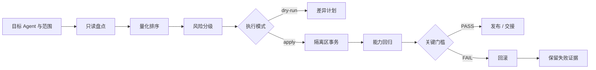

# Agent Slim 通用架构

## 1. 产品边界

Agent Slim 是跨维度瘦身调度器，不是“一键删缓存”工具。它回答四个问题：

1. 哪些内容每轮都占用上下文，哪些只在触发后加载，哪些只占磁盘？
2. 哪些候选有真实证据、可量化影响且风险可控？
3. 如何以最小、可逆的动作完成减负？
4. 减负后，关键触发、引用、结构和常用任务是否仍然正常？

首版宿主为 Codex。其他 Agent 只能按适配器契约接入；契约存在不等于平台能力已实测。没有对应能力和测试证据时，适配器必须返回 `unsupported`。

## 2. Hot / Warm / Cold 三层

| 层 | 定义 | 典型对象 | Token 影响 | 默认动作 |
|---|---|---|---|---|
| Hot | 每轮或每次调用都会进入上下文的常驻内容 | 常驻规则、Skill 元数据、工具说明、固定注入片段 | 直接影响每轮输入 | 先测量；只允许压缩已验证描述，不盲删约束 |
| Warm | 满足触发词、路由或任务条件后才加载的内容 | Skill 正文、参考文档、脚本说明、模板 | 只有实际少加载时才有 Token 收益 | 将已验证低频内容移入可路由的按需区 |
| Cold | 不进入上下文，只在磁盘保存的内容 | 旧会话归档、备份、缓存、历史包 | 不直接产生 Token 收益 | 只在安全 allowlist 内隔离或归档，收益单独记为磁盘 |

### Token 账本规则

- Hot 缩减：只有实际调用链不再发送被移除内容，才计 Token 收益。
- Warm 缩减：只有原本会被加载、改动后确实未加载的部分，才计 Token 收益；仍被加载的内容不计。
- Cold 操作：只计磁盘与备份时间收益，Token 收益必须为 0。
- 静态字符估算：可用于排序和 dry-run 预算，不得写成账单实测。
- 最终收益：优先读取宿主或现有用量工具的实际 `input + output`；无实测时写“估算，待确认”。
- 归档会话和清理备份不能冒充 Token 收益；它们只进入磁盘账本。

## 3. 总体流程



| 阶段 | 输入 | 输出 | 失败处理 |
|---|---|---|---|
| 只读盘点 | 宿主能力、范围、引用关系、加载规则 | inventory.json、未知项 | 读取失败即停止，不猜测 |
| 量化排序 | Hot/Warm/Cold 事实、用量源、候选 | 分栏收益与优先级 | 无证据的项降级或标待确认 |
| 风险分级 | 候选动作、allowlist、影响面 | R0-R3 与准入结论 | R3 默认阻断 |
| 可逆执行 | 已审阅计划、隔离区、事务清单 | apply-report.json | 任何异常进入回滚 |
| 能力回归 | 触发集、引用、frontmatter、常用任务 | verify-report.json | 关键项失败即回滚 |
| 发布/交接 | 全部 PASS 的验证证据 | 报告、事务清单、回滚入口 | 未确认状态不得宣称完成 |

默认模式始终是 dry-run。`apply` 必须由调用方显式请求，并先完成盘点、风险分级和回滚预检。

## 4. 量化排序

### 4.1 分层指标

- Hot Token 影响：`实际或估算的每轮上下文缩减量`。
- Warm Token 影响：`内容估算 Token × 预期加载频率`；实际加载频率未知时标为估算。
- Cold 磁盘影响：`可恢复移动或压缩后的字节数`，Token 影响固定为 0。
- 置信度：`measured`、`estimated`、`unknown` 三档。
- 加载频率：从宿主日志或实际触发统计获得；无证据时不得包装成实测。

优先级先按“收益等级 × 证据置信度 × 加载频率”排序，再用风险等级做准入门槛。不得用收益分数抵消高风险。

### 4.2 证据标签

| 标签 | 含义 | 能否用于最终收益声明 |
|---|---|---|
| measured | 现有计量工具或宿主日志的直接读数 | 可以，注明时间窗口 |
| estimated | 基于字符数、文件大小或规则推导 | 不可以，只能写估算 |
| unknown | 缺少可靠信息 | 不可以，进入待确认 |

## 5. 风险分级

| 等级 | 示例 | 默认 |
|---|---|---|
| R0 | 仅生成报告、哈希、差异和建议 | 自动执行 |
| R1 | 压缩已验证描述、补充路由、移动到 Warm | 设计期候选；s3 不提供自动改写 |
| R2 | 隔离备份、归档已验证旧会话、隔离已确认低频 Skill 文件 | 必须逐项展示证据和回滚方式 |
| R3 | 删除、密钥/provider/认证、系统配置、VACUUM、公司数据外发 | 默认禁止，不纳入本技能自动动作 |

## 6. 职责矩阵

| 能力 | Ponytail | Skill Architect | Memory Orchestrator | 用量事实源 | Agent Slim |
|---|---|---|---|---|---|
| 某个功能/文档是否应存在 | 决策 | 接收结论 | 不负责 | 不负责 | 调用并记录结论 |
| 单个 Skill 的章节外移、路由和校验 | 提供存在性判断 | 决策与执行 | 不负责 | 不负责 | 调度并验收结果 |
| 记忆阈值、恢复包、压缩与交接 | 不负责 | 不负责 | 独占 | 不负责 | 不复制阈值，只登记交接结果 |
| Token 用量口径与事实读数 | 不负责 | 不负责 | 可消费 | 事实源 | 只消费，不另造口径 |
| 跨维度盘点、排序、风险门、回滚编排 | 不负责 | 不负责 | 不负责 | 提供数据 | 负责 |

边界原则：Agent Slim 不重写上述技能的专业判断，也不把它们的阈值、算法或恢复流程复制进本技能。

## 7. 宿主适配器接口

统一接口只描述最小能力，不暗示所有宿主都已支持：

```json
{
  "capabilities": {
    "hot_warm_cold_inventory": "supported|unsupported|unknown",
    "frontmatter_parse": "supported|unsupported|unknown",
    "reference_graph": "supported|unsupported|unknown",
    "token_usage_read": "supported|unsupported|unknown",
    "skill_usage_index": "supported|unsupported|unknown",
    "safe_move": "supported|unsupported|unknown",
    "quarantine": "supported|unsupported|unknown",
    "plugin_management": "supported|unsupported|unknown",
    "plugin_disable": "supported|unsupported|unknown",
    "session_archive": "supported|unsupported|unknown",
    "regression_runner": "supported|unsupported|unknown",
    "rollback": "supported|unsupported|unknown"
  },
  "inventory": "Inventory | unknown | unsupported",
  "plan": "SlimPlan | unknown | unsupported",
  "apply": "ApplyResult | unknown | unsupported",
  "verify": "VerificationResult | unknown | unsupported",
  "rollback": "RollbackResult | unknown | unsupported"
}
```

适配器必须先声明能力，再返回结果。`supported` 需要本机证据；`unknown` 表示目录、索引或测试命令缺失；`unsupported` 表示明确不实现。缺少能力时不得伪造成功，也不得静默降级为删除。Codex 首版适配器基于文件、插件和会话元数据逐项探测；其他宿主只保留同一接口。插件管理、插件停用和实时路由回归没有实现时分别报告 `unsupported` 或 `unknown`。

## 8. “不影响使用”的验证设计

以下五类证据必须同时具备，才可说能力未回退：

1. **触发命中**：关键触发词仍路由到预期 Skill/模块；易混触发词没有被错误抢占。
2. **引用完整**：Skill 正文、索引、模板、脚本和参考文件全部存在，路径可解析。
3. **结构可解析**：Skill frontmatter 在本项目声明的受限 YAML 子集内可解析，`name` 和 `description` 齐全；完整 YAML 解析未实现，不得冒充已验证。
4. **任务回归**：预先定义的代表性常用任务仍能完成，输出契约没有缺失关键字段。
5. **恢复可用**：应用到临时隔离副本后能回滚，回滚后的文件哈希与变更前一致。

任一关键项 FAIL，则改动不得交付；非关键项缺证据只能标“待确认”。

## 9. 隔离与回滚

每次 apply 在 Home 外创建唯一事务目录，至少写入：

- `manifest.json`：Home 相对源路径、隔离目标、SHA-256、字节、mtime、动作和验证方法。
- `manifest.sha256`：事务清单自身哈希。
- `payload/`：仅接收从原位置移动出的内容，保留相对路径。
- `restore.py`、`restore.sh`：默认 dry-run，显式 `--apply` 才恢复。
- `README-restore.txt`：人工恢复入口。
- `result.json`：apply 后写入；restore 后增量写回恢复结果。

执行顺序是“计划复核与目标哈希预检 → 创建唯一事务目录和恢复工件 → 移入隔离区 → 逐项复核 SHA-256 → 能力回归”。目标、事务目录或隔离目标冲突时立即停止；apply 中途失败用同一 manifest 回滚已移动项，恢复遇到用户后改内容也停止，不覆盖。

## 10. 非目标

- 不把 Agent Slim 做成通用系统清理器。
- 不替代 Ponytail、Skill Architect、Memory Orchestrator 或现有 Token 用量看板。
- 不自动删除会话、原始资料、备份或插件缓存。
- 不自动修改密钥、provider、认证、计费或系统级配置。
- 不用磁盘节省数字冒充 Token 节省。
- 不承诺尚未接入和实测的宿主能力。
- 不把任何公司、客户、项目或私人路径数据写进发布包。

## 11. 已实现接口与后续边界

- `audit`：已实现 Hot/Warm/Cold 盘点、引用图、证据标签和稳定 JSON。
- `plan`：已实现收益分栏、风险排序、证据降级和外部事务路径预计算。
- `apply`：已实现三种移动类 allowlist 动作、前置 manifest/哈希/恢复脚本和审计日志。
- `verify`：已实现目标/备份 SHA-256、保留文件、引用、JSON/受限 frontmatter 和 test-command 回归。
- `restore`：已实现 manifest 校验、冲突停止和幂等恢复。
- `host`：已实现只读能力探测，输出 `supported / unknown / unsupported`，不输出 Home 绝对路径。

详细命令、退出码、冲突处理、事务格式和完整操作路径见 `docs/usage.md` 与 `docs/execution-contract.md`。

当前版本仍不实现内容改写、插件关闭、数据库维护、系统配置修改或云端外发。真实宿主的触发/路由回归只有在调用方提供可执行 test-prompts 时才算实测；缺失时返回 `PARTIAL`。
