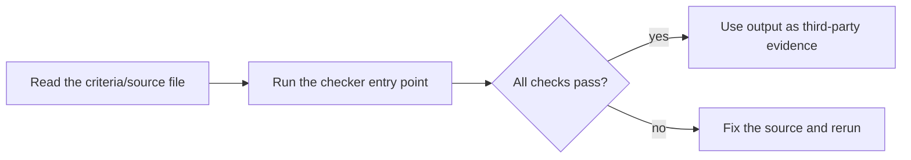

# ai-security-redteam

AI 安全与红队测试实操手册——覆盖六大攻击面（提示注入、越权与工具滥用、数据与隐私泄露、幻觉与质量缺陷、供应链与模型投毒、拒绝服务）、OWASP LLM Top 10 映射、完整红队流程与零依赖本地工具。当你要做 AI 系统红队测试、攻击面建模、测试用例生成、漏洞分级或修复复测时使用。触发词：AI安全、红队测试、提示注入、LLM安全、OWASP、渗透测试、安全测试、AI红队。

## Usage

- Entry point: `SKILL.md` — read its frontmatter `name` / `description` to decide applicability, then follow the steps.
- No `scripts/` directory: this skill ships documentation only.

## License

MIT — see [LICENSE](LICENSE).


---

## Quick start / 快速开始

**English**: Zero-dependency Python CLI skill package. See `SKILL.md` for the when-to-use guide and the executable entry point below. 中文说明见下文。



### Example run / 示例输出

Recorded on 2026-10-16 with a clean Python 3.13 environment (stdlib only):

```text
$ python tools/ai_redteam_toolkit.py --help
usage: ai_redteam_toolkit [-h] {risk,cases,grade,report,fix} ...

AI 安全与红队测试本地工具包 v1.0.0（零网络、零攻击、仅标准库）

positional arguments:
  {risk,cases,grade,report,fix}
    risk                攻击面风险清单
    cases               测试用例
    grade               漏洞分级
    report              红队报告模板
    fix                 修复建议

options:
  -h, --help            show this help message and exit
$ echo $?
0
```
