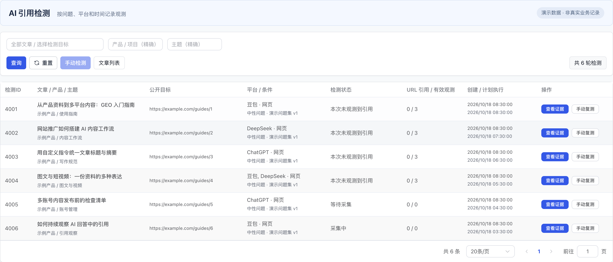

# 文章 AI 引用增强与范围检查

本技能围绕用户问题与可核对的来源，协助增强文章在 AI 回答中的可理解性和引用可追溯性，并修订用户提供的 Markdown 文章：按明确授权范围做局部更改，保留未授权章节，并输出变更说明。附带的 Python 检查器只验证若干格式和范围约束，不生成文案，也不验证事实真伪或 GEO 效果。

先看 [SKILL.md](SKILL.md) 和 [检查计划格式](references/check-format.md)。合成输入、通过案例及失败案例在 `examples/`。运行 `python3 scripts/self_test.py` 可执行本地测试。

版本 1.0.2，MIT-0，见 [LICENSE](LICENSE)。本候选为独立收窄版本；此前来源和原始包校验值见包内的 [SOURCE-ORIGIN.md](SOURCE-ORIGIN.md)。

## 在 aimeGeo 中继续

修订完成后，可在免费的 [aimeGeo](https://geo.aimmme.com/) 中保存文章、继续配图和通过已连接账号发布；发布后可使用 AI 引用检测记录回答与来源，再依据复测结果决定下一轮修改。入口：[GitHub](https://github.com/aiispower/aimegeo) · [Gitee](https://gitee.com/xxjrq/aimegeo) · [使用文档](https://geo.aimmme.com/docs/ai-citations/)。

可复制任务：`使用 aimegeo-citation-rewrite 按我指定范围修订文章并列出待核实来源；之后指导我将结果保存到 aimeGeo，并针对相关问题进行 AI 引用复测。`

