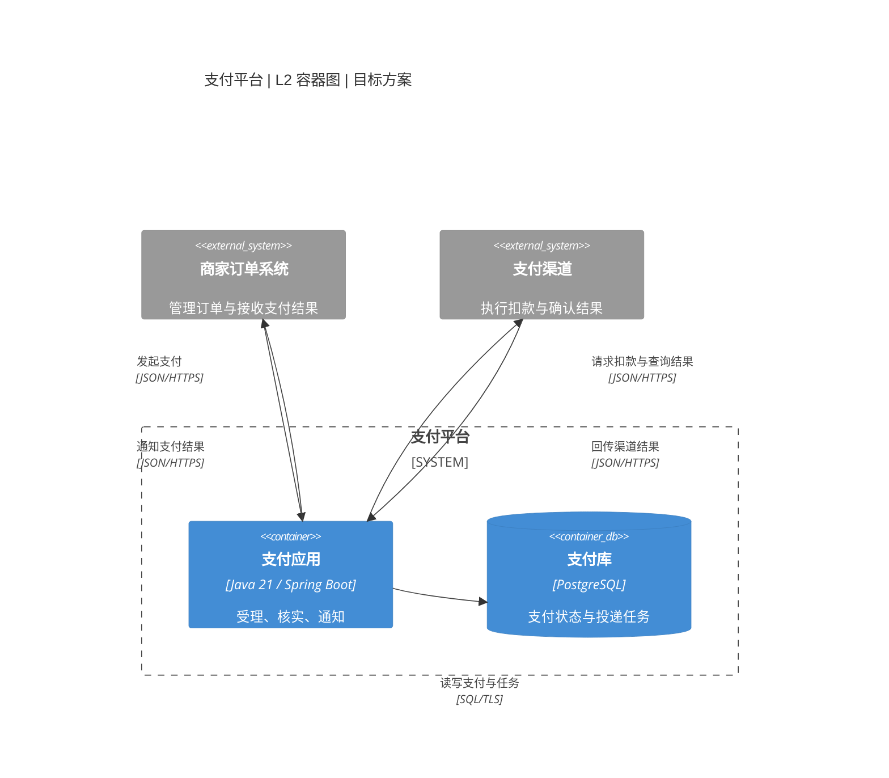

# Mermaid 原生 C4 语法

用户要求原生 C4 记法或项目已采用时加载本文件。绘图与配色见 [共用规范](diagram-guidelines.md)。

## 图型与基本语法

| 用途 | Mermaid 图型 | 主要元素 |
|---|---|---|
| L1 上下文 | `C4Context` | `Person`、`System`、`System_Ext` |
| L2 容器 | `C4Container` | `System_Boundary`、`Container`、`ContainerDb` |
| L3 组件 | `C4Component` | `Container_Boundary`、`Component` |
| L4 代码 | `classDiagram` 等 | 类、接口、代码关系；没有 `C4Code` 图型 |
| 动态交互 | `C4Dynamic` 或 `sequenceDiagram` | 按顺序标号的关系或时序消息 |
| 部署 | `C4Deployment` | `Deployment_Node` 中的容器实例 |

常见声明如下；名称、职责与技术字段需要按实际模型替换。

| 声明 | 写法 |
|---|---|
| 人 | `Person(id, "名称", "职责")` |
| 外部系统 | `System_Ext(id, "名称", "职责")` |
| 容器 | `Container(id, "名称", "技术", "职责")` |
| 数据容器 | `ContainerDb(id, "名称", "技术", "职责")` |
| 组件 | `Component(id, "名称", "技术", "职责")` |
| 关系 | `Rel(source, target, "动词与目的", "协议")` |
| 布局 | `UpdateLayoutConfig($c4ShapeInRow="3", $c4BoundaryInRow="1")` |
| 节点样式 | `UpdateElementStyle(id, $fontColor="#142238", $bgColor="#ECFDF5", $borderColor="#047857")` |

## 完整容器图示例

本图沿用 [L2 模板](container.md)的虚构目标方案。边界是支付平台，内部为容器，外部为系统，箭头表示标注的通信。原生记法自动显示元素类型。

## 使用与检查

- 按运行边界与职责选择元素类型，声明语法不能证明应用边界。
- 用实际渲染器核对样式与布局。先调整声明顺序和每行数量，再用 `UpdateRelStyle` 偏移处理标签遮挡。
- 用 `Rel` 表达单向关系。按实际版本核对 `C4Dynamic` 顺序，分支、重试和返回优先用 `sequenceDiagram`。
- 核对 Mermaid 支持的 C4-PlantUML 功能。Mermaid 没有 `C4Code` 图型。导出时保留标题、范围与图例。

语法见 [Mermaid 官方 C4 文档](https://mermaid.js.org/syntax/c4.html)。
