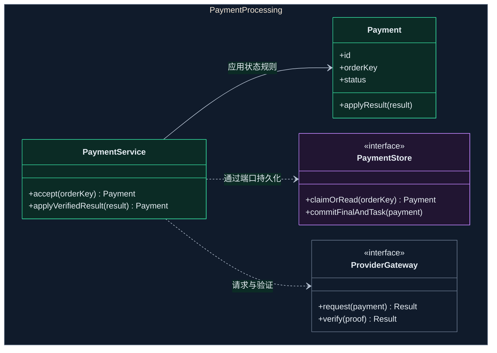
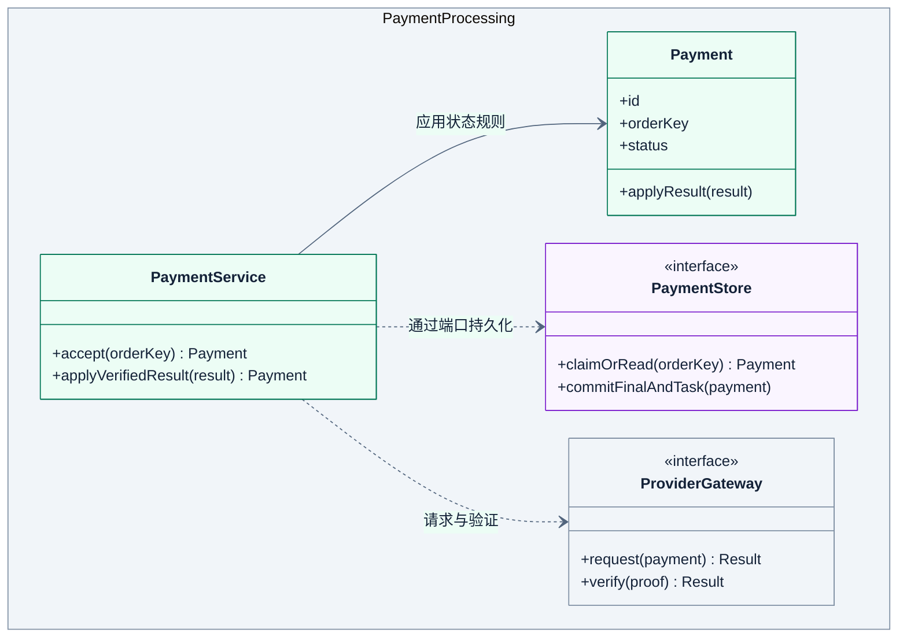

# L4 代码图

展开一个组件，用类、接口、函数或数据结构说明实现。

## 画法

- 本例只展开支付处理，使用 `classDiagram` 表达 Java 类、接口与依赖。
- `PaymentService` 调用 `Payment` 的状态规则，通过 `PaymentStore` 和 `ProviderGateway` 端口访问外部能力。接口属于支付处理，实现在 L3 的存储与渠道适配器中。
- 只保留相关方法。现状图核对实际符号和路径，目标图注明拟议设计。

示例是支付处理的虚构目标方案。图例中 namespace 表示组件代码范围，`<<interface>>` 表示接口，实线箭头表示关联，虚线箭头表示代码依赖。

绘图与配色见共用的 [绘图与视觉规范](diagram-guidelines.md)。

## 完整模板

### 暗色

### 亮色

`commitFinalAndTask` 约定原子提交终态与通知任务。事务、唯一幂等键和并发更新仍需源码与测试验证。

## 检查

- 确认代码元素属于目标组件，并能对应实际符号或拟议设计。
- 核对接口归属、依赖和关联记法，行为要求有类图之外的证据。

定义见 [C4 代码图](https://c4model.com/diagrams/code)。
