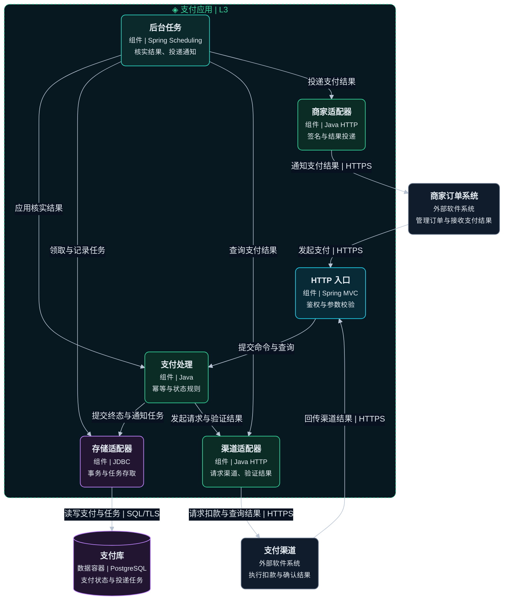
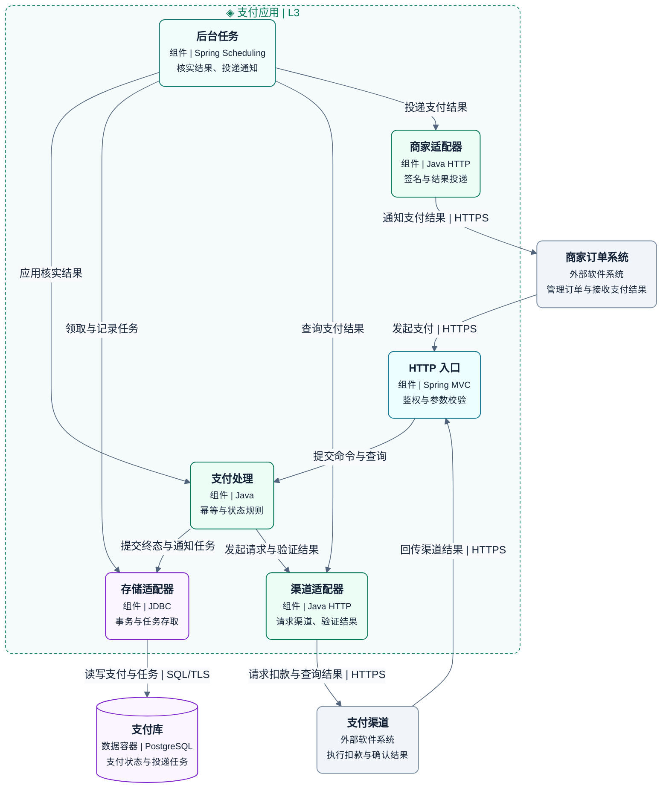

# L3 组件图

展开一个容器，说明具有明确接口的功能单元及其协作。

## 画法

- 只展开支付应用，支付库、商家与渠道留在应用边界之外。
- HTTP 入口、支付处理、后台任务和三个适配器都是组件，在同一应用内执行。
- 本图表达运行调用。源码依赖和接口实现关系需要另画并注明含义。

示例是支付应用的虚构目标方案。图例中虚线框是应用容器，框内为组件，框外为数据容器或外部系统，实线表示运行调用。

绘图与配色见共用的 [绘图与视觉规范](diagram-guidelines.md)。

## 完整模板

### 暗色

### 亮色

支付处理负责幂等与状态规则，存储适配器负责事务写入。后台任务核实结果，并通过商家适配器投递通知。L4 只展开支付处理，其端口由存储与渠道适配器实现。

## 检查

- 确认组件的职责、接口和所属容器，核对状态、事务与任务处理的负责者。
- 确认组件关系细化了 L2 的接口与数据访问，组件没有被误画为独立部署单元。

定义见 [C4 组件图](https://c4model.com/diagrams/component)和 [组件抽象](https://c4model.com/abstractions/component)。
