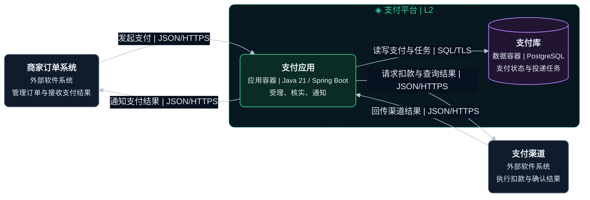
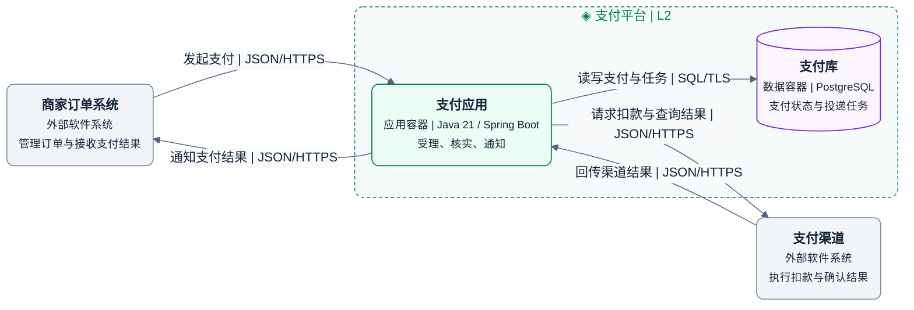

# L2 容器图

展开一个系统，说明应用与数据存储的职责、技术和通信。

## 画法

- 展开支付平台，内部只有支付应用和支付库。外部系统保留原名称与类型。
- 后台任务在支付应用内执行，属于组件。实际独立启动和部署时，再建模为单独容器。
- 按执行边界划分 SPA、API 和任务进程。依赖库和源码目录不能直接证明容器边界。
- 数据的逻辑归属与托管位置分开表达，机器、副本和负载均衡器放到部署图。

示例是支付平台的虚构目标方案。图例中虚线框是系统边界，绿色为应用容器，紫色为数据容器，灰色为外部系统，实线表示通信。

绘图与配色见共用的 [绘图与视觉规范](diagram-guidelines.md)。

## 完整模板

### 暗色

### 亮色

支付应用独占支付库，保存支付状态和通知任务。终态与通知任务原子持久化是示例设计，组件与动态视图需说明由谁执行。

## 检查

- 确认每个内部节点都是应用或数据存储，职责、技术、协议与数据所有者明确。
- 确认 L1 的外部关系能落到容器，L3 展开的是同一个支付应用。

定义见 [C4 容器图](https://c4model.com/diagrams/container)和 [容器抽象](https://c4model.com/abstractions/container)。
