# L1 系统上下文图

以一个系统为整体，说明用途、直接使用者和外部协作系统。

## 画法

- 支付平台是目标系统，商家订单系统和支付渠道在边界之外。
- 只画直接参与者。本例没有人直接操作平台。
- 用业务语言说明关系，内部服务、数据库和代码留到下一层。同公司的其他系统也可以是外部系统。

示例是支付平台的虚构目标方案。图例中绿色为目标系统，灰色为外部系统，实线箭头表示业务交互方向，不表示顺序。

绘图与配色见共用的 [绘图与视觉规范](diagram-guidelines.md)。

## 完整模板

### 暗色

```mermaid
---
config:
  theme: "base"
  look: "classic"
  fontFamily: "\"PingFang SC\", \"Helvetica Neue\", Arial, sans-serif"
  flowchart: {nodeSpacing: 28, rankSpacing: 40, padding: 14, curve: basis}
  sequence: {mirrorActors: false, actorMargin: 42, messageMargin: 28, boxMargin: 10}
  themeVariables: {darkMode: true, background: '#07111F', fontFamily: '"PingFang SC", "Helvetica Neue", Arial, sans-serif', fontSize: 15px,
      primaryColor: '#0B2B25', primaryTextColor: '#E6EDF3', primaryBorderColor: '#34D399', lineColor: '#B8C4D4',
      textColor: '#E6EDF3', secondaryColor: '#211532', tertiaryColor: '#101B2B', clusterBkg: '#101B2B', clusterBorder: '#66758A',
      edgeLabelBackground: '#07111F', actorBkg: '#101B2B', actorBorder: '#34D399', actorTextColor: '#E6EDF3', actorLineColor: '#66758A',
      signalColor: '#B8C4D4', signalTextColor: '#E6EDF3', labelBoxBkgColor: '#101B2B', labelBoxBorderColor: '#66758A',
      labelTextColor: '#E6EDF3', loopTextColor: '#E6EDF3', noteBkgColor: '#28220E', noteBorderColor: '#FACC15',
      noteTextColor: '#E6EDF3', activationBkgColor: '#0B2B25', activationBorderColor: '#34D399', sequenceNumberColor: '#07111F'}
  themeCSS: |
    .nodeLabel small { color: #9AA9BC; font-size: 12px; }
    .nodeLabel b { font-weight: 600; }
    .cluster-label { font-weight: 600; }
    .edgeLabel { background-color: #07111F; color: #9AA9BC; }
    .cluster rect { rx: 10; ry: 10; }
    .actor { rx: 8; ry: 8; }
---
flowchart LR
    Merchant("<b>商家订单系统</b><br/><small>外部软件系统<br/>管理订单与接收支付结果</small>")
    Platform("<b>支付平台</b><br/><small>软件系统<br/>受理支付并交付结果</small>")
    Provider("<b>支付渠道</b><br/><small>外部软件系统<br/>执行扣款与确认结果</small>")
    Merchant -->|"发起支付"| Platform
    Platform -->|"通知支付结果"| Merchant
    Platform -->|"请求扣款与查询结果"| Provider
    Provider -->|"回传渠道结果"| Platform
    classDef external fill:#101B2B,stroke:#66758A,color:#E6EDF3,stroke-width:1.2px,rx:8,ry:8
    class Merchant,Provider external
    classDef service fill:#0B2B25,stroke:#34D399,color:#E6EDF3,stroke-width:1.2px,rx:8,ry:8
    class Platform service
```

### 亮色

```mermaid
---
config:
  theme: "base"
  look: "classic"
  fontFamily: "\"PingFang SC\", \"Helvetica Neue\", Arial, sans-serif"
  flowchart: {nodeSpacing: 28, rankSpacing: 40, padding: 14, curve: basis}
  sequence: {mirrorActors: false, actorMargin: 42, messageMargin: 28, boxMargin: 10}
  themeVariables: {darkMode: false, background: '#F8FAFC', fontFamily: '"PingFang SC", "Helvetica Neue", Arial, sans-serif',
      fontSize: 15px, primaryColor: '#ECFDF5', primaryTextColor: '#142238', primaryBorderColor: '#047857', lineColor: '#52657D',
      textColor: '#142238', secondaryColor: '#FAF5FF', tertiaryColor: '#F1F5F9', clusterBkg: '#F1F5F9', clusterBorder: '#8090A4',
      edgeLabelBackground: '#F8FAFC', actorBkg: '#F1F5F9', actorBorder: '#047857', actorTextColor: '#142238', actorLineColor: '#8090A4',
      signalColor: '#52657D', signalTextColor: '#142238', labelBoxBkgColor: '#F1F5F9', labelBoxBorderColor: '#8090A4',
      labelTextColor: '#142238', loopTextColor: '#142238', noteBkgColor: '#FFFBEB', noteBorderColor: '#92400E',
      noteTextColor: '#142238', activationBkgColor: '#ECFDF5', activationBorderColor: '#047857', sequenceNumberColor: '#F8FAFC'}
  themeCSS: |
    .nodeLabel small { color: #53647A; font-size: 12px; }
    .nodeLabel b { font-weight: 600; }
    .cluster-label { font-weight: 600; }
    .edgeLabel { background-color: #F8FAFC; color: #53647A; }
    .cluster rect { rx: 10; ry: 10; }
    .actor { rx: 8; ry: 8; }
---
flowchart LR
    Merchant("<b>商家订单系统</b><br/><small>外部软件系统<br/>管理订单与接收支付结果</small>")
    Platform("<b>支付平台</b><br/><small>软件系统<br/>受理支付并交付结果</small>")
    Provider("<b>支付渠道</b><br/><small>外部软件系统<br/>执行扣款与确认结果</small>")
    Merchant -->|"发起支付"| Platform
    Platform -->|"通知支付结果"| Merchant
    Platform -->|"请求扣款与查询结果"| Provider
    Provider -->|"回传渠道结果"| Platform
    classDef external fill:#F1F5F9,stroke:#8090A4,color:#142238,stroke-width:1.2px,rx:8,ry:8
    class Merchant,Provider external
    classDef service fill:#ECFDF5,stroke:#047857,color:#142238,stroke-width:1.2px,rx:8,ry:8
    class Platform service
```

L2 展开本图的支付平台，保留商家与渠道的身份和协作关系。

## 检查

- 确认系统目的、边界和直接参与者，每条关系都有业务含义。
- 确认图中没有内部技术单元，L2 展开保持相同系统身份。

定义见 [C4 系统上下文图](https://c4model.com/diagrams/system-context)。
