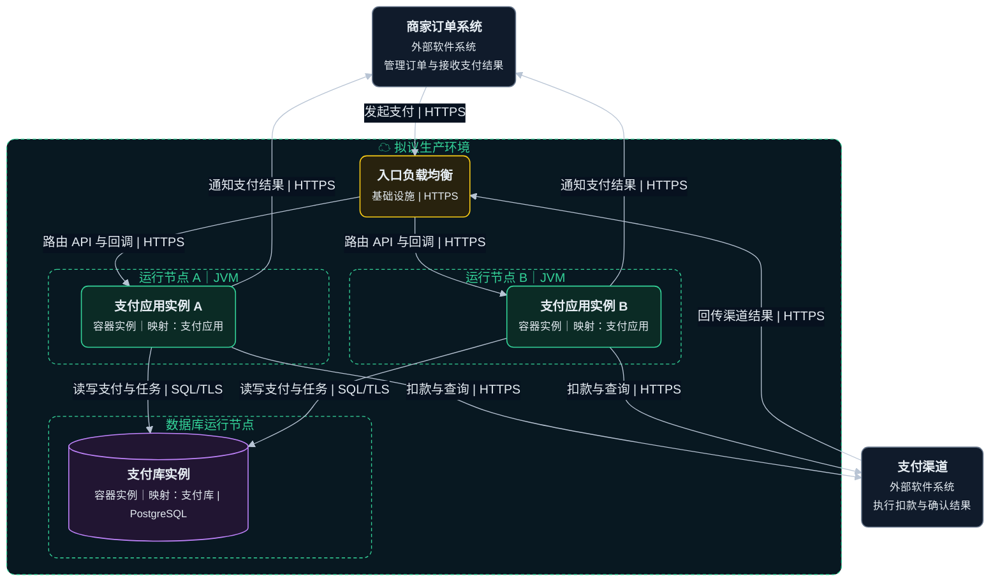
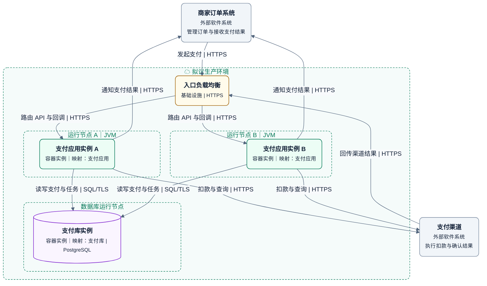

# 部署图

在一个确定环境中，将逻辑容器的实例映射到部署节点，并说明通信路径。

## 画法

- 本例为拟议生产环境，包含入口负载均衡、两个 JVM 和一个数据库运行环境。
- 每个 JVM 运行一个支付应用实例，两者都映射到 L2 的支付应用。数据库实例映射到支付库。
- 渠道回调经过入口，应用向商家和渠道发出请求并访问数据库。
- 可用区、网络和故障切换按实际资料补充。托管位置与逻辑归属分开说明。

示例是虚构目标方案。图例中外层虚线框为部署环境，内层为运行节点，绿色为应用实例，紫色为数据实例，黄色为基础设施，灰色为外部系统，实线表示通信。

绘图与配色见共用的 [绘图与视觉规范](diagram-guidelines.md)。

## 完整模板

### 暗色

### 亮色

两个应用实例都包含后台任务，任务领取需要租约或等价并发控制，并处理重复投递。单数据库示例没有声明自动切换或高可用。

## 检查

- 确认环境、实例数和运行位置有依据或属于明确的目标设计，每个实例能映射回 L2 容器。
- 核对入口、回调、出站和数据库路径，以及多实例任务协调、状态一致性与故障恢复。

定义见 [C4 部署图](https://c4model.com/diagrams/deployment)。
