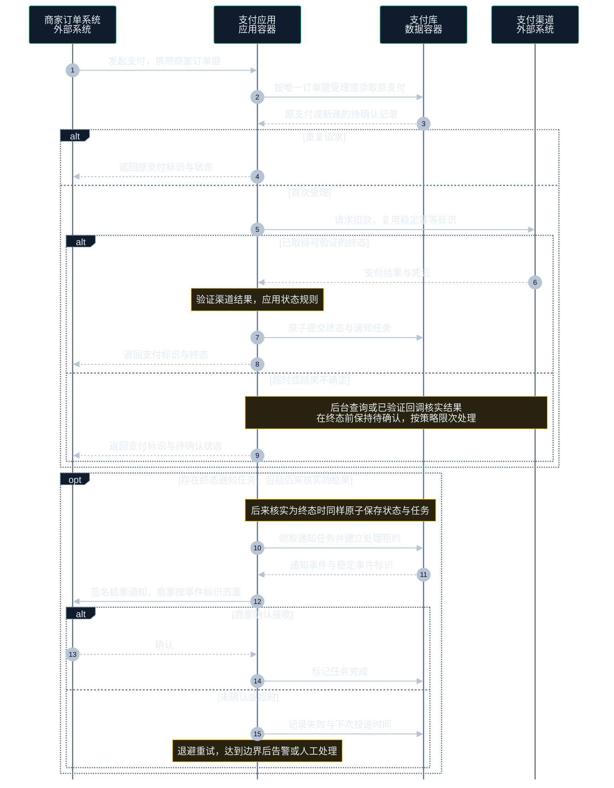
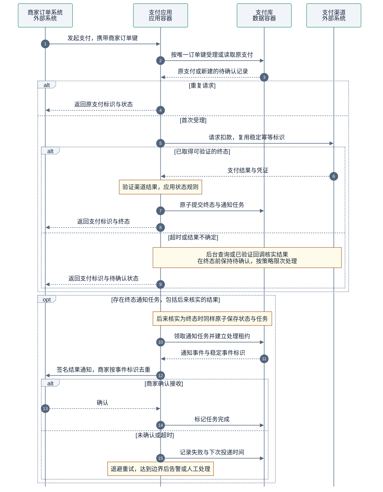

# 动态交互图

选择一个场景，说明静态模型中的对象如何在运行时协作。

## 画法

- 本例使用 L2 容器和外部系统。需要内部细节时另画 L3 时序，避免把容器与其组件列为同级参与者。
- 用 `sequenceDiagram` 表达顺序和条件，交互需有结构关系支持。
- 区分请求已受理、支付已终结和商家已确认接收。超时表示结果不确定。

示例是发起支付与结果通知的虚构目标方案。图例中实线箭头是请求，虚线箭头是响应，Note 是约束。

绘图与配色见共用的 [绘图与视觉规范](diagram-guidelines.md)。

## 完整模板

### 暗色

### 亮色

同一商家订单键复用原支付记录，渠道请求复用稳定幂等标识。后台任务或已验证回调核实结果，终态与通知任务原子保存。通知按至少一次投递设计，商家按事件标识去重。重试采用退避并设次数或时间边界，超限后告警或人工处理。

## 检查

- 确认交互能映射回结构，状态变更与异常处理有负责者。
- 核对重复请求、回调与投递的幂等策略，以及不确定结果和重试的结束条件。

定义见 [C4 动态图](https://c4model.com/diagrams/dynamic)。
