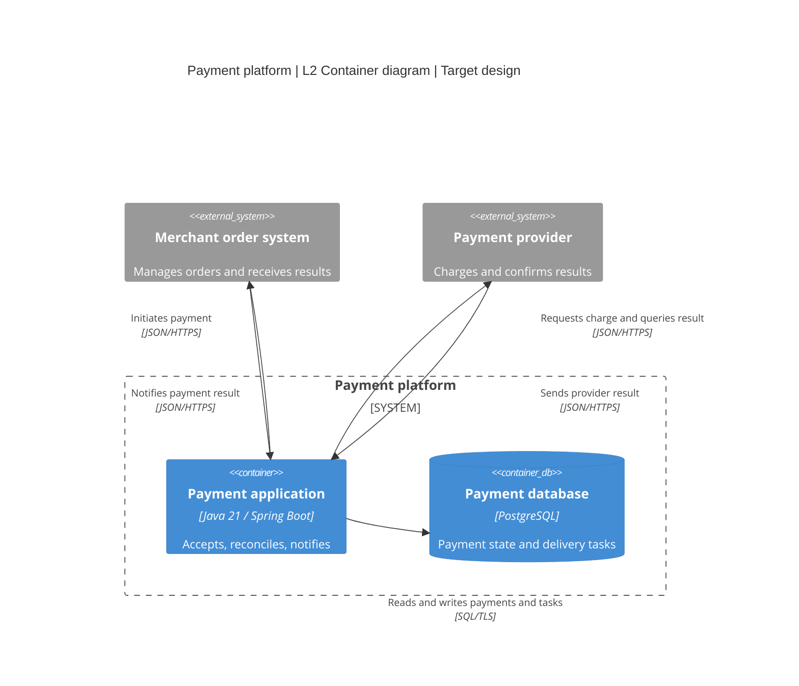

# Native Mermaid C4 syntax

Use this reference when native C4 notation is requested or already used in the project. For drawing and colors, read the [shared guidelines](diagram-guidelines.md).

## Diagram types and basic syntax

| Purpose | Mermaid type | Main elements |
|---|---|---|
| L1 Context | `C4Context` | `Person`, `System`, `System_Ext` |
| L2 Container | `C4Container` | `System_Boundary`, `Container`, `ContainerDb` |
| L3 Component | `C4Component` | `Container_Boundary`, `Component` |
| L4 Code | `classDiagram` or similar | Classes, interfaces, code relations; no `C4Code` type |
| Dynamic interaction | `C4Dynamic` or `sequenceDiagram` | Ordered relationships or sequence messages |
| Deployment | `C4Deployment` | Container instances inside `Deployment_Node` |

Common declarations are shown below. Replace field values with the actual model.

| Declaration | Syntax |
|---|---|
| Person | `Person(id, "Name", "Responsibility")` |
| External system | `System_Ext(id, "Name", "Responsibility")` |
| Container | `Container(id, "Name", "Technology", "Responsibility")` |
| Data container | `ContainerDb(id, "Name", "Technology", "Responsibility")` |
| Component | `Component(id, "Name", "Technology", "Responsibility")` |
| Relationship | `Rel(source, target, "Verb and purpose", "Protocol")` |
| Layout | `UpdateLayoutConfig($c4ShapeInRow="3", $c4BoundaryInRow="1")` |
| Node style | `UpdateElementStyle(id, $fontColor="#142238", $bgColor="#ECFDF5", $borderColor="#047857")` |

## Complete container example

This fictional target design uses the [L2 template](container.md) model. The boundary is the payment platform. Internal elements are containers and external elements are systems. Arrows show labeled communication. Native notation displays element types.

## Use and checks

- Choose element types from runtime boundaries and responsibilities. A declaration cannot establish an application boundary.
- Check native styling and layout in the actual renderer. Adjust declaration order and shapes per row, then use `UpdateRelStyle` offsets for overlapping labels.
- Use `Rel` for directed relationships. Verify `C4Dynamic` ordering in the installed version. Use `sequenceDiagram` for branches, retries, and responses.
- Check which C4-PlantUML features Mermaid supports. Mermaid has no `C4Code` type. Retain the title, scope, and legend in exports.

See the [official Mermaid C4 documentation](https://mermaid.js.org/syntax/c4.html).
