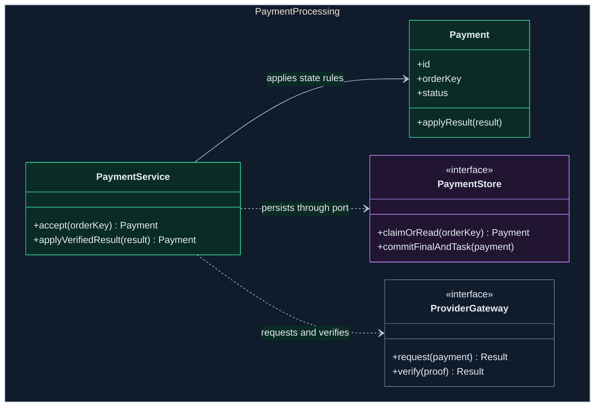
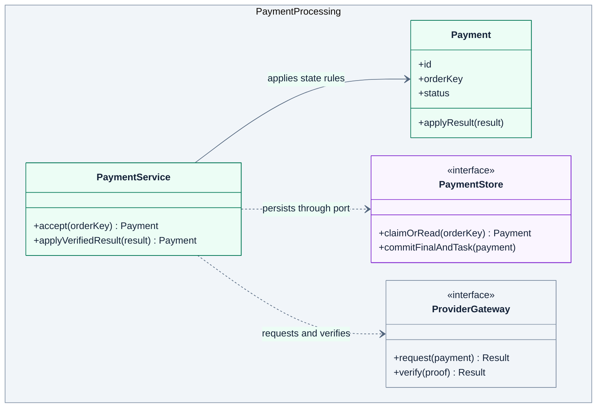

# L4 Code diagram

Expand one component into classes, interfaces, functions, or data structures that explain its implementation.

## Drawing approach

- Expand only payment processing. Use `classDiagram` for Java classes, interfaces, and dependencies.
- `PaymentService` invokes `Payment` state rules and uses `PaymentStore` and `ProviderGateway` ports. Interfaces belong to payment processing. L3's storage and provider adapters implement them.
- Keep only relevant methods. Verify actual symbols and paths for current-state views, and label proposed symbols in target views.

This is a fictional target design for payment processing. The namespace is the component's code scope. `<<interface>>` marks an interface, a solid arrow an association, and a dashed arrow a code dependency.

Use the shared [diagram and visual guidelines](diagram-guidelines.md).

## Complete templates

### Dark

### Light

`commitFinalAndTask` requires final state and delivery task to commit atomically. Source and tests must verify transactions, unique idempotency keys, and concurrent updates.

## Checks

- Confirm code elements belong to the target component and map to actual symbols or a proposed design.
- Check interface ownership and relationship notation. Support behavioral requirements with evidence beyond the class diagram.

See the [C4 code diagram definition](https://c4model.com/diagrams/code).
