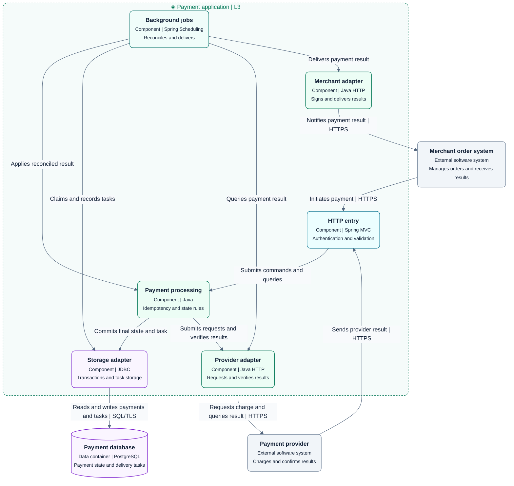

# L3 Component diagram

Expand one container into units of functionality with explicit interfaces and collaboration.

## Drawing approach

- Expand only the payment application. Keep the database, merchant, and provider outside its boundary.
- HTTP entry, payment processing, jobs, and three adapters are components executing in the same application.
- This diagram shows runtime calls. Use a separate labeled diagram for source dependencies or interface realization.

This is a fictional target design. The dashed boundary is the application container. Internal nodes are components, external nodes are a data container or software systems, and solid lines represent runtime calls.

Use the shared [diagram and visual guidelines](diagram-guidelines.md).

## Complete templates

### Dark

```mermaid
---
config:
  theme: "base"
  look: "classic"
  fontFamily: "\"PingFang SC\", \"Helvetica Neue\", Arial, sans-serif"
  flowchart: {nodeSpacing: 28, rankSpacing: 40, padding: 14, curve: basis}
  sequence: {mirrorActors: false, actorMargin: 42, messageMargin: 28, boxMargin: 10}
  themeVariables: {darkMode: true, background: '#07111F', fontFamily: '"PingFang SC", "Helvetica Neue", Arial, sans-serif', fontSize: 15px,
      primaryColor: '#0B2B25', primaryTextColor: '#E6EDF3', primaryBorderColor: '#34D399', lineColor: '#B8C4D4',
      textColor: '#E6EDF3', secondaryColor: '#211532', tertiaryColor: '#101B2B', clusterBkg: '#101B2B', clusterBorder: '#66758A',
      edgeLabelBackground: '#07111F', actorBkg: '#101B2B', actorBorder: '#34D399', actorTextColor: '#E6EDF3', actorLineColor: '#66758A',
      signalColor: '#B8C4D4', signalTextColor: '#E6EDF3', labelBoxBkgColor: '#101B2B', labelBoxBorderColor: '#66758A',
      labelTextColor: '#E6EDF3', loopTextColor: '#E6EDF3', noteBkgColor: '#28220E', noteBorderColor: '#FACC15',
      noteTextColor: '#E6EDF3', activationBkgColor: '#0B2B25', activationBorderColor: '#34D399', sequenceNumberColor: '#07111F'}
  themeCSS: |
    .nodeLabel small { color: #9AA9BC; font-size: 12px; }
    .nodeLabel b { font-weight: 600; }
    .cluster-label { font-weight: 600; }
    .edgeLabel { background-color: #07111F; color: #9AA9BC; }
    .cluster rect { rx: 10; ry: 10; }
    .actor { rx: 8; ry: 8; }
---
flowchart TB
    Merchant("<b>Merchant order system</b><br/><small>External software system<br/>Manages orders and receives results</small>")
    Provider("<b>Payment provider</b><br/><small>External software system<br/>Charges and confirms results</small>")
    subgraph PayApp["◈ Payment application | L3"]
        direction TB
    Api("<b>HTTP entry</b><br/><small>Component | Spring MVC<br/>Authentication and validation</small>")
    Core("<b>Payment processing</b><br/><small>Component | Java<br/>Idempotency and state rules</small>")
    Jobs("<b>Background jobs</b><br/><small>Component | Spring Scheduling<br/>Reconciles and delivers</small>")
    Store("<b>Storage adapter</b><br/><small>Component | JDBC<br/>Transactions and task storage</small>")
    ChannelClient("<b>Provider adapter</b><br/><small>Component | Java HTTP<br/>Requests and verifies results</small>")
    MerchantClient("<b>Merchant adapter</b><br/><small>Component | Java HTTP<br/>Signs and delivers results</small>")
    Api -->|"Submits commands and queries"| Core
    Core -->|"Commits final state and task"| Store
    Core -->|"Submits requests and verifies results"| ChannelClient
    Jobs -->|"Applies reconciled result"| Core
    Jobs -->|"Claims and records tasks"| Store
    Jobs -->|"Queries payment result"| ChannelClient
    Jobs -->|"Delivers payment result"| MerchantClient
    end
    PayDB[("<b>Payment database</b><br/><small>Data container | PostgreSQL<br/>Payment state and delivery tasks</small>")]
    Merchant -->|"Initiates payment | HTTPS"| Api
    Provider -->|"Sends provider result | HTTPS"| Api
    Store -->|"Reads and writes payments and tasks | SQL/TLS"| PayDB
    ChannelClient -->|"Requests charge and queries result | HTTPS"| Provider
    MerchantClient -->|"Notifies payment result | HTTPS"| Merchant
    classDef external fill:#101B2B,stroke:#66758A,color:#E6EDF3,stroke-width:1.2px,rx:8,ry:8
    class Merchant,Provider external
    classDef entry fill:#082A36,stroke:#22D3EE,color:#E6EDF3,stroke-width:1.2px,rx:8,ry:8
    class Api entry
    classDef service fill:#0B2B25,stroke:#34D399,color:#E6EDF3,stroke-width:1.2px,rx:8,ry:8
    class Core,ChannelClient,MerchantClient service
    classDef worker fill:#0B292B,stroke:#2DD4BF,color:#E6EDF3,stroke-width:1.2px,rx:8,ry:8
    class Jobs worker
    classDef data fill:#211532,stroke:#C084FC,color:#E6EDF3,stroke-width:1.2px,rx:8,ry:8
    class Store,PayDB data
    style PayApp fill:#081821,stroke:#34D399,color:#34D399,stroke-width:1px,stroke-dasharray:4 3,rx:10,ry:10
```

### Light

Payment processing owns idempotency and state rules. The storage adapter owns transactional writes. Jobs reconcile results and deliver notifications through the merchant adapter. L4 expands only payment processing, with ports implemented by the storage and provider adapters.

## Checks

- Confirm component responsibilities, interfaces, and container ownership. Assign state, transactions, and jobs to their owners.
- Confirm relationships refine L2 interfaces and data access, and keep components distinct from separately deployed units.

See the [C4 component diagram](https://c4model.com/diagrams/component) and [component abstraction](https://c4model.com/abstractions/component).
