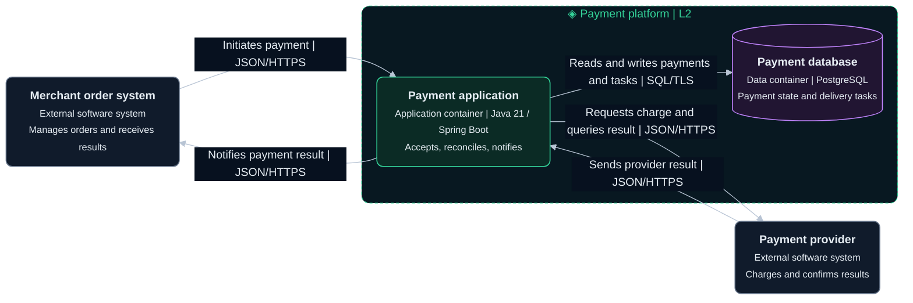
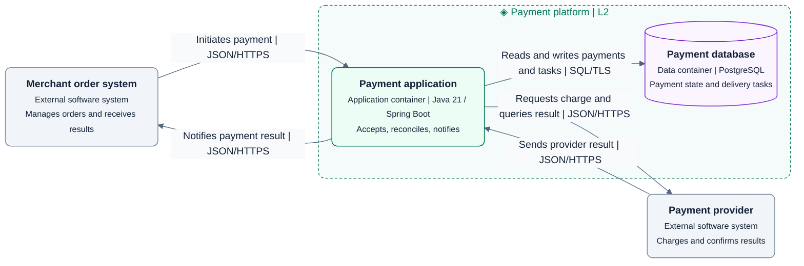

# L2 Container diagram

Expand one system to show applications and data stores, their responsibilities, technologies, and communication.

## Drawing approach

- Expand the payment platform into the payment application and database. Retain external system names and types.
- Jobs run inside the payment application as components. Use a separate container if evidence shows an independently started and deployed worker.
- Use execution boundaries to distinguish a SPA, API, or job process. Libraries and source folders alone cannot establish container boundaries.
- Separate logical data ownership from hosting location. Put machines, replicas, and load balancers in deployment views.

This is a fictional target design. The dashed boundary is the system. Green marks the application container, purple the data container, and gray external systems. Solid lines represent communication.

Use the shared [diagram and visual guidelines](diagram-guidelines.md).

## Complete templates

### Dark

### Light

The payment application exclusively accesses the database, which stores payment state and delivery tasks. Atomic persistence of final state and delivery task is an example design decision. Component and dynamic views must assign its implementation.

## Checks

- Confirm each internal node is an application or data store, with explicit responsibility, technology, protocol, and data ownership.
- Map L1's external relationships to containers and expand the same payment application at L3.

See the [C4 container diagram](https://c4model.com/diagrams/container) and [container abstraction](https://c4model.com/abstractions/container).
