# L1 System context diagram

Show one system as a whole, with its purpose, direct users, and external collaborators.

## Drawing approach

- The payment platform is the target system. The merchant order system and payment provider are external.
- Include only direct participants. This example has no direct human user.
- Label relationships in business language. Leave internal services, databases, and code for later levels. Systems in the same company can still be external.

The example is a fictional target design. Green marks the target system and gray marks external systems. Solid arrows indicate business interaction direction, not order.

Use the shared [diagram and visual guidelines](diagram-guidelines.md).

## Complete templates

### Dark

```mermaid
---
config:
  theme: "base"
  look: "classic"
  fontFamily: "\"PingFang SC\", \"Helvetica Neue\", Arial, sans-serif"
  flowchart: {nodeSpacing: 28, rankSpacing: 40, padding: 14, curve: basis}
  sequence: {mirrorActors: false, actorMargin: 42, messageMargin: 28, boxMargin: 10}
  themeVariables: {darkMode: true, background: '#07111F', fontFamily: '"PingFang SC", "Helvetica Neue", Arial, sans-serif', fontSize: 15px,
      primaryColor: '#0B2B25', primaryTextColor: '#E6EDF3', primaryBorderColor: '#34D399', lineColor: '#B8C4D4',
      textColor: '#E6EDF3', secondaryColor: '#211532', tertiaryColor: '#101B2B', clusterBkg: '#101B2B', clusterBorder: '#66758A',
      edgeLabelBackground: '#07111F', actorBkg: '#101B2B', actorBorder: '#34D399', actorTextColor: '#E6EDF3', actorLineColor: '#66758A',
      signalColor: '#B8C4D4', signalTextColor: '#E6EDF3', labelBoxBkgColor: '#101B2B', labelBoxBorderColor: '#66758A',
      labelTextColor: '#E6EDF3', loopTextColor: '#E6EDF3', noteBkgColor: '#28220E', noteBorderColor: '#FACC15',
      noteTextColor: '#E6EDF3', activationBkgColor: '#0B2B25', activationBorderColor: '#34D399', sequenceNumberColor: '#07111F'}
  themeCSS: |
    .nodeLabel small { color: #9AA9BC; font-size: 12px; }
    .nodeLabel b { font-weight: 600; }
    .cluster-label { font-weight: 600; }
    .edgeLabel { background-color: #07111F; color: #9AA9BC; }
    .cluster rect { rx: 10; ry: 10; }
    .actor { rx: 8; ry: 8; }
---
flowchart LR
    Merchant("<b>Merchant order system</b><br/><small>External software system<br/>Manages orders and receives results</small>")
    Platform("<b>Payment platform</b><br/><small>Software system<br/>Accepts payments and delivers results</small>")
    Provider("<b>Payment provider</b><br/><small>External software system<br/>Charges and confirms results</small>")
    Merchant -->|"Initiates payment"| Platform
    Platform -->|"Notifies payment result"| Merchant
    Platform -->|"Requests charge and queries result"| Provider
    Provider -->|"Sends provider result"| Platform
    classDef external fill:#101B2B,stroke:#66758A,color:#E6EDF3,stroke-width:1.2px,rx:8,ry:8
    class Merchant,Provider external
    classDef service fill:#0B2B25,stroke:#34D399,color:#E6EDF3,stroke-width:1.2px,rx:8,ry:8
    class Platform service
```

### Light

```mermaid
---
config:
  theme: "base"
  look: "classic"
  fontFamily: "\"PingFang SC\", \"Helvetica Neue\", Arial, sans-serif"
  flowchart: {nodeSpacing: 28, rankSpacing: 40, padding: 14, curve: basis}
  sequence: {mirrorActors: false, actorMargin: 42, messageMargin: 28, boxMargin: 10}
  themeVariables: {darkMode: false, background: '#F8FAFC', fontFamily: '"PingFang SC", "Helvetica Neue", Arial, sans-serif',
      fontSize: 15px, primaryColor: '#ECFDF5', primaryTextColor: '#142238', primaryBorderColor: '#047857', lineColor: '#52657D',
      textColor: '#142238', secondaryColor: '#FAF5FF', tertiaryColor: '#F1F5F9', clusterBkg: '#F1F5F9', clusterBorder: '#8090A4',
      edgeLabelBackground: '#F8FAFC', actorBkg: '#F1F5F9', actorBorder: '#047857', actorTextColor: '#142238', actorLineColor: '#8090A4',
      signalColor: '#52657D', signalTextColor: '#142238', labelBoxBkgColor: '#F1F5F9', labelBoxBorderColor: '#8090A4',
      labelTextColor: '#142238', loopTextColor: '#142238', noteBkgColor: '#FFFBEB', noteBorderColor: '#92400E',
      noteTextColor: '#142238', activationBkgColor: '#ECFDF5', activationBorderColor: '#047857', sequenceNumberColor: '#F8FAFC'}
  themeCSS: |
    .nodeLabel small { color: #53647A; font-size: 12px; }
    .nodeLabel b { font-weight: 600; }
    .cluster-label { font-weight: 600; }
    .edgeLabel { background-color: #F8FAFC; color: #53647A; }
    .cluster rect { rx: 10; ry: 10; }
    .actor { rx: 8; ry: 8; }
---
flowchart LR
    Merchant("<b>Merchant order system</b><br/><small>External software system<br/>Manages orders and receives results</small>")
    Platform("<b>Payment platform</b><br/><small>Software system<br/>Accepts payments and delivers results</small>")
    Provider("<b>Payment provider</b><br/><small>External software system<br/>Charges and confirms results</small>")
    Merchant -->|"Initiates payment"| Platform
    Platform -->|"Notifies payment result"| Merchant
    Platform -->|"Requests charge and queries result"| Provider
    Provider -->|"Sends provider result"| Platform
    classDef external fill:#F1F5F9,stroke:#8090A4,color:#142238,stroke-width:1.2px,rx:8,ry:8
    class Merchant,Provider external
    classDef service fill:#ECFDF5,stroke:#047857,color:#142238,stroke-width:1.2px,rx:8,ry:8
    class Platform service
```

L2 expands the payment platform and preserves the merchant and provider identities and relationships.

## Checks

- Confirm purpose, boundaries, direct participants, and the business meaning of each relationship.
- Keep internal technology out of L1 and preserve system identity in L2.

See the [C4 system context definition](https://c4model.com/diagrams/system-context).
