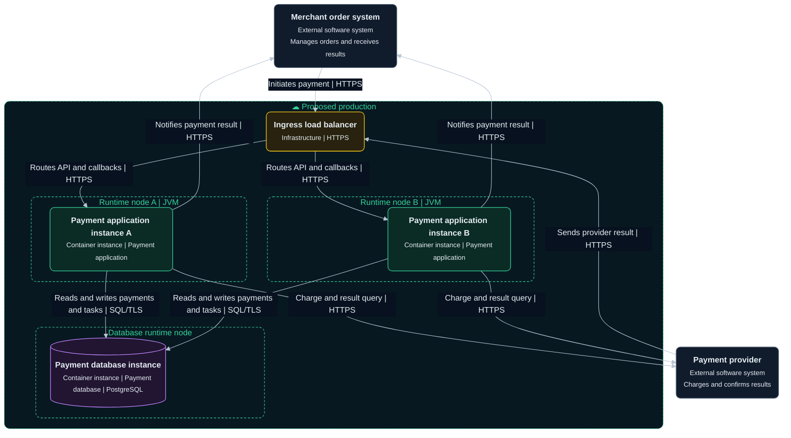
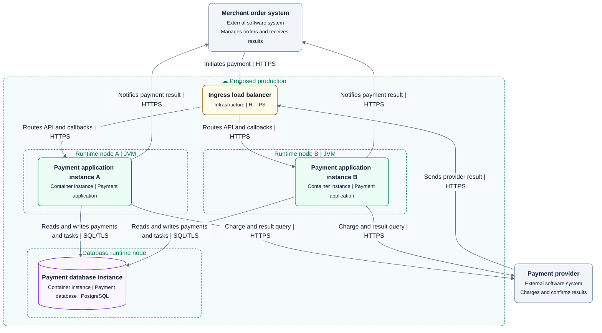

# Deployment diagram

Map logical container instances to deployment nodes in one environment and show communication paths.

## Drawing approach

- This proposed production environment contains an ingress load balancer, two JVMs, and one database runtime.
- Each JVM runs one payment application instance. Both map to the L2 application, and the database instance maps to the L2 database.
- Provider callbacks pass through ingress. The application accesses the database and sends requests to the merchant and provider.
- Add availability zones, networks, and failover from evidence. Separate hosting location from logical ownership.

This is a fictional target design. The outer dashed boundary is the environment and inner boundaries are runtime nodes. Green marks application instances, purple the data instance, yellow infrastructure, and gray external systems. Solid lines represent communication.

Use the shared [diagram and visual guidelines](diagram-guidelines.md).

## Complete templates

### Dark

### Light

Both application instances contain jobs. Claiming tasks requires a lease or equivalent concurrency control, with duplicate delivery handling. The single-database example makes no automatic failover or high-availability claim.

## Checks

- Support the environment, counts, and placement with evidence or an explicit target design. Map each instance to its L2 container.
- Check ingress, callback, outbound, and database paths, along with job coordination, state consistency, and recovery across instances.

See the [C4 deployment diagram definition](https://c4model.com/diagrams/deployment).
