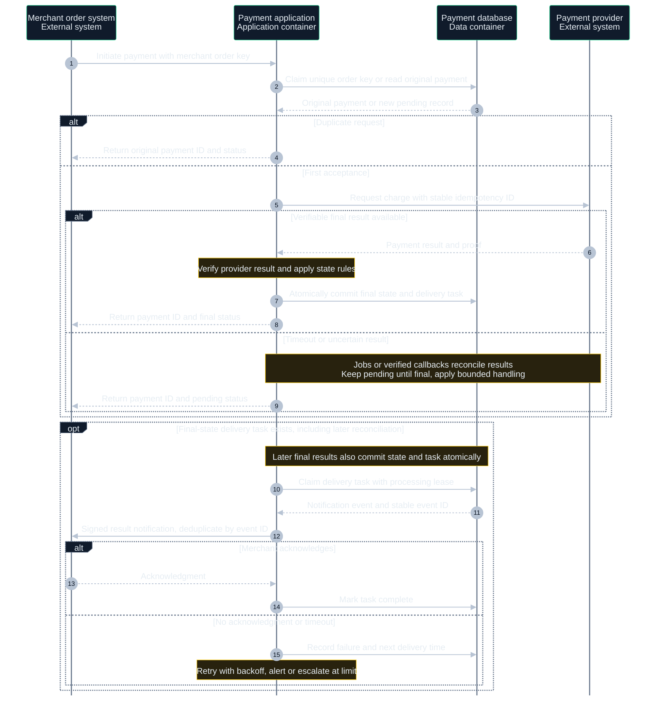
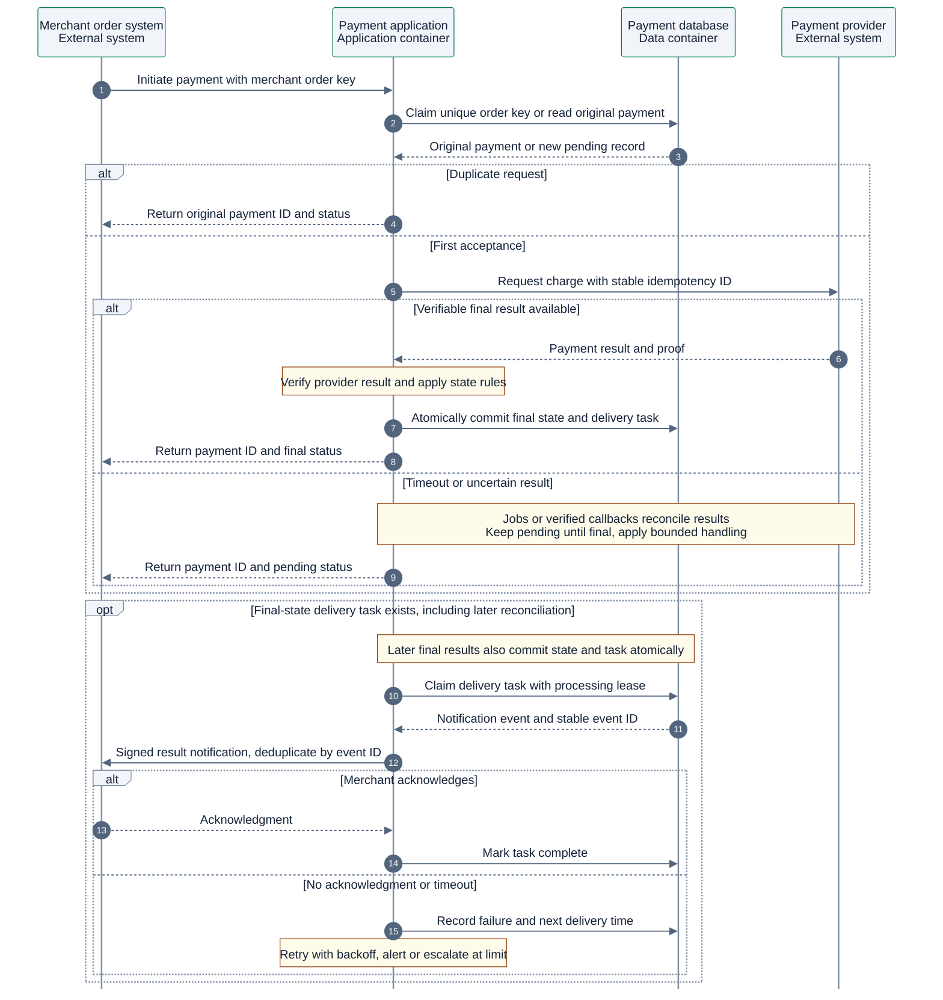

# Dynamic interaction diagram

Select one scenario and show how static-model elements collaborate at runtime.

## Drawing approach

- Use L2 containers and external systems. Draw a separate L3 sequence for internal detail, keeping containers and their components at separate levels.
- Use `sequenceDiagram` for order and conditions. Ground interactions in structural relationships.
- Distinguish accepted requests, final payment state, and acknowledged merchant delivery. A timeout leaves the result uncertain.

This fictional target design covers payment initiation and result notification. Solid arrows are requests, dashed arrows responses, and notes constraints.

Use the shared [diagram and visual guidelines](diagram-guidelines.md).

## Complete templates

### Dark

### Light

A merchant order key reuses the original payment record. Provider requests use a stable idempotency identifier. Jobs or verified callbacks reconcile results. Final state and delivery task commit atomically. Notifications use at-least-once delivery and merchant deduplication by event identifier. Retries use backoff and count or time limits, followed by alerts or manual handling.

## Checks

- Map interactions to the structure and assign owners for state changes and failure responses.
- Check idempotency for repeated requests, callbacks, and delivery. Define stop conditions for uncertain results and retries.

See the [C4 dynamic diagram definition](https://c4model.com/diagrams/dynamic).
