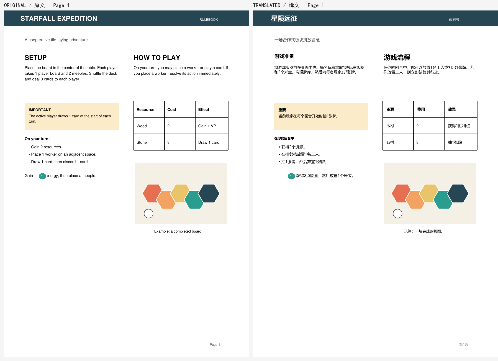

# 桌游规则书汉化 · Board Game Rulebook ZH

把英文桌游 PDF 规则书汉化成中文，**插图、棋盘、卡牌图、图标、表格线和原版版式保持原位**。

这是一个 Agent Skill（`SKILL.md`），也可以直接当命令行工具用：

- 内置桌游术语表（worker placement / deck-building / meeple / token / exhaust …）；
- 只擦文字层，不擦位图/矢量图；
- 表格单元、双栏、页眉页脚、内嵌图标单独处理；
- 渲染后自动比对位图/矢量图摘要，图文错位直接报错；
- 输出 QA 报告 + 左右对照预览，供逐页目检。



> Demo 是仓库自带的合成样例（`examples/make_sample.py`），不含任何受版权保护的规则书。

[English README](README.md)

## 链接

- GitHub：https://github.com/C0S1N3/boardgame-rulebook-zh
- ClawHub：`boardgame-rulebook-zh`（页面：https://clawhub.ai/C0S1N3/skills/boardgame-rulebook-zh ；首次发布需安全扫描，若暂时 404 请稍后再试）

## 为什么不会把图弄乱

1. 对每一行文字加 redaction 时设置 `fill=False`、`images=NONE`、`graphics=NONE`：只擦字，保留所有图片和线条。
2. 译文写回原段落 bbox；空间不足时只向下借用空白，不进入其他文字、图片或表格单元。
3. 表格单元译文被夹在 cell 内；内嵌图标用绕图排版。
4. 渲染后重新打开输出 PDF，比对：
   - 位图数量、内容摘要、位置；
   - 矢量图数量/摘要；
   - 页面尺寸、旋转、页数；
   - 译文是否完整、有没有压到图/文字/表格线。

任何一项失败，`report.md` 会报 error，不应交付。

## 安装

```bash
python -m pip install -r requirements.txt
```

- Python 3.9+
- PyMuPDF（测试 1.26.5）
- Pillow

中文字体会自动选择：Microsoft YaHei / SimHei / SimSun（Windows）、PingFang / STHeiti（macOS）、Noto Sans CJK / WQY（Linux）；都没有时用 PyMuPDF 内置 CJK 字体。

## 快速开始

```bash
python scripts/extract.py rulebook.pdf -o work
# 读 work/source.md，填写 work/translations.tsv
# 检查/补充 work/termbase.tsv
python scripts/render.py rulebook.pdf -w work -o out
# 看 out/qa/report.md 和 out/qa/pages/page_*.png
```

最终文件：

- `out/rulebook_zh.pdf` — 原位汉化 PDF
- `out/qa/report.md` — 中文 QA 报告
- `work/termbase.tsv` — 项目术语库
- `out/qa/pages/*.png` — 左右对照预览

只有 QA **error = 0** 才应交付；warning 需要逐条复核。

## 作为 Skill 使用

把整个目录放到 Agent 的 skills 目录即可，例如 Qoder：

```text
~/.qoder-cn/skills/boardgame-rulebook-zh/SKILL.md
```

或按 ClawHub/OpenClaw 的 skill 目录规范安装。  
Agent 读到“汉化桌游规则书 / translate board game rulebook PDF / 术语要准确 / 图片不能错位”等请求时，应使用本 skill。

## 术语

- `references/glossary.csv`：推荐译法 + avoid + wrong，供脚本查表和 QA。
- `references/glossary-notes.md`：易混词解释（deck/deck-building、token/marker/counter、meeple/pawn、exhaust/tap、reveal/flip…）。
- `references/style.md`：中文文风、句式、量词、标点、卡牌名规则。
- `references/official-titles.md`：常见游戏官方/通行中文名；不参与自动替换。

项目里用 `work/termbase.tsv` 定死译名；官方中文版优先。QA 对术语表里明确的错译（如 meeple → 米普）报 error，对建议译法报 info。

## 排版修正

自动放不下时：

1. 先精简译文；
2. 再用 `work/layout_overrides.json` 改安全排版框；
3. 最后才接受更小字号。

```json
{
  "p003_s008": {
    "box": [28, 423, 292, 540],
    "font_size": 10.0,
    "align": "left",
    "note": "加宽 10pt，避免逗号落到行首"
  }
}
```

表格单元的 override 会被夹回 cell；不会越过边框。

## 自测

```bash
python examples/selftest.py --negative
```

- 正向：合成双栏规则书（表格、位图、矢量图标、内嵌图标）→ 34 段、9 个表格单元、2 个内嵌图标，0 error / 0 warning；位图、矢量图、页面几何全部不变。
- 负向：故意写错术语（米普）、漏译、表格溢出、emoji 缺字；QA 以退出码 1 拦截。

已本地验证一页真实出版社规则书（*Age of Conan*，FFG，42 段，双栏、羊皮纸满版底图、大幅人物插画、项目符号列表）：0 error / 0 warning（用一次 layout override 修正行首标点），位图/矢量图摘要不变。原 PDF 受版权保护，不随仓库分发。

## 不支持

- 扫描版/纯图片 PDF、矢量描边文字：不会做覆盖式汉化，见 `references/scanned-pdfs.md`。
- 逐行竖排文字：保留原文并警告。
- 复杂表单、批注、嵌套表格：需要目检。
- 重排页面/改纸张尺寸：本工具只做原位汉化，不重新设计版式。

## 目录

```text
SKILL.md
scripts/
  extract.py
  render.py
  pdf_common.py
references/
  glossary.csv
  glossary-notes.md
  style.md
  layout-and-qa.md
  qa-checklist.md
  scanned-pdfs.md
  official-titles.md
examples/
  make_sample.py
  selftest.py
  demo_page1.png
```

## 许可

MIT。仅用于你有权翻译的文档；不要把受版权保护的原始规则书或整页译文提交到公开仓库。
