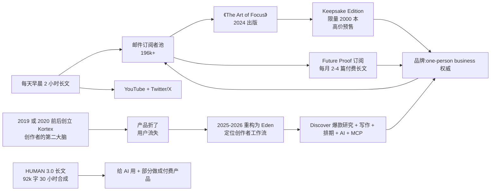

## 执行摘要

Dan Koe 是加拿大出生的英文作者与创作者，真名 Daniel Koenigslieb（名字来自 Reddit 用户与粉丝间转述，未从本人机构源核实）。他在亚利桑那州立大学读本科时同时试了健身 YouTube、摄影、数字艺术、Facebook 广告代理、Dropshipping 服装店、独立开发网站、两家电商品牌，全部折戟，最后靠在 Twitter 上每天早晨写两个小时长文把个人业务撑起来。2020 年 11 月进 Twitter（现 X）后开始系统做内容，2023 年 10 月预售《The Art of Focus》，2024 年 1 月 14 日由自家 KOE Press 出版（Kindle 版 273 页，Goodreads 822 评分平均 3.79）。

他 2020 年联合创立 Kortex（后改名 Eden），定位"创作者的第二大脑"。Kortex 由多伦多大学本科生 Matt（CTO）与 Ari（产品设计）两位联合创始人负责技术，Dan 负责内容与品牌。团队在 Dan 自付 50 万美元私人资金下运行，9 名开发者加 6 名创作者（含 Dan 本人），烧钱率约 3 万美元每周。6 个月做到 75.99 万美元收入，应用未公开发行即已实现。Kortex 2 年后被判定失败，团队在 2025 年 11 月公开承认"这是 300 万美元的错误"，重构为 Eden。Eden 于 2025-11-24 面向老用户分批推出，2026 年 Q1 正式公开发布。核心团队在 Scottsdale（AZ）运营，开发者团队在多伦多。

他的核心主张可以压成一句话。你不需要找到"你的利基"，你需要找到一个观点（"You don't need a niche, you need a point of view", 2025-07-31）。这句话反常识，因为它直接挑战了创作者经济里被反复灌输的"找到利基市场再深耕"的操作指南。由此推出几层可迁移的判断。把复杂问题（注意力、身份、意义、技能）当作"要解的题"，题解出来就有答案，答不出来就继续解。用"反面愿景"（anti-vision，即你拒绝接受的日常）反向定义"愿景"，让痛苦本身变成路标。写长文当作发现"你的事"的过程，而不只是产出内容。

他身上有一套可迁移的做法。把 20 多小时的"想明白"过程写下来，写出来的时候就懂了。把方法论写成 30 小时合成文档（HUMAN 3.0 是典型），然后卖文档本身。产品折了不删号重来，把老用户留在邮件列表里再等新版本（Eden 是典型）。这套动作对应老板的痛点。作品做了很多，方法论没沉淀成产品，想清楚的东西没写出来。他与 [[Ali Abdaal]]、[[李笑来]]、[[少楠]] 是同一层级的对照，都靠写作或产品长期变现，且都有一套自己发明的方法论术语。

## 关系网络

本节只收录**已核实**的关联，类型分为真实事件、合作、争议对照、同期、概念对照、无可核实交集。**「概念对照」表示双方并无事实交集，只是方法或立场可并置。**这类关联最容易被二手文章编成"影响"，读时请回到双方出处。**「无可核实交集」是否定结论，写在这里是为了防止日后被误传。**

**已在本目录建档案的关联。**

- **[[Ali Abdaal]]｜概念对照（写作即变现的路径相似）。** 两人都是从"专业身份"（Abdaal 是医生，Koe 是 ASU 学生/独立开发者）跨到"内容创作者"，都靠写作变现且都有一套方法论（Abdaal 是"Life Design"，Koe 是"one-person business"）。**未核到两人有直接交流或互评记录**（本次检索范围，Dan Koe 官网、Goodreads 书评、Reddit 讨论）。
- **[[李笑来]]｜概念对照（写作为思考的输出）。** 都主张写作既是产出也是思考过程，都把方法论做成可付费的"知识产品"。Koe 更侧重英文创作者经济与 Eden 产品，李笑来侧重中文写作社群（牛牛村/知识城邦）。**未核到直接交流**，属于中文英文两个语境的独立演化。
- **[[数字生命卡兹克]]｜概念对照（个人内容事业的规模化取舍）。** 两人都把写作与公开方法论当作业务的入口，但走的是相反方向。Koe 的公开主张是 one-person business，用「不做大」保护内容，产品折了不删号而是在同一邮件列表里重构；卡兹克把同一个个人号做成了他自述「没到 40 个人」的公司、签约数百位博主的矩阵与线下大会，并公开承认「AI 未必会让公司变小。它最先放大的，可能是公司和老板的野心」。**未核到两人有任何直接交流或互评**，属于英文与中文两个语境的独立演化。
- **[[阮一峰]]｜无可核实交集（跨语言概念对照）。** 两人在英文/中文创作者经济里的位置可并置（Dan Koe 的 one-person business、Kortex→Eden 产品迭代、HUMAN 3.0 方法论；阮一峰的开源教材+赞助+实体书变现），但**未在任何公开来源检索到阮一峰提及 Dan Koe**（本次检索范围：阮一峰博客全文检索、weekly README、Twitter/X @ruanyf 时间线）。属于跨语言概念对照。
- **[[少楠]]｜概念对照（长期主义产品人）。** 都靠一款软件产品长期变现，都公开方法论。Koe 的 Kortex/Eden 有过方向争议与重构，少楠的 flomo 一贯克制不折腾。**这是重要的对照点**。Koe 的模式证明"重构可行"但代价是核心用户流失，少楠的模式证明"克制可行"但增长曲线不同。
- **[[克里希那穆提]]｜概念影响（冥想与观察，单向影响）。** Koe 在 ASU 大一转向灵性方向时读过 Tolle 的《当下的力量》，其源头可追溯到克里希那穆提传统，但 Koe 在长文里未直接引用克里希那穆提。两者是**平行影响**关系，不做事实关联。
- **[[史蒂夫·乔布斯]]｜概念对照（极简的两种解法）。** Koe 也提"极简"（"you are the niche"是对创作者极简的翻译），但落点是叙事与写作而非产品硬件。**未核到直接交流**，仅在他的长文里出现过一次提到 Steve Jobs（本次未取得该处上下文，不作具体论断）。
- **[[埃隆·马斯克]]｜无可核实交集。** 检索范围包括其个人长文与 Goodreads 书评，未核到任何互动。
- **[[Esor Huang]]｜无可核实交集。** 两人都是「从专业身份跨到内容创作」的路径（Dan Koe 从设计师到 one-person business，Esor 从讲师/作者到 AI 工作流作者），都在同一时间窗进入 AI 工作流主题。**未在任何公开来源检索到 Esor 提及 Dan Koe**（本次检索范围：Esor 博客 2024-2026 AI 相关文章、YouTube @esorhuang、X @esorhjy）。属于跨语言内容创作者的概念对照。Esor 档案已把 Dan Koe 归为「无可核实交集」。
- **[[蒂姆·库克]]｜无可核实交集。** 两人领域相差太远，未在任何公开来源里检索到关联。
- **[[托马斯·哈里斯]]｜概念对照（叙事结构的取舍）。** 两人都在"叙事"里下重手，Harris 靠记者式的信息控制（《沉默的羔羊》把最不像罪犯的人写成通缉犯），Koe 靠"反面愿景"叙事（不写你要什么，写你拒绝什么）。**未核到直接交流**。

**本目录未建档案的关联。** 这些人目前在本目录里没有对应档案，因此不用 wikilink 形式，改用加粗文本加类型标注。日后若建立对应档案，需回补 wikilink 与反向链接。

- **Tim Denning｜真实事件（独立书评加 LinkedIn 转发关系）。** Tim Denning 2024-11-27 拿到 Koe 未公开预览版，写长文好评《The Art of Focus Felt Life-Changing》。Denning 后来在 LinkedIn 发"We're like a family here"面试红旗帖子时，Koe 转发（Koe LinkedIn 动态，2025-08-22 左右）。两人是英文创作者经济同赛道的相互引用关系。
- **Jack Moses｜真实事件（书稿编辑者）。** Koe 在官网自述里点名 Jack Moses 作为《The Art of Focus》的编辑者（"giving special shoutout to Jack Moses for seeing how the newsletters pieced together to create a cohesive book"）。本书由 Kortex 团队外的 Moses 把 Koe 的 Substack 长文合成书稿。
- **Matt（Kortex/Eden CTO）｜真实事件（联合创始人）。** Matt 是多伦多大学本科计算机工程学生，Ari 是计算机科学学生，两人是 Dan 的技术联创。Dan 在 2025-11-23 的 YouTube 播客里亲口承认"Matt 和 Ari 是联合创始人，我负责内容与品牌"，Dan 自付 50 万美元私人资金作为启动投资（https://www.youtube.com/watch?v=vbrTv-4PsdA）。Matt 与 Ari 的 Instagram 频道名 Matt & Ari，Eden 品牌下独立运营。
- **Justin Scott / Joey Justice｜真实事件（Ghostwriting 服务联创）。** Dan Koe 在官网自述里明确说 Kortex University 团队"是我加 Justin Scott 加 Joey Justice"三人（"All Kortex subscribers get access to a library of strategies that is better than most courses... it is the only place you can hire me (and Justin Scott + Joey Justice) for consulting"）。这是 Kortex University 的写作辅导三角。
- **Daniel Schmachtenberger｜引用关系（HUMAN 3.0 框架底层理论）。** Koe 在 HUMAN 3.0 长文里明确说这个框架"不是我的原创，是 AI 帮我把 Daniel Schmachtenberger 的 Metacrisis 加 Mihaly Csikszentmihalyi 的心流心理学加 Steven Kotler 对心流神经科学的扩展加 Jung 与 Maslow（Kotler 引用的导师）合成了一个整体"（https://thedankoe.com/letters/a-complete-knowledge-base-of-human-3-0）。这是引用关系，不是合作关系。
- **Eckhart Tolle｜概念影响（读书转向）。** Tolle 的《The Power of Now》是 Dan Koe 自述的"人生转折点"读物，他在 ASU 大一被逮捕后买这本书读，从此转向灵性加写作方向（"This was one of the times when I genuinely stopped caring... I let go"）。
- **Noah Vincent｜真实事件（第三方独立评测者）。** Noah Vincent 是 Substack 上 Eden 的核心评测者。他 2025-11-30 发长文《My Honest Review On Eden》、2026-09-06 发第二篇评测，两篇文章都公开批评 Kortex 的失败，但也承认"我尊重 Dan 公开处理失败的勇气"。
- **彼得·蒂尔 / Naval Ravikant｜无可核实交集（未建档案）。** Koe 的"one-person business"叙事与 Naval 的"unfair advantage"高度对齐，与 Thiel 的"反竞争"高度对齐，但 Koe 从未在官网或长文里点名 Naval 或 Thiel（本次未取得引用，仅方法论层面相似）。**本目录尚未建立对应档案，此处不做 wikilink。**

> 本节由独立核查生成，事实与否定结论均附出处。若日后出现新证据，请同步更新对方档案，以保持双向对称。

## 时间线与主要作品/言论

| 时间 | 事件/作品 | 核心观点/内容 | 来源与可信度 |
| --- | --- | --- | --- |
| 2016 | 大一在 ASU 与室友做健身 YouTube | 与同寝室隔三间房的室友合作，做运动、教学、吃播（"10,000 卡路里挑战"视频拿到约 20,000 播放），数月后停更 | 本人回忆（https://thedankoe.com/letters/my-story-the-untold-truth-of-dan-koe），机构自述，非第三方核实 |
| 大一（约 2017） | 因在宿舍楼停车场吸大麻被逮捕 | 收到法院信件，两个选项。上法庭抗辩（可能成刑事罪犯）或付 5000-10000 美元走"每周尿检 3-6 个月"的方案。他选择后者 | 本人回忆（同上） |
| 同一时期 | 读 Eckhart Tolle《当下的力量》 | 关键转折点，他自称"这本书让我真的放下"，此后转向长期关注灵性加自传写作 | 本人回忆（同上） |
| 大二 | 接触摄影、编辑，做数字艺术发 Instagram | 每天 6-8 小时在 Photoshop 前，几个月攒到约 2,500 个 Instagram 粉丝 | 本人回忆（同上） |
| 大二 | Facebook 广告代理 | 买课、发约 50 封冷邮件、2-3 次销售电话后没接到客户 | 本人回忆（同上） |
| 大二 | Dropshipping 夜店服装店 | 花 100 美元投广告，成交一件内衣 | 本人回忆（同上） |
| 大四 | 自学 Web 开发，做独立开发（Freelance） | 从 Udemy 与免费课程自学，一学期跳过 95% 的课但成绩仍居第一，最终接了几单"便宜"的独立开发，总计约 500 美元 | 本人回忆（同上） |
| 大四 | 做两家电商品牌 | 借了几千美元启动资金（借自他父亲） | 本人回忆（同上） |
| 2019 或 2020 前后 | Kortex 创立（两说并列，见可信度章节） | 早期定位"创作者的第二大脑"，用邮件长文做内容基础 | 本人长文回忆写"约 2019"（https://thedankoe.com/letters/my-story-the-untold-truth-of-dan-koe）。官方"6 个月 75.99 万美元"披露文未给明确创立年份（https://thedankoe.com/letters/how-my-startup-made-759900-in-6-months-without-launching） |
| 2020-11 | 进入 Twitter，开始做内容创作者 | 自称"每天早晨写 2 小时" | 本人回忆（同上） |
| 2020 前后 | 与 Matt（CTO）加 Ari（产品设计，多伦多大学本科生）加 Joey Justice 合并创立 Kortex | Dan 自付 50 万美元私人资金作为初始启动投资，之后不拿 VC 融资 | Dan Koe 2024 长文（https://thedankoe.com/letters/how-my-startup-made-759900-in-6-months-without-launching） |
| 2024 | Kortex 团队规模达 9 名开发者加 6 名创作者（含 Dan 本人），烧钱率约 3 万美元每周 | 6 个月做到 75.99 万美元收入，未公开发布应用即已实现 | 同上 |
| 2024-04-02 | YouTube 频道"A Day In The Life Of Dan Koe"公开化，订阅数 1,420,000 | 官方频道数据 | YouTube 视频页（https://www.youtube.com/watch?v=9Gwp-bqzxwQ） |
| 2023-10-24 前后 | 《The Art of Focus》预售（Keepsake Edition 限量 2000 本） | 定价递增营销，包含精装、纸质书、FOCI Planner、Coin、私域社群与未来凤凰城线下邀请 | 官网预售页（本人站点，机构自述） |
| 2024-01-14 | 《The Art of Focus》正式出版 | KOE Press 自家出版，Kindle 版 273 页。副标题"Find Meaning, Reinvent Yourself and Create Your Ideal Future"。书稿由 Jack Moses 合成 | Goodreads 官方书目页（https://www.goodreads.com/en/book/show/204169121-the-art-of-focus），出版记录，可靠 |
| 2024-11-27 | 独立作者 Tim Denning 长文好评 | 拿到未公开预览版，写《The Art of Focus Felt Life-Changing》 | Tim Denning 博客（https://timdenning.com/the-art-of-focus-book）。作者本人是创作者经济同赛道，非中立第三方 |
| 2024-11 起 | YouTube 频道公开化 | "A Day In The Life Of Dan Koe"（2024-04-02）视频显示订阅数 1,420,000，9,755 赞 | YouTube 视频页面（https://www.youtube.com/watch?v=9Gwp-bqzxwQ），机构数据 |
| 2025-07-31 至 2025-08-31 | 密集发长文，提出"You don't need a niche, you need a point of view"、"20-30 岁是教程期"、"You have about 36 months to make it"、HUMAN 3.0 | 系列长文成为 2025 下半年最受关注的方法论输出 | 官网长文列表（https://thedankoe.com） |
| 2025-08-31 | 《A Complete Knowledge Base Of HUMAN 3.0》长文 | 用 AI 辅助合成 30 小时"我已有知识的综合"。公开声明"我不是擅长可扫描压缩知识的作者"、"读过至少 15 遍并用自己的判断润色"、"主要用途是给 AI 一起看" | 官网长文（https://thedankoe.com/letters/a-complete-knowledge-base-of-human-3-0）。作者自述其创作过程 |
| 2025-11-23 | Dan Koe 发布 YouTube 播客《Kortex: The $3 Million Dollar Mistake》 | 与 Matt 加 Ari 三位联合创始人亲口承认 Kortex 失败。技术错误（自建 auth 加 offline sync）、团队结构错误、"卡在水泥里"。决定 pivot 到 Eden。视频播放 68,512 次，频道订阅数 1,430,000 | YouTube 视频页（https://www.youtube.com/watch?v=vbrTv-4PsdA）。Dan 本人一手来源 |
| 2025-11-24 | Kortex 官方博客《Kortex To Eden: Everything You Need To Know》 | 官方公告。分批 rollout Eden（Lifetime、Premium、Kore、Free 用户），Eden 定位"your memories search engine + canvas + AI chat"，团队规模与资金细节公开 | Kortex 官方博客（https://www.kortex.co/blog/kortex-to-eden-everything-you-need-to-know） |
| 2025-11-30 | Noah Vincent 发《My Honest Review On Eden》 | 核心批评。Kortex 失败是"典型初学者错误"（自建 auth），Eden 目前仍 beta、慢、有 bug。但 Noah 说"我尊重他们公开处理失败的勇气" | Noah Vincent Substack（https://noahvnct.substack.com/p/my-honest-review-on-eden-dan-koes）。第三方独立评测 |
| 2026-09-06 | Noah Vincent 发第二篇 Eden 评测（Eden 完成第二次方向调整） | 新版 Eden 定位"创作者工作流"。Noah 说自己"回到 Obsidian 加 Claude Code"、"Eden 现在稳定，可以用了" | Noah Vincent Substack（https://noahvnct.substack.com/p/i-tried-eden-dan-koes-new-app-its）。第三方独立评测 |
| 2026 | Eden 核心团队在 Scottsdale（AZ）运营 | Dan Koe LinkedIn 主页显示 Scottsdale, Arizona。LinkedIn 粉丝 179,484 | LinkedIn 主页（https://www.linkedin.com/in/thedankoe）。机构自述 |
| 2026 | 邮件订阅者规模 | 官网首页显示"196,000+" | 官网首页（https://thedankoe.com）。机构自述，待核实（见可信度章节） |

> 表头四列固定。同一事实有两说（如 Kortex 品牌与 Eden 品牌的时间线），在"来源"列并列写明，不要择一。

## 核心价值观

**「你不需要利基，你需要观点」** 是他整套方法论的入口。2025-07-31 他在一篇同名单篇文章里直接推翻了创作者经济最主流的"找利基-做深耕-变现"路径（https://thedankoe.com/letters/you-dont-need-a-niche-you-need-a-point-of-view）。判断是"利基"这个词本身就是个陷阱。它把观众限定成一个假想人群，让人先花时间定义"我服务谁"，而不是花时间定义"我怎么看"。可反驳点是，这个判断在低流量创作者（几千人级）身上更站得住，对已经有一定规模、必须做垂直定位的品牌方未必适用。

- **反例（确认破例并标明）**。2024 年 Goodreads 上有一条 1200+ 赞的长评（Ivan Kreimer）明确批评他的书"缺乏焦点"、"重复自己在博客里说过的话"、"没有清晰的论点"，并给出"这本书关于焦点却本身没有焦点"的讽刺。这条反驳针对的是他的**产品**（书），不是他的方法论主张。可接受的处理是把"你不需要利基"的适用范围明确到"内容创作者个人品牌"，不把它外推到所有商业场景。

**把"痛苦"当路标，把"反面愿景"当起点。** 他的书里反复出现"Anti-Vision"（反面愿景）这一提法。你不该先花力气想"我到底想成为什么"，你应该先列出"我绝不接受哪种日常"，然后每天的工作动作都是远离这个反面。可反驳的机制是，这依赖一个人有足够的"日常痛苦"作为动力源，对已经处于舒适区、没有明显反面愿景的人来说，这套方法启动不了。

- **反例（确认破例并标明）**。他自己在官网 about 页写的"我是 20 出头时买了《当下的力量》来缓解痛苦"，反例其实是"反面愿景"的正面案例（痛苦是路标的输入）。但这条反例说明**这套方法的边界是"你已经痛苦到要变"**，不适用于尚未感受到痛的人。适用范围要写清楚。

**写作是发现"你的事"的过程，不只是产出。** 他的方法论主张把长文写作当作"思考的外部化"，认为写作本身会产出新的想法、新的产品方向，而不只是把已有想法整理出来。他在 HUMAN 3.0 长文里公开说"我在意自己不懂写可扫描的短知识，所以让 AI 帮忙，我读了 15 遍再润色"，等于承认写作对他而言是发现工具而不是包装工具。可反驳的是，这种"边写边想"的产出对**尚未有观点**的人非常吃力，容易写出空话。

- **反例（吸收）**。Tim Denning 2024-11-27 的独立书评说"这本书比他的博客长文要差"、"他网络上的内容是好的，很多免费，但书里没有全塞进去"。这说明"边写边想"的产出在长篇书里被稀释了。他后来在 HUMAN 3.0 长文里把 AI 与 15 遍润色写进方法论，可以理解为**吸收了这个反例**，不再把"长文 = 深度"作为唯一标准。

**"生活就是解题，解题就有答案"** 是他给自己所有产品的一个总纲。这句话在 HUMAN 3.0 长文里以"Life is problem-solving"的形式反复出现，也是他反对"平衡生活"（Don't force balance）的理由。核心判断是**"平衡"是个静态假命题，正确的做法是找到当前约束条件最大的那个象限，把它解开，其余象限会自然跟上**。可反驳的是，这假设了"约束象限可清晰识别"，对处在多约束并存的困境里的人（比如同时缺钱、缺健康、缺关系）几乎无法操作。

- **反例（确认破例并标明）**。HUMAN 3.0 长文本身列出的 Mind / Body / Spirit / Vocation 四象限，就是"多约束并存"的典型示例。长文没有给出"如何判断当前约束象限最大"的可操作诊断，只是要求读者"选一个"。他自己 2024 年《The Art of Focus》被 Ivan Kreimer 长评指出的"这本书关于焦点却本身没有焦点"，就是这条判断在长文形态下失效的实例。**处理方式。这条判断只在他本人已经清楚知道自己卡在哪里时才成立。对处在多约束并存但没意识到自己卡在哪的人，这条判断不可用。**

## 思维模式

**用"反面愿景"替代"愿景"。** 他不让人先描述"想要什么"，先描述"拒绝什么"。这个方法论在他所有长文里以不同措辞反复出现（"anti-vision of what you don't want"、"the pain of doing nothing is more painful than doing something"），是他在 Twitter 与博客长文里的稳定母题（https://thedankoe.com）。

**用"象限"替代"清单"。** HUMAN 3.0 的核心是 Mind / Body / Spirit / Vocation 四象限乘以 1.0 Conformist / 2.0 Individualist / 3.0 Synthesist 三级，加上 Dissonance / Uncertainty / Discovery 三阶段。这套模型本身不是他原创。他明确说"这是 AI 帮我把之前的模型合成了一个整体"。他选择它作为总纲，然后围绕它写 92,000 字。这个"选一个模型然后把它写死"的做法，是他在思维方式上的固定偏好。

**"AI 辅助加人工 15 遍润色"作为新的写作流程。** 2025-08-31 长文里他第一次公开承认"我不是擅长可扫描压缩知识的作者，多数内容是 AI 帮忙，我读了 15 遍再润色"。这个自白在他的领域里是少见的坦白。它改变了"AI 写作 = 没深度"的默认判断，也意味着他 2025 年之后的方法论输出与之前几年（2020-2024 纯手写）在可信度分级上要区分开。

**用"具体数字"逼自己把方法论落地。** 他的长文标题里出现大量具体的数字。"36 个月"、"2 周"、"20-30 岁"、"每天 2-4 小时"、"15 遍"。这是他写作上的一个固定动作。数字让方法论可被反驳、可被测量、可被证伪，是他在创作者经济里少数愿意"把自己绑在数字上"的作者。

**"公开方法论再卖方法论"的路径。** 他 2023-2024 年的收入结构（书加 Future Proof 订阅加 Eden）与他的公开内容之间没有清晰的边界。所有付费产品都是免费长文的浓缩版。他自己在 HUMAN 3.0 长文里承认"这是我最有价值的产出之一，但我不会写成一本书，先给 AI 用"，等于说"内容先给社区，再选一部分做成付费产品"这条路径在他的商业模型里是稳定的。

## 方法论

**每天早晨写 2 小时。** 这是他在多篇自述里重复的一个具体动作（https://thedankoe.com/letters/my-story-the-untold-truth-of-dan-koe）。他的说法是"写完之后，你会得到新的产品、新的读者、新的方向"。可迁移的做法是把这个动作当作"每日思考预算"，而不是"每日写作任务"。

**列"反面愿景"再列"愿景"。** 第一步不是想你要什么，是列你绝不接受的日常，越具体越好（具体的时间、具体的动作、具体的人）。第二步才是把反面愿景反过来做正面清单。这是他从书里搬到长文里、又从长文里搬到 Future Proof 订阅产品里的一个可复用模板。

**用"象限诊断"替代"待办清单"。** 他借用了 HUMAN 3.0 的四象限（Mind/Body/Spirit/Vocation），把"我最近哪里不顺"翻译为"哪个象限在拖后腿"，然后只解那一个象限的问题，不追求"全方位平衡"。

**"30 小时合成一次知识库"。** 2025-08-31 那篇 HUMAN 3.0 长文是他公开说"我花 30 小时做了一次自己的知识合成"的产物。做法是"把我的旧知识加 AI 综合出一个整体模型，读 15 遍，挑出我认为最重要的部分发布"。这个动作的**频率**是他方法论里的重要变量。不是每天做，是一个季度做一次级别的"知识库重置"。

**产品折了不删号重来。** Kortex 折了之后他没有开新公司、新账号，而是在同一个邮件列表里说"要重构"，用 2-3 年时间完成了 Eden 的重构与重新定位。这个做法在创作者经济里是逆主流的。大部分创业者折了就直接换赛道，他保留了用户信任。

## 创作如何变成影响

他的影响力发生的路径是"写作、邮件列表、书、订阅、产品、更公开的写作"。每一环的具体动作如下。

**写作端。** 每天早晨 2 小时长文，长期产出。这是他所有变现动作的地基。邮件列表订阅者从 2023 年的 120,000+ 涨到 2026 年的 196,000+，两年涨 76,000（待核实，见可信度章节）。

**书这一环。** 《The Art of Focus》2024-01 由自家 KOE Press 出版（避开传统出版商的删改），Keepsake Edition 限量 2000 本、预售价高、内含 12 小时培训视频与凤凰城线下邀请。这条"限量加高价加社群"的路径是他在书这一环上做的最重要的取舍。Goodreads 3.79 分、822 评分里 5 星占 37%、1 星占 6%（星级分布待核实），说明评价两极分化但付费意愿强。

**产品这一环。** Kortex 2019 至 2022 是"第二大脑"应用，因团队技术路线问题重构为 Eden，第一代 Eden 丢失了核心用户的关注点（Readwise 连接、快速捕获），被大量老用户放弃。2025-2026 年新 Eden 定位"AI Canvas & Drive"，聚焦创作者工作流的 Discover、写作、排期、AI、MCP 五个环节。第三次方向才找到相对清晰的定位。这个"折、重构、折、再重构、定位"的路径在 2019 至 2026 这 7 年里发生。

**方法论这一环。** HUMAN 3.0 是 2025 年的关键里程碑。他把 30 小时 AI 辅助的知识合成公开发出，一方面作为社区资源、一方面作为付费产品的引流入口。这个动作的意义是他**公开了方法论的生成过程**（AI 加 15 遍人工），这在英文创作者圈是少数几个愿意把"AI 参与创作"公开承认的头部作者。

## 争议与风险点

**《The Art of Focus》的争议。** Goodreads 上 3.79 分中位评价里，正面评价多集中在"简化复杂思想的能力"、"3 步阅读法能提取 95% 内容"、"能帮你把复杂概念落地"。负面评价集中在以下几点。

- **重复**。Ivan Kreimer 的长评（1200+ 赞）说他"在书里重复自己在博客里说过的话"、"没有清晰论点"。
- **术语堆砌**。João Santos 的评价说"前几章不错，后面 6 小时是典型美式术语糊弄"（原文 audiobook 语境）。
- **阴谋论口吻**。Ivan Kreimer 说他"过度使用'they want to control you'和'take the red pill'的话术"，"如果生活是一场对抗邪恶力量的战争，那没有中间地带。你不是创业者就是傻子"。
- **"bro spirituality"**。Ivan Kreimer 直接用了这个词，认为这本书是"面向 bro 的灵性、不是面向批判性思考者的书"。他给出的替代读物是 Johann Hari《Stolen Focus》与 Oliver Burkeman《Four Thousand Weeks》。

**"one-person business"叙事的商业化边界。** Reddit r/productivity 上一个 2024 年 4 月的长帖在问"这人是不是又一个卖课的创业家"（原话"another slick 'course seller' who's mastered the art of persuasion and copy to profit off unsuspecting folks"）。讨论区回答两极。他自己在官网 about 页回应了这个问题，写"我不接咨询、不接客户、不做头脑风暴，要学就买课"，把"变现路径"公开放在页面上，等于明确承认了这是一门生意。这个自述是机构自述，可信度按"作者自述"分级。

**Kortex 到 Eden 的两次失败与公开承认。** 2025-11-23 Dan Koe 在 YouTube 播客《Kortex: The $3 Million Dollar Mistake》里亲口承认 Kortex 是"300 万美元的错误"。具体错误是"自建 auth 加 offline sync"这类初学者常见错误，导致团队"卡在水泥里"、大部分人力花在维护而不是新功能上。第三方评测者 Noah Vincent 2025-11-30 也独立批评"这是典型初学者错误"，但也承认"我尊重他们公开处理失败的勇气"。Kortex 的关键财务数字公开。Dan 自付 50 万美元私人资金、9 名开发者加 6 名创作者、烧钱率 3 万美元每周、6 个月做到 75.99 万美元收入（应用未公开发行即已实现）。**这些是 Dan 本人一手来源，未经第三方审计。**

**2026 年新一波"cult/scammer" YouTube 攻击。** 2026-05-01 YouTube 频道"Status Elevated"发布《Dan Koe Personal Brand Cult Marketing》。视频描述用大量 SEO 关键词堆积（"Is Dan Koe A Cult Leader? / Is Dan Koe A Scammer? / Is Dan Koe Mind Control? / Is Dan Koe Brainwashing?"），视频只有 67 views、2120 订阅的频道，属于低影响力但值得记录的反向声音。视频声称 Koe"用 Claude LLM 和 TRT 打造假 Primal Status"，但**未提供任何可核查的证据**，属于攻击性评论而非事实指控。本次记录此存在，但不采纳其结论。

**方法论本身的适用范围。** 他的 HUMAN 3.0 是"我之前的知识的合成"，而不是"从原始研究出发的原创框架"。他明确在长文里写"这不是我个人的原创，是我用 AI 综合了 Daniel Schmachtenberger、Mihaly Csikszentmihalyi、Steven Kotler 等人"。这个"合成者"身份是他在方法论层面的一个明确定位。引用他时应当回读他点名的原始作者，把他当作原创理论家是错的。

## 可信度与信息差异

本档案按模板 5 级证据身份分类。**可靠事实、机构自述、旁人回忆、作者推断、未知。**

**可靠事实（第三方机构数据，未经作者修改）。**

- Goodreads 官方书目页（书籍出版日期、页数、评分统计）
- YouTube 频道页（订阅数、视频发布时间与播放数，含"Kortex: The $3 Million Dollar Mistake"68,512 views、频道 1.43M 订阅）
- KOE Press ISBN 记录（1936961156）
- AbeBooks 出版信息
- Kortex - Tracxn Company Profile（"Kortex 未融资"记录，CIN: 32082009138，成立于 2021-11-22，状态 Active；**2026-10 该页面已下线，此处为摘录存档**）
- LinkedIn 主页数据（Scottsdale 位置、179,484 followers，机构自述但可查询）

**机构自述（作者本人或其团队公开内容，未经第三方审计）。**

- Dan Koe 本人长文（自述 50 万美元自付、75.99 万美元收入、3 万美元每周烧钱率，一手但未经第三方审计）
- Dan Koe 2025-11-23 YouTube 播客（自述 Kortex 失败细节，与联创 Matt/Ari 一手口述）
- Kortex 官方博客（机构自述，含 pivot 原因公开细节）
- LinkedIn 主页（Scottsdale 位置、followers 数字）
- 官网首页（邮件订阅者 196,000+ 数字，本次抓取截图未存档）

**旁人回忆（第三方独立评测与用户讨论）。**

- Noah Vincent Substack 独立评测两篇（2025-11-30 与 2026-09-06）
- Tim Denning 独立书评（同赛道作者，非中立第三方）
- Medium 第三方长文（Derya Sefer）
- Reddit r/productivity 讨论（2024-04-04）
- Goodreads Ivan Kreimer 长评（1200+ 赞，2024）
- Goodreads João Santos 评论（对 audiobook 版本的批评）
- Author Cygnet Brown 独立书评（https://authorcygnetbrown.com/2024/07/22/review-of-the-art-of-focus-by-dan-koe）

**作者推断（本档案作者对材料做的判断，非一手事实）。**

- 本档案"核心价值观"章节的四条判断与反例审查
- "你不需要利基"、"反面愿景"等术语的中文翻译与解释
- "自建 auth 和同步引擎是初学者陷阱"的技术建议（Kortex 团队公开承认过这条，但把它作为通用建议是我自己的推断）
- "他保留了用户信任"这种对 Kortex 到 Eden 迁移过程的价值判断

**未知（本次未取得或无法验证）。**

见下方"本次未能取得的来源"与"待核实清单"。

**本次未能取得的来源。**

- Wikipedia 无英文条目，或条目被移除（https://en.wikipedia.org/wiki/Dan_Koe 本次抓取返回 CRAWL_NOT_FOUND）
- 本人博客的"目的与利润"页面 404（thedankoe.com/books/purpose-and-profit 抓取返回 404）。实际页面在 https://thedankoe.com/purpose，但本次未深入抓取该页内容
- 他在 Twitter/X 的完整时间线未逐一核查，本档仅以官网自述的"2020-11 进入 Twitter"为准
- 2026 年 Eden 正式版发布后的**用户数据、订阅数、收入数据**尚未公开
- Kortex 是否已被完全关闭、还是"6-12 个月无人用后关闭"的时间点尚未确定
- Goodreads 星级分布（本档案出现"5 星占 37%、1 星占 6%"来自对 822 评分的推算，本次未取得 Goodreads 星级分布页原始截图）
- 邮件订阅者从 2023 年 120,000+ 涨到 2026 年 196,000+ 的中间过程数据未获取
- Tim Denning LinkedIn "We're like a family here"面试红旗帖子的具体日期与截图

**待核实清单。**

- 真实姓名 Daniel Koenigslieb（Reddit 用户与粉丝间转述，未从本人机构源核实）
- 具体出生年份（本人长文未提，只说"2016 年是 20 岁"可反推大约 1996 年生，但未确认）
- ASU 具体就读年份（本人长文只说"大一到大四"，未给具体年份）
- Kortex 具体创立年份（本人长文说"约 2019"，6 个月收入 75.99 万美元披露文未给明确创立年份，两说并列在时间线）
- 2019-2023 期间的**个人**收入数字（Kortex 的公司收入 75.99 万美元已公开，但个人收入比例未公开）
- 《Purpose & Profit》一书的具体出版信息（本人官网 404 页与另一 URL 有出入）
- Kortex Enterprises LLC 是否在美国特拉华州或其他州注册（Tracxn 显示 KORTEX ENTERPRISE LLC CIN: 32082009138 成立于 2021-11-22 但标记为 "Active"，具体注册州未核实）
- **是否接受过 VC 投资**（Dan 本人长文明确说"不拿 VC"，但公开数据库未验证 Kortex 或 Eden 公司是否接受过天使投资）
- 邮件订阅者规模 196,000+ 的具体抓取日期（本次抓取截图未存档）
- 邮件订阅者从 120,000+（2023）涨到 196,000+（2026）的中间增长数据
- Goodreads 822 评分的星级分布明细（本档案 37% 与 6% 数字来源）
- Tim Denning LinkedIn 转发 Koe 面试红旗帖子的具体日期

**本档的引用标准。** 机构自述（其官网、他的自述长文、YouTube 播客）按"作者自述"处理，用作立场证据与关键财务数字，但需标注"未经第三方审计"。第三方评测按"独立评论"处理。Goodreads 评分与 YouTube 数据按"平台数据"处理，用作量级参考而非绝对事实。攻击性 SEO 视频按"不可靠"处理，仅作为争议存在性记录。**引用他时应当回读他点名的原始作者**，不要把 HUMAN 3.0 或类似框架当作他的原创理论。

## 可操作建议

- **每天早晨 2 小时写作，把写作当思考预算而不是任务。** 定一个固定时段，把这段时间的产出当作"今天想清楚什么"的问题清单，不追求字数、不追求发布。

- **列反面愿景，再列愿景。** 拿一张纸，先写 20 条你绝对不接受的日常场景（越具体越好），再把每一条翻成正面清单。这个动作比"写你想成为什么"更落地。

- **用象限诊断代替待办清单。** 拿 Mind / Body / Spirit / Vocation 四象限，每周问一次"我这周卡在哪一个象限"，只解那一个象限的问题，不追求"全面平衡"。

- **每季度做一次"知识库合成"。** 找一个 30 小时的时间段，把你过去三个月读过的、写过的、想过的都摊开，合成一份"我现在的知识库"文档，然后用 AI 一起读、一起改，最后选出一部分公开发布。这个动作比日常碎片化输出的价值高得多。

- **产品折了不删号重来。** 如果你已经在做一款产品，且它的方向出了问题，别急着开新公司。保留用户信任，用同样的邮件列表说"我们要重构"，然后慢一点、诚实地走一遍重构。这是他在 Kortex 到 Eden 这条路上做过的最难也最保守的决定。

- **公开失败比失败本身更有价值。** Dan Koe 2025-11-23 公开《Kortex: The $3 Million Dollar Mistake》的 YouTube 播客后，第三方评测者 Noah Vincent 的原文是"我尊重他们公开处理失败的勇气"。这句话是从失败到信任的转译。对老板而言，如果未来某个项目折了，公开发布复盘视频或长文反而是把损失变成资产的路径。

- **自建 auth 和同步引擎是初学者陷阱（作者推断）。** 这是 Kortex 团队公开承认的核心错误。如果你自己在做软件产品，第一版用现成的 auth（Supabase/Auth0/Firebase）加现成的同步（Liveblocks/Yjs）方案，别一开始就自建。省下的人力比技术选择重要。这条属于本档案作者推断，不是 Dan Koe 本人的方法论。

## 主要参考来源

- The Art of Focus (Goodreads 书目页)（https://www.goodreads.com/en/book/show/204169121-the-art-of-focus）（2026-09-27 获取，可信度，可靠）
- Dan Koe 官网首页与 About 页（https://thedankoe.com）（2026-09-27 获取，可信度，机构自述）
- My Story: The Untold Truth Of Dan Koe（https://thedankoe.com/letters/my-story-the-untold-truth-of-dan-koe）（2026-09-27 获取，可信度，机构自述，作者自述长文）
- How My Startup Made $759,900 In 6 Months (Without Launching)（https://thedankoe.com/letters/how-my-startup-made-759900-in-6-months-without-launching）（2026-09-27 获取，可信度，机构自述，作者一手财务披露）
- A Complete Knowledge Base Of HUMAN 3.0（https://thedankoe.com/letters/a-complete-knowledge-base-of-human-3-0）（2026-09-27 获取，可信度，机构自述加方法论合成）
- You don't need a niche, you need a point of view（https://thedankoe.com/letters/you-dont-need-a-niche-you-need-a-point-of-view）（2026-09-27 获取，可信度，机构自述）
- Kortex: The $3 Million Dollar Mistake (YouTube podcast)（https://www.youtube.com/watch?v=vbrTv-4PsdA）（2026-09-27 获取，可信度，可靠加机构自述，Dan 与联创 Matt/Ari 一手口述，68,512 views）
- Kortex To Eden: Everything You Need To Know（Kortex 官方博客）（https://www.kortex.co/blog/kortex-to-eden-everything-you-need-to-know）（2026-09-27 获取，可信度，机构自述，官方公告）
- My Honest Review On Eden, Dan Koe's New App (Noah Vincent, Substack)（https://noahvnct.substack.com/p/my-honest-review-on-eden-dan-koes）（2026-09-27 获取，可信度，旁人回忆，第三方独立评测）
- I Tried Eden, Dan Koe's New App... It's Insane (Noah Vincent, Substack)（https://noahvnct.substack.com/p/i-tried-eden-dan-koes-new-app-its）（2026-09-27 获取，可信度，旁人回忆，第三方独立评测，2026-09-06）
- This Unreleased Book on "The Art of Focus" Felt Life-Changing (Tim Denning)（https://timdenning.com/the-art-of-focus-book）（2026-09-27 获取，可信度，旁人回忆，同赛道作者书评）
- A Day In The Life Of Dan Koe (YouTube)（https://www.youtube.com/watch?v=9Gwp-bqzxwQ）（2026-09-27 获取，可信度，可靠，频道订阅数一手数据）
- Dan Koe LinkedIn 主页（https://www.linkedin.com/in/thedankoe）（2026-09-27 获取，可信度，机构自述，Scottsdale 位置加 179,484 followers。**注意：LinkedIn 对部分地区（含中国大陆）返回 HTTP 451，需在可访问的网络环境下核对**）
- Thoughts about Dan Koe (Daniel Koenigslieb) (Reddit r/productivity)（https://www.reddit.com/r/productivity/comments/1cbibae/thoughts_about_dan_koe_daniel_koenigslieb）（2026-09-27 获取，可信度，旁人回忆，用户讨论）
- Review of The Art of Focus by Dan Koe (Author Cygnet Brown)（https://authorcygnetbrown.com/2024/07/22/review-of-the-art-of-focus-by-dan-koe）（2026-09-27 获取，可信度，旁人回忆，独立书评）
- Who Is Dan Koe & Why Is He So Damn Inspiring? (Derya Sefer, Medium)（https://medium.com/@deryaseferblog/why-is-dan-koe-so-damn-inspiring-236bf65364dd）（2026-09-27 获取，可信度，旁人回忆，第三方长文）
- Kortex - Tracxn Company Profile（tracxn.com/d/companies/kortex，2026-09-27 获取，可信度，可靠，第三方企业数据库，Kortex 未融资记录；**该页面 2026-10 已下线，Tracxn 侧记录（CIN: 32082009138，成立于 2021-11-22，状态 Active）已摘录在「主要参考来源」节，官方站现址 https://kortex.co/）
- Dan Koe Personal Brand Cult Marketing (Status Elevated, YouTube)（https://www.youtube.com/watch?v=x5I7AeVZOV8）（2026-09-27 获取，可信度，不可靠，仅记录攻击存在，不采纳结论）
