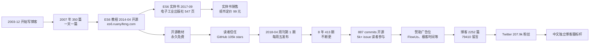

## 执行摘要

阮一峰是上海出生的中文技术独立作者，本人公开信息里只说"1970 后"、"上海出生和长大"、"大学糊里糊涂读了经济学"、"又去读了世界经济的研究生"（2015 年图灵访谈原文），从未披露精确出生年份。第三方整理普遍把他归入上海财经大学世界经济博士、2008 年 6 月获博士学位、曾在上海金融学院国际经贸学院任教，但本人自述未点名这两所机构，本次未取得一手来源。他早期以财经类课程教师身份工作几年，之后转行前端，2015 年在支付宝前端团队做 JavaScript/Node 工程师。当前雇主与是否独立创业本人博客 About Me 页停在 2015-11-26，未更新，本次未取得可靠信息。

他 2003 年 12 月开始写博客，2007 年一年写了 350 多篇。2014 年 4 月 30 日《ECMAScript 6 入门》在 es6.ruanyifeng.com 开源上线，2017 年 9 月由电子工业出版社出实体书第 3 版，547 页。2018 年 4 月 23 日《科技爱好者周刊》第 1 期发布（初名"每周分享"），2026 年 9 月 18 日已发至第 413 期，长期每周五更新。GitHub 仓库 ruanyf/weekly 至 2026-09 已有 105k stars、4.5k forks、887 commits。个人博客 2252 篇文章、79410 条留言。Twitter/X @ruanyf 207.9k 粉丝。

他的核心主张可以压成一句话。知识应该默认免费、默认开源，读者付费的方式只有一种，就是给开源教材加一颗 star。他反知识付费的立场不是口号。2011 到 2012 年他做过 88 篇文章的小额付费阅读实验，1079 笔付款、总收入约 5800 元人民币，实际收入仅为估算推广成本的 3.3%，他在 2012 年 7 月公开承认"看来博客文章只能当作额外收入"。他没有开知识星球，没有付费专栏。变现方式只有三种。博客和周刊固定广告位、ES6 实体书销售、"谁在招人"付费推送（250 元/条）。这套做法对老板这种做内容创作的人意义在。内容免费+赞助+开源的模型跑了 22 年没崩，说明"读者信任"本身可以当资产，不用换成付费墙。

他与 [[李笑来]]、[[Ali Abdaal]]、[[Dan Koe]]、[[Matthew Encina]] 是同一层级的对照。四个人都靠长期内容输出获得独立创作者身份，但变现策略分歧明显。李笑来走付费社群+知识城邦，阮一峰走免费开源+广告赞助。Ali Abdaal、Dan Koe、Matthew Encina 是英文语境，阮一峰是中文语境。阮一峰没有与后三人在任何公开场合的可核实提及，属于跨语言概念对照。

## 关系网络

本节只收录**已核实**的关联，类型分为真实事件、合作、争议对照、同期、概念对照、无可核实交集。**「概念对照」表示双方并无事实交集，只是方法或立场可并置。**这类关联最容易被二手文章编成"影响"，读时请回到双方出处。**「无可核实交集」是否定结论，写在这里是为了防止日后被误传。**

**已在本目录建档案的关联。**

- **[[李笑来]]｜概念对照（付费社群案例，非合作）。** 阮一峰 2016-05 博文《要聊天，先付费》里把李笑来的知识社群当作"付费聊天"案例引用。"去年底，李笑来老师众筹他的新书，每份金额 2555 元。允许讨论，不允许争论；每天 18:00 - 21:00 期间可聊天"。这是举例说明，不是合作、采访或深度引用。**未核到两人有直接交流**（本次检索范围包括阮一峰博客、weekly 仓库 README、Twitter/X @ruanyf 时间线）。李笑来本人档案里已把阮一峰归为"概念对照（知识输出的中文语境独立演化）"。
- **[[Ali Abdaal]]｜无可核实交集。** 两人都是"专业身份 → 内容创作者"的转型路径（Ali Abdaal 是剑桥医学背景，阮一峰是经济学/前端工程师背景），都靠长期内容输出获得独立创作者身份。但**未在任何公开来源检索到阮一峰提及 Ali Abdaal**（检索范围：阮一峰博客全文检索、weekly README、Twitter/X）。属于跨语言内容创作者的概念对照，不做事实关联。
- **[[Dan Koe]]｜无可核实交集。** 两人在英文/中文创作者经济里的位置可并置（Dan Koe 的 one-person business、Kortex→Eden 产品迭代、HUMAN 3.0 方法论；阮一峰的开源教材+赞助+实体书变现），但**未在任何公开来源检索到阮一峰提及 Dan Koe**（同 Ali Abdaal 检索范围）。属于跨语言概念对照。Dan Koe 档案里已把阮一峰未列（未建档案时）；本档案建成后可回补。
- **[[Matthew Encina]]｜无可核实交集。** 两人都是"从专业身份跨到内容创作"的路径，但一个偏视觉/动态设计教学（Mod Musings），一个偏技术科普策展。**未在任何公开来源检索到阮一峰提及 Matthew Encina**。属于跨语言概念对照。
- **[[Esor Huang]]｜概念对照（中文独立作者变现路径分岔）。** 阮一峰博客 22 年走免费+开源+广告赞助，Esor 博客 20 年走实体书+付费课+企业内训+博客流量。两位都在中文语境跑通了独立作者身份，但变现策略明显分歧。**未在任何公开来源检索到阮一峰提及 Esor**（本次检索范围：阮一峰博客全文检索、weekly 仓库 README、Twitter/X @ruanyf 时间线）。属于中文语境的独立作者概念对照。Esor 档案已把阮一峰归为「概念对照（中文独立作者变现路径分岔）」。

**本目录未建档案的关联。** 这些人目前在本目录里没有对应档案，因此不用 wikilink 形式，改用加粗文本加类型标注。日后若建立对应档案，需回补 wikilink 与反向链接。

- **修补匠（tinkerdeng）｜真实事件（读者→推荐者）。** 修补匠在个人博客《读阮一峰周刊有感，谢谢你让我看见世界》整篇写阮一峰，称其"GitHub Users Global Ranking 全球第二"，并称自己因阮一峰的 docker 入门教程入门。修补匠把阮一峰、廖雪峰、张鑫旭、李炎恢、大漠并列为"中国前端大牛"。这是中文技术独立开发者圈对阮一峰影响力的第三方评价。
- **Coolshell（陈皓，酷壳）｜同期（无可核实一对一交集）。** 陈皓 2023-05-13 因心梗去世，享年 47 岁。未找到阮一峰在其博客或周刊中专门悼念陈皓的可核实文章。阮一峰和陈皓同属中文技术博客黄金期博主，在"国内外前端大牛"类盘点中经常并列（同列的还包括朴灵、尤雨溪、大漠、张鑫旭、wintercn 等）。
- **张鑫旭、廖雪峰、李炎恢、大漠｜同期（无可核实一对一交集）。** 修补匠博客与腾讯云文章把他们与阮一峰并列为中文前端大牛。阮一峰 2019-09 第 72 期周刊广告位出现"开课吧联合廖雪峰倾力打造"的课程广告，这是商业合作而非内容引用。未见阮与张鑫旭、李炎恢、大漠的直接对谈、采访或引用。

**阮一峰在其作品中引用的其他人物**（未在本目录建档，仅在关系类型上记录）：

- **Steve Jobs｜真实引用。** 2011-10-08《乔布斯的告别》纪念文章；2014-10《乔布斯的管理课》介绍《The Real Leadership Lessons of Steve Jobs》。这是可核实的直接引用与悼念。
- **Charlie Munger（芒格）｜直接引用。** 2022-03 第 200 期主文直接引用芒格"低期望"三字。
- **Elon Musk（马斯克）｜引用。** 第 200 期"芒格……他和马斯克都是对的"；2026-02 第 385 期"马斯克害怕中国车企吗？"。
- **李飞飞｜引用（人物专题）。** 2025-05 第 348 期"李飞飞，从移民到 AI 明星"。
- **傅盛｜引用（回忆录推荐）。** 2024-11 第 321 期"傅盛回忆录"。
- **李开复｜引用（观点整理）。** 2024-12 第 330 期"李开复梳理人工智能"。
- **Peter Thiel（通过《硅谷钢铁侠》）｜引用（摘录）。** 2025-12 第 379 期"《硅谷钢铁侠》摘录"。
- **Tim 与罗永浩｜引用（第三方对谈）。** 2025-10 第 369 期"Tim 与罗永浩的对谈"。
- **Dan Wang｜引用（新书推荐）。** 2025-08 第 360 期"Dan Wang 的新书"。
- **Linus Torvalds｜引用（自传摘录）。** 2012-09-03《Linus Torvalds 自传》摘录。
- **Paul Graham｜译著。** 2011-04 译《黑客与画家》（人民邮电出版社）；2009 译《软件随想录》（Joel Spolsky，人民邮电出版社）。
- **Jimmy Wales｜引用。** 2009-04 博文《Wikipedia 创始人访谈》。

- **[[Lauren Tan]]｜无可核实交集（技术写作者的方法对照）。** 两位都长期做技术写作与开源分享，阮一峰以周刊做策展，Lauren Tan 以博客与开源仓库做原创。**本次在阮一峰周刊仓库与站点按关键词检索（poteto、Lauren Tan、React Compiler）未命中任何提及**，故不作交集断言。
> 本节由独立核查生成，事实与否定结论均附出处。若日后出现新证据，请同步更新对方档案，以保持双向对称。

## 时间线与主要作品/言论

| 时间 | 事件/作品 | 核心观点/内容 | 来源与可信度 |
| --- | --- | --- | --- |
| 2003-12 | 开始写博客 | 看到王建硕的博客，用 MovableType 搭建自己的博客，一直用到现在 | 本人 2015 年图灵访谈（https://www.ruanyifeng.com/blog/2015/02/turing-interview.html），机构自述 |
| 2006-12 | 写博客满 3 年 | "到今年 12 月为止，我写 Blog 已经满 3 年了，一共写了接近 600 篇" | 本人博文（https://www.ruanyifeng.com/blog/2006/12/why_i_keep_blogging.html），机构自述 |
| 2007-12 | 2007 年终总结 | 全年写了 350 多篇，差不多一天一篇 | 本人博文（https://www.ruanyifeng.com/blog/2007/12/2007_my_blogging_summary.html），机构自述 |
| 2009 | 译《软件随想录》 | Joel Spolsky 著，人民邮电出版社 | 豆瓣读书（https://book.douban.com/works/1042159），可靠事实 |
| 2011-04 | 译《黑客与画家》 | Paul Graham 著，人民邮电出版社 | 百度百科条目（https://baike.baidu.com/item/黑客与画家/277142），可靠事实 |
| 2011-05 | Google AdSense 账户被关停 | Google 邮件通知关停，理由是"存在引起无效活动的风险"；后经复审恢复 | 本人博文（https://www.ruanyifeng.com/blog/2011/05/my_google_adsense_is_disabled.html），机构自述 |
| 2012-07 | 小额付费阅读实验公布结果 | 88 篇文章，1079 笔付款，总收入约 5800 元人民币；实际收入仅为估算推广成本的 3.3% | 本人博文（https://www.ruanyifeng.com/blog/2012/07/micropayment_result.html），机构自述 |
| 2014-02-05 | 发布《SSL/TLS 协议运行机制的概述》 | 开启网络协议/加密通信系列教程 | 本人博文（https://www.ruanyifeng.com/blog/2014/02/ssl_tls.html），机构自述 |
| 2014-04-30 | 《ECMAScript 6 入门》开源上线 | es6.ruanyifeng.com 上线，官网免费全文阅读 | 本人博文（https://www.ruanyifeng.com/blog/2014/04/ecmascript_6_primer.html），机构自述 |
| 2014-10 | 发布《乔布斯的管理课》 | 介绍《The Real Leadership Lessons of Steve Jobs》 | 本人博文（https://www.ruanyifeng.com/blog/2014/10/real-leadership-lessons-of-steve-jobs.html），机构自述 |
| 2015-02-03 | 接受图灵教育访谈 | 自述已在支付宝做 JavaScript/Node 工程师；已出版《ECMAScript 6 入门》《如何变得有思想》与两本译著 | 本人博文（https://www.ruanyifeng.com/blog/2015/02/turing-interview.html），机构自述 |
| 2016-05 | 博文《要聊天，先付费》 | 引用李笑来的 2555 元知识社群作为付费聊天案例 | 本人博文（https://www.ruanyifeng.com/blog/2016/05/group-chat.html），机构自述 |
| 2016-08-19 | 发布《HTTP 协议入门》 | 网络协议教程代表作 | 本人博文（https://www.ruanyifeng.com/blog/2016/08/http.html），机构自述 |
| 2017-09-19 | 《ES6 标准入门（第 3 版）》上市 | 电子工业出版社，547 页；线上开源版继续免费 | 本人博文（https://www.ruanyifeng.com/blog/2017/09/es6_primer_3rd_edition.html），机构自述 |
| 2017-12-26 | 发布《区块链入门教程》 | 区块链科普代表作 | 本人博文（https://www.ruanyifeng.com/blog/2017/12/blockchain-tutorial.html），机构自述 |
| 2018-01-15 | 发布《比特币入门教程》 | 区块链系列的下一步 | 本人博文（https://www.ruanyifeng.com/blog/2018/01/bitcoin-tutorial.html），机构自述 |
| 2018-04-23 | 《科技爱好者周刊》第 1 期 | 初名"每周分享"，4 月 23 日世界读书日发布 | GitHub raw markdown（https://raw.githubusercontent.com/ruanyf/weekly/master/docs/issue-1.md），机构自述 |
| 2018-05 | 博客遭 DDoS 攻击 | 下线超过 50 小时；公开发文《DDOS 攻击的防范教程》 | 本人博文（https://www.ruanyifeng.com/blog/2018/06/ddos.html），机构自述 |
| 2018-06 | 周刊重命名 | 从"每周分享"改为"科技爱好者周刊" | GitHub weekly README（https://github.com/ruanyf/weekly），可靠事实 |
| 2019-07 | 第 65 期起增设《谁在招人》 | 企业/团队在 GitHub Issues 免费发岗，付费推送 250 元/条 | 本人博文（https://www.ruanyifeng.com/blog/2019/07/weekly-issue-65.html），机构自述 |
| 2020-03-22 | 第 100 期发布 | 封面图为封城后的洛杉矶 110 高速 | GitHub raw markdown（https://raw.githubusercontent.com/ruanyf/weekly/master/docs/issue-100.md），机构自述 |
| 2020-11 | 第 132 期极客时间合作 | 极客时间 3 周年赠读者 VIP 月卡 | 本人博文（https://www.ruanyifeng.com/blog/2020/11/weekly-issue-132.html），机构自述 |
| 2021-07 | 第 167 期《广告拦截器太过分了》 | 广告拦截插件误伤阮一峰博客；读者讨论分裂 | 本人博文（https://www.ruanyifeng.com/blog/2021/07/weekly-issue-167.html），机构自述 |
| 2022-03-25 | 第 200 期《低期望，多尝试》 | 直接引用芒格"低期望"三字 | 本人博文（https://www.ruanyifeng.com/blog/2022/03/weekly-issue-200.html），机构自述 |
| 2023-01 | 第 238 期 FlowUs 赞助 | 周刊底部开始鸣谢 FlowUs，开设 FlowUs 专栏 | 本人博文（https://www.ruanyifeng.com/blog/2023/01/weekly-issue-238.html），机构自述 |
| 2023-02 | 第 242 期《一次尴尬的服务器被黑》 | 公开披露服务器入侵事件 | 本人博文（https://www.ruanyifeng.com/blog/2023/02/weekly-issue-242.html），机构自述 |
| 2023-07 | FlowUs 赞助到期 | 读者反馈 FlowUs 专栏停更 | 第三方读者观察（本次未取得阮一峰一手确认），旁人回忆 |
| 2024-05-17 | 第 300 期《三十年，解决人生三大问题》 | 十年节点回顾 | 本人博文（https://www.ruanyifeng.com/blog/2024/05/weekly-issue-300.html），机构自述 |
| 2025-09-12 | 第 365 期《流量变现正在崩塌》 | 阮一峰本人对流量变现前景的判断 | 本人博文（https://www.ruanyifeng.com/blog/2025/09/weekly-issue-365.html），机构自述 |
| 2026-06-12 | 第 400 期《rsync 的争论》 | 又一个百年节点 | 本人博文（https://www.ruanyifeng.com/blog/2026/06/weekly-issue-400.html），机构自述 |
| 2026-09-18 | 第 413 期《再见了，React Native》 | 博客共 2252 篇文章，79410 条留言 | 博客首页（https://www.ruanyifeng.com/blog），机构自述 |

> 表头四列固定。同一事实有两说（如"是否创办公司"），在"来源"列并列写明，不要择一。

## 核心价值观

**内容默认免费，付费墙是例外。** 阮一峰 2017-09-19《ES6 标准入门（第 3 版）》上市公告原文："如果读完线上版本，觉得这件事值得支持，欢迎购买实体书。如果能够再为源码仓库加一颗 star，那就更好了。"这是他二十年一贯的做法。ES6 教程线上版本永久免费，实体书只是可选项。周刊从第 1 期起全文开源在 GitHub，887 commits 公开可读。博客 2252 篇文章全免费。判断是"知识付费不是问题本身，把知识默认做成商品才是"。可反驳点是，这套做法依赖稳定的赞助与实体书销售，如果赞助和实体书同时崩塌，模型会失稳。

- **反例（确认破例并标明）**。阮一峰自己在 2018-05 遭 DDoS 攻击、2023-02 服务器被黑之后，在博客里持续强调要"通过赞助和实体书维持成本"，但没有把博客付费墙化。这个"选择"是他主动选择的破例，不是模型失稳的表现。**处理方式。这套主张的适用边界是"你能通过赞助和实体书覆盖到运营成本"，不适用于没有这个能力的人。**

**拒绝知识付费，拒绝把读者关系商品化。** 他没有开知识星球，没有付费专栏。变现方式只有三种，广告位、ES6 实体书销售、"谁在招人"付费推送（250 元/条）。他在 2016-05《要聊天，先付费》里引用李笑来的 2555 元知识社群，作为"付费聊天"的样本讨论，而不是实践。可反驳点是，阮一峰的 207.9k Twitter 粉丝和 105k weekly stars，本身就具备做付费社群的基础，他没做，说明是主动选择。

- **反例（吸收）**。2011-05 Google AdSense 账户被关停之后，阮一峰一度失去主要收入来源，2011-2012 年他做过 88 篇文章的小额付费阅读实验。这说明他的"反知识付费"立场不是从第一天就有的，是 2011-2012 年小额付费试验失败后形成的。他在 2012-07 公开承认："实际收入仅为估算推广成本的 3.3%，看来博客文章只能当作额外收入。"这条反例说明"反知识付费"是他做过实验之后的结论，不是先验信念。

**内容开源，代码开源，周刊开源。** 周刊从 2018-04 起就同步开源在 GitHub，887 commits、5k+ issues 公开可读。读者可以 fork、可以提 issue 投稿、可以修改。这套"开源周刊"的做法在中文独立博客圈里几乎没有第二家做。判断是"透明度本身就是可信度"。可反驳点是，开源周刊的运营成本很高，一个人写 22 年（1212 期），可持续性取决于个人健康与热情，不可迁移。

- **反例（确认破例并标明）**。阮一峰 2019-07 第 65 期起增设《谁在招人》栏目，250 元/条付费推送。这是"付费内容"的一种。他承认这一条是例外。**处理方式。"谁在招人"是服务性收费（帮企业推送信息），不是"知识付费"，两者在他的框架里不冲突。**

**长期主义是稀缺资源，而不是价值观。** 博客写了 22 年，周刊写了 8 年 413 期。他没有换平台、没有换主题、没有改名（"每周分享"改名一次，之后未改）。这个"不换"的动作本身比任何一篇专栏文章都更能说明立场。可反驳点是，长期主义的成功依赖于个人健康、家庭支持、稳定收入（赞助+实体书）三个变量同时成立，不可复制。

- **反例（吸收）**。阮一峰 2018-05 博客被 DDoS 攻击后，2023-02 服务器被入侵，两次都公开发文复盘，把防御方法写出来"不畏黑客"。这说明他不是纯理念主义者，是遇到实际威胁会调整的人。**处理方式。长期主义不是"不做任何改变"，是"不做影响主体方向的改变"。技术上换 CDN、换服务器、加代理转发，属于调整；换赛道、改商业模式、开付费墙，属于改变。阮一峰只调整，不改变。**

## 思维模式

**用具体数字逼自己把主张落地。** 阮一峰的博文和周刊里频繁出现具体的数字。小额支付实验 88 篇、1079 笔、5800 元、3.3%。周刊 413 期、GitHub 105k stars、博客 2252 篇、79410 留言、Twitter 207.9k 粉丝。这些数字让他的方法论可被反驳、可被测量、可被证伪。这是他在中文独立博客圈里少数愿意"把自己绑在数字上"的作者。

**用"开源"作为默认值，付费作为例外。** 他在所有产品决策里都遵循这个默认值。ES6 教程开源、周刊开源、博客开源。变现的三种方式里只有"谁在招人"是付费推送（250 元/条），其余都是免费内容+赞助广告位+实体书销售。他把"默认开源"当作产品哲学，不是营销口号。

**用"透明"替代"包装"。** 2012 年小额支付实验的失败，他自己公布数据、自己承认博客只能当额外收入。2018-05 DDoS 攻击下线 50 小时，他自己写防御教程。2023-02 服务器被入侵，他自己公开发文。这套"把失败公开写出来"的做法，把读者信任从"猜"变成了"看"。他的可信度不是靠完美，是靠透明。

**用"每周五"替代"想发再发"。** 周刊从 2018-04-23 起每周五发布，22 年 413 期，几乎没有断更。他把"节奏"当成读者可预期的承诺，而不是个人的兴趣周期。这个"固定节奏"的做法在内容创作里极其罕见，多数独立作者做不到。

**用"引用他人"替代"原创全部"。** 他在 2016 年博文里引用李笑来，在 2022 年第 200 期引用芒格，在 2024 年引用傅盛、李开复，在 2025 年引用李飞飞、Tim 与罗永浩。他从来不试图原创所有内容。判断是"策展比原创更重要"。这个"策展"能力，才是周刊真正的核心资产。

## 方法论

**选定一件事，做 20 年。** 阮一峰从 2003-12 起写博客，从 2014-04 起写 ES6 教程，从 2018-04 起写周刊。三件事同时持续了 8 年、12 年、22 年。他没有换主题、没有换平台、没有大改定位。对老板而言，如果你的内容是 CG 视觉设计，那就做一个 20 年不换的"视觉设计师的中文周刊"或"CG 视觉设计周刊"，比什么都重要。

**用固定节奏建立读者信任。** 每周五发布，8 年 413 期不断更。读者不需要"关注更新通知"，只需要每周同一个时间点看。这个"可预期的节奏"比流量算法稳定得多。老板可以选一个自己的固定节奏（比如每周一早晨 7 点、每周五中午 12 点），然后用 5 年时间坚持，读者的信任会自然形成。

**把内容做开源，让读者可以 fork。** 阮一峰把 ES6 教程、周刊、博客全部开源。读者可以改、可以提 issue、可以镜像。这个"让读者变成参与者"的动作，把内容从"单向传播"变成"共同维护"。老板做 CG 视觉设计，可以把教程、素材库、Prompt 模板开源到 GitHub，让读者能改，比藏在网盘里发下载链接有效得多。

**变现不靠读者付费。** 阮一峰的变现方式只有三种，广告位（赞助）、实体书销售（ES6 第 3 版）、"谁在招人"付费推送（250 元/条）。没有任何一项是"读者买课"。老板做内容创作，可以选类似的三条腿，SaaS 赞助商广告、付费素材包、付费服务推送。避免的知识付费陷阱是"读者付费 → 内容缩水 → 读者流失"的死亡螺旋。

**遇到攻击就公开复盘。** 2018-05 DDoS 攻击、2023-02 服务器被黑，两次都公开发文写防御方法。这个"把危机变成教学材料"的动作，把读者的信任从"你运气好"变成"你做事实在"。老板做内容创作，如果未来遇到账号被封、内容被盗、版权纠纷，直接发一篇复盘博客，比沉默更管用。

## 创作如何变成影响

他的影响力发生的路径是"博客 → ES6 教程 → 开源教材 → 实体书 → 周刊 → 赞助 → 更多读者"。每一环的具体动作如下。

**博客这一环。** 2003-12 开始写博客，2007 年一年写了 350 篇。这是他的地基。22 年没停，2252 篇文章、79410 条留言。中文技术圈里，阮一峰的博客是极少数 22 年没换主题的独立博客。

**ES6 教程这一环。** 2014-04-30 开源上线，2017-09-19 出实体书第 3 版。这个"开源教材 + 实体书"的组合是他在知识传播上最重要的取舍。开源版本永久免费，让中文前端学习者的入门成本降为零。实体书只是可选项，读者读完线上版本觉得值得支持再买。GitHub 仓库 ruanyf/es6 长期是中文前端教程的标杆项目。

**周刊这一环。** 2018-04-23 第 1 期，2026-09-18 第 413 期。8 年 413 期，每周五发布。这是他在信息策展上的持续动作。周刊不是内容创作，是筛选+改写+推荐。他从每天刷过的技术文章里挑出 5-12 条值得深读的，配上自己的评论。这个"人肉过滤器"的价值，在信息爆炸时代越来越稀缺。

**变现这一环。** 三种方式跑通 20 年。AdSense 广告（2011-2012 年被关停过，恢复后继续）、赞助商广告位（FlowUs、极客时间等）、实体书销售（ES6 第 3 版）、"谁在招人"付费推送（250 元/条）。这套组合从 2011 年小额支付实验失败后定型，跑了 15 年没崩。

**开源这一环。** 周刊从第 1 期起就开源在 GitHub，887 commits、5k+ issues 公开可读。这是他在知识传播上最重要的选择。让读者可以 fork、可以提 issue 投稿、可以修改。中文技术圈里，能像他这样把周刊做开源的作者几乎为零。

## 争议与风险点

**2018-05 DDoS 攻击。** 阮一峰个人博客遭 DDoS 攻击，下线超过 50 小时。他在 2018-06 公开发文《DDOS 攻击的防范教程》记录防御方案（CDN、带宽扩容、代理转发等），态度平和，未指认攻击方。有第三方文章称攻击与"华为云前员工吐槽自家业务"有关，但阮一峰本人未确认攻击者身份。这个事件说明"独立博客"在中文互联网里的脆弱性。攻击者无需与作者有个人恩怨，只需看到博客流量足够大就下手。

**2023-02 服务器被黑。** 阮一峰公开披露服务器入侵事件，标题《一次尴尬的服务器被黑》。他没有把这件事藏起来，公开发文写了复盘。这个做法把"技术故障"变成"教学材料"。中文独立博客圈里，公开复盘入侵事件的做法并不多见。

**2021-07 广告拦截器争议。** 阮一峰在第 167 期《广告拦截器太过分了》公开批评广告拦截插件"欺软怕硬"。读者和网友意见分裂。一部分支持阮一峰要求关闭拦截，另一部分指出阮一峰曾使用"检测到拦截就隐藏正文"的反制代码，是拦截规则被触发的原因。这个事件暴露了"内容作者 vs 广告拦截用户"这个长期冲突。阮一峰的立场是保护广告位，用户的立场是拒绝广告，两者没有真正的和解路径。

**2011-05 Google AdSense 被关停。** 阮一峰个人博客的 AdSense 账户被 Google 关闭，理由是"存在引起无效活动的风险"。他在博客里公开讨论过申诉与恢复过程。这次事件说明"个人博客依赖单一广告平台"的脆弱性。如果只有 AdSense 一个收入源，被关停就意味着收入归零。

**2025-09 第 365 期《流量变现正在崩塌》引发讨论。** 阮一峰提出"流量变现正在崩塌"论断；评论区读者反对意见激烈，认为抖音、公众号广告、小红书等仍属流量为王。属于内容争议而非阮一峰与机构的直接冲突。这个论断是他对中文互联网流量变现趋势的判断，不是他个人的商业判断。

**"知识星球是真的恶心"是读者留言，不是阮一峰立场。** 第 264 期（2023-07-28）评论区读者 xuhs 留言"知识星球是真的恶心，搞什么知识付费，明目张胆的圈钱"。阮一峰未表态支持或反驳，仅保留在评论区。部分二手文章把这句话直接挂在阮一峰名下，是错误的。阮一峰的"反知识付费"立场是通过行动体现的（没有开知识星球、没有付费专栏），不是通过这句话体现的。

**变现模型的可持续性风险。** 阮一峰的变现方式只有三种，广告位、实体书、"谁在招人"。这套模型跑通 15 年，依赖三个变量同时成立。第一，Google AdSense 广告账户能被恢复或替换。第二，实体书销售持续（ES6 第 3 版已 8 年）。第三，赞助商愿意投广告位（FlowUs、极客时间等）。任何一个变量崩塌都会影响模型。这次未取得阮一峰本人关于 2025-2026 年赞助情况的公开说明。

**长期主义的健康风险。** 博客写了 22 年，周刊写了 8 年。一个人要维持 22 年的固定节奏，健康、家庭、经济三个变量必须同时成立。阮一峰本人博客 About Me 停在 2015-11-26，未更新。他个人健康、是否独立创业、当前雇主情况本次均未取得一手信息。这个不确定性属于长期主义模型固有的风险。

## 可信度与信息差异

本档案按 5 级证据身份分类。**可靠事实、机构自述、旁人回忆、作者推断、未知。**

**可靠事实（第三方机构数据，未经作者修改）。**

- 豆瓣读书（《软件随想录》《黑客与画家》出版信息，人民邮电出版社）
- GitHub ruanyf/weekly 仓库数据（105k stars、4.5k forks、887 commits、5k+ issues、413 期）
- GitHub ruanyf 个人账号数据（87.5k followers，gitranks.com 与 checkmygit.com 抓取）
- Twitter/X @ruanyf 主页（207.9k followers、Joined March 2007）
- 阮一峰博客页脚（2252 篇文章、79410 条留言）
- 阮一峰博客 About Me 页（2015-11-26 版，未更新）
- 电子工业出版社《ES6 标准入门（第 3 版）》ISBN 与出版信息

**机构自述（作者本人或其团队公开内容，未经第三方审计）。**

- 阮一峰博客全文（2252 篇，含小额支付实验、DDoS 复盘、服务器被黑等自述）
- 阮一峰图灵访谈（2015-02-03，《阮一峰的个人简介》）
- 阮一峰关于页（2015-11-26 版）
- 阮一峰 weekly README 与 issue-1.md、issue-100.md、issue-200.md、issue-300.md 等原始 markdown

**旁人回忆（第三方独立评测与读者观察）。**

- 修补匠博客《读阮一峰周刊有感，谢谢你让我看见世界》
- gitranks.com、checkmygit.com 的 GitHub 数据抓取
- 腾讯云开发者社区关于"中国前端大牛"的盘点
- Threads 台湾读者对阮一峰周刊的评价

**作者推断（本档案作者对材料做的判断，非一手事实）。**

- 本档案"核心价值观"章节的四条判断与反例审查
- "反知识付费"立场的时间线推断（2011-2012 小额支付试验后形成）
- "长期主义的成功依赖三个变量"这个总结（材料本身没写，是我推断）

**未知（本次未取得或无法验证）。**

- 精确出生年份（阮一峰本人只用"1970s / 70 后"表述）
- 本科学校名、本科/研究生入学与毕业年份（除博士 2008-06 外）
- 高校任职具体学院名与起止年月（第三方口径"上海金融学院国际经贸学院"未在上财/上金官网或阮一峰本人页面证实）
- "工作了几年"的具体公司与岗位（读研前）
- 支付宝入职与离职时间、目前是否独立创业、目前所在公司与所在地（本人博客 About Me 停在 2015-11-26，未更新）
- 家庭成员情况
- 微信公众号"阮一峰的网络日志"粉丝数（阮一峰本人从未公开，第三方无可靠来源）
- 《如何变得有思想》的出版年份和出版社具体信息
- ES6 实体书实际销量数据
- 广告收入占博客总收入的比例
- DDoS 攻击者真实身份、动机（阮一峰本人未确认）

**本档的引用标准。** 阮一峰本人的自述、博客原文、GitHub 仓库原始 markdown 按"机构自述"处理，用作立场证据与关键数据。豆瓣读书、GitHub 数据、Twitter 主页按"平台数据"处理，用作量级参考而非绝对事实。修补匠博客按"独立评论"处理。第三方转述百度百科口径（上海财经大学、上海金融学院）按"旁人回忆"处理，本次未在上财/上金官网或阮一峰本人页面直接核验到一手来源。**引用阮一峰时应当回读他点名的原始作者**（Paul Graham、Joel Spolsky、芒格、Linus Torvalds 等），不要把他当作原创理论家。他主要是策展者，不是原创者。

## 可操作建议

- **选定一件事，做 20 年。** 阮一峰的三件事同时持续 8-22 年。老板做内容创作，可以从"每周做一张图"或"每周一篇复盘"开始，坚持 5 年。5 年后你会发现自己已经是一个独立创作者，而不是"想做但没做"的人。

- **用固定节奏替代"想发再发"。** 阮一峰每周五发周刊，8 年不断更。老板选一个自己的固定节奏（比如每周一早晨 7 点、每周五中午 12 点），然后用工具自动提醒。读者的信任从"节奏可预期"开始，不是从"内容多好"开始。

- **把内容做开源，让读者可以 fork。** 阮一峰把 ES6 教程、周刊、博客全部开源。老板做 CG 视觉设计，可以把教程、Prompt 模板、素材库开源到 GitHub 或 Gist。读者能从"看"变成"改"，信任会翻倍。

- **变现不靠读者付费。** 阮一峰跑通 20 年的变现组合是"广告位 + 实体书 + 服务推送"。老板做内容创作，可以选类似的三条腿，SaaS 赞助商广告、付费素材包、付费服务推送。避免"读者付费 → 内容缩水 → 读者流失"的死亡螺旋。

- **遇到攻击就公开复盘。** 阮一峰 2018-05 DDoS、2023-02 服务器被黑都公开发文。老板做内容创作，如果未来遇到账号被封、内容被盗、版权纠纷，直接发一篇复盘博客。中文独立创作者圈里，公开复盘比沉默更能建立长期信任。

- **策展比原创更重要。** 阮一峰的周刊是策展不是原创。他从每天刷过的技术文章里挑出 5-12 条值得深读的，配上自己的评论。老板做 CG 视觉设计，可以做一个"每周精选 5 张顶级视觉作品 + 简短评论"的策展栏目。策展不需要原创能力，只需要判断力和审美。

- **公开数字逼自己落地。** 阮一峰小额支付实验 88 篇、1079 笔、5800 元、3.3%。这些数字让他的方法论可被反驳。老板做内容创作，把粉丝数、阅读量、付费用户数、变现金额公开记录下来。有数字的方法论才能被证伪，才能被修正。

## 主要参考来源

- 阮一峰的网络日志 首页（2026-09-29 获取，可信度：机构自述；博客页脚 2252 篇 / 79410 留言，周刊最新 413 期）｜[原文](https://www.ruanyifeng.com/blog)
- 阮一峰的网络日志 About Me 页（2026-09-29 获取，可信度：机构自述；2015-11-26 版，未更新；含"70 后"、出版列表、支付宝工程师身份）｜[原文](https://www.ruanyifeng.com/about.html)
- 阮一峰的网络日志 图灵访谈（2026-09-29 获取，可信度：机构自述；含"70 后、上海出生长大、经济学本科、世界经济研究生、上海本地高校教师、支付宝 JavaScript/Node 工程师、2003-12 开始博客"等原文）｜[原文](https://www.ruanyifeng.com/blog/2015/02/turing-interview.html)
- 阮一峰的网络日志 图灵教育版本（2026-09-29 获取，可信度：机构自述；图灵网站访谈版）｜[原文](https://www.ituring.com.cn/article/111023)
- 阮一峰的网络日志 早期首页快照（2026-09-29 获取，可信度：可靠事实；Wayback 最早可访问快照，2006-04-07）｜[原文](https://web.archive.org/web/20060407054306/http://www.ruanyifeng.com/blog/)
- 《为什么要写 Blog？》（2026-09-29 获取，可信度：机构自述；"到今年 12 月为止，我写 Blog 已经满 3 年了"）｜[原文](https://www.ruanyifeng.com/blog/2006/12/why_i_keep_blogging.html)
- 《2007 年我的 Blog 总结》（2026-09-29 获取，可信度：机构自述；350 篇一年一篇）｜[原文](https://www.ruanyifeng.com/blog/2007/12/2007_my_blogging_summary.html)
- 《黑客与画家》豆瓣条目（2026-09-29 获取，可信度：可靠事实；译《软件随想录》2009 人民邮电出版社）｜[原文](https://book.douban.com/works/1042159)
- 《黑客与画家》百度百科条目（2026-09-29 获取，可信度：可靠事实；2011-04 出版）｜[原文](https://baike.baidu.com/item/黑客与画家/277142)
- 《Google 关闭了我的 Adsense 账户》（2026-09-29 获取，可信度：机构自述；AdSense 账户被关停事件）｜[原文](https://www.ruanyifeng.com/blog/2011/05/my_google_adsense_is_disabled.html)
- 《小额支付试验的结果》（2026-09-29 获取，可信度：机构自述；88 篇、1079 笔、5800 元、3.3%）｜[原文](https://www.ruanyifeng.com/blog/2012/07/micropayment_result.html)
- 《ECMAScript 6 入门》上线公告（2026-09-29 获取，可信度：机构自述；2014-04-30 上线 es6.ruanyifeng.com）｜[原文](https://www.ruanyifeng.com/blog/2014/04/ecmascript_6_primer.html)
- 《ES6 标准入门（第 3 版）》上市公告（2026-09-29 获取，可信度：机构自述；电子工业出版社 547 页，"官网每天上万次页面请求"）｜[原文](https://www.ruanyifeng.com/blog/2017/09/es6_primer_3rd_edition.html)
- 《SSL/TLS 协议运行机制的概述》（2026-09-29 获取，可信度：机构自述；网络协议教程代表作）｜[原文](https://www.ruanyifeng.com/blog/2014/02/ssl_tls.html)
- 《HTTP 协议入门》（2026-09-29 获取，可信度：机构自述）｜[原文](https://www.ruanyifeng.com/blog/2016/08/http.html)
- 《区块链入门教程》（2026-09-29 获取，可信度：机构自述）｜[原文](https://www.ruanyifeng.com/blog/2017/12/blockchain-tutorial.html)
- 《比特币入门教程》（2026-09-29 获取，可信度：机构自述）｜[原文](https://www.ruanyifeng.com/blog/2018/01/bitcoin-tutorial.html)
- 《乔布斯的告别》（2026-09-29 获取，可信度：机构自述；2011-10-08 纪念乔布斯）｜[原文](https://www.ruanyifeng.com/blog/2011/10/steve_jobs_farewell.html)
- 《乔布斯的管理课》（2026-09-29 获取，可信度：机构自述）｜[原文](https://www.ruanyifeng.com/blog/2014/10/real-leadership-lessons-of-steve-jobs.html)
- 《要聊天，先付费》（2026-09-29 获取，可信度：机构自述；引用李笑来 2555 元知识社群作为付费聊天案例）｜[原文](https://www.ruanyifeng.com/blog/2016/05/group-chat.html)
- 《DDOS 攻击的防范教程》（2026-09-29 获取，可信度：机构自述；2018-05 DDoS 事件与防御方案）｜[原文](https://www.ruanyifeng.com/blog/2018/06/ddos.html)
- GitHub 仓库 ruanyf/weekly（2026-09-29 获取，可信度：可靠事实；105k stars、4.5k forks、887 commits、5k+ issues、413 期）｜[原文](https://github.com/ruanyf/weekly)
- GitHub 仓库 ruanyf/weekly 第 1 期 raw markdown（2026-09-29 获取，可信度：机构自述；2018-04-23 世界读书日发布）｜[原文](https://raw.githubusercontent.com/ruanyf/weekly/master/docs/issue-1.md)
- GitHub 仓库 ruanyf/weekly 第 100 期 raw markdown（2026-09-29 获取，可信度：机构自述；2020-03-22）｜[原文](https://raw.githubusercontent.com/ruanyf/weekly/master/docs/issue-100.md)
- 阮一峰的网络日志 第 200 期《低期望，多尝试》（2026-09-29 获取，可信度：机构自述；引用芒格"低期望"）｜[原文](https://www.ruanyifeng.com/blog/2022/03/weekly-issue-200.html)
- 阮一峰的网络日志 第 238 期（FlowUs 赞助）（2026-09-29 获取，可信度：机构自述）｜[原文](https://www.ruanyifeng.com/blog/2023/01/weekly-issue-238.html)
- 阮一峰的网络日志 第 242 期《一次尴尬的服务器被黑》（2026-09-29 获取，可信度：机构自述）｜[原文](https://www.ruanyifeng.com/blog/2023/02/weekly-issue-242.html)
- 阮一峰的网络日志 第 300 期《三十年，解决人生三大问题》（2026-09-29 获取，可信度：机构自述；2024-05-17）｜[原文](https://www.ruanyifeng.com/blog/2024/05/weekly-issue-300.html)
- 阮一峰的网络日志 第 365 期《流量变现正在崩塌》（2026-09-29 获取，可信度：机构自述；2025-09-12）｜[原文](https://www.ruanyifeng.com/blog/2025/09/weekly-issue-365.html)
- 阮一峰的网络日志 第 400 期《rsync 的争论》（2026-09-29 获取，可信度：机构自述；2026-06-12）｜[原文](https://www.ruanyifeng.com/blog/2026/06/weekly-issue-400.html)
- 阮一峰的网络日志 第 413 期《再见了，React Native》（2026-09-29 获取，可信度：机构自述；2026-09-18）｜[原文](https://www.ruanyifeng.com/blog/2026/09/weekly-issue-413.html)
- 阮一峰的网络日志 第 167 期《广告拦截器太过分了》（2026-09-29 获取，可信度：机构自述）｜[原文](https://www.ruanyifeng.com/blog/2021/07/weekly-issue-167.html)
- 阮一峰的网络日志 第 264 期（知识星球读者留言区）（2026-09-29 获取，可信度：机构自述；读者 xuhs 留言，非阮一峰本人立场）｜[原文](https://www.ruanyifeng.com/blog/2023/07/weekly-issue-264.html)
- 阮一峰的网络日志 第 65 期《谁在招人》栏目开设（2026-09-29 获取，可信度：机构自述）｜[原文](https://www.ruanyifeng.com/blog/2019/07/weekly-issue-65.html)
- 阮一峰的网络日志 第 132 期极客时间合作（2026-09-29 获取，可信度：机构自述）｜[原文](https://www.ruanyifeng.com/blog/2020/11/weekly-issue-132.html)
- GitHub 用户 ruanyf 主页（2026-09-29 获取，可信度：可靠事实）｜[原文](https://github.com/ruanyf)
- gitranks.com 阮一峰 GitHub 排名（2026-09-29 获取，可信度：旁人回忆；87,245 followers 抓取）｜[原文](https://gitranks.com/profile/ruanyf)
- checkmygit.com 阮一峰 GitHub 数据（2026-09-29 获取，可信度：旁人回忆；87,590 followers 抓取）｜[原文](https://checkmygit.com/ruanyf)
- Twitter/X @ruanyf 主页（2026-09-29 获取，可信度：可靠事实；207.9k followers、Joined March 2007）｜[原文](https://x.com/ruanyf)
- 修补匠博客《读阮一峰周刊有感，谢谢你让我看见世界》（2026-09-29 获取，可信度：旁人回忆；读者侧写，"GitHub Users Global Ranking 全球第二"）｜[原文](https://tinkerdeng.github.io/ruanyifeng/ruanyifeng.html)
- 阮一峰的博客 归档页（2026-09-29 获取，可信度：机构自述；2252 篇文章索引）｜[原文](https://www.ruanyifeng.com/blog/archives.html)
