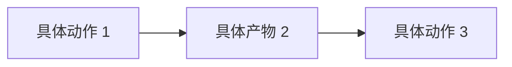

<!--
════════════════════════════════════════════════════════════════════
  人物档案模板 · 通用骨架
════════════════════════════════════════════════════════════════════

本模板从 30 份真实人物档案（cgartlab-obsidian / 03-资源/人物/）的
实践里提炼，是「11 节 · 15 条硬规矩 · 5 级证据」的落盘骨架。

【怎么用】
1. 复制本文件到目标知识库的档案目录（如 03-资源/人物/{{name}}.md）
2. 替换所有 {{占位符}} 与表格空行
3. 逐节读 HTML 注释，按注释里的「写什么 / 写多少 / 证据要求 / 常见错误」落笔
4. 落盘前删除本文件所有 HTML 注释（Obsidian 阅读视图虽不渲染，但成稿应干净）
5. 跑校验：python scripts/validate_archive.py <file>（结构 + 禁词 + frontmatter）
   + node scripts/check-frontmatter.mjs（知识库 type/tags/日期规范，若在 Obsidian 库中）

【11 节顺序不可增删改】
执行摘要 → 关系网络 → 时间线与主要作品/言论 → 核心价值观 → 思维模式 →
方法论 → 创作如何变成影响 → 争议与风险点 → 可信度与信息差异 →
可操作建议 → 主要参考来源

【15 条硬规矩】
① 结构类
  1. 一级章节固定 11 个，名称与顺序不可增删改。缺项写「本次未取得」，不删章节。
  2. 关系网络必须双向。A 链 B，则 B 的档案里必须有一条链回 A。

② 标点与句式
  3. 禁破折号 ——、—、–。改用句号或逗号；年份区间用半角连字符（2005-2017）。
     书名、作品名、人物原话内部的连接号属原文，保留不动。
  4. 提示性冒号只用于引出人物直接原话。「核心是：」一律改句号。
  5. 禁翻案腔「不是 A 而是 B」。划边界写成「A 是主要来源，B 排在后面」。
  6. 禁商业黑话：闭环、能力沉淀、赋能、抓手、底层逻辑、内容矩阵、拉通、复利、范本、范式。
  7. 禁模型路标词：值得注意的是、本质上、由此可见、从某种意义上说、总之、总体而言。
  8. 禁借喻清单：仓库、抽屉、温度、坍塌、浪潮、钥匙、底座。
     例外：知识管理语境里「仓库」字面指 Obsidian 库，不是借喻。

③ 证据纪律
  9. 每条事实可点开核验。链接用本次实际抓到的地址；抓不到写「未取得」，绝不构造 URL。
  10. 查不到标「待核实」+ 同句写清原因。不得为减少计数删限定语或编造来源。
  11. 证据身份 5 级写进可信度章节：①可靠事实 ②机构自述 ③旁人回忆 ④作者推断 ⑤未知。
      机构自述不作事实用；来源冲突两说并列，不挑最适合故事的那条写死。
  12. 引号内一个字都不能动。要消除引语里的破折号，就把引语断开，破折号落到引号外。

④ 判断纪律
  13. 核心价值观至少 1 条最强判断，写成具体、可被反驳的立场，不写描述。
  14. 判断写完做反例审查。反例只能取自本档案已有材料，不许联网现找。
      找不到真反例就写清适用边界，不硬造。
  15. 关系可查 ≠ 影响双向。单向影响要如实标注「单向」。

【长度参考】
质量底线 ≥ 300 行（不含 frontmatter）；标杆 dan-koe.md 278 行、esor-huang.md 289 行、
ruanyifeng.md 294 行。超过 350 行考虑合并同类信息。
════════════════════════════════════════════════════════════════════
-->

## 执行摘要

<!--
写什么：三段左右，回答「这人是谁、他主张什么、和我有什么关系」。
  第一段 · 身份锚点：姓名、出身、教育、职业转折、当前状态。只写可核实的事实，
    机构自述与第三方说法分开标注。
  第二段 · 核心主张：压成一句话的核心论点，再给 2-4 层可迁移推论。
    主张要反常识、可被反驳，不写「他很努力」这类空话。
  第三段 · 与读者的关系：为什么对 CG／视觉设计＋内容创作者有意义，
    指出他的哪套做法对应你的哪个痛点。
多少：400-600 字，不超过 3 段。
证据要求：身份事实必须有 URL；无来源的直接不写。
常见错误：把履历堆成流水账；把「他说过」写成「他做到了」；漏掉与读者的连接层。
-->

（第一段：身份锚点）

（第二段：核心主张，压成一句话 + 可迁移推论）

（第三段：与读者的关系）

## 关系网络

<!--
写什么：只收录「已核实」的关联。类型固定 6 类：
  真实事件 / 合作 / 争议对照 / 同期 / 概念对照 / 无可核实交集。
  另有一类「未能核查」：既不说有也不说无，写明检索范围与结论。
格式：- **[[某人]]｜类型（一句话说明）。** 一段说明，附检索范围与出处。
关键规矩：
  · 「概念对照」必须写明「无事实交集」，防止二手文章填成「影响」。
  · 「无可核实交集」是否定结论，必须写，这是档案的价值所在。
  · 本目录没建档的人，不用 wikilink，用加粗文本 + 类型标注。
  · A 链 B，B 必须链回 A（双向链）。新增档案后扫描全库补链。
多少：已建档的关联逐条写；未建档的关键关联另起一段。
证据要求：每条关联附检索范围；「查无交集」也要写清查了哪里。
常见错误：把「同赛道」写成「合作」；把「读过他的书」写成「受他影响」；
  查不到就跳过不写（应该写「无可核实交集」或「未能核查」）。
-->

本节只收录**已核实**的关联，类型分为真实事件、合作、争议对照、同期、概念对照、无可核实交集。**「概念对照」表示双方并无事实交集，只是方法或立场可并置。** 这类关联最容易被二手文章编成「影响」，读时请回到双方出处。**「无可核实交集」是否定结论，写在这里是为了防止日后被误传。**

**已在本目录建档案的关联。**

- **[[某人]]｜真实事件（作品关联，非合作）。** 写清事件、年份、双方各自的位置与出处。
- **[[某人]]｜概念对照（查无交集）。** 双方方法可并置，但查不到任何往来。**必须写明「无事实交集」。**
- **[[某人]]｜无可核实交集。** 写清检索范围与结论。**否定结论同样要写。**

**本目录未建档案的关联。** 用加粗文本 + 类型标注，不用 wikilink，日后建档再回补。

- **某人｜真实事件（说明）。** 一段说明。
- **某人｜无可核实交集（未建档）。** 写清检索范围与结论。

> 本节由独立核查生成，事实与否定结论均附出处。若日后出现新证据，请同步更新对方档案，以保持双向对称。

## 时间线与主要作品/言论

<!--
写什么：按时间排序的可核实事件、作品、里程碑言论。
表格四列固定：时间 / 事件或作品 / 核心观点或内容 / 来源与可信度。
关键规矩：
  · 一条时间线只写一件事（原子事实），一格不超过 2 行。
  · 同一事实有两说（年份、出版社、届次），在「来源」列并列写，不择一。
  · 争议性定性判断交给「争议与风险点」，时间线只放可核实事件。
多少：≥ 20 条事件（验收清单硬指标）。
证据要求：每条附 URL + 访问日期；机构自述标注「机构自述」。
常见错误：把「据说」写成「发生」；同一事件拆成多条凑数；来源列只写域名不写具体路径。
-->

| 时间 | 事件/作品 | 核心观点/内容 | 来源与可信度 |
| --- | --- | --- | --- |
|  |  |  |  |
|  |  |  |  |
|  |  |  |  |

## 核心价值观

<!--
写什么：他相信什么。3-5 条，每条以加粗的判断句开头，写立场不写描述。
每段结构：**（一句具体、可被反驳的判断）**：论证 + 举证。
关键规矩：
  · 至少 1 条最强判断，必须是可被反驳的立场，不能是「重视质量」这类正确的废话。
  · 每条判断做完要写反例审查：「反例（吸收 / 驳倒 / 确认破例并标明）」+ 一句说明。
  · 反例只能取自本档案已有材料（时间线、言论、作品），不许联网现找。
多少：4 段左右。
证据要求：判断要有档案内的事实支撑；反例要指名道姓。
常见错误：写成「他的价值观是……」的描述；反例写成「但人无完人」的敷衍；
  为了凑反例把不相干的事硬凑。
-->

**（一句具体、可被反驳的判断）**：论证与举证。

- **反例（吸收 / 驳倒 / 确认破例并标明）**：一句说明。

**（第二句判断）**：论证与举证。

- **反例（……）**：一句说明。

## 思维模式

<!--
写什么：他怎么想问题、怎么下判断。用他自己的话与做法举证。
写「某人会怎么做」句式（视角模拟），避免 AI 自称或搬理论。
多少：通常 2-3 段或 3-5 条。
证据要求：尽量引用他的原话或具体决策，附出处。
常见错误：写成抽象的性格描述（「他很有洞察力」）；把别人的框架安到他头上而不标来源。
-->

（他怎么想问题、怎么下判断，用他的话与做法举证）

## 方法论

<!--
写什么：可迁移的具体做法。编号或分段均可，动词开头。
关键规矩：抽象原则到具体动作的翻译要在本节完成，不停在「要有长期主义」这种口号。
多少：5-8 条。
证据要求：每条做法要能对应档案里的作品或言论。
常见错误：写成通用建议（「多读书多思考」）；把「他的方法」写成「理想方法」。
-->

- **（动词开头的动作）**：具体怎么做，对应哪件作品或哪段言论。
- **（动词开头的动作）**：具体怎么做。

## 创作如何变成影响

<!--
写什么：他的影响力是怎么发生的。作品 → 传播 → 变现或扩散的路径。
可用 mermaid 画流程图。禁止用「闭环」这个词，写清楚每一环具体是什么。
多少：一段说明 + 一张流程图（可选）。
证据要求：路径里的每个节点要能对应档案里的具体事实。
常见错误：画一个正确的通用增长漏斗；把「他很有影响力」当结论。
-->

（作品 → 传播 → 变现或扩散的路径）

## 争议与风险点

<!--
写什么：只写有据可查的争议，并同时写明各方立场。
涉个人指控时：只写法院或机构的结论，不渲染，不替任何一方下判断。
搜索后查无实据的常见说法，可列出并注明「未获证实」。
在世人物严格遵循 Wikipedia BLP：无可靠来源的争议性材料直接不写。
多少：有几条写几条，没有就写「本次未发现可核实的公开争议」。
证据要求：争议各方都要有出处，不能只写一方。
常见错误：把「网传」当争议；只写批评不写回应；替读者下判断。
-->

（有据可查的争议、各方立场、查无实据的常见说法）

## 可信度与信息差异

<!--
写什么：这一节的诚实度决定了整份档案的可用性。
四块内容固定：
  1. 证据身份 5 级分级（①可靠事实 ②机构自述 ③旁人回忆 ④作者推断 ⑤未知）
  2. 本次未能取得的来源（逐条写原因：域名不可达 / 限流 / 需付费 / 需登录）
  3. 待核实清单（每条必须写清为什么查不到，不能只写「待核实」）
  4. 本档的引用标准（例如：机构自述只作立场用，不作事实用）
多少：不设上限，宁多勿少。
证据要求：待核实项必须带原因。
常见错误：待核实清单空着；只写「来源可靠」不写分级；把「抓取失败」写成「不存在」。
-->

**证据身份分级**：

- **① 可靠事实**：（机构官网、奖项数据库、档案馆、一手出版物）
- **② 机构自述**：（本人博客、官网、GitHub、公开演讲。**立场证据，不作事实用**）
- **③ 旁人回忆**：（媒体报道、他人博客、访谈被访者）
- **④ 作者推断**：（基于证据的合理推断，明标推断）
- **⑤ 未知**：（本次未取得，写清原因）

**本次未能取得的来源**：（逐条写明原因，例如域名不可达、限流、需付费）

**待核实清单**：

- （条目）（未获证实的原因）

**本档的引用标准**：（例如：机构自述只作立场用，不作事实用）

## 可操作建议

<!--
写什么：读者今天就能做的具体动作。5 条左右，每条以加粗的动词短语开头。
关键规矩：每条建议必须挂到档案里已经出现的具体证据或作品，不凭空发明。
多少：≥ 5 条。
证据要求：每条能指回档案里的某节或某条事实。
常见错误：写「学习他的精神」这种不可执行的话；建议超出他的实际做法。
-->

- **（动词开头的动作）**：具体怎么做，挂到哪条证据。
- **（动词开头的动作）**：具体怎么做。

## 主要参考来源

<!--
写什么：URL 汇总，让档案可自我证伪。
格式：- （来源名称）（可点开核验的 URL）（访问日期，可信度：高／中／低）
多少：≥ 10 条。
证据要求：必须是本次实际访问到的地址；抓不到的不写或标注「未取得」。
常见错误：凭记忆构造 URL；只写主页不写具体文章；访问日期缺失。
-->

- （来源名称）（URL）（YYYY-MM-DD 访问，可信度：高／中／低）
