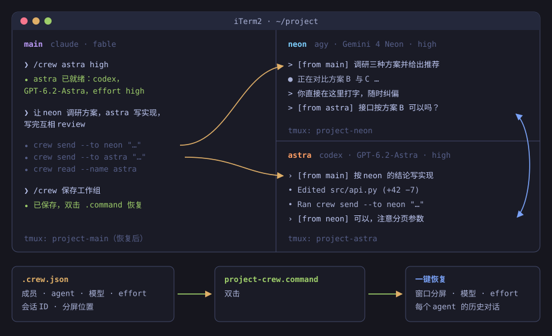

# crew

一个 [Claude Code](https://claude.com/claude-code) skill：在 iTerm2 里给当前会话分屏，几秒钟拉起一个新的 agent（Codex、Antigravity `agy`、Claude Code），指定模型和思考强度；agent 之间通过 tmux 互发消息；整组可以保存到项目目录，之后一键恢复窗口、模型、effort 和每个 agent 的历史对话。



## 适合什么场景

**快速多 agent。** 正在和 Claude Code 干活，想让另一个模型并行做一块（调研、写实现、做 review），输入 `/crew astra high` 就多一个窗格，不用自己开终端、进目录、起 tmux、敲启动参数。

**监控中间态，随时微调。** 每个 agent 都是真实的交互式界面，就在你眼前的窗格里跑。它在想什么、改了哪些文件、卡在哪一步，都直接看得到；发现方向偏了，直接在那个窗格里打字纠正，不用等它跑完再返工。这是它和后台子 agent 最大的区别。

**跨模型协作。** 不同厂商的模型放进同一个组，主会话可以分派任务、读取各自的进展，组员之间也能直接对话（比如让一个写、一个审）。

**长期项目。** 讨论到一半要关机，保存一下；下次双击一个文件，整组 agent 带着各自的上下文回到原来的分屏位置。

## 安装

```bash
git clone https://github.com/garmanwu/crew ~/.claude/skills/crew
```

需要 macOS、iTerm2、`tmux`、`python3`，以及要用到的 agent CLI（`codex`、`agy`、`claude`，已登录）。重启 Claude Code 后即可使用 `/crew`。

## 用法

在项目目录里的 Claude Code 会话（称为 main）中：

```
/crew                      # 列出 6 个模型（codex、agy、claude 各前 2 个），回一行选择，如：2 design high
/crew astra high           # 直接指定：模型 astra，effort high
/crew 保存工作组            # 保存成员、模型、effort、会话 ID、分屏位置
```

也可以直接用自然语言：

```
新开一个 codex 叫 design，用 astra，effort high
让 design 看一下 SPEC.md 第 3 节，给出修改建议
看看 design 现在做到哪了
```

恢复：先退出 main 所在的窗口，然后双击项目目录里的 `<目录名>-crew.command`。

### 每一步发生了什么

| 操作 | 结果 |
|---|---|
| 新开 agent | 在 main 旁边分屏，进入同一目录，新建 tmux 会话 `<目录名>-<名称>`，带模型和 effort 启动，并告诉它组里有谁、怎么发消息 |
| 发消息 | 文本送进对方的输入框并提交，自动带 `[from 发送者]` 前缀 |
| 读进展 | 读取对方窗格当前的屏幕内容 |
| 保存 | 重新读取每个窗格当前的会话 ID，写入 `.crew.json`，生成 `<目录名>-crew.command` |
| 恢复 | 新开一个 iTerm2 窗口，按原来的分屏顺序恢复每个 agent 的对话；tmux 会话还活着时直接接回去，不重启 |

### 直接用脚本

skill 背后只有一个脚本，agent 之间也是用它通讯：

```bash
CREW=~/.claude/skills/crew/scripts/crew.py
python3 $CREW models
python3 $CREW spawn --name design --agent codex --model gpt-6.2-astra --effort high
python3 $CREW send --to design "请看一下 SPEC.md 第 3 节"
python3 $CREW read --name design --lines 80
python3 $CREW status
python3 $CREW save
python3 $CREW restore --dir <项目目录>
```

## 需要知道的

- **Codex 默认以 full access 启动**（`-s danger-full-access -a never`）：执行命令不受沙箱限制，也不请求审批，范围是整台机器。原因是 Codex 的沙箱会拦住 tmux，关掉才能主动给组员发消息。想保留沙箱就在新开时说"保留沙箱"（`--sandbox`），这时它只能被读取，不能主动发消息。
- **main 第一次不在 tmux 里**，组员给它发不了消息，由 main 去读组员的窗格。恢复过一次之后 main 也在 tmux 里，才是双向通讯。
- **main 的原窗口还开着时拒绝恢复**，避免同一个对话被两个进程同时写入。
- tmux 会话名带目录名前缀，不同项目里同名的 agent 不会互相干扰。
- 只恢复分屏结构，不恢复窗格的精确尺寸。
- 目前只支持由 Claude Code 会话作为 main 建组。
- 没有"移除成员"命令：`tmux kill-session -t <目录名>-<名称>`，再从 `.crew.json` 里删掉对应成员。

模型列表、启动参数和会话存储位置在 2026-11 用 Claude Code 2.1、codex-cli 0.170、agy 1.5 验证过；这些 CLI 更新后可能需要调整。
