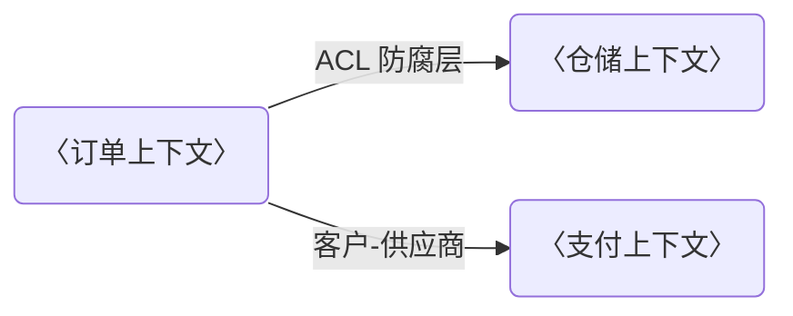
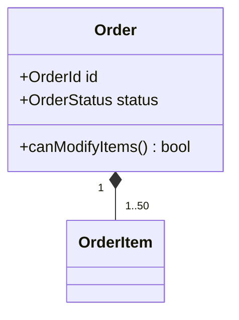

# DDD-DESIGN：〈系统/领域名〉领域设计与数据合同

> **产出者**：架构师/领域专家——领域模型的唯一权威记录者；AI 编程智能体可整理术语与事件清单，人类签发
> **受众**：架构师/后端/DBA/新成员 + AI 编程智能体（按聚合边界与事件合同生成代码骨架与消费方）
> **归档**：`docs/project/ddd-design.md`；纪律：先上下文，后模型，最后合同；只链接不复制（同一信息只维护一处）
> **真值源**：模块划分与聚合边界以 `./design.md` 为准；接口载荷以 `./api-contract.md` 为准；表结构以数据库 Schema 文件为准；领域划分争议列 blocked_on 回架构师，不擅自切边界
> **质量门禁**：① 每个限界上下文有聚合根与依赖方向 ② 每个聚合根的不变量显式且落到代码守卫点 ③ 跨上下文仅经三种合同通信、无共享库表 ④ 事件合同含投递语义

## 1. 领域全景

〈填写指引：核心域/支撑域/通用域划分及一句话理由；划分决定投入优先级——核心域自建并持续投入，支撑域够用即可，通用域优先外购/开源；理由写价值判断而非功能罗列。〉

| 域类型 | 领域 | 一句话理由 |
|---|---|---|
| 示例：核心域 | 〈订单履约〉 | 〈履约时效是差异化竞争力，自建〉 |
| 示例：支撑域 | 〈库存〉 | 〈服务核心域，够用即可〉 |
| 示例：通用域 | 〈通知〉 | 〈无差异化，直接用云服务〉 |

## 2. 限界上下文

〈填写指引：上下文映射只画依赖方向与关系类型——合作/防腐层（ACL）/共享内核/客户-供应商；防腐层必须落到代码路径；表中的上下文与代码模块/目录一一对应，AI 编程智能体按名索引代码。〉

| 上下文 | 职责 | 关键聚合根 | 上游/下游 | 集成方式 |
|---|---|---|---|---|
| 示例：order | 〈订单生命周期管理〉 | 〈Order〉 | 〈下游：wms、notification〉 | 〈事件发布 + 订阅方 ACL〉 |

## 3. 领域模型（逐上下文）

〈填写指引：按上下文逐节展开——实体/值对象/聚合根/领域事件，classDiagram 或表择一不混用；不变量必须写成可执行的守卫规则并注明代码位置——聚合边界靠不变量执法，写"需要保持一致性"这类空话不执法。示例：order 上下文。〉

- 聚合根不变量：〈"订单支付后不可改明细"——守卫于 src/domain/order/order.ts canModifyItems()，违反抛 InvariantViolationError〉

| 构造 | 类型 | 说明 |
|---|---|---|
| 示例：OrderItem | 实体 | 〈订单行，仅可经聚合根 Order 修改〉 |
| 示例：Address | 值对象 | 〈不可变，相等性按值比较〉 |
| 示例：order.paid | 领域事件 | 〈支付完成时发布，载荷见第 4 节事件合同〉 |

## 4. 数据合同

〈填写指引：跨上下文只经三种合同通信，本文维护合同清单与归属；载荷/DDL 细节一律链接不复制——载荷与错误码链 `./api-contract.md` 对应端点，DDL 链 Schema 文件；事件合同必须写投递语义，消费方按语义设计幂等。〉

- **API 合同**（跨上下文接口清单）：〈接口/方向/承载 FR；载荷与错误码细节链 `./api-contract.md` 对应端点，不复制〉

- **库表合同**（核心表归属）：

| 核心表 | 归属上下文 | 对外暴露字段 |
|---|---|---|
| 示例：orders | 〈order〉 | 〈只读：id/status/total；其余字段仅本上下文可访问〉 |

（DDL 细节链 〈db/schema.sql〉，不复制）

- **事件合同**：

| 事件名 | 载荷结构 | 发布方 | 订阅方 | 投递语义（至少一次/恰好一次） |
|---|---|---|---|---|
| 示例：order.paid | 〈orderId/paidAt/amount，结构摘要〉 | 〈order〉 | 〈wms、notification〉 | 〈至少一次；订阅方须幂等〉 |

## 5. 演进规则

〈填写指引：边界变更（拆分/合并上下文、聚合迁移）走 ADR 流程（`./adr/`），先决策后改模；数据合同变更走 `./api-contract.md` 第 6 节变更规则，事件合同 breaking change 同样升版本并通知全部订阅方；未经此二流程的边界/合同改动按违规处理。〉

## 红线自查（一票否决，提交前逐条勾选）

- [ ] 先上下文后模型：所有聚合均落在某个限界上下文内，无"游离聚合"
- [ ] 每个聚合根的不变量显式且已注明代码守卫点
- [ ] 跨上下文无共享库表直连，仅经 API/库表/事件三种合同
- [ ] 领域划分争议已列 blocked_on 回架构师，未擅自切边界
- [ ] 载荷与 DDL 细节未复制（只有链接与摘要）
- [ ] 事件合同均含投递语义；至少一次语义已注明"订阅方须幂等"

## 追踪链

| 方向 | 对象 | 说明 |
|---|---|---|
| 上游（本文消费） | 〈`./design.md` 第 5 节构建块 / `./api-contract.md` / 〈db/schema.sql〉 / ADR-NNNN〉 | 领域划分的输入依据 |
| 下游（消费本文） | 〈`./design.md` 第 8 节横切概念 / 后端代码骨架 / 事件订阅方实现 / 评审清单〉 | 按本设计实现与验证的对象 |
