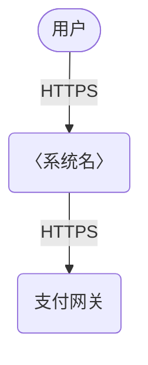
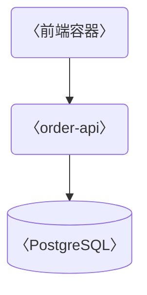
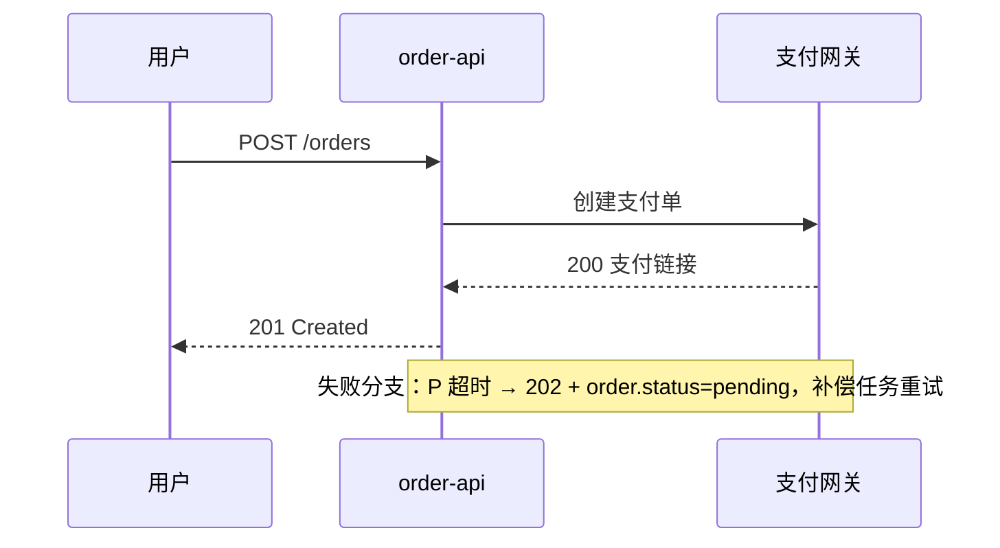
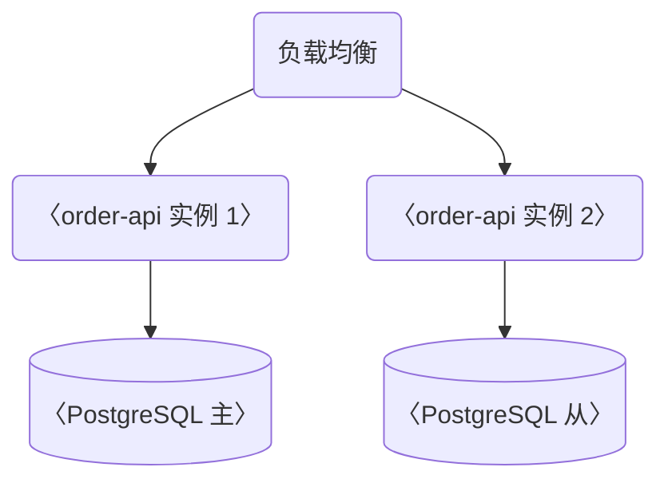

# DESIGN：〈系统/模块/特性名——一句话定位，如"订单中心：承接交易主链路的核心领域服务"〉（arc42 + C4）

> **产出者**：架构师/技术负责人——架构的唯一权威记录者；AI 编程智能体可起草，人类架构师签发
> **受众**：全体项目参与者（人类 + AI 编程智能体）；实现、评审、测试均以本文件为蓝图
> **归档**：`docs/project/design.md`；裁剪原则：12 章按项目规模裁剪，可合并不可静默省略，被裁章节保留标题并写"不适用 + 原因"
> **真值源**：架构本身。决策细节链 `./adr/` 档案；部署事实以 `./deploy-guide.md` 为准；业务流程以 `./business-process.md` 为准；与实现漂移即缺陷
> **质量门禁**：① 图示统一 Mermaid ② 每个重大选型可追溯至 ADR-NNNN ③ 约束与决策严格分列 ④ 核心场景时序覆盖正常与失败分支

## 1. 引言与质量目标

〈填写指引：一段话说明本设计覆盖的范围与动机，链接需求出处（`./req-spec.md` 的 FR-NNN）；范围外的显式排除，防止 AI 编程智能体过度泛化。示例：本设计覆盖下单到支付回调全链路，对应 FR-001–FR-014；履约调度不在本篇范围。〉

**干系人及关注点**（每人一行）：

| 干系人 | 关注点 |
|---|---|
| 示例：运维 | 发布可回滚、日志可查、可水平扩 |

**质量目标**（≤5 条，可量化，验收时逐条核验）：

- 〈如：下单接口 P95 < 300ms（1000 TPS 基准）；可用性 ≥ 99.9%；故障恢复 RTO < 5min〉

## 2. 架构约束

〈填写指引：硬约束——"没得选"的既成事实：技术栈锁定、组织结构、合规法规、既有系统，每条注明来源。纪律：约束与决策严格分列——约束是"没得选"，决策是"选了"；误把决策写成约束会让读者（尤其 AI）失去质疑与重估入口，决策须链 ADR（`./adr/`）。〉

| 类型 | 约束 | 来源 |
|---|---|---|
| 示例：技术 | 〈运行时锁定 Node.js 20 LTS〉 | 〈组织既有平台 / ADR-0003〉 |
| 示例：组织 | 〈后端仅 2 人，无专职运维〉 | 〈团队现状〉 |
| 示例：合规 | 〈用户手机号落库须加密〉 | 〈个保法 / 内部安全规范〉 |

## 3. 系统范围与上下文（C4-L1）

〈填写指引：本系统画为一个黑盒，只画边界——外部用户/角色/系统与本系统的交互，不暴露内部结构。对外契约逐条列明：暴露什么（API/事件/文件）、消费什么（第三方 API/数据源）；这是 AI 编程智能体判断改动影响面的依据。〉

| 元素 | 类型 | 职责 | 交互协议 |
|---|---|---|---|
| 示例：支付网关 | 外部系统 | 〈渠道收款与回调〉 | 〈HTTPS + Webhook〉 |

对外契约清单（逐条，不遗漏）：〈暴露：`POST /api/v1/orders`（`./api-contract.md` 第 2 节）、事件 `order.paid`（`./ddd-design.md` 第 4 节）；消费：短信通道、对象存储〉

## 4. 解决方案策略

〈填写指引：核心思路 3-5 条——分层方式/架构风格/关键取舍，每条链接承载它的 ADR-NNNN；本节是全文导读，读者据此决定精读哪几章。示例：①事件驱动解耦下单与履约（ADR-0007）；②CQRS 仅用于订单查询侧（ADR-0009）。〉

## 5. 构建块视图（C4-L2 容器）

〈填写指引：先按下表取舍 C4 级别再画图；容器名与代码仓库/目录名一致，AI 编程智能体按名索引代码。〉

| C4 级别 | 画什么 | 何时需要 |
|---|---|---|
| L1 上下文 | 系统黑盒与外部交互 | 必画（本篇最低门槛，对应第 3 节） |
| L2 容器 | 部署单元及其依赖 | 默认画（本节） |
| L3 组件 | 容器内模块划分 | 仅复杂容器；简单容器展开是过度设计 |

| 容器 | 职责 | 技术 | 对外接口 | 依赖 |
|---|---|---|---|---|
| 示例：order-api | 〈订单领域逻辑〉 | 〈Node.js 20 / PostgreSQL 16〉 | 〈REST，`./api-contract.md` 第 2 节〉 | 〈pay-gw、kafka〉 |

白盒展开（仅复杂容器，L3 组件级）：〈模块划分与依赖方向，对齐 `./ddd-design.md` 第 2 节限界上下文；不重复其聚合细节〉

## 6. 运行视图

〈填写指引：关键场景时序 ≤5 个（Mermaid sequenceDiagram），覆盖正常分支与失败分支（超时/降级/补偿）；场景取自 `./req-spec.md` 核心场景，图前标注场景编号。业务视角端到端流程链 `./business-process.md`，互链不重复——本节只写组件间消息顺序。〉

场景：〈FR-001 正常下单〉

## 7. 部署视图

〈填写指引：部署节点/网络边界/协议/环境差异。本节画结构，`./deploy-guide.md` 写操作步骤；两文冲突 = 文档缺陷，以 DEPLOY-GUIDE 为准并回改本节。〉

## 8. 横切概念

〈填写指引：鉴权/错误处理/日志/幂等/事务等贯穿机制的全局约定——只写"本项目怎么做"，通用规则引用 `./dev-standards.md` 与 ADR，不复制全文（同一信息只维护一处）。示例：错误码结构以 `./dev-standards.md` 第 3 节为基线；幂等键 = Idempotency-Key 头，TTL 24h，实现于 src/middleware/idempotency.ts。〉

## 9. 架构决策（ADR 索引）

〈填写指引：索引本项目全部相关 ADR；状态与日期逐条对照 `docs/project/adr/NNNN-*.md` 档案头核对，索引与档案不一致即缺陷；superseded 条目保留且 superseded-by 链完整可追溯。〉

| ADR | 标题 | 状态 | 日期 |
|---|---|---|---|
| 示例：[ADR-0007](./adr/0007-event-driven.md) | 〈服务间通信采用事件驱动〉 | accepted | YYYY-MM-DD |

## 10. 质量需求

〈填写指引：第 1 节质量目标的展开：按场景写负载模型/性能/可用性/安全/可运维性，每条可度量可验证；"当前达标状态"在 doc-class 转 as-is 后维护，写明验证方式（压测报告/监控链接）。〉

| 质量属性 | 场景 | 度量 | 当前达标状态 |
|---|---|---|---|
| 示例：性能 | 〈1000 TPS 下单〉 | 〈P95 < 300ms〉 | 〈未测 / 已达标：压测报告链接〉 |

## 11. 风险与技术债

〈填写指引：只汇总不新增结论——来源限于评审报告/安全评估/测试报告；新发现的风险先入对应报告再索引到此；责任角色必须落到具体角色而非"团队"。〉

| 风险/债务 | 影响 | 缓解计划 | 责任角色 |
|---|---|---|---|
| 示例：〈单点 Redis〉 | 〈缓存击穿致全量穿透 DB〉 | 〈多副本 + 熔断，ROADMAP BK-021〉 | 〈后端负责人〉 |

## 12. 词汇表

〈填写指引：只收本篇高频且易歧义的术语，首次出现给英文原文；通用术语不收，项目专属黑话必收。〉

| 术语 | 含义 |
|---|---|
| 示例：履约单 | 〈订单支付成功后生成的仓储执行指令，order.fulfilled 事件载体〉 |

## 红线自查（一票否决，提交前逐条勾选）

- [ ] C4-L1 上下文图存在且系统为黑盒
- [ ] 每个重大选型链接至 ADR-NNNN 且其状态非 rejected
- [ ] 约束与决策严格分列——没有把"选了"写成"没得选"
- [ ] 部署视图与 `./deploy-guide.md` 一致，冲突已回改
- [ ] 核心场景时序覆盖正常与失败分支
- [ ] 现状与目标不混节——to-be 口吻统一，无现在时事实陈述
- [ ] 被裁章节均保留标题并标注"不适用 + 原因"，无静默省略

## 追踪链

| 方向 | 对象 | 说明 |
|---|---|---|
| 上游（本文消费） | 〈`./req-spec.md` FR-NNN / ADR-NNNN / 既有系统文档〉 | 设计的输入依据 |
| 下游（消费本文） | 〈`./api-contract.md` / `./ddd-design.md` / `./dev-standards.md` / `./deploy-guide.md` / 评审清单〉 | 以本设计为蓝本的实现与派生文档 |
