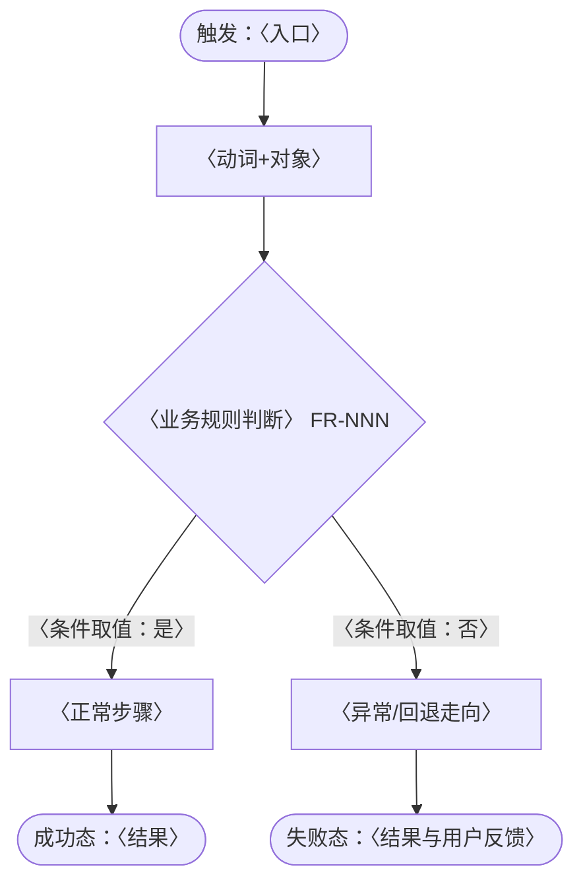
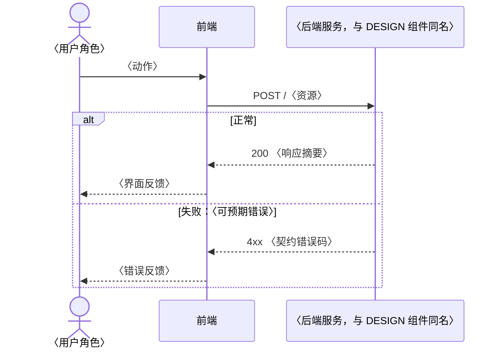

# 业务流程与时序（BUSINESS-PROCESS）：<产品/域名称>

> **产出者**：技术文档工程师——把 REQ-SPEC 的业务流程图示化；与需求/契约/实现不一致时列 blocked_on 回责任角色，不改图迁就现实，也不改代码迁就图
> **受众**：业务方/产品、新成员、前后端联调（人类读者：端到端流程叙事）；AI 编程智能体（BP-nn 可追踪、节点可对照 FR 与契约端点）
> **归档**：`docs/project/business-process.md`（本文件即业务流程图示的唯一权威记录）
> **真值源**：业务流程步骤与业务规则 = REQ-SPEC（`./req-spec.md`，FR 与业务规则条目）；系统交互时序 = API-CONTRACT（`./api-contract.md`）+ DESIGN（`./design.md`）+ 代码实际实现。不一致列 blocked_on 回需求分析师/架构师
> **质量门禁**：① 每个 BP-nn 图含异常/回退路径且终点收口成功态与失败态 ② 判断分支标承载 FR 编号、分支条件写明取值 ③ 时序图正常+失败分支成对出现 ④ 消息标注契约端点、参与方命名与 API-CONTRACT 端点归属及 DESIGN 组件命名一致

## 1. 流程清单

| 编号 | 端到端业务流程 | 触发者 | 前置条件 | 关联 FR | 关键业务规则 |
|---|---|---|---|---|---|
| 示例：BP-01 | 订单提交到支付完成 | 买家 | 购物车非空 | FR-001, FR-002 | 引用 FR 编号及其 GWT（`./req-spec.md`），不另写规则副本 |

〈填写指引：编号 `BP-nn`，一经分配不复用；流程名体现端到端（"动词到动词"）；只收跨角色/跨系统的端到端流程——单页操作流程归 UI-SPEC §3（`./ui-spec.md`），文字行为场景归 USER-STORY §4（`./user-stories.md`），互链不重复。〉

## 2. 业务流程图（Mermaid flowchart）

每个 BP-nn 一张图，必须包含：

- **触发入口与正常路径**：步骤按 REQ-SPEC 顺序，节点标动词+对象（如"提交订单"）。
- **判断分支**：标承载它的 FR 编号，分支条件写明取值（如"库存 ≥ 数量 {FR-003}"）；REQ-SPEC 未覆盖的分支列 blocked_on 回需求分析师，不发明规则。
- **异常/回退路径**：失败、超时、取消、部分完成的走向——不只画 happy path。
- **流程终点**：成功态与失败态均显式收口，不留悬空节点。

〈填写指引：图节点名与第 4 节追踪矩阵"流程步骤"列逐字一致，便于 AI 与人对照；异常路径写明系统行为（回滚/保留草稿/重试入口），"报错"不是路径描述。〉

## 3. 关键场景时序图（Mermaid sequenceDiagram）

每个关键场景一张图（与 BP-nn 对应），必须包含：

- **参与方**：用户角色/前端/后端服务/外部系统，命名与 API-CONTRACT 端点归属、DESIGN（`./design.md`）组件命名一致。
- **正常分支 + 失败分支**成对出现：失败分支至少覆盖一个可预期错误（校验失败、下游超时），错误响应对应契约错误码。
- **消息标注端点**：如 `POST /orders`，与 API-CONTRACT（`./api-contract.md`）逐一可对照；契约未定义的交互列 blocked_on，不凭想象补端点。

〈填写指引：本文与 DESIGN §6 运行视图的分工——本文是业务视角（参与方为角色与系统），DESIGN 是架构视角（组件级运行场景），互链不重复；与 USER-STORY §4 文字用例互链不复制。〉

## 4. 流程-需求追踪矩阵

| 流程步骤（图节点） | 所属流程 | 对应 FR | 验收锚点 |
|---|---|---|---|
| 示例：提交订单 | BP-01 | FR-001 | GWT 见 `./req-spec.md` FR-001，只引用不复制 |

〈填写指引：孤儿步骤（无 FR 对应）列 blocked_on 回需求分析师；FR 未被任何流程覆盖的，在下表风险登记如实列出，不隐藏。〉

| 风险登记 | 说明 | 去向 |
|---|---|---|
| 示例：FR-005 未被任何 BP 覆盖 | 属单页操作，已由 UI-SPEC §3 承载，或为覆盖缺口 | 已由 UI-SPEC 承载（`./ui-spec.md` §3）/ blocked_on 回需求分析师 |

## 5. 术语表

| 业务术语 | 含义 | 真值源 |
|---|---|---|
| 示例：履约 | 订单从支付完成到用户签收的全过程 | REQ-SPEC / DESIGN 领域模型（`./design.md`），链接不复制定义 |

〈填写指引：只收业务方与工程理解有分歧风险的术语；同一术语在本文全部图中含义一致；术语定义不在此复制，链真值源。〉

## 红线自查（一票否决，提交前逐条勾选）

- [ ] 每个 BP-nn 图有异常/回退路径，终点显式收口成功态与失败态，无悬空节点
- [ ] 判断分支均标承载 FR 编号且分支条件写明取值；REQ-SPEC 未覆盖的分支已列 blocked_on
- [ ] 时序图正常+失败分支成对出现，错误响应与契约错误码对应
- [ ] 时序消息标注的端点全部在 API-CONTRACT 可查，参与方命名与 DESIGN 组件一致
- [ ] 未出现"改图迁就现实"或"改代码迁就图"——不一致均已列 blocked_on 回责任角色
- [ ] 未被流程覆盖的 FR 已在风险登记如实列出

## 追踪链

| 方向 | 对象 | 说明 |
|---|---|---|
| 上游（本文消费） | REQ-SPEC（`./req-spec.md`）/ API-CONTRACT（`./api-contract.md`）/ DESIGN（`./design.md`）/ 代码实际实现 | 流程步骤、业务规则、端点与组件命名的真值 |
| 下游（消费本文） | USER-STORY §4（`./user-stories.md`，文字用例互链）/ UI-SPEC §3（`./ui-spec.md`，页面交互视角）/ TEST-PLAN 场景用例（`./test-plans/`）/ 新成员 onboarding | 业务流程全景的图示入口 |
