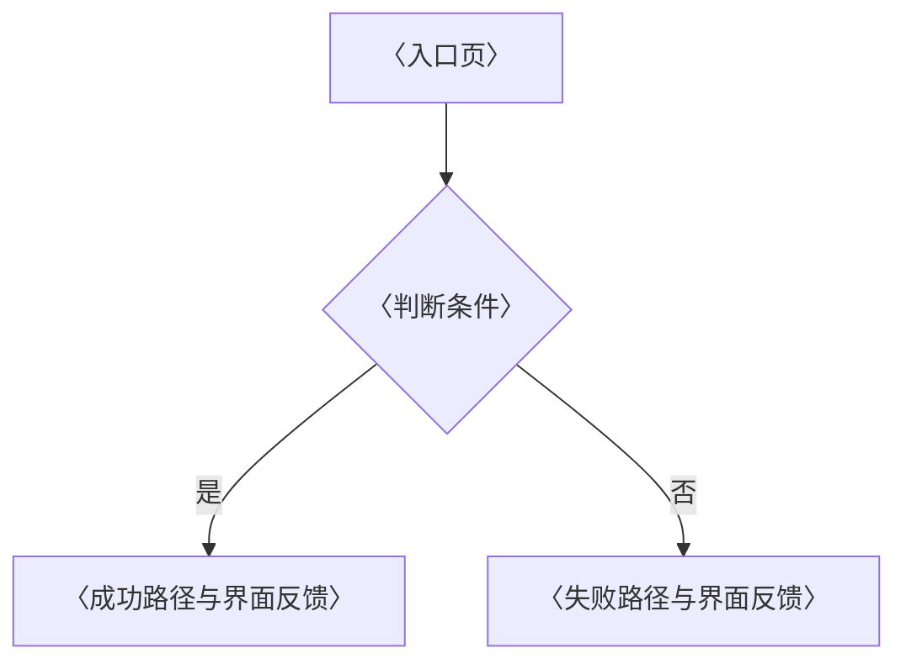

# UI/UX 规格（UI-SPEC）：<产品/模块名称>

> **产出者**：UI/UX 设计师——与前端工程师协同维护；实现与本文不一致时，要么按本文修实现、要么走评审修订本文，不允许"文档一套、界面一套"
> **受众**：前端工程师/AI 编程智能体（像素级可执行规范：hex、px、路由、端点）；产品验收者
> **归档**：`docs/project/ui-spec.md`（本文件即界面实现的唯一权威规范）
> **真值源**：需求与验收 = REQ-SPEC（`./req-spec.md`）；业务流程全景 = BUSINESS-PROCESS（`./business-process.md`）；接口定义 = API-CONTRACT（`./api-contract.md`）——本文定义"界面长什么样、如何反馈"，不复制业务规则与接口定义
> **质量门禁**：① 组件五态齐全（默认/悬停或聚焦/激活/禁用/加载）② 空/载/错/禁四类全局态有约定 ③ 文本对比度 ≥4.5:1 ④ 第 2 节每页数据来源端点在 API-CONTRACT 可查

## 1. 页面清单与层级

| 页面 | 路由 | 入口 | 出口 | 优先级 |
|---|---|---|---|---|
| 示例：订单详情 | /orders/:id | 订单列表行点击 | 改址成功 → 详情页刷新 | P0 |
| 示例：改收货地址 | /orders/:id/address | 订单详情"修改地址"按钮 | 保存成功 → 返回订单详情 | P0 |

〈填写指引：路由必须与代码路由一致，是 AI 编程智能体与测试的定位锚点；入口/出口保证页面不悬空——没有出口的页面要么补出口，要么说明终态（如支付完成页）；优先级沿用 REQ-SPEC 对应 FR，不改写。〉

## 2. 信息架构（逐页）

### 〈页面名〉

- **区块划分**：首屏必见〈填写指引：不滚动即可完成主任务的区块〉 / 滚动可见〈次要信息〉 / 折叠〈默认收起的内容〉
- **数据来源**：依赖端点对应 API-CONTRACT（`./api-contract.md`），如 `GET /orders/:id`；契约未定义的端点列 blocked_on 回后端，不凭想象补端点
- **全局态呈现**：空数据〈呈现内容 + 引导动作〉 / 加载中〈骨架屏或 spinner 及出现时机〉 / 错误〈文案 + 重试入口〉 / 无权限〈文案与申请路径〉

〈填写指引：每页一节（复制本节结构），四类全局态各自写清"呈现什么"，禁止"同上"；空态必须有下一步引导动作，不是只放插画；错误态文案说清"错在哪、怎么改"。〉

## 3. 核心交互流（Mermaid）

> 只画页面交互视角（单任务跨页反馈）；端到端业务全景链 BUSINESS-PROCESS（`./business-process.md`），互链不重复。

〈填写指引：节点用页面/组件名，边上标触发动作；失败路径必须写明界面反馈（错误提示、停留页面、字段聚焦）——这是前端实现的直接依据；一个核心任务一张图，不超过 3 张。〉

## 4. 组件复用清单

| 组件 | 五态 | 使用页面 |
|---|---|---|
| 示例：Button | 默认/悬停/激活/禁用/加载 | 全局 |

〈填写指引：清单与组件库一一对应，五态任何一态未定义即不可入库；新建页面前先查本表复用，重复造组件视为缺陷；五态中"悬停或聚焦"按输入设备取一即可，触屏取聚焦/按压态。〉

## 5. 视觉规范

- **色板**：主色〈hex〉、辅色〈hex〉；语义色：成功〈hex〉 / 警告〈hex〉 / 危险〈hex〉 / 信息〈hex〉；文本对比度 ≥4.5:1（与背景逐对核验，记录核验结果）。
- **字号阶梯**：12/14/16/20/24/32（px；阶梯外字号视为缺陷）。
- **间距体系**：4/8 网格（8 的倍数）。
- **圆角与阴影**：〈约定 + 数值，如圆角 4/8，阴影仅 elevation-1/2 两层〉。

〈填写指引：视觉规范对全部页面生效，是 AI 编程智能体生成样式的硬约束；色值、字号、间距必须写数值，"与设计稿一致"不是规范。〉

## 6. 响应式断点

| 断点 | 范围 | 布局策略 |
|---|---|---|
| 移动 | <768px | 单列 |
| 平板 | 768-1024px | 双列 |
| 桌面 | >1024px | 固定侧栏 |

〈填写指引：范围与数值须与 REQ-SPEC NFR 兼容性条目一致；布局策略写到"工程师不看稿也能搭布局"的粒度，如"侧栏收起为底部 Tab"。〉

## 7. 表单规范（逐字段）

| 字段 | 类型 | 校验 | 错误文案（人话） | 默认值 |
|---|---|---|---|---|
| 示例：收货地址 | 多行文本 | 必填，≤50 字 | 请填写收货地址，最多 50 字 | 上次下单地址 |
| 示例：收件人手机号 | 文本 | 必填，11 位数字 | 请输入 11 位手机号 | 上次下单手机号 |

〈填写指引：错误文案面向最终用户说人话，说清"错在哪、怎么改"，禁止"Invalid input"；校验规则须有 REQ-SPEC 对应 FR 的 GWT 支撑，REQ-SPEC 没有的校验先回需求分析师补 FR，不擅自加；默认值写明来源（上次值/空/服务端下发）。〉

## 红线自查（一票否决，提交前逐条勾选）

- [ ] 组件复用清单五态齐全，无缺态组件
- [ ] 每页四类全局态（空/载/错/禁）呈现均已写明，无"同上"
- [ ] 文本对比度 ≥4.5:1，色值与背景逐对核验过
- [ ] 数据来源端点全部可在 API-CONTRACT 查到，无凭想象补的端点
- [ ] 表单校验规则全部有 FR（GWT）支撑
- [ ] 核心交互流每张图含失败路径与界面反馈

## 追踪链

| 方向 | 对象 | 说明 |
|---|---|---|
| 上游（本文消费） | REQ-SPEC（`./req-spec.md`）/ PERSONA（`./personas/`，技能水平与文案口吻）/ API-CONTRACT（`./api-contract.md`）/ BUSINESS-PROCESS（`./business-process.md`，流程上下文） | 验收标准、用户假设、端点与流程真值 |
| 下游（消费本文） | 前端实现与组件库 / TEST-PLAN UI 用例（`./test-plans/`）/ DESIGN 前端结构（`./design.md`） | 界面实现的直接规范 |
