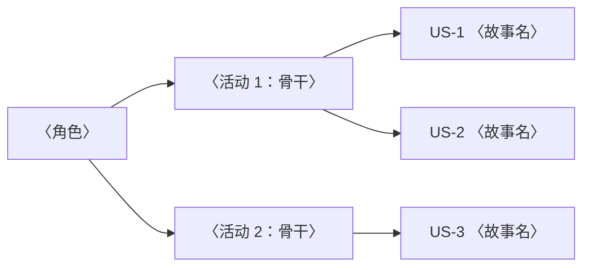

# 用户故事与用例（USER-STORY）：<产品/迭代名称>

> **产出者**：产品经理/技术文档工程师——对 REQ-SPEC 做故事化/场景化转译
> **受众**：产品/开发/测试（迭代规划与沟通语言）；实现细节见 DESIGN（`./design.md`）与 API-CONTRACT（`./api-contract.md`），不在本文
> **归档**：`docs/project/user-stories.md`（本文件即故事/用例的唯一权威记录；用例指行为场景，测试用例归 TEST-PLAN）
> **真值源**：REQ-SPEC（`./req-spec.md`）——只做故事化/场景化转译，不发明需求；无法映射到 FR 的故事列 blocked_on 回需求分析师
> **质量门禁**：① 每个故事至少映射一个 FR ② 优先级沿用 REQ-SPEC 不改写 ③ 验收标准逐条引用对应 FR 的 GWT、不写副本 ④ 每个 FR 至少映射一个故事，P0/P1 FR 至少映射一个用例

## 1. 用户角色（Persona）

| 角色 | 画像要点 | 目标 | 对应 PERSONA |
|---|---|---|---|
| 示例：买家 | 价格敏感、移动端为主 | 省心完成下单与售后 | 〈persona-id + 链接 `./personas/<persona-id>-<名称>.md`〉 |

〈填写指引：角色集合与 REQ-SPEC §2 一致，不新增角色；画像要点一句话，细节链 PERSONA，不复制画像内容。〉

## 2. 用户故事地图

〈填写指引：
- 三层结构"角色 → 活动（骨干行）→ 故事"；纵向切片 = 一个端到端可交付价值，按列竖切即一个可演示增量。
- 骨干活动对齐 REQ-SPEC §2 核心场景（≤3 个），不凭空加活动；与 PRD §2、REQ-SPEC §2 三处同名同序。
- 故事编号与第 3 节清单一致，地图上不出现清单外的故事。〉

## 3. 用户故事清单

| 故事 ID | 用户故事（作为〈角色〉，我希望〈行为〉，以便〈价值〉） | 对应 FR | 优先级 |
|---|---|---|---|
| 示例：US-1 | 作为买家，我希望发货前自助修改收货地址，以便不用联系客服 | FR-001 | P0 |
| 示例：US-2 | 作为买家，我希望改址后收到确认通知，以便放心订单会送到新地址 | FR-001 | P0 |

〈填写指引：
- 编号 `US-n`，一经分配不复用；一个 FR 可拆多个故事，一个故事至少映射一个 FR。
- 优先级沿用 REQ-SPEC 的 P0/P1/P2，不改写——故事与 FR 优先级冲突即映射错误，回查 REQ-SPEC。
- 验收标准不在故事里另写副本：逐条引用对应 FR 的 GWT（`./req-spec.md` FR-NNN）。
- 按 INVEST 自检（独立/可协商/有价值/可估/足够小/可测）：不满足"足够小"时拆分（拆出的故事沿用原 FR 映射、新编 US-n），其余项无法满足时列 blocked_on 回需求分析师，不硬凑。〉

## 4. 用例（行为场景）

### UC-1：〈用例名，动词+对象〉

- **参与者**：〈主参与者 + 次参与者，与 PERSONA 角色一致〉
- **前置条件**：〈系统状态，如：订单状态为"待发货"〉
- **主流程**：1. 〈步骤〉 2. 〈步骤〉 3. 〈步骤〉
- **备选/异常流程**：〈a1 与主流程第 1 步分叉：〈走向与结果〉；a2 与主流程第 n 步分叉：〈走向与结果〉〉
- **后置条件**：〈成功后的系统状态〉
- **对应 FR**：FR-001 〈备选流程分支无 FR 覆盖的，列 blocked_on 回需求分析师，不发明行为〉

### UC-2：〈按需复制本节结构〉

- **参与者**：〈主参与者 + 次参与者〉
- **前置条件**：〈系统状态〉
- **主流程**：1. 〈步骤〉 2. 〈步骤〉
- **备选/异常流程**：〈a1 与主流程第 n 步分叉：〈走向与结果〉〉
- **后置条件**：〈成功后的系统状态〉
- **对应 FR**：〈FR-NNN〉

〈填写指引：编号 `UC-n`，一经分配不复用；用例是行为场景的文字描述——图示化业务流程见 BUSINESS-PROCESS（`./business-process.md`），互链不重复；测试用例归 TEST-PLAN（`./test-plans/`），不在此重复。按需复制本节结构，每个 P0/P1 主流程 FR 至少一个用例。〉

## 5. 追踪矩阵

| FR | 用户故事 | 用例 |
|---|---|---|
| 示例：FR-001 | US-1, US-2 | UC-1 |
| 示例：FR-002 | US-3 | UC-2 |

〈填写指引口径：
- 每个 FR 至少映射一个故事；P0/P1（主流程）FR 至少映射一个用例。
- 孤儿故事/孤儿用例（映射不到 FR）= 需求缺口，列 blocked_on 回需求分析师，不保留无源故事。
- 验收状态不在本文件维护：见 TEST-REPORT（`../process/test-reports/`）的 FR 验收矩阵（同一信息只维护一处）。〉

## 红线自查（一票否决，提交前逐条勾选）

- [ ] 每个故事/用例可映射到 REQ-SPEC 的 FR，无发明需求；映射不到的已列 blocked_on
- [ ] 故事优先级与对应 FR 的优先级一致，未改写
- [ ] 验收标准全部为对 FR GWT 的引用，无副本
- [ ] 故事地图骨干活动 ≤3，与 REQ-SPEC §2 核心场景同名同序
- [ ] INVEST 不满足的故事已拆分或列 blocked_on，未硬凑
- [ ] P0/P1 FR 均已映射至少一个用例

## 追踪链

| 方向 | 对象 | 说明 |
|---|---|---|
| 上游（本文消费） | REQ-SPEC（`./req-spec.md`）/ PERSONA（`./personas/`）/ PRD §3 价值语句（`./prd.md`） | 需求真值、角色画像、产品价值口径 |
| 下游（消费本文） | TEST-PLAN / TEST-REPORT（`./test-plans/` / `../process/test-reports/`）/ BUSINESS-PROCESS（`./business-process.md`，图示互链）/ ROADMAP 迭代切分（`./ROADMAP.md`） | 故事是迭代规划与验收追踪的语言 |
