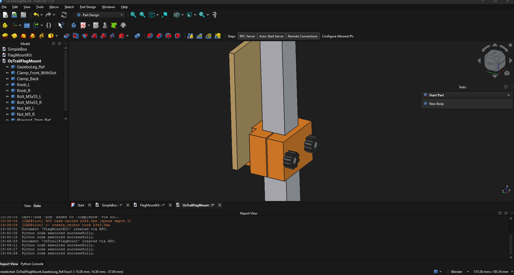
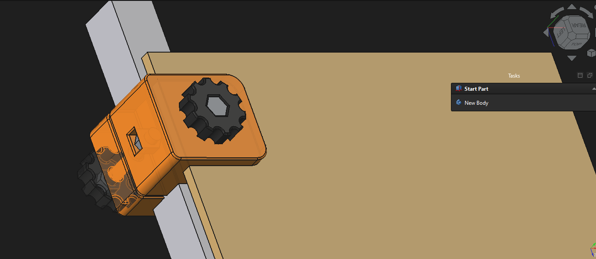
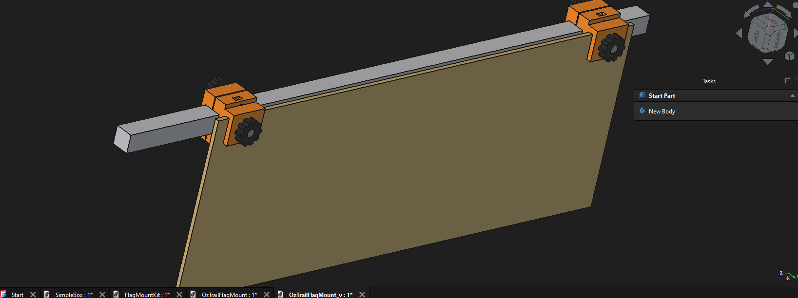

# FreeCAD CADPilot

Drive a local FreeCAD session from any model in OpenClaw. This skill registers [CADPilot](https://github.com/LBurny/cadpilot) as a local stdio MCP server, so you do not need Claude Desktop or a `claude_desktop_config.json` entry.



## What it does

- Connects OpenClaw to the FreeCAD GUI through `uvx cadpilot`.
- Keeps both hops local: MCP on stdio, FreeCAD RPC on `127.0.0.1:9875`.
- Calls only tools advertised by `openclaw mcp probe`.
- Models parts, checks geometry, and can export print-ready solids.





## Requirements

- [FreeCAD](https://www.freecad.org/), with the CADPilot addon installed and its RPC server started.
- [CADPilot](https://github.com/LBurny/cadpilot), launched as `uvx cadpilot`.
- [uvx](https://docs.astral.sh/uv/guides/tools/), available on `PATH`.
- [OpenClaw](https://openclaw.ai/), with MCP enabled.

CADPilot is the FreeCAD MCP server this skill launches. The older Claude Desktop setup uses [neka-nat/freecad-mcp](https://github.com/neka-nat/freecad-mcp) and the command `uvx freecad-mcp`. This skill replaces that Claude Desktop dependency. Any model available in OpenClaw can use it.

## Install

```bash
openclaw skills install @joeszeles/freecad-cadpilot
```

In FreeCAD, open the CADPilot workbench and start the RPC server before asking the agent to model.

## Use

Ask for the part in normal language. The agent proves FreeCAD is listening, registers `uvx cadpilot` if needed, probes the tool list, then calls the matching advertised tool.

Do not point MCP at the FreeCAD RPC URL, bind `0.0.0.0`, or enable remote FreeCAD access.
