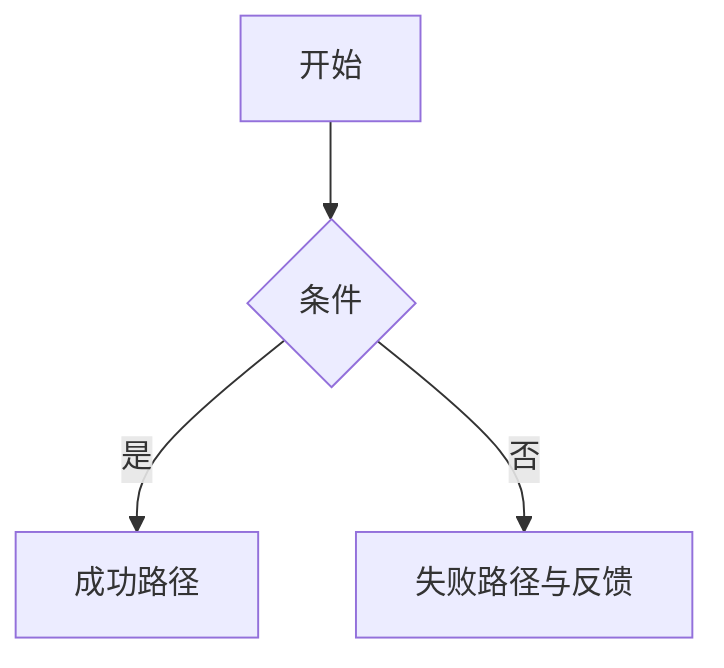

# UI/UX 规格（ui-spec）

> 产出者：UI/UX 设计师。归档：`docs/ui-spec.md`。
> 质量门禁：五态齐全（默认/悬停或聚焦/激活/禁用/加载）；空/载/错/禁四类全局态有约定。

## 1. 页面清单与层级

| 页面 | 路由 | 入口 | 出口 | 优先级 |
|---|---|---|---|---|

## 2. 信息架构（逐页）

### <页面名>

- **区块划分**：首屏必见 <…> / 滚动可见 <…> / 折叠 <…>
- **数据来源**：依赖端点（对应 api-contract）。
- **全局态呈现**：空数据 / 加载中 / 错误 / 无权限 各自如何呈现。

## 3. 核心交互流（Mermaid）

> 只画页面交互视角（单任务跨页反馈）；端到端业务全景流程见 `docs/business-process.md`
> （互链不重复）。

## 4. 组件复用清单

| 组件 | 五态 | 使用页面 |
|---|---|---|
| Button | 默认/悬停/激活/禁用/加载 | 全局 |

## 5. 视觉规范

- **色板**：主色 <hex>、辅色 <hex>、语义色（成功/警告/危险/信息）；文本对比度 ≥ 4.5:1。
- **字号阶梯**：12/14/16/20/24/32。
- **间距体系**：4/8 网格（8 的倍数）。
- **圆角与阴影**：<约定>。

## 6. 响应式断点

| 断点 | 范围 | 布局策略 |
|---|---|---|
| 移动 | <768px | 单列 |
| 平板 | 768-1024px | 双列 |
| 桌面 | >1024px | 固定侧栏 |

## 7. 表单规范（逐字段）

| 字段 | 类型 | 校验 | 错误文案（人话） | 默认值 |
|---|---|---|---|---|
