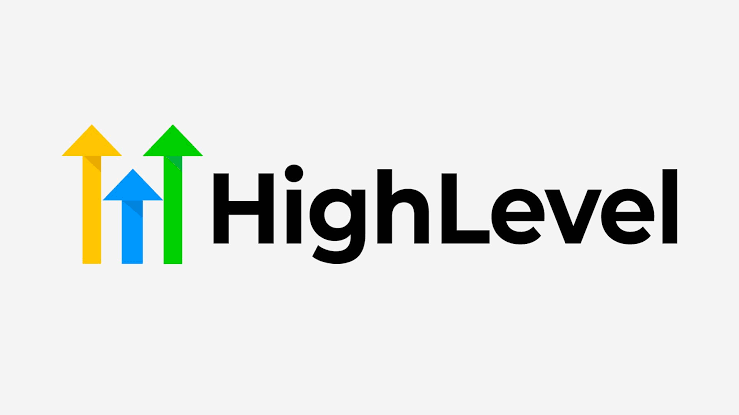

# 🎯 GoHighLevel Lead Qualifier & Conversational Triage
### *Qualificação Conversacional de Leads e Triagem Automática no GoHighLevel*

<p align="center">
  
</p>

<p align="center">
  <a href="https://clawhub.ai"></a>
  <a href="https://ia.sthub.com.br"></a>
  
  
</p>

---

## 🇺🇸 English

### Overview
**GHL Lead Qualifier** handles automated conversational triage for inbound leads entering GoHighLevel via webhooks or forms. It qualifies prospects naturally over WhatsApp/SMS, extracts key details (budget, urgency, requirements), and transitions opportunities across CRM Kanban stages.

### 🚀 Quick Onboarding & First-Time Setup
1. **Get your Access Token & GHL Credentials**:
   - Access the developer portal at [https://ia.sthub.com.br](https://ia.sthub.com.br) to generate your access token.
   - Obtain your GHL Private Integration Token and Location ID in your sub-account settings.
2. **Configure Environment Variables**:
   ```bash
   export HABILIS_API_KEY="hab_live_..."
   export GHL_API_KEY="pit-..."
   export GHL_LOCATION_ID="your_ghl_location_id"
   ```
3. **Usage Example**:
   ```bash
   hermes run "ghl-lead-qualifier: triage new inbound contact +5527999999999"
   ```

### Key Capabilities
- 💬 **Natural Conversational Triage**: Engages prospects without rigid robotic scripts.
- 🏷️ **Dynamic Tagging & Scoring**: Labels leads with interest tags and assigns priority status.
- 📋 **Automated Kanban Movement**: Moves deals into Active Follow-up or Qualified stages.

---

## 🇧🇷 Português

### Visão Geral
O **GHL Lead Qualifier** realiza triagem conversacional inteligente para novos leads recebidos via webhook ou formulários no GoHighLevel. Conduz o diálogo pelo WhatsApp/SMS de maneira natural, extrai necessidades e orçamento, e atualiza os estágios de negócio no CRM.

### 🚀 Onboarding Rápido & Primeiro Uso
1. **Obtenha seu Token de Acesso & Credenciais GHL**:
   - Acesse o portal de desenvolvedores em [https://ia.sthub.com.br](https://ia.sthub.com.br) para gerar seu token de acesso.
   - Obtenha seu Token de Integração Privada e Location ID no painel do GoHighLevel.
2. **Configure as Variáveis de Ambiente**:
   ```bash
   export HABILIS_API_KEY="hab_live_..."
   export GHL_API_KEY="pit-..."
   export GHL_LOCATION_ID="seu_ghl_location_id"
   ```
3. **Exemplo de Execução**:
   ```bash
   hermes run "ghl-lead-qualifier: triar novo contato +5527999999999"
   ```

### Principais Recursos
- 💬 **Triagem Conversacional Natural**: Diálogos fluidos sem scripts engessados.
- 🏷️ **Pontuação e Marcação Automática**: Adiciona tags de interesse e define urgência.
- 📋 **Avanço Automático de Etapas**: Move a oportunidade no Kanban conforme o nível de interesse do lead.

---

## 📦 Installation / Instalação

```bash
hermes skills install ghl-lead-qualifier
# or via clawhub
clawhub install ghl-lead-qualifier
```
