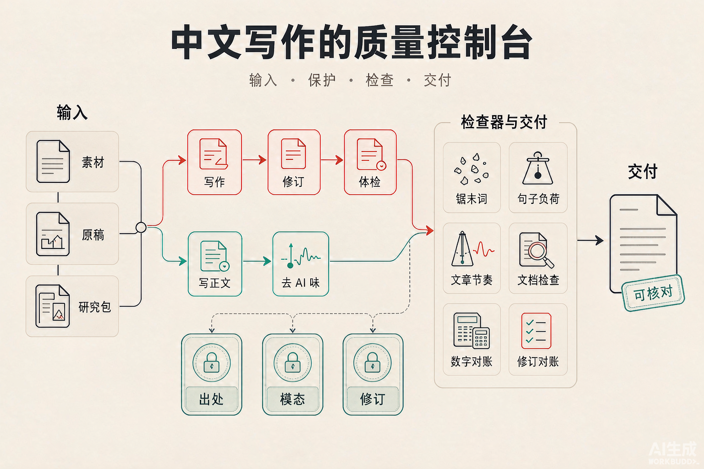

# hekouwang-writer-skill

**会勇禾口王 · 中文写作质量控制 Skill**

[在线产品介绍与 HTML 案例](https://huiyonghkw.github.io/hekouwang-writer-skill/) · [GitHub 源码](https://github.com/huiyonghkw/hekouwang-writer-skill)

把素材写成结构清楚、事实可追溯、数字可对账的中文文档；也支持基于研究包写文章、修订已有文稿和文章去 AI 味。

它不只是给模型一组写作提示：有明确的文档/文章分流、出处与模态保护、修改差异对账，以及 6 个纯 Python 标准库脚本。脚本只检查和报告，不会自动改写文档；机械检查也不等于事实正确或合规保证。



> 原创示意图。方法论参考来源见下方「方法论来源」；致谢用于说明方法来源，不是 MIT-0 许可的附加义务。

一句话方法论：**先想清楚写给谁、用来做什么，再用纪律把内容装进结构。**

## 适用场景

| 适合 | 不适合 |
|---|---|
| 中文方案、报告、说明、办事指南、邮件、汇报的写作与修订 | 英文写作（句长阈值按中文设计） |
| 文档体检、数字对账、改动范围核对 | 没有素材的创意/营销文案 |
| 基于研究包或素材写公众号、头条、长文章正文 | 诗歌、小说等创作型写作 |
| 文章去 AI 味与保真改写 | 替作者编造第一人称经历或事实 |

## 它与普通改写提示的差异

- **事实边界明确**：出处、数字、引用和「约/可能/待核实」等模态有专门保护规则。
- **修订可追溯**：改稿保留原意与指定范围，列出改动；可用对账脚本定位未申报变化。
- **机械检查可运行**：检查句子负荷、结构节奏、文档格式、数字关系；告警与硬错误分开。
- **人工判断不冒充自动化**：脚本只报告问题，不能代替读者盲读、来源核实或专业判断。

## 它解决什么问题

AI 写的文档常见问题包括结论埋得太深、一段塞入多个事实、数字对不上、术语前后不一，以及文章表达套路化。本 Skill 把流程纪律、事实与修订保护、机械检查组合成一套可复核的工作流。

## 两种模式

| 模式 | 对象 | 做什么 |
|---|---|---|
| 文档模式（默认） | 方案、报告、说明、办事指南、家庭文档、邮件、汇报 | 结构化写作、修订、只检查不改写、文档体检；不补第一人称 |
| 文章模式 | 公众号、头条、长文章母版 | 写正文：从研究包写文章；去 AI 味：先诊断再分三档改写；保留事实、原意和信息密度 |

文章模式覆盖文章写作、转述测试、数字口径三标签、白话规则和盲读，细则见 `references/article-writing.md` 等参考文件。

想看完整流程如何落地，见[六个案例](examples/README.md)：包括现有家庭办事文档案例，以及五个按不同能力组织的流程演示。

## 五层架构

| 层 | 管什么 | 核心产出 |
|---|---|---|
| 路由层 | 请求三档（轻量/常规/复杂）+ 检查/格式档豁免 + 场景路由表 + 修订模式 | 什么文档用什么结构 |
| 骨架层 | 澄清清单 + WRITE 五步法（Who→Why→How→Draft→Polish） | 每节一句核心句的骨架 |
| 文风层 | 句法纪律：一句一事、≤45/60字、一词一义、模态保留 | 无歧义短句 |
| 质量层 | 五轴心 + 出口闸门两问 + 交付格式 + 降级三件套 | 可核对的交付物 |
| 自进化层 | learnings 台账 + 晋升规则 | 越用越准 |

## 三大铁律

1. **出处铁律**：政策、数字、专有名词必须有出处；查不到标注"暂无出处"，不编造。
2. **模态铁律**："可能/约/待核实"是内容不是噪音，简化时原样保留。
3. **修订铁律**：改文档保留事实与意图，每处改动列出、可回退。

## 快速开始

1. 提供任务和素材，例如「把这份会议材料整理成给家属看的办事指南」或「先检查这份报告，不要替我改写」。
2. 需要改稿时，指出要解决的问题和必须保留的内容；只要求检查时，Skill 只给原句、问题和建议，不直接重写。
3. 按任务档位运行相应检查器。不是每篇都跑所有脚本；数字对账按复杂度或数字改动情况触发。示例见[案例索引](examples/README.md)。

## 检查器与修订对账

6 个工具均为 Python 标准库实现，支持 `--selftest`；检查脚本只报告，不改写用户文档。其中 5 个负责文风、结构、文档或数字检查，`change_list.py` 单独负责改前/改后对账。

| 脚本 | 查什么 | 触发时机 | 进程退出码 |
|---|---|---|---|
| `sawdust_scan.py` | 锯末词密度（默认 3 处/千字） | 按写作/修订流程运行 | 发现告警仍为 0（advisory） |
| `sentence_load.py` | 句长、分句堆叠、修饰嵌套、分号 | 按写作/修订流程运行 | 发现告警仍为 0（advisory） |
| `rhythm_scan.py` | 文章节奏、等长连句、翻案句、段末拔高、排比、重复口径/免责 | 文章模式 | 发现告警仍为 0（advisory） |
| `doc_lint.py` | 表格列数、标题层级；另提示同义词、敏感信息等 | 文档写作/修订 | 表格列数或标题层级硬错误时返回 1 |
| `check_fidelity.py` | 表格合计、乘法、加法链等算术关系 | 复杂档；常规档动过数字时 | 检出算术不一致时返回 1 |
| `change_list.py` | 改前/改后差异与数字变化 | 修订模式常规档以上 | 默认只报告；`--strict-numbers` 且有数字变化时返回 1 |

**退出码说明**：`sentence_load.py --json` 的 `hard` 是超过必拆阈值的句子数量，不代表进程返回码；该脚本仍是 advisory，恒返回 0。其余 advisory 脚本也恒返回 0。`doc_lint.py` 与 `check_fidelity.py` 的硬错误可用于 CI 阻断；`change_list.py` 只有加 `--strict-numbers` 才会因数字变化返回 1。硬错误仍需结合上下文处理，检查器不替代事实核实或人工审读。

改动脚本前先跑 `python3 scripts/<脚本>.py --selftest`。

## 被其他 skill 调用

检查器都支持从 stdin 读文本、`--json` 输出，字段只增不改，可以当接口用：

```bash
echo "$TEXT" | python3 "$SKILL_DIR/scripts/sawdust_scan.py" --json    # over / density / findings
echo "$TEXT" | python3 "$SKILL_DIR/scripts/sentence_load.py" --json   # over / warn_items / stacked / hard
echo "$TEXT" | python3 "$SKILL_DIR/scripts/rhythm_scan.py" --json     # length_cv / equal_runs / not_but / uplift / parallel / hedges / hedge_repeat / warnings
echo "$TEXT" | python3 "$SKILL_DIR/scripts/doc_lint.py" --json        # hard_errors / warnings
echo "$TEXT" | python3 "$SKILL_DIR/scripts/check_fidelity.py" --json  # errors
```

已接入：[dianping-review-skill](https://github.com/huiyonghkw/dianping-review-skill) >= 1.2.0，它的内容检查按这里的规范拦截点评文案。

## 接入 git hook / CI

```bash
#!/bin/sh
# .git/hooks/pre-commit：只查暂存区里改动的 .md
SKILL_DIR="$HOME/.codebuddy/skills/hekouwang-writer-skill"  # 改成你的实际安装位置
files=$(git diff --cached --name-only --diff-filter=ACM | grep '\.md$')
[ -z "$files" ] && exit 0
python3 "$SKILL_DIR/scripts/doc_lint.py" $files && python3 "$SKILL_DIR/scripts/check_fidelity.py" $files || exit 1
```

## 目录结构

```
hekouwang-writer-skill/
├── SKILL.md                      # Agent Skill 主文件（铁律+路由+流程要点+指针，细则在 references/）
├── AGENTS.md                     # 维护本仓库时的 Agent 规则
├── README.md
├── CHANGELOG.md
├── LICENSE                       # MIT-0
├── _meta.json
├── .gitignore
├── images/
│   └── writer-skill-overview.png # README 产品总览图
├── .learnings/                   # 自进化台账模板（LEARNINGS/ERRORS/FEATURE_REQUESTS）
├── references/
│   ├── write-flow.md             # WRITE 操作卡 + 七种文档原型 + 进度卡模板
│   ├── style-rules.md            # 句法纪律完整表 + 放行项判定流程
│   ├── deai-flavor.md            # AI 味成因 + 三级诊断 + 锯末词表 + 句式级黑名单 + G1-G5 + P1-P3 + 自检清单
│   ├── counter-examples.md       # 反例库：不合格写法 + 问题逐条 + 合格改法
│   ├── article-mode.md           # 文章模式改写：七类诊断 + 事实账 + 三档改写 + 输出格式
│   ├── article-writing.md        # 文章模式写正文：四件事 + 数字三标签 + 内涵六来源 + 大白话八条 + 口径只说一次 + 自查
│   ├── blind-read.md             # 交稿前无上下文盲读：读者画像 + 8 问提示词 + 结果怎么落到改法
│   ├── plain-talk.md             # 大白话手册：术语三句话、六种不白、类比、不能改的东西
│   ├── voice-samples.md          # 会勇禾口王声音样本（已发布原句 + 好在哪 + 不该学的）
│   ├── evidence-and-delivery.md  # 证据三分 + 出口闸门 + 降级三件套 + learnings 格式
│   ├── clarify-questions.md      # 动笔前澄清清单（先读再问 + 分文体五问 + 三方向选择法）
│   └── glossary.md               # 术语表机制（一词一义的数据源）
├── scripts/                      # 检查器（原创实现）
│   ├── sawdust_scan.py           # 锯末词密度
│   ├── sentence_load.py          # 句长/分句堆叠/修饰嵌套/分号
│   ├── rhythm_scan.py            # 结构层 AI 味：节奏、不是而是、段末拔高、排比、重复免责
│   ├── doc_lint.py               # 表格列数/标题跳跃/同义词轮换/待核实项
│   ├── check_fidelity.py         # 算术对账：合计行/列、乘法、加法链
│   └── change_list.py            # 修订对账：改前/改后全部改动处 + 数字变动
└── examples/
    ├── README.md                 # 案例索引与能力覆盖矩阵
    ├── family-pension-case.md    # 真实家庭办事文档案例（已脱敏）
    ├── write-sop.md              # 新写操作说明（流程演示）
    ├── revise-project-report.md  # 既有文档修订（流程演示）
    ├── doc-checkup-only.md       # 只检查、不改写（流程演示）
    ├── article-from-research.md  # 研究材料写文章（流程演示）
    └── deai-rewrite.md           # 文章去 AI 味（流程演示）
```

## 作为 Agent Skill 安装

拷贝到 skill 目录即可（CodeBuddy：`~/.codebuddy/skills/`）：

```bash
cp -r hekouwang-writer-skill ~/.codebuddy/skills/
```

SKILL.md 的 frontmatter `description` 已含触发词，加载后由"写文档/改文档/去AI味/文档体检"等意图自动触发。

## 方法论来源（致谢）

本技能的方法论参考以下公开 Skill 与标准；本仓库的规则组织、案例和检查脚本为原创实现或重写。此处致谢用于说明方法来源，不是 MIT-0 许可额外施加的署名条件：

- **kunlun-doc-write / doc-write**（昆仑增长）：WRITE 流程、每节核心句、边界声明
- **universal-writer**：出处铁律、修订模式、进度卡、风险告知格式
- **asd-ste100**（GitHub: danyuchn/asd-ste100-skill）：句法纪律、模态保留、一词一义
- **chenlin-credible-translate**（真笔翻译）：五轴心、禁止层 P1-P3、G1-G5、机械检查思路
- **dev-god**（SkillHub 下载量第1）：证据三分、诚实状态标签、降级三件套
- **dev-expert**（第2）：三档机制、出口闸门思想
- **parenting-expert**（第3）：边界显式声明、输出前自检、最少输入原则
- **tencent-docs**（第4）：场景路由表
- **self-improving-agent**（第5）：learnings 台账与晋升规则
- **ASD-STE100 Issue 9**（2025-01）：受控语言标准本身

文章模式 1.3.0 的写正文与结构层检查参考了以下公开 skill，文本与代码均为重写：

- **zh-humanizer**（ClawHub @junci003）：AI 味是「太平均」、口语词不是味精、删名词测试、三档强度、分级诊断
- **khazix-writer**（数字生命卡兹克）：知识顺手带出、先认领对方处境、扣主线句、读者视角终审
- **李诞写作心法**（ClawHub @whyischen）：先破后立、一句话说清本质、转述测试
- **说人话**（GitHub: morningisle/shuo-ren-hua）：术语三段式（是什么、能干嘛、有什么坑）
- **Humanizer-zh / qu-ai-wei**：改写前记事实账、按作用判断连接词和三项列表

## 版本历史

见 [CHANGELOG.md](CHANGELOG.md)。
