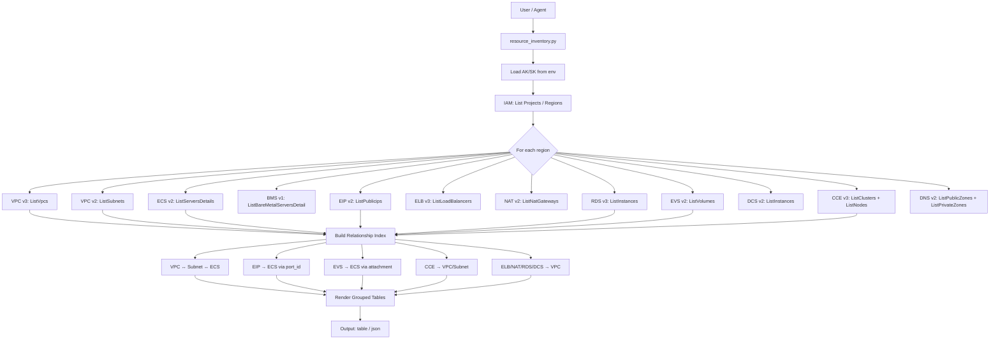

# 数据流图

## 请求/响应流程



## 关联索引构建

```text
1. vpc_index:     {vpc_id → vpc_entry}        (from VPC query)
2. subnet_index:  {subnet_id → subnet_entry}   (from Subnet query)
3. ecs_id_index:  {server_id → ecs_entry}      (from ECS query)
4. eip_port_index: {port_id → server_id}       (from ECS network_interfaces)
5. evs_server_index: {volume_id → server_id}   (from ECS volume attachments)

Cross-reference:
- EIP.associated_server = eip_port_index[EIP.port_id]
- EVS.attached_to = evs_server_index[EVS.id]  (or from EVS attachment directly)
- Subnet.vpc_name = vpc_index[Subnet.vpc_id].name
- ELB.vpc_name = vpc_index[ELB.vpc_id].name
- NAT.vpc_name = vpc_index[NAT.vpc_id].name
```
