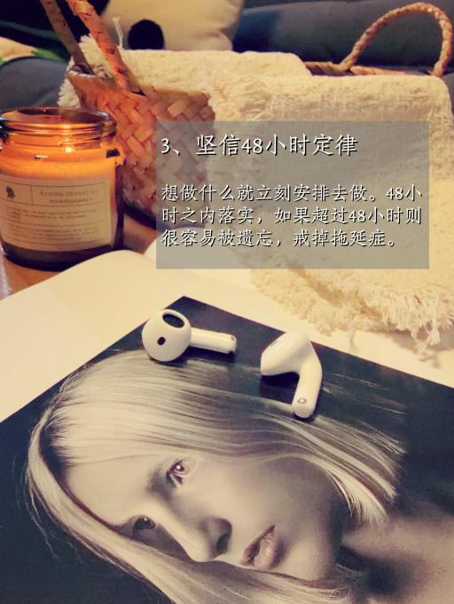

# ins-style-img-bulk-gen SKILL



Bulk-generate Instagram-style images by randomly composing elements from an curated element library, then dispatching prompts to image generation skills in parallel.

Also may generate 2x2 collage, and add text in two modes:

| Mode | Result | Use for |
|---|---|---|
| `ins` (default) | Semi-transparent gray mask + title + body | Inner-page / content images |
| `cover` | No mask. Oversized centered title (~2×) with black outline + shadow. Title only | Social covers (Xiaohongshu / WeChat / Video) |

```bash
# ins: gray mask + title + body
python scripts/add_ins_overlay.py -i in.jpg -o out.jpg -t "❤ 富婆的 12 个隐秘爱好" -b "1、…"

# cover: no mask, big outlined title, no body
python scripts/add_ins_overlay.py -i in.jpg -o out.jpg -m cover -t "40+后才明白\n女人越来越差的9个原因"
```


[中文 →](README.zh-cn.md)