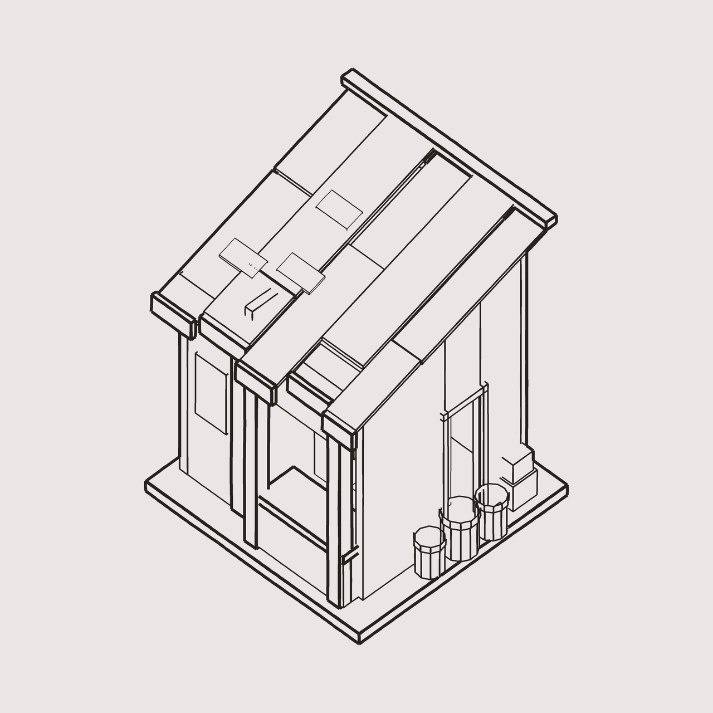

# iso-lineart-pipeline

**参数化三维体块 → 等距线稿。** 用来给图生图模型锁剪影和构造，或者单纯出一张结构清楚的等距草图。

不是"用程序画图"，是**用三维体块保证几何自洽，再让消隐算法决定哪条线该出现**。

```bash
pip install -r requirements.txt
cd scripts
python design_shop.py shop_lineart.png     # 出一张 1920×1920 线稿，约 3 秒
```



<sub>`design_shop.py` 现出的示例（1280px）。屋顶悬空、排线糊剪影、斜撑读成脚手架这三类问题在这里都不存在——因为几何是三维的。</sub>

---

## 它解决什么

手工（或半手工）在二维画布上拼等距线稿，会稳定地烂在这三处：

- **屋顶悬空**——屋面和墙体各自算坐标，中间空一条缝
- **剪影被吃掉**——加了排线/纹理，外轮廓和内部线一个粗细
- **构件读成脚手架**——斜撑、立柱与墙面没有依附关系

这三条都是**表达能力**问题，不是精度问题，所以加细节只会更烂。
换一种画法就没有了：

```
三维基元（box / slab / extrude / beam / prism）
    ↓ 正交投影（等距，比例可标定）
z-buffer 隐藏线消隐（超采样 2×）
    ↓ 逐边采样：d ≤ zbuf + EPS 才画
线宽按「离剪影多少像素」自动分级
```

---

## 三个关键机制

| 机制 | 作用 |
|---|---|
| **墙顶跟屋面斜**（`wquad`） | 单坡屋的山墙顶必须是梯形。做平了必然留三角缝，整栋读成"顶着盖子" |
| **剪影带自适应线宽** | 把"没人覆盖"的像素膨胀 3px 当剪影带，落在带内的线段自动升粗。外轮廓重、内部轻，全自动 |
| **构件尺寸下限 0.03** | 换算到 240px 游戏尺寸还有 3.3px。低于这个数不是细节，是噪点 |

---

## 目录

```
scripts/
  line3d.py             渲染器：基元 / 投影 / 消隐 / 线宽分级（不含造型）
  design_shop.py        一栋单层单坡铺子的体块设计，跑起来就是完整示例
  make_comparison.py    对照板：并排 + 游戏尺寸缩略档
docs/
  lineart-rules.md      踩过的坑与量化结论（先读这个）
```

`line3d.py` 不认识"房子"，只有五个基元和一套消隐。换造型只改 `design_shop.py`。

---

## 写自己的造型

```python
import line3d as L
from line3d import box, slab, wquad, beam, prism

def build():
    F = []
    F += box(-0.3, 0.3, -0.3, 0.3, -0.02, 0.0, 'sil')          # 地台
    F += wquad(-0.2, 0.2, -0.2, 0.2, 0.0, lambda a: 0.4 + a*0.3)  # 顶是斜的墙
    F += slab([(0,0,0.5),(0.4,0,0.6),(0.4,0.4,0.6),(0,0.4,0.5)], 0.01)  # 斜板
    return F

L.render(build(), 'out.png')
```

坐标是 `(a, b, h)`：`a` 沿屏幕右下，`b` 沿屏幕左上，`h` 向上。
`a` 和 `b` 都增大 = 远离相机，所以屏幕上看的是 `-a` 和 `-b` 两个面。

线宽参数：

```python
W_SIL, W_STR, W_DET = 8.0, 3.8, 2.5   # 成品像素
EPS = 0.0022                          # 消隐容差，别调大
```

---

## 对照板

判线稿好不好，必须同时看 1:1 和游戏尺寸两档——很多问题只在其中一档暴露。

```bash
python make_comparison.py --out board.png \
    --item "旧:before.png" --item "新:after.png" --item "参考:ref.jpg"
```

---

## 边界（别指望它做这些）

- **不做材质、不画笔触。** 亚像素抖动只能让线别太直，达不到手绘压感。
- **不做冷暖。** 纯线稿没有色阶，「暖光冷影」那一层得靠上色或模型给。
- **不做自动构图。** 相机固定，画面位置按包围盒居中，别的要自己调。

---

## 依赖

Python 3.10+，`numpy`、`Pillow`。无 GPU、无网络、无 API。

## License

MIT
