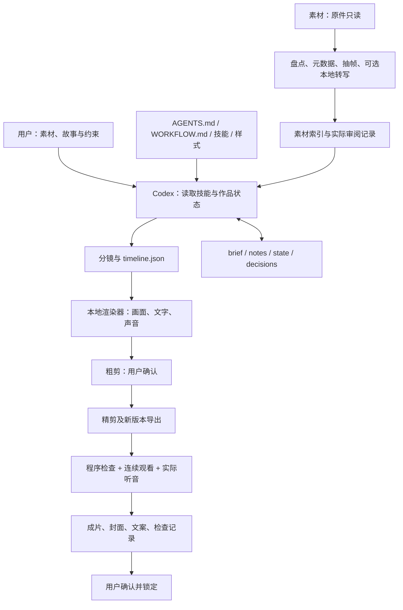

# 本地 Vlog 制作工具包：技术架构

版本：1.0.0

本包把“制作规则、作品记录、素材处理和渲染”分开。Codex 读取规则与状态，实际审阅用户指定素材，再通过本地脚本生成可复查的产物。JSON 和文档负责保存决策，FFmpeg、Python 与字体负责把已经确定的编辑方案变成文件。

## 1. 数据流



图中“连续观看”和“实际听音”是独立验收工作，不是渲染器自动完成的推断。一次真实播放可以同时覆盖两项，但应记录检查的具体版本与范围。

## 2. 目录分工

| 位置 | 职责 |
|---|---|
| `AGENTS.md` | 工作区入口、读取顺序与保护边界 |
| 已安装的 `local-vlog-production/` | 技能及视觉参数说明，与素材工作区分开 |
| `WORKFLOW.md` | 从输入到确认锁定的制作流程 |
| `长期记忆.md` | 新使用者逐步建立的偏好；不继承原制作者的私人故事 |
| `workspace_config.json` | 相对目录、默认输出与工具配置 |
| `workspace_state.json` | 工作区状态；不能代替具体作品的证据 |
| `capability_report.md` | 能力说明和验证边界 |
| `素材/<主题>/` | 用户指定的原始照片、视频与伴随文件，制作时只读 |
| `作品/<作品名>/` | 每条作品的描述、审阅、时间线、导出与确认记录 |
| `工作数据/` | 共享索引、派生文件、缓存与日志 |
| `公共资源/` | 公共样式、字体和许可；用户另行添加可用音乐 |
| `模板/` | 新作品文档与交付检查起点 |
| `tools/` | 可移植的工作区管理、媒体处理与渲染脚本 |

包内引用应以工作区为基准。工具程序的本机位置可以单独配置；不要把某台电脑的用户名、盘符和素材目录写成所有人必须使用的路径。

## 3. 执行层

| 入口 | 工作范围 | 不代表已经完成 |
|---|---|---|
| `tools/workspace.py` | 环境检查、列出主题、建立作品结构 | 不会自动看完素材或确认作品 |
| `tools/media.py` | 选定主题的媒体盘点、联系表或抽帧产物 | 不会自动理解每张照片、每句对白和叙事意义 |
| `tools/transcribe.py` | 可选的本地语音转写 | 识别文本不是经实际听音核对的定稿字幕 |
| `tools/render_timeline.py` | 读取约定的 JSON 时间线并导出画面和声音 | 不会自行批准分镜、音乐许可或最终成片 |
| `tools/qa.py` | 解码、时长、黑场线索与基础音量测量 | 不代替实际观看、听音或真峰值与综合响度测量 |
| `tools/make_demo.py` | 生成无私人素材的演示图片、视频和测试音 | 不代表真实拍摄素材或真实音乐 |

环境检查是独立入口；具体参数以 [工具命令](docs/工具命令.md)和随包脚本的 `--help` 为准。渲染格式见 [时间线格式](docs/时间线格式.md)。脚本发生变化时，需要同时检查示例时间线、文档和合成演示，避免只更新其中一项。

### 渲染器实际分工

渲染器把顺序排列的 `image`、`video`、`color` 片段组成基础画面，再叠加 `photo_card`、`full_photo`、`sticker_title` 和稳定 `subtitle` 图层。照片与视频支持按约定构图填充或留边，画面处理使用 Pillow/NumPy，编码交给 FFmpeg。C 类文字页以已经设计好的静态图片进入时间线。

音频有两条互斥路径：使用显式音轨参数混音，或沿用已经确认的完整 AAC 音轨。混音轨道要给出来源、原片入点、成片位置、时长、音量和淡入淡出；程序不自动做旁白避让、不自动执行“减 30%”，也不自动添加限幅器。沿用完整 AAC 音轨时，渲染器直接复制音频并核验编码数据摘要，以便发现声音是否意外改变。

渲染器不自动调色、防抖、转写、配音、生成笔刷图或选择故事。HDR 或宽色域输入需要先完成经过检查的预处理；不能把标签改成 SDR 就当作色彩转换完成。已有文件与素材目录受输出保护，源文件保持只读。

配置字体并通过 `tools/make_demo.py` 生成本机合成示例后，在工作区根目录可以先验证示例时间线，再导出到一个新的文件名：

```powershell
python tools/render_timeline.py --workspace-root . --timeline examples/演示时间线.json --output 作品/演示/05_exports/demo_v001.mp4 --validate-only
python tools/render_timeline.py --workspace-root . --timeline examples/演示时间线.json --output 作品/演示/05_exports/demo_v001.mp4
```

若该文件已经存在，使用新版本号，不覆盖已有结果。环境检查和时间线校验通过，也仍需实际渲染才能验证输出。

### 核心依赖与可选依赖

- 核心：Python 3.10+、Pillow、NumPy、FFmpeg、ffprobe，以及 FFmpeg 的 `libx264` 编码能力。
- 可选本地 ASR：`faster-whisper` 及对应运行依赖、模型。CPU 可用；不同模型会改变速度、内存和识别效果。
- 可选元数据补充：ExifTool。没有它时，不应猜测缺失的拍摄时间、时区或设备时差。
- 旁白：用户录音或另行选择的 TTS 服务。在线 TTS 不是核心依赖，也不会因为安装本包而自动启用。
- 图像生成：当前 Codex 环境可用的内置图像生成能力，按任务需要调用，不属于本地 Python 渲染器的一部分。

本包不捆绑 FFmpeg 可执行文件、ASR 模型、个人声音、配乐、第三方登录信息或用户素材。第三方软件和字体的来源及许可见 [THIRD_PARTY_NOTICES.md](THIRD_PARTY_NOTICES.md)。

## 4. 素材、时间线与状态

素材入口的直接子目录定义主题。作品可引用多个主题，原件不因归类而移动或复制。索引与作品记录应保留源路径、素材身份、技术信息和引用范围；原文件名、元数据与用户描述有冲突时，记录候选依据，不用修改时间强行补成拍摄时间。

区分两条时间线：

- **拍摄时间线**：素材实际发生的先后与依据；证据不足时仅记录相对顺序。
- **剪辑时间线**：作品为了叙事采用的镜头顺序、入出点、照片时长、字幕、标题和声音。

`timeline.json` 是编辑数据源，不是任一商业剪辑软件的原生工程。可移植渲染器只执行其格式明确支持的字段；描述了某种效果不等于程序已经实现。复杂变速、特殊转场、HDR、全景拼接、厂商专用防抖或高级调色，需要单独实现和验证，不应靠写入任意 JSON 字段就宣称生效。

作品记录至少承担以下职责：

| 记录 | 内容 |
|---|---|
| `brief.md` | 这次作品的目标、主题、风格和最新要求 |
| `notes.md` | 身份、事实、隐私、素材疑点等补充信息 |
| `state.json` | 当前阶段、当前版本、待完成工作 |
| `decisions.md` | 用户对具体版本、声音、样式和范围的确认 |
| 审阅及检查记录 | 实际查看或听过的范围、方法、发现的问题和复查结果 |

文件存在、脚本退出成功、用户选择了某种样式，这三件事都不能直接推出“整个作品已经验收”。锁定必须绑定用户实际确认的作品与版本。

## 5. 视觉与声音的复用边界

公共样式是新作品的起点，新建作品应保存自己的样式快照。之后修改公共样式，不应自动重渲染已存在或已锁定的作品。

三类视觉起点的职责相互独立：照片 01 处理照片进入与落位；艺术字 B 处理重点词的分层及短暂运动；文字页 C 是默认静态的独立阅读页。把某张照片铺满时需重新检查构图，不能拉伸；照片叠在视频上时，背景应继续推进，除非明确设计为定格或全屏照片接管。

整片默认不启用递进蒙太奇。只有当前作品明确要求该手法时，才按信息增加、视角变化或情绪递进组织重复题材，并保留实际来源与时间关系。

音频要保存可追溯的来源、片段和处理参数。音乐与人声平衡由新使用者首次确认，不依赖包外的私人混音参考。“BGM 减 30%”仅指在明确的基准分轨上乘 `0.70`，约为减少 3.10 dB；它不是整片响度目标，也不应在每次导出时累计执行。已接受音轨在纯视觉修订中优先直接复用；改变总时长或切点后，必须重新核对同步。

## 6. 验证层与可移植性

验证分为四层，各自报告结果：

1. **环境检查**：依赖能否启动、编解码器和字体是否可用。
2. **合成演示**：用不含私人素材的短片验证实际渲染链路；它只证明这组演示输入能工作。
3. **程序检查**：媒体能否完整解码、尺寸与时长是否符合要求，以及实际执行过的声音或画面检测。
4. **内容审阅**：实际看图、连续观看和听音，检查事实、切点、字幕、裁切、动效、音乐平衡与隐私。

版本 1.0.0 以 Windows 为主要验证环境；具体通过项与未执行项以包内验证记录为准。目录与 Python 工具按可迁移方式组织，但其他系统尚未实测，不承诺直接运行完全一致。操作系统、FFmpeg 构建、字体渲染和依赖版本都可能造成差异。GPU 加速不是基础链路的前提，也不因电脑存在 GPU 就被标记为已验证。

迁移时保留整个工作区的关联文件，更新本机工具路径，再运行环境检查和合成演示。把一个 `SKILL.md` 单独复制到别处，不会同时带走字体、模板、渲染脚本、历史确认和素材引用。具体操作边界见 [迁移边界与隐私](docs/迁移边界与隐私.md)。
