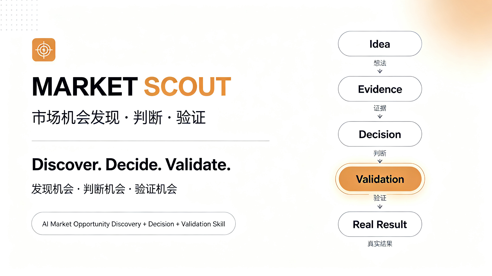
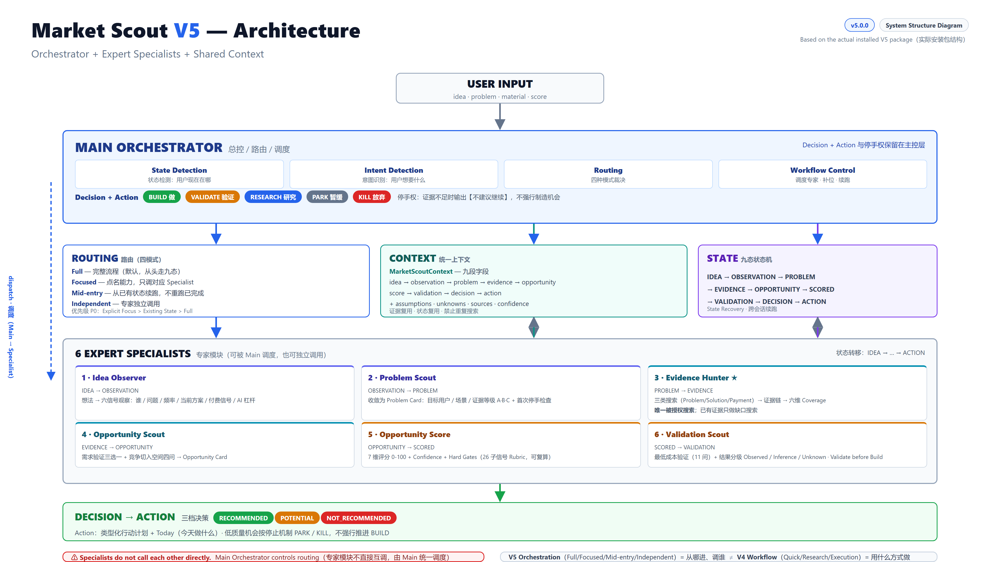
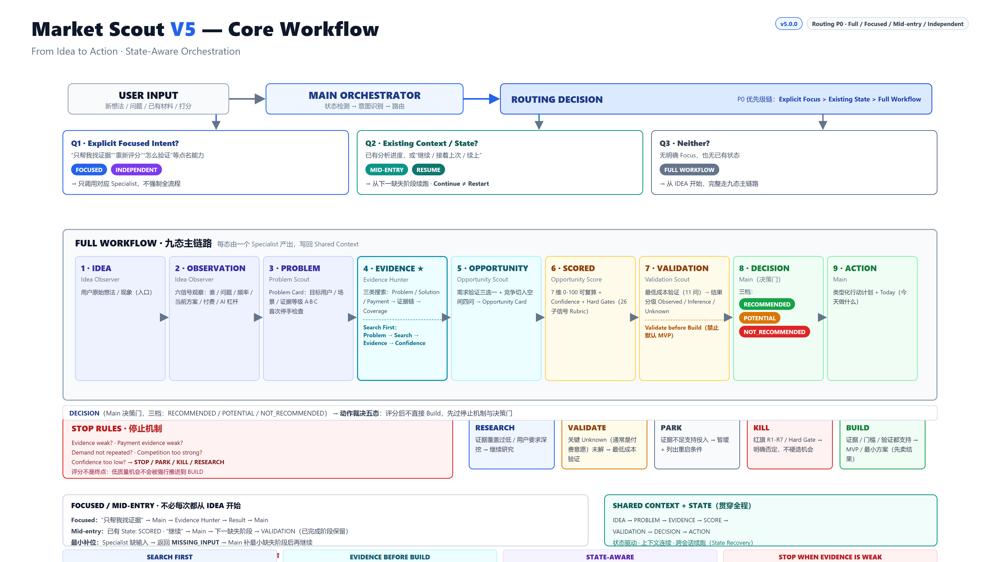

<div align="center">



# 🔭 Market Scout

**真实问题 → 证据 → 需求 → 验证 → 决策 → 行动**

**一个帮助你从“一个想法”走向“真实验证”的 AI Agent Skill**

**Discover. Validate. Decide. Act.**

[](./CHANGELOG.md)
[](./LICENSE)


[⬇ 下载 V5.0.0](./releases/market-scout-v5.0.0.zip) · [安装](#-安装) · [快速开始](#-快速开始) · [V5 核心](#-v5--orchestrator--expert-specialists) · [路由](#-how-v5-works--routing) · [版本演进](#-版本演进) · [项目结构](#-project-structure)

</div>

---

## Have an idea? Market Scout helps you / 你有一个想法？Market Scout 帮你：

**英文 / English**

```
Discover a real problem
→ Find evidence (problem / solution / payment)
→ Score the opportunity
→ Make a decision
→ Validate key assumptions at the lowest cost
→ Feed real-world results back
→ Re-evaluate and act
```

**中文 / 中文**

```
发现真实问题
→ 找证据（问题 / 现有方案 / 付费行为）
→ 评估机会
→ 做出判断
→ 用最低成本验证关键假设
→ 把真实结果交回来
→ 重新判断并行动
```

> 不要先 Build 再找用户。**Don't build first. Verify first.**

## What is Market Scout? / 它是什么？

Market Scout is an AI Agent Skill for turning a vague idea into an evidence-backed decision and an actionable plan — from observation to validation.

Market Scout 是一个 AI Agent Skill：把一个模糊想法，变成有证据支撑的判断、最低成本的验证方案、和可执行的下一步行动。

它**不是**「AI 赚钱点子生成器」。它不会凭空给你编项目，也不会停在“一份漂亮的市场分析报告”：

```
先观察问题
→ 搜索证据
→ 判断需求
→ 评估机会
→ 验证关键假设
→ 再决定是否行动
```

核心思想：**先验证，再收费，再产品化**（Validate before Build）。

---

## 🚀 V5 — Orchestrator + Expert Specialists

**V5 最大的升级不是“多了几个功能”，而是 Market Scout 从一个整体 Skill，升级为由 Main Orchestrator 统一调度 Expert Specialists 的 Agent 工作系统。**

### 从单体到编排 / From Monolith to Orchestration

```
V4: 单体工作流能力（一个 Skill 里跑完整流程）
       ↓
V5: Main Orchestrator（总控）
       ↓
    Routing（路由：判断从哪里进、调谁）
       ↓
    Expert Specialists（6 个专家子技能）
       ↓
    Shared Context / State（共享上下文与状态）
       ↓
    Decision / Action（决策与行动，保留在主控层）
```



### Main Orchestrator 总控

负责：理解用户当前需求 → 判断从哪里进入 → 决定调用哪个 Specialist → 管理 Context / State → 决定下一步。

### Expert Specialists 专家子技能（6 个）

| Specialist | 职责 | 输入 → 输出 |
|---|---|---|
| **Idea Observer** | 把想法/现象拆成可观察信号 | Idea → Observation |
| **Problem Scout** | 把观察定义成可研究的问题 | Observation → Problem |
| **Evidence Hunter** | 三类搜索 + 证据链（唯一被授权搜索的专家） | Problem → Evidence |
| **Opportunity Scout** | 需求验证 + 竞争切入空间 | Problem + Evidence → Opportunity |
| **Opportunity Score** | 7 维评分 + Confidence + Hard Gates | Opportunity + Evidence → Score |
| **Validation Scout** | 设计最低成本验证、读真实结果 | Opportunity + Score → Validation |

> **Specialist 之间不互相调用。** 正确关系是 Main → Specialist → Main → 下一个 Specialist；缺输入时 Specialist 只返回 MISSING_INPUT，由 Main 负责补位。

---

## 🧠 How V5 Works — Routing 路由

V5 不会机械地从第一步跑到最后一步。Main Orchestrator 先判断“用户在哪里、想要什么”，再决定怎么走。路由优先级：

```
1. Explicit Focused Intent（你明确说要做什么）
2. Existing Context / State（你已经做到一半）
3. Full Workflow（什么都没有，从头完整开始）
```

### ① 你明确说要做什么

> “帮我找真实需求证据。”

→ 直接进入 **Evidence Hunter**，不跑完整流程。

### ② 你已经做到一半

比如你已经完成 Idea / Problem / Evidence / Score，然后说：

> “继续。”

V5 **不会从头开始**，而是从**下一缺失阶段**继续（SCORED → VALIDATION）。

### ③ 什么都没有

才从完整闭环开始：

```
Idea → Observation → Problem → Evidence → Opportunity → Score → Validation → Decision → Action
```



> **V5 不要求每一次分析都从 Idea 开始。** 你可以从全新想法开始，也可以直接找证据、重新评分、或继续上一次分析——这正是 Orchestrator 的意义。

---

## 🔀 Orchestration Modes 四种调度模式

| Mode | 用途 | 例子 |
|---|---|---|
| **Full** | 从头完整运行 | “我有一个想法，帮我完整分析” |
| **Focused** | 针对一个明确需求调用对应 Specialist | “帮我找真实需求证据” |
| **Mid-entry** | 从已有上下文/状态继续 | “我已有问题定义和证据，继续评分” |
| **Independent** | 单独使用某个专家能力 | 单独触发 Evidence Hunter / Validation Scout |

### V4 Mode 与 V5 Orchestration Mode 是两个维度

V5 同时保留 V4 的三种工作模式，但它们**不是同一个东西**：

| 概念 | 值 | 回答的问题 |
|---|---|---|
| **V4 Mode**（工作方式） | Quick / Research / Execution | 采用哪种已有能力深度 |
| **V5 Orchestration Mode**（调度方式） | Full / Focused / Mid-entry / Independent | 从哪里进入、如何调度 |

两者可以组合，例如：**Research + Focused**（深挖某个能力）、**Quick + Full**（快速走完整链）、**Execution + Mid-entry**（已有结论直接执行）。

> V5 Routing 决定“怎么进入和调度”；V4 Mode 决定“采用哪种工作方式”。二者正交，不互相竞争。

---

## 🧠 Context & State 上下文与状态

V5 不是每次都重新开始。它维护一份统一的 **MarketScoutContext**（idea / observation / problem / evidence / opportunity / score / validation / decision / action + assumptions / unknowns / sources / confidence 等 19 个字段）与九态状态机（IDEA → OBSERVATION → PROBLEM → EVIDENCE → OPPORTUNITY → SCORED → VALIDATION → DECISION → ACTION），让工作流能够：

```
继续（继续上次分析）
恢复（跨会话续跑；材料丢失时明确 Unknown，而不是猜测）
补充（只补缺失字段，不重复询问）
重新评分（按固定规则重算）
进入下一阶段（State 正确推进）
```

> 数据契约与字段映射见安装包内 orchestrator/context.md；工作文件见 templates/v5-context-card.md。

---

## 🔄 Core Workflow 核心工作流

这是 Market Scout 的完整能力链（不是每次都必须严格从第一步走到最后一步——V5 Orchestrator 会根据你的当前状态选择合适的进入点）：

```
Idea
 ↓
Observation
 ↓
Problem
 ↓
Evidence
 ↓
Opportunity
 ↓
Score
 ↓
Validation
 ↓
Decision
 ↓
Action
```

---

## 🔎 Core Principles 核心原则

### Search First 证据优先

先寻找三类证据，再判断机会：

```
Problem Evidence  —— 有人遇到这个问题吗？
Solution Evidence —— 他们现在怎么解决？
Payment Evidence  —— 有没有人为类似结果付钱？
```

### Don't Build First 不要先造产品

```
想法 → 写代码 → 做产品 → 寻找用户   ✗

真实问题 → 证据 → 需求 → 验证 → 再决定是否 Build   ✓
```

### Evidence Before Confidence 证据先于自信

没有证据时，输出的是 Unknown / To Verify / Evidence Insufficient——**不能把假设写成事实**。

### Stop When Evidence Is Weak 停在证据前

Market Scout 拥有**停止权**。如果证据不足、支付意愿弱、需求不重复、竞争过强，它会允许：

```
RESEARCH（继续研究）
VALIDATE（先验证再决定）
PARK（暂缓，列出重启条件）
KILL（明确否定）
```

而不是为了完成流程强行 BUILD。判断结果分三档：

| 决策 | 含义 |
|---|---|
| 🟢 **RECOMMENDED** | 值得继续推进（当前证据支持投入） |
| 🟡 **POTENTIAL** | 证据不足，需要进一步验证（通常进入最低成本验证） |
| 🔴 **NOT_RECOMMENDED** | 当前证据不支持继续投入（停止，并说明什么新证据可以重启） |

---

## 📈 Version Evolution 版本演进

Market Scout 不是突然出现的 V5，而是一步步长成的工作系统：

### V1 — First Prototype 最初原型

核心：**从想法出发 → 尝试寻找问题 → 尝试验证**。验证“AI 能不能帮我系统化寻找真实问题和机会”。

### V1.1 — Structured Analysis 结构化分析

让机会分析结构化：三类搜索、Problem Card、Evidence Chain、三种模式、状态机。

### V2 — Evidence & Validation 证据与验证

形成完整机会分析流程 **FIND → VALIDATE → EVALUATE → BLUEPRINT → MONETIZE**：只有“看起来不错”的想法是不够的，需要证据。加入需求验证、项目评估（GO / VALIDATE FIRST / NO-GO 三档）、机会转项目、商业化与获客。

### V3 — Core Closed Loop 决策闭环

**Evidence → Score → Decision → MVP → Action**：证据三态、7 维机会评分（0-100 可复算）、三档决策（RECOMMENDED / POTENTIAL / NOT_RECOMMENDED）、MVP Blueprint、动态 Action Plan。让分析最终产生“决策”。

### V3.1 — Determinism Layer 确定性强化

Score Rubric（26 个子信号五档）、Confidence（决策置信度，与评分分离）、Hard Gates（硬门槛 / Score Ceiling / 红旗三层）、Evidence Coverage（六维证据覆盖度）、Evidence-driven Action（证据驱动行动）。

### V4 — Validation Engine 验证引擎（v4.0.0）

**判断 → 最低成本验证 → 读真实结果 → 重新判断**：Validation Plan 11 问、Lowest-Cost Validation、Validate before Build、Success / Failure Criteria、Validation Result 分级（Observed / Inference / Unknown）、Re-evaluation 规则化重算、Learn Loop。

### 🚀 V5 — Orchestrated Expert System 编排式专家系统（当前版本）

**V4 能力保留 → 内部模块化 → Main Orchestrator → Routing → Expert Specialists → Context / State → Full / Focused / Mid-entry / Independent。**

> **V5 不是重新发明 Market Scout，而是把已经形成的能力变成一个可以按需调度的 Agent 工作系统。**

---

## 💡 Usage Examples 使用示例

**例 1 · 全新想法 → 完整流程（Full）**

```
用户：我有一个帮助大学生整理课程资料的想法。

进入：Full Workflow
Idea → Observation → Problem → Evidence → Opportunity → Score → Validation → Decision → Action
```

**例 2 · 只想找证据（Focused）**

```
用户：我已经找到很多用户抱怨了，帮我看看有没有真实需求。

进入：Evidence Hunter（三类搜索 + 证据链，不跑完整流程）
```

**例 3 · 只想重新评分（Focused）**

```
用户：按照 Market Scout 的标准重新给这个机会评分。

进入：Opportunity Score（7 维评分 + Confidence + Hard Gates，可复算）
```

**例 4 · 继续上次分析（Mid-entry）**

```
用户：继续上次的分析。

Context 中已完成 Score → 从 SCORED 继续 → VALIDATION（不从头重跑）
```

---

## 📥 安装 / Installation

纯 Markdown AI Skill：**不需要 npm / pip，不运行任何服务，无额外依赖**（与 USER_GUIDE.md 完全一致）。

> 用户只需要安装**一个** Market Scout V5。安装包内已包含：Main Skill + Orchestrator + 6 个 Specialist + Context / State + Tools + 全部资源。**不需要分别安装 6 个 Specialist。**

**方式一：拖拽一键安装（推荐）**

1. 下载并解压 [market-scout-v5.0.0.zip](./releases/market-scout-v5.0.0.zip)，取出其中的 `market-scout` 文件夹（部分客户端支持直接拖 zip）。
2. 拖入 AI 客户端的「技能 / 一键安装」入口；不支持时改用方式二。
3. 按「验证安装」确认版本。

**方式二：手动放入技能目录**

1. 解压得到 `market-scout` 文件夹。
2. 放入 AI 客户端的技能目录（通常叫 `.user_skills/` 或 `skills/`）。
3. 保证路径为 `<技能目录>/market-scout/SKILL.md`。
4. 重启或刷新客户端。

**或 Clone 本仓库**：`git clone https://github.com/kio831/market-scout.git`

> 装过旧版：V5 向下兼容、V1-V4 能力全部保留；部分平台同名目录不覆盖，建议先删除旧 `market-scout` 文件夹再安装。

**验证安装**：打开安装后的 `SKILL.md`，同时搜到 `V5 Orchestrator`、`MarketScoutContext` 和 `specialists/` = V5.0.0；再运行 `tools/validate_skill.py --dev` = 开发完整性通过。

## ⚡ 快速开始 / Quick Start

```
1. 安装 Market Scout V5
2. 给它一个想法 / 问题 / 观察 / 已有资料
3. 它判断：Focused？Mid-entry？还是 Full？
4. 按需调用对应 Specialist
5. 读 Decision + Validation Plan
6. 去现实里验证
7. 把结果交回来 → 重新判断
```

| 你想做什么 | 可以这样说 | 进入 |
|---|---|---|
| 快速判断一个想法 | “学校打印店总有人让老板改 PDF，有没有机会？” | Quick / Full |
| 只要证据 | “帮我找这个问题的真实需求证据” | Focused → Evidence Hunter |
| 打分与决策 | “这个想法值不值得做，打个分” | Focused → Opportunity Score |
| 设计与执行验证 | “帮我验证一下这个想法” / “我验证了 20 个人，3 个付费” | Focused → Validation Scout |
| 继续上次分析 | “继续” | Mid-entry（从下一缺失阶段续跑） |

**三种工作方式（V4 Mode）**：Quick（随手判断，保持轻量）· Research（深挖完整报告）· Execution（停止研究、直接给执行清单）。

**四种调度模式（V5 Orchestration Mode）**：Full · Focused · Mid-entry · Independent。

## 📚 Documentation & 项目结构 / Repository Structure

- [USER_GUIDE.md](./USER_GUIDE.md) — 用户安装与使用说明
- [CHANGELOG.md](./CHANGELOG.md) — 版本变更记录（v1.0 → v1.1 → v2.0.0 → v3.0.0 → v3.1.0 → v4.0.0 → v5.0.0）
- [CONTRIBUTING.md](./CONTRIBUTING.md) — 贡献指南

```
market-scout/
├── SKILL.md                    # 主控入口：铁律、路由、状态检测、V2-V4 全部能力、V5 Orchestrator
├── README.md                   # 本文件（GitHub 项目主页）
├── USER_GUIDE.md               # 用户安装与使用说明
├── CHANGELOG.md                # 版本变更记录
├── CONTRIBUTING.md / LICENSE / .gitignore
├── assets/                     # README 配图（hero + V5 architecture / core workflow）
├── orchestrator/   (4)         # V5 总控层：architecture / routing / state / context
├── specialists/    (6)         # V5 专家子技能（可独立调用）
├── references/     (23)        # 方法论文档
├── templates/      (18)        # 卡片/报告模板（含 v5-context-card.md）
├── examples/       (16)        # 流程示例（全部为演示数据）
├── tools/
│   ├── validate_skill.py       # 自检脚本（--dev 开发模式 / --release 发布模式）
│   ├── verify_source_sync.py   # 发布防线：仓库 vs 发布包一致性校验
│   ├── test_v31_cases.py       # V3.1 规则用例测试（A-F + 矩阵）
│   ├── test_v4_validation.py   # V4 验证引擎用例测试（A-G）
│   ├── test_v5_orchestrator.py # V5 架构测试（A-G）
│   └── test_v5_e2e.py          # V5 端到端行为测试（E2E-01..08 + R1-R4）
├── releases/
│   ├── market-scout-v5.0.0.zip    # ✅ V5.0.0 正式安装包
│   └── market-scout-v5.0.0.skill  # ✅ 同内容 .skill 格式
└── website/
    └── index.html              # 项目落地页（可挂 GitHub Pages）
```

## 📥 V5 Package 安装包

| 文件 | 说明 |
|---|---|
| [market-scout-v5.0.0.zip](./releases/market-scout-v5.0.0.zip) | 正式安装包（zip） |
| [market-scout-v5.0.0.skill](./releases/market-scout-v5.0.0.skill) | 同上内容（.skill 格式，与 zip 字节一致） |
| [market-scout-v4.0.0.zip](./releases/market-scout-v4.0.0.zip) | 历史版本：V4.0.0（Validation Engine） |

## 🗺 Roadmap

| 版本 | 状态 | 内容 |
|---|---|---|
| v1.0 | ✅ 已发布 | Opportunity Discovery：三类搜索、Problem Card |
| v1.1 | ✅ 已发布 | Structured Analysis：Evidence Chain、三模式、状态机 |
| v2.0.0 | ✅ 已发布 | Opportunity Workflow：Validate / Evaluate / Blueprint / Monetize |
| v3.0.0 | ✅ 已发布 | Evidence → Score → Decision：证据三态、三档决策、MVP、行动计划 |
| v3.1.0 | ✅ 已发布 | Rubric / Confidence / Hard Gates / Coverage / Evidence-driven Action |
| v4.0.0 | ✅ 已发布 | Validation Engine：判断 → 最低成本验证 → 真实结果 → 重新判断 |
| **v5.0.0** | **🚀 当前版本** | **Orchestrator + Expert Specialists：路由、状态机、统一 Context、四种调度模式** |
| 后续迭代 | 📋 规划中 | 仅针对 Bug / 稳定性 / 真实用户反馈 / 规则优化，不再新增大型功能 |

## 🤝 Contributing & License

欢迎 Issue 与 PR，流程见 [CONTRIBUTING.md](./CONTRIBUTING.md)。

[MIT](./LICENSE) © Market Scout Contributors —— 可自由使用、修改、分发，包括用于个人副业探索与商业项目。

---

<div align="center">

> **我有一个想法 → Market Scout 判断我需要什么 → 调度对应专家 → 找证据 → 评估机会 → 判断有多可靠 → 设计最低成本验证 → 我去现实里验证 → 把结果交回来 → 重新判断并行动。**

#### From vague ideas to validated decisions.

**Discover. Validate. Decide. Act.**

[⬆ 回到顶部](#-market-scout)

</div>
