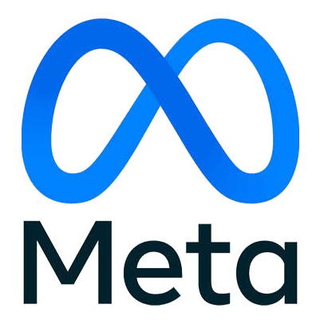

# 🚀 Meta Ads Autonomous Subagent & Traffic Manager
### *Subagente Autônomo Especialista em Meta Ads & Gestão de Tráfego*

<p align="center">
  
</p>

<p align="center">
  <a href="https://clawhub.ai"></a>
  <a href="https://xvix.com.br"></a>
  
  
</p>

---

## 🇺🇸 English

### Overview
**Meta Ads Subagent** is an autonomous AI marketing agent that audits, optimizes, and scales Facebook & Instagram Ads campaigns using the Meta Graph API v24.0. It features a standardized 3-level naming hierarchy, automated SVG 1080x1080 ad creative synthesis, CPA-based stop-loss rules, and real-time alerts.

### 🚀 Quick Onboarding & First-Time Setup
1. **Get your Habilis MCP Token**:
   - Access the developer portal at [https://xvix.com.br](https://xvix.com.br) to generate your access token.
2. **Configure Environment Variables**:
   ```bash
   export HABILIS_API_KEY="hab_live_..."
   export META_ACCESS_TOKEN="EAA..."
   export META_AD_ACCOUNT_ID="act_1234567890"
   ```
3. **Configure Hermes / OpenClaw (`config.yaml`)**:
   ```yaml
   mcp_servers:
     habilis:
       url: "https://xvix.com.br/api/mcp"
       headers:
         Authorization: "Bearer ${HABILIS_API_KEY}"
   ```
4. **Run Doctor Diagnostic**:
   ```bash
   hermes run "mcp_meta_ads_get_ad_account(ad_account_id='${META_AD_ACCOUNT_ID}')"
   ```

### Key Capabilities
- 📊 **3-Level Taxonomy**: Structured naming for Campaigns, Ad Sets, and Ads for effortless tracking.
- 🎨 **1080x1080 Creative Generator**: Autonomous SVG banner generation and asset uploads.
- 🛑 **Autonomous CPA Guardrails**: Automatically pauses underperforming ads exceeding CPA thresholds.
- 🔒 **Zero-Storage Security**: Meta access tokens remain exclusively on the client machine.

---

## 🇧🇷 Português

### Visão Geral
O **Meta Ads Subagent** é um agente autônomo de tráfego pago especialista em Meta Graph API v24.0. Realiza auditoria periódica de contas, geração de criativos 1080x1080 com IA, ajuste de lances, monitoramento de ROAS/CPA, governança de naming em 3 níveis e alertas inteligentes.

### 🚀 Onboarding Rápido & Primeiro Uso
1. **Obtenha seu Token Habilis MCP**:
   - Acesse o portal de desenvolvedores em [https://xvix.com.br](https://xvix.com.br) para gerar seu token de acesso.
2. **Configure as Variáveis de Ambiente**:
   ```bash
   export HABILIS_API_KEY="hab_live_..."
   export META_ACCESS_TOKEN="EAA..."
   export META_AD_ACCOUNT_ID="act_1234567890"
   ```
3. **Conecte o MCP no Hermes / OpenClaw (`config.yaml`)**:
   ```yaml
   mcp_servers:
     habilis:
       url: "https://xvix.com.br/api/mcp"
       headers:
         Authorization: "Bearer ${HABILIS_API_KEY}"
   ```
4. **Execute o Teste de Conexão**:
   ```bash
   hermes run "mcp_meta_ads_get_ad_account(ad_account_id='${META_AD_ACCOUNT_ID}')"
   ```

### Principais Recursos
- 📊 **Hierarquia em 3 Níveis**: Nomenclatura profissional e estruturada para Campanhas, Conjuntos e Anúncios.
- 🎨 **Motor de Criativos 1080x1080**: Geração e upload de banners com renderização vetorial de alta conversão.
- 🛑 **Proteção de Orçamento (Stop-Loss)**: Pausa automática de criativos fora da meta de CPA.
- 🔒 **Privacidade Zero-Storage**: Tokens do Meta Ads residem apenas no seu ambiente local.

---

## 📦 Installation / Instalação

```bash
hermes skills install meta-ads-subagent
# or via clawhub
clawhub install meta-ads-subagent
```
