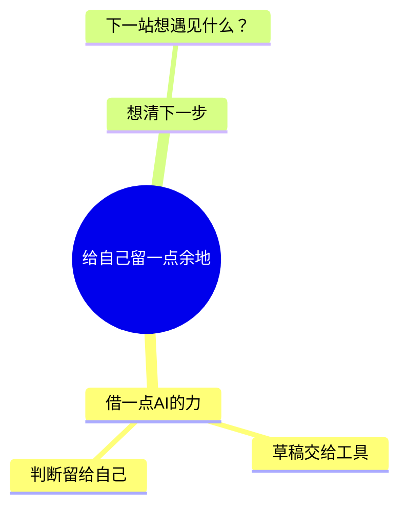

# 使用、续改与排查

按当前请求阅读对应小节。日常生成只需 SKILL.md，不必读取全部内部样式配置。

## 功能与适用边界

| 需要完成的事 | 当前能力 |
| --- | --- |
| 从资料生成 | 将助手已读取的笔记、文档、网页、代码或想法整理成层级内容，生成独立 HTML。Mindbox 不自带抓取器、OCR 或模型服务。 |
| 推荐或换样式 | 16 套完整样式，支持名称、简称、样式编码和旧 P 代号；换样式保留正文和层级。 |
| 继续修改 | 读取最新 Mindbox HTML，提取当前内容，补充、删减、纠错并更新同一文件；明确另存时保留原文件。 |
| 浏览器编辑 | 节点改字、添加、删除、撤销/重做；Markdown 批量编辑与导图同步，来源说明保留在正文之外。 |
| 阅读与分享 | 折叠、平移、缩放和阅读演示；接收人只需现代浏览器。字体和代码内嵌，无需 Node.js 或服务。 |
| 图像交付 | 阅读器导出完整 PNG 和 WebP 阅读动图，另可保存当前 HTML。 |
| 检查与维护 | 本地版本/完整性检查、只读检查新版本、安装、显式更新／升级与卸载；旧安装器另支持指定版本和单版本回退。 |

这是层级思维导图工具。精确时序、跨节点连线、自由绘图、实时协作、托管 AI 服务与独立 Agent/MCP 服务不在当前能力内。浏览器图像导出依赖 canvas、下载和 WebP 编码支持；不要把某个浏览器成功当作所有设备的保证。

## 输入和内容

网页、云文档、PDF、图片或代码仓库的读取依赖当前助手提供的工具和权限。优先复用已提供的正文；无法访问时说明缺少哪部分，取得必要内容再整理，不凭链接猜测。只有用户明确的请求才授权外部动作。

Markdown 恰好包含一个 `mermaid` 代码块，首行为 `mindmap`。用空格缩进、一行一个节点、一棵单根树；2 个空格是易读约定。完整 Mermaid 的关系箭头、图标、类和样式指令不受支持。

````markdown
---
preset: MMH0S8
---

# 我的工作与生活



来源与限定：保留实际链接、章节、代码路径或用户提供的说明。
````

命令行明确指定的样式优先于 Markdown 元信息；元信息中 `style:` 优先于 `preset:`。普通使用选完整样式即可，不必编辑七维组合。五种内部结构为左右展开、向右展开、向下层级、括号分解和缩进大纲；用户明确要求改结构时再参考 [内部组合](style-combinations.md)，其余维度沿用原值。

没有固定节点数量目标。技术保护为 120000 个源字符、每标签 500 个字符、根节点下最多 20 层；超过限制应按语义拆分并保留内容，不用任意截断凑数。`mindbox_N["..."]` 是导出器保护特殊文字的编码，续改时保留其含义。

## 文件与续改

所有路径替换为实际位置；文件路径有空格时加引号。用输入文件可避免不同终端的 stdin 写法差异。

```bash
node "<skill-dir>/scripts/render.cjs" --input "/path/draft.md" --output "/path/map.html" --preset "浮生小趣"
node "<skill-dir>/scripts/render.cjs" --input "/path/map.html" --extract
node "<skill-dir>/scripts/render.cjs" --input "/path/map.html" --revise "/path/revised.md"
node "<skill-dir>/scripts/render.cjs" --input "/path/map.html" --check
```

同一话题用 `--revise`；`--output another.html` 才是明确另存。完整修订 Markdown 可更新来源说明；只提供 mindmap 代码块的补丁会保留原说明。没指定新样式时保留当前样式。换风格按 SKILL.md 的同路径 `--switch-to` 命令执行。

CLI 会同时生成配套 Markdown，但浏览器修改不会同步写回旧 Markdown。最新保存的 HTML 才是继续编辑的依据。提取不会执行 HTML 脚本；任意第三方 HTML 不是可续改的 Mindbox 文件。

## 浏览器编辑和导出

| 操作 | 方法 |
| --- | --- |
| 改字 | 双击或 F2；Enter 确认，Escape 取消。 |
| 添加 | 选中节点后 Tab 增加子节点，Enter 增加同级；根节点 Enter 增加子节点。 |
| 删除 | Delete/Backspace 删除所选分支，根节点不能删除。 |
| 撤销/重做 | Ctrl/⌘ Z；Ctrl/⌘ Shift Z 或 Ctrl Y。最多保留本会话 50 次内容操作。 |
| 批量修改 | 切到 Markdown，修改后点击样式名称或 Ctrl/⌘ Enter 应用；无效草稿保留可编辑，原有效导图不被替换。 |
| 折叠与导航 | 节点旁折叠/计数按钮或 Space；方向键访问父子节点。 |
| 查看细节 | 平移、滚轮缩放、适应画布；比例按钮恢复真实 100% 字号。 |
| 保存 | 保存 HTML 或 Ctrl/⌘ S，下载包含当前内容、来源、样式、折叠及视图的新文件。未完成的 Markdown 草稿也可保存。 |

保存后使用新下载的 HTML；没有后台自动保存，撤销历史不跨会话保留。渲染器不会自动更新磁盘上的文件。

用户要求 PNG 或动图时，通过当前 HTML 的「导出」菜单生成。具备浏览器工具时实际下载并检查文件；否则交付 HTML 并给出准确的菜单操作，不虚构已生成的媒体或 CLI 参数。PNG 包含全部节点，不受当前折叠与缩放影响；大图受像素预算限制。WebP 按实际内容分段聚焦，是位图动画。阅读演示和节点顺序不代表因果或优先级。

## 版本与常见问题

项目、Skill 身份、运行资源及下载包版本由仓库 `package.json` 统一生成。包内 [version.json](../version.json) 是这个副本的版本，不代表所有机器或公开发布的版本。查看已安装副本：

```bash
node "<skill-dir>/scripts/render.cjs" --version
node "<skill-dir>/scripts/manage.cjs" --status
```

| 情况 | 处理 |
| --- | --- |
| Node 无法运行或版本过低 | 确认 `node --version` 至少 22.20；指出缺失环境，不改写一套替代页面。 |
| 解析失败 | 根据行号修正单根、空格缩进和唯一代码块，保留原内容及已有文件。 |
| 找不到样式 | 先查 [样式指南](style-guide.md)，仍不明确时运行 `--list --compact`；不编造编码。 |
| 输出已存在 | 同话题使用续改；独立成果换路径。只有当前请求授权替换时使用 `--force`。 |
| 资源指纹不一致 | 停止使用受损包；按 [维护说明](maintenance.md) 从完整可信包恢复，不能关闭校验继续生成。 |
| HTML 无可编辑内容 | 取得最新 Mindbox HTML 或其真实内容源；不能把任意网页当作脑图文件。 |
| 尚未完成的 Markdown | `--extract` 返回当前草稿，先修正草稿；不要用旧配套 Markdown 覆盖它。 |
| 无法导出动画 | 核对浏览器编码/下载支持，保留 HTML；不把 PNG 改扩展名冒充 WebP。 |

`--check` 检查结构、样式与最终文件指纹，不验证来源事实、不执行浏览器操作。渲染不联网、不要求密钥；模型费用和资料访问规则由宿主助手决定。

安装、更新／升级、卸载、指定版本与旧安装器回退见 [维护说明](maintenance.md#installed-versions-and-updates)。更新仅在用户要求时执行；本地版本和包校验通过不等于 GitHub 发布已完成。
