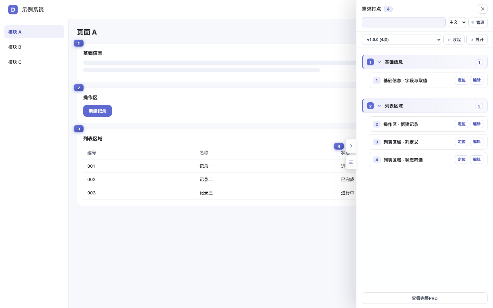
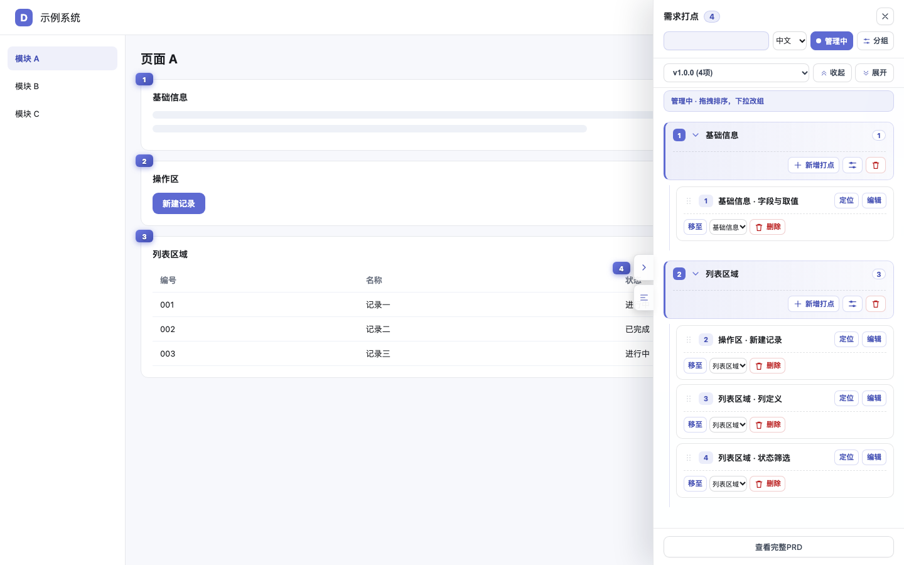
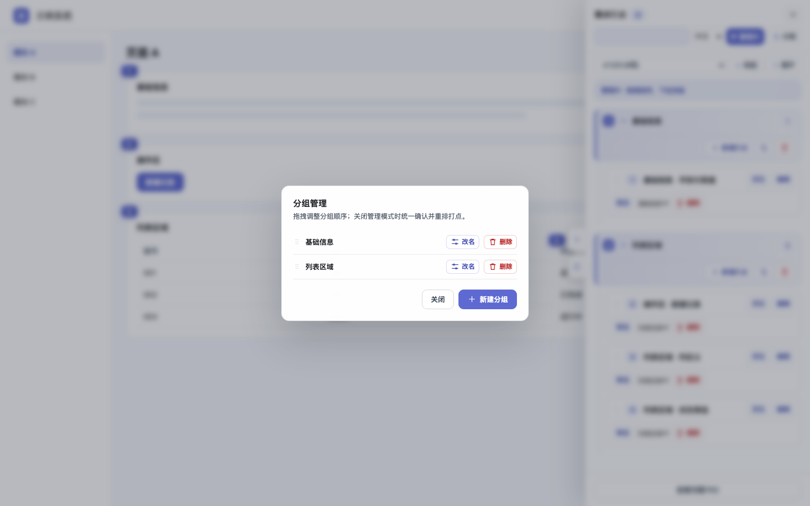
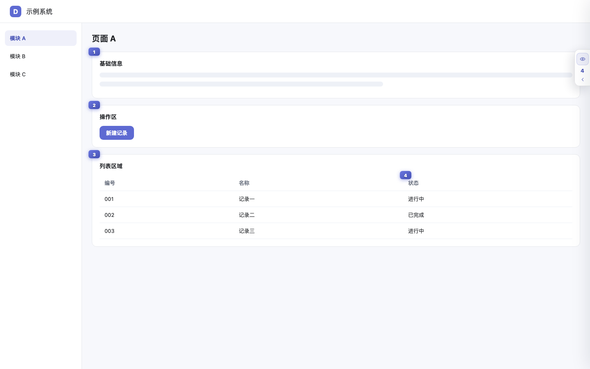

# pm-proto-prd-pin 2.1.0

纯原生 Vanilla JS 的原型 PRD 打点与分组管理引擎。2.1.0 基于 2.0 重构版本增量升级。
前端零依赖。不初始化 `package.json`，不安装 npm 包。

**English.** Version 2.1.0 builds on 2.0. New: a pre-locate state preparation hook (`PRD_PREPARE_ANCHOR`) for multi-step wizards, one grouping resolver (`PRD_GROUPS_RESOLVE`) shared by drawer and documents, per-pin group persistence in D1 (`pinGroups`), grouped rendering in all three PRD outputs, and groups expanded by default with per-browser collapse state. 2.0 features remain: in-situ PRD pinning, multi-version spec generation, first-class grouping, light glass UI, inline SVG icons, rounded pin badges, drag reordering with insertion indicators, automatic renumbering by group, unified save on exiting manage mode, dynamic view and modal anchoring, four-language hot switching, visitor read-only isolation, five persistence modes, Vditor IR editor, Mermaid diagrams, and an interactive table editor. No secrets or personal data are stored in this Skill.

**日本語.** 2.1.0 は 2.0 の後継です。多段ウィザード向けの状態復元フック、ドロワーと文書で共通のグループ判定インターフェース、D1 の `pinGroups` 保存、三つの PRD 出力でのグループ表示、デフォルト展開とブラウザ単位の折りたたみ保持を追加しました。機密情報は含まれません。

**한국어.** 2.1.0은 2.0의 후속 버전입니다. 다단계 마법사용 상태 복원 훅, 드로어와 문서가 공유하는 그룹 판정 인터페이스, D1 `pinGroups` 저장, 세 가지 PRD 출력의 그룹 표시, 기본 펼침과 브라우저별 접기 상태 유지를 추가했습니다. 비밀 정보는 포함되지 않습니다.

## 功能总览

| 模块 | 能力 |
|---|---|
| 打点 | 十字准星拾取、自愈 selector、发光框追踪、气泡详情 |
| 编辑器 | Vditor IR、Tab 缩进、可视化表格、Mermaid、规约模板、草稿暂存 |
| 分组 | 自建 / 改名 / 删除 / 拖拽调序、元素拾取锚点、快速定位、空组占位、默认展开 |
| 管理模式 | 未保存横条、插入指示线、关闭时统一确认、按组自动重排编号、滚动位置保持 |
| 圆点 | 圆角方标牌、同坐标错开、视图 / 模块 / 侧栏过滤、动态渲染重绘 |
| 定位 | 容器映射、弹窗分类打开、状态准备钩子、强制重渲染、失败延迟重试 |
| 显示 | 亮色玻璃、内联 SVG、三态抽屉、窄竖条控制台、两行头部 |
| 多语言 | 中 / 英 / 日 / 韩四份完整字典、热切换、Vditor 联动、词条回退 |
| 导出 | Markdown 按组分段、新网页 PRD TOC 与正文按组、PRD 文档大屏按组、PDF 打印 |
| 权限 | 访客只读、创立人鉴权、一键锁定 |
| 持久化 | Cloudflare D1、Supabase、JSONBin、GitHub Contents、本地 Node 服务 |
| 其它 | 多版本隔离、导入冲突处理、SPA 路由拦截、DOM 自适应 |

## 示例截图

全部使用占位文案。无姓名、公司、项目信息。图片同时托管在本仓库 `assets/images/`。ClawHub 等外部平台用 2.0.0 tag 的 raw 地址渲染，见 `SKILL.md` 第 1 节（截图未变，tag 保留）。

### 抽屉与分组



### 管理模式



### 分组管理弹窗



### 页面圆点与边缘控制台



## 快速开始

```bash
python3 scripts/inject.py <目标原型目录>
cd <目标原型目录>
./start.sh
```

`inject.py` 完成：

1. 复制 `prd-pin-tool.js`、`prd-groups.js`、`prd-hook-templates.js` 到 `assets/js/`。
2. 复制 `assets/vendor/`。
3. 复制 `server.js` 与 `start.sh`。
4. 为每个 `.html` 生成双常量数据文件 `prd-data-<name>.js`。
5. 在 `</body>` 前注入配置块与三个脚本引用。

已注入页面会跳过，不会重复写入。

## 目录结构

```text
pm-proto-prd-pin/
├── SKILL.md                       # Agent 执行规范（完整功能与契约）
├── README.md                      # 本文件
├── scripts/inject.py              # 一键植入
└── assets/
    ├── prd-pin-tool.js            # 核心引擎
    ├── prd-groups.js              # 分组扩展层（loader 动态加载）
    ├── prd-hook-templates.js      # 通用定位钩子
    ├── server.js                  # 零依赖本地服务
    ├── start.sh
    ├── vendor/vditor/             # 离线编辑器资源
    └── images/                    # 2.1.0 脱敏示例图
```

目标项目植入后：

```text
<target>/
├── *.html
├── server.js
├── start.sh
└── assets/
    ├── js/
    │   ├── prd-pin-tool.js
    │   ├── prd-groups.js
    │   ├── prd-hook-templates.js
    │   └── prd-data-<page>.js
    └── vendor/vditor/
```

## 加载顺序


核心引擎末尾的 loader 按同目录加载 `prd-groups.js?v=2.1.0`。两个文件必须成对部署。

## 配置

注入块只写占位与空实现。按目标项目补齐。

```javascript
window.PRD_CLOUDFLARE_URL = '';                 // 网关地址，不含密钥
window.PRD_GROUP_PRESET = [
  { id: 'g-list', name: '列表区域', match: ['列表区域'], label: '页面 A' }
];
window.PRD_VIEW_LABELS = { 'view-a': '页面 A' };
window.PRD_VIEW_JUMPS = {
  'view-a': { go: function () {}, render: function () {} }
};
window.PRD_HOOK_CONFIG = {
  containerHints: [['#listContainer', 'view-a']],
  titleViewHints: { '列表区域': 'view-a' },
  dynamicPattern: /#listContainer/,
  modalOpeners: [],
  prepareAnchor: function (selector, pin, view) {},   // 可选：恢复分步状态，必须幂等
  switchView: function (viewKey) {
    if (window.UI && typeof UI.showView === 'function') UI.showView(viewKey);
  },
  currentView: function () { return 'view-a'; },
  scope: function () { return { top: '', home: '' }; }
};
```

| 全局 | 用途 |
|---|---|
| `PRD_CLOUDFLARE_URL` | Pages 网关地址。留空时由工具配置面板填写。 |
| `PRD_CACHE_VERSION_OVERRIDE` | 本地缓存版本。数据口径变化时升此值。 |
| `PRD_GROUP_PRESET` | 初始分组。 |
| `PRD_VIEW_LABELS` | 视图 key → 中文名。 |
| `PRD_VIEW_JUMPS` | 视图 key → `{ go, render }`。 |
| `PRD_PAGE_FILES` | 页面文件列表。 |
| `PRD_HOOK_CONFIG` | 定位钩子配置。 |
| `PRD_PREPARE_ANCHOR` | 钩子模板暴露。定位前恢复页面状态，业务侧可覆盖。 |
| `PRD_D1_GROUPS` | 云端拉回的分组定义。 |
| `PRD_D1_PIN_GROUPS` | 云端拉回的逐条打点归属。 |
| `PRD_GROUPS_RESOLVE` | 分组扩展层暴露的归属接口。 |
| `PRD_REFRESH_MARKERS` | 核心引擎暴露。业务渲染后主动重绘圆点。 |

`navigate` 按容器 id 推断视图并切视图。动态容器锚点即使已在目标视图也要重渲染。
`openModal` 同步创建弹窗 DOM。元素未生成时核心引擎自动重试定位 8 次。
`PRD_PREPARE_ANCHOR` 在切视图、开弹窗之后执行，用于恢复向导步骤、分步表单与数据源。重试前会再执行一次。

## 数据

D1 存储对象：

```json
{
  "pageKey": "page",
  "versionRegistry": { "activeVersion": "v1.0.0", "versions": { "v1.0.0": [] } },
  "savedPins": [],
  "updatedAt": "ISO 时间",
  "groups": [],
  "pinGroups": {}
}
```

- `savedPins` 与 `versionRegistry.versions[activeVersion]` 同源。
- `groups` 是顶层字段。旧版工具忽略它，兼容旧显示。
- 任何保存都要带上 `groups`，避免覆盖丢失。
- `groups[]` 字段：`id / name / order / match[] / label / collapsed / anchor / link`。
- `anchor` 字段：`{ selector, view, pageKey }`。
- `pinGroups` 字段：`{ "<selector>\u0001<title>": "<groupId>" }`，优先于 `match[]`。
- 旧客户端不识别 `pinGroups`，保存时丢弃。关键归属须同时用 `match[]` 覆盖。
- `groups[].collapsed` 只作快照，不决定他人默认展示。折叠状态只认本机缓存。
- docId 统一去掉 `.html` 后缀。

本地 `prd-data-*.js` 双常量同源，仅作 `file://` 兜底。
分组配置另存 `localStorage`，key 前缀 `prd_groups_v1_`。

## 多语言支持（i18n）

工具内建四语言完整字典，不是简单文案替换。

| 语言 | key | Vditor 映射 |
|---|---|---|
| 简体中文 | `zh-CN` | `zh_CN` |
| English | `en` | `en_US` |
| 日本語 | `ja` | `ja_JP` |
| 한국어 | `ko` | `ko_KR` |

- 字典 `I18N` 覆盖抽屉、工具栏、搜索、卡片脚标、Vditor、PRD 大屏、Toast、冲突弹窗、语言名称。词条 115+。
- `t(key)` 回退：当前语言 → 中文 → key 本身。
- 偏好持久化：`localStorage('prd_ui_lang')`。抽屉顶部下拉热切换，无需刷新。
- `getVditorLang()` 联动 Vditor 语言包。
- 新增词条时四份字典使用同一个 key，禁止硬编码可见文案。
- 扩展第 5 种语言：加字典、加 `<option>`、加 Vditor 映射（无对应包时回退 `en_US`）。

完整字典结构、新增词条流程与扩展步骤见 `SKILL.md` 第 3.8 节。

## 部署

### 数据表

```sql
CREATE TABLE IF NOT EXISTS prd_docs (
  id TEXT PRIMARY KEY,
  data TEXT NOT NULL,
  updated_at TEXT NOT NULL
);
```

### 接口

- `GET /api/prd/:docId`：公开只读。
- `POST /api/prd/:docId`：校验 `Authorization: Bearer <环境变量>` 后写入。
- 支持 CORS 预检。

### 命令模板

```bash
# 变量由部署环境提供。命令中不出现任何值。
curl -X POST "$PRD_GATEWAY/api/prd/$DOC_ID" \
  -H "Authorization: Bearer $PRD_ADMIN_SECRET" \
  -H 'Content-Type: application/json' \
  --data-binary @payload.json

CLOUDFLARE_API_TOKEN="$CLOUDFLARE_API_TOKEN" wrangler pages deploy public --project-name "$PROJECT" --branch main
```

- 写入前 `GET` 备份到 `archive/d1-<docId>-before-<时间戳>.json`。
- 写入后 `GET` 回读，核对 `savedPins` 与 `versionRegistry` 逐字段一致。
- 未经用户明确授权，禁止部署与 `git push`。

## 权限矩阵

| 入口 | 访客只读 | 已解锁 | 管理中 |
|---|---|---|---|
| 查看打点、定位、PRD 大屏 | 显示 | 显示 | 显示 |
| 新增 / 编辑 / 删除打点 | 隐藏 | 显示 | 显示 |
| 排序管理、版本新建 / 导入 | 隐藏 | 显示 | 显示 |
| 分组按钮、分组管理 | 隐藏 | 隐藏 | 显示 |
| 拖拽调序、改组、关闭管理保存 | 隐藏 | 隐藏 | 显示 |

## 常见问题

**刷新后看到旧样式**：升脚本 `?v=` 参数并强刷。

**分组按钮不显示**：「分组」入口只在管理模式开启且已解锁时显示。

**打点定位失败**：检查 `PRD_HOOK_CONFIG` 是否覆盖目标容器，弹窗是否同步创建。

**编号不连续**：关闭「管理中」触发统一确认与按组重排。新建打点默认「未分组」并排到最后。

**圆点在其它模块残留**：补齐 `currentView`、`scope`、`PRD_VIEW_LABELS`。

**语言切换后文案缺失**：补齐四份字典同一 key，检查 `t(key)` 回退。

**页面卡顿**：确认 observer 忽略了工具浮层自身 DOM 变化。

**ClawHub 看不到图片**：`SKILL.md` 使用 2.0.0 tag 的 raw 地址。相对路径见 `assets/images/`。

## 验证

```bash
node --check assets/prd-pin-tool.js
node --check assets/prd-groups.js
node --check assets/prd-hook-templates.js
node --check assets/server.js
python3 -m py_compile scripts/inject.py
```

试注入：

```bash
python3 scripts/inject.py /tmp/prd-pin-trial
```

浏览器走查清单与故障排查见 `SKILL.md` 第 8、9 节。

## 安全

- 本 Skill 与注入产物**不含任何密钥、Token、密码、账号 ID、项目地址、姓名或公司名称**。
- 管理员写入密钥只存目标项目环境变量 `PRD_ADMIN_SECRET` 与本地密码管理器。
- 部署凭据只存环境变量 `CLOUDFLARE_API_TOKEN`。
- 命令模板只引用变量名，不出现值。
- 写入前 `GET` 备份，写入后 `GET` 回读。
- 示例截图全部使用占位文案。
- `.git` 历史已从 Skill 目录移除。需要版本管理时重新初始化。

## 变更清单

### 2.1.0（2026-11）

1. 新增 `PRD_PREPARE_ANCHOR` 状态准备钩子，修复分步向导 / 分步表单 / 数据源依赖元素的定位空白页。
2. 定位重试前再跑一次准备钩子。分组快速定位降级：通用容器 anchor 不作锚点，`view` 为空按 `label` 反查。
3. PRD 文档三处输出统一按组：弹窗左右两侧、新网页 TOC 与正文、导出 Markdown。
4. 新增 `PRD_GROUPS_RESOLVE` 归属接口，抽屉与文档共用口径。
5. D1 新增顶层 `pinGroups`，改组即写云端。
6. 分组默认展开，折叠状态只认本机缓存。文档首帧就绪后按签名变化重绘一次。

### 2.0（基线）

1. 核心引擎与分组扩展层拆分，loader 动态加载。
2. 分组一等公民：自建、改名、删除、拖拽调序、元素拾取锚点、快速定位。
3. 管理模式统一保存：预览顺序、未保存横条、关闭时二次确认、按组强制重排编号。
4. 圆点改圆角方标牌，默认 CSS 同步亮色化，同坐标网格错开。
5. 视图、顶部模块、侧栏菜单、动态容器、弹窗锚点纳入渲染与定位过滤。
6. 动态视图主动刷新与定位延迟重试，修复偶发定位失败。
7. 导出 Markdown 与新网页 PRD 按组显示。
8. UI 改为亮色玻璃 + 靛蓝强调 + 内联 SVG。
9. 管理模式重绘保持列表滚动位置。
10. 四语言 i18n 热切换、Vditor 语言联动与词条回退规则完整保留。
11. 注入脚本生成双常量数据文件与通用钩子配置块。
12. 本地服务改为通用实现。示例截图换成 2.0 脱敏图。
13. 文档补齐 English / 日本語 / 한국어 摘要、多语言章节、权限矩阵、状态机与可渲染截图。
14. Skill 内嵌 `.git` 历史移除。全部资产无密钥、无项目主体信息。
