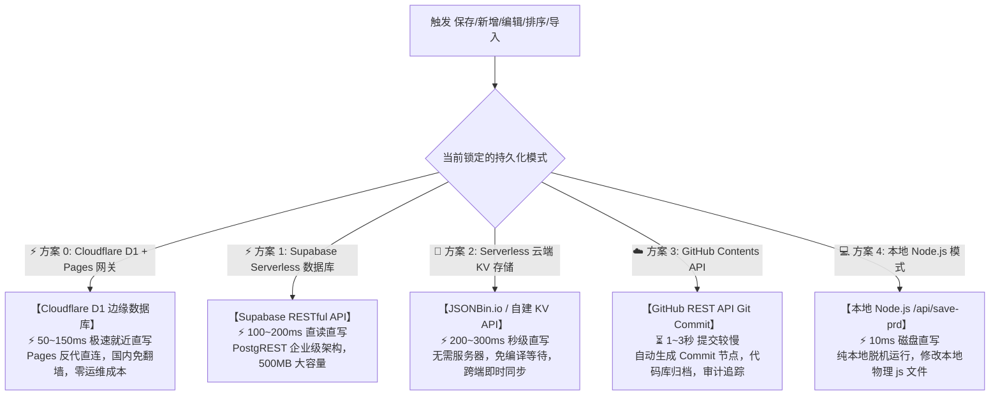

# 📌 PM Prototype PRD Pinning & Multi-Version Specification Engine

<div align="center">

**The Ultimate Interactive PRD Pinning, Vditor IR Markdown Editor & Five-Modal Persistence System for HTML / Vue / React Prototypes.**

[](https://github.com/barry0-0/pm-proto-prd-pin)
[](https://opensource.org/licenses/MIT)
[](#-internationalization-i18n)
[](#-quick-start)

[English](#-english-documentation) • [简体中文](#-简体中文文档) • [日本語](#-日本語ドキュメント) • [한국어](#-한국어-문서)

</div>

---

## 📸 Interface Screenshots

| ✍️ Vditor IR Live Editor & Visual Tables | 🗂️ 3-State Drawer (Full / Semi Rail / Hidden) |
| :---: | :---: |
|  |  |
| **🔄 Pure-White Mermaid Statecharts** | **📑 Full Page Deliverable PRD Screen** |
|  |  |

---

# 🌐 English Documentation

## ⚛️ Cross-Framework Compatibility (HTML / Vue / React) & Autonomous Detection

- **Autonomous Tech-Stack Inspection**: Automatically analyzes `package.json`, Vite/Webpack configs, or HTML structure to detect if the project is **Pure HTML**, **Vue.js (2/3/Nuxt)**, or **React (18/Next.js)**.
- **Interactive Clarification Fallback**: If the framework cannot be determined automatically, the agent prompts the user to confirm the framework and target pages/modules before proceeding.
- **SPA Client-Side Route Sync**: Intercepts `history.pushState` / `popstate` to automatically adapt pins across SPA route transitions without page refreshes.
- **Virtual DOM Dynamic Re-anchoring**: Automatically re-attaches pins when conditional components (`v-if` / React modals) enter or exit the DOM.
- **Scoped CSS & Hash Filtration**: Automatically filters Vue `data-v-xxxx` and React CSS-in-JS hashes to guarantee robust long-term selector anchoring.
- **Tailwind CSS Reset Isolation & SPA Resource Hydration**: Full CSS isolation sandbox protecting Vditor toolbar icons from Tailwind Preflight distortion, with ISO-8859-1 safe header sanitization for non-ASCII SPA routes.

---

## 🌟 Five-Modal Persistence System & Comparison

| Persistence Mode | Underlying Architecture | Read/Write Latency | Use Cases & Key Characteristics |
| :--- | :--- | :--- | :--- |
| **⚡ Mode 0: Cloudflare D1 Edge Database + Pages Gateway —— [Recommended / Global Speed]** | Cloudflare D1 (SQLite) + Worker + Pages Reverse Proxy Gateway (`GET /api/prd/{docId}` Public Read, `POST` Private Write with Bearer Secret) | **Ultra-Fast (50~150ms)**<br>Global CDN edge cache, China mainland direct access bypass, 24/7 always on | **Best for Team Collaboration & Hosted Demos**: Zero server ops, seamless Mainland China access via Pages proxy, instant global sync. |
| **⚡ Mode 1: Supabase Serverless Database** | Supabase RESTful PostgREST (`GET /rest/v1/{table}` Public Read, `POST` Upsert with API Key) | **Ultra-Fast (100~200ms)**<br>Enterprise relational backend, 500MB storage | **Best for Large Multi-Table Prototypes**: High concurrency, structured relational specs, and extensive revision logs. |
| **🔑 Mode 2: Serverless Cloud KV Storage (JSONBin.io / Custom KV)** | RESTful KV API (`GET /latest` Public Read, `PUT` Private Write with Master Key) | **Instant (200~300ms)**<br>Zero build wait, instant cross-browser hydration | **Best for Fast Online Staging**: Zero-server deployment (GitHub Pages, Vercel). Instant synchronization across devices. |
| **☁️ Mode 3: GitHub Contents API Git Commit** | GitHub REST API (`PUT /contents/{filePath}` Base64 encoded Git Commits) | **Slower (1~3s)**<br>Git tree hashing, commit chaining, and Pages rebuild delay | **Best for Strict Audit Trails**: Automatically generates formal Git commits with complete commit history. |
| **💻 Mode 4: Local Node.js Disk Storage** | Native Node.js server (`POST /api/save-prd` writing directly to disk via fs) | **Sub-millisecond (10~50ms)**<br>Direct local filesystem I/O | **Best for Offline Development**: Pure offline local development with zero external network dependency. |

---

## 🔒 Dynamic UI Guard & Creator Authentication Matrix

To prevent unauthorized modifications on hosted prototypes, the system enforces a strict dynamic protection matrix:

```mermaid
graph TD
    UserOpen["User Opens Prototype Page"] --> CheckAuth{"Is Admin Secret Verified?<br>(isPRDEditAuthorized)"}
    
    CheckAuth -->|❌ Unauthorized (Visitor Read-Only)| VisitorUI["【Dynamic UI Guard & Feature Hiding】<br>• Hide top 'Reorder' button<br>• Hide 'New/Import' buttons & management dropdown options<br>• Hide card 'Edit' & 'Delete' actions<br>• Hide drawer bottom '+ Add Pin' primary button<br>• Hide 56px Mini-rail bottom '+' button<br>• Hide pin inspect bubble 'Edit Spec' action<br>• Status badge displays '🔒 Cloudflare (Visitor Read-Only)'"]
    
    CheckAuth -->|✅ Authorized (Admin Mode)| AdminUI["【Full Interactive Workbench】<br>• Show Add Pin, Edit, Delete, and Reorder<br>• Show New Version, Import, and Safety Lock<br>• Status badge displays '🟢 Cloudflare (Unlocked)'<br>• Real-time mutations saved directly to cloud storage"]
```

1. **Visitor Read-Only Mode (Zero-Interruption Browsing)**:
   - Visitors get instant read access to all pins, Markdown specs, Mermaid diagrams, and PDF exports without entering credentials.
   - All editing, pin creation, deletion, version management, and import entry points are completely hidden from the UI.
2. **One-Click Creator Unlock**:
   - Clicking the `🔒 Cloudflare (Visitor Read-Only)` badge prompts for the Admin Secret Key (`PRD_ADMIN_SECRET`).
   - Once validated, the UI instantly unlocks and unhides all management controls.

---

## 🌟 Key Capabilities & Features

| Capability | Technical Implementation | PM & Engineering Benefit |
| :--- | :--- | :--- |
| **✍️ Vditor IR Markdown Workbench** | Integrated Vditor (Instant Rendering mode) with relative vendor loading + CDN auto-fallback | Typora-grade live authoring experience; instantaneous rendering for all components |
| **⌨️ Multi-Level Tab Indentation** | Native `Tab` and `Shift+Tab` event handlers for unordered/ordered/task lists | Effortlessly organize nested specifications (`1 -> 1.1 -> 1.1.1`) |
| **📊 Interactive Visual Table Editor** | 2D HTML cell matrix, direct cell typing, `Enter/Tab` navigation, 1-click row/col ops | Completely eliminates markdown pipe `\| col \|` syntax friction; feels like Excel/Word |
| **🔄 Pure-White Mermaid Vector Engine** | Dedicated white container with dynamic bottom viewBox compensation (+28px) | Zero clipped labels or distorted arrows on Statecharts, Sequences, and Flowcharts |
| **💡 3 Core Business Templates** | Fast-insert buttons for Business Rules, Statechart Diagrams, and Data Dictionary Tables | Rapid authoring of standardized specification clauses |
| **👀 Single-Entry Stash & Minimize** | Clean close `✕` in header + `👀 Stash & View Page` in bottom bar (`.prd-editor-mini-dock` pill) | Review underlying prototype elements without losing unsaved drafts; 1-click restore |
| **🌐 Native 4-Language i18n** | Full 115-key dynamic dictionary covering `en`, `zh-CN`, `ja`, `ko`; runtime hot-switching | Seamless multi-lingual team collaboration across global product workflows |
| **🗂️ 3-State Drawer & Dual Handles** | Full (400px), Semi (56px Mini Rail), Hidden (0px); dual inward-facing edge handles | Frees up 95% of prototype canvas while keeping all pins immediately accessible |
| **🔒 Reorder Safety Lock & Cascade** | Normal browsing locks order; manage mode unlocks `🔝 Top`, `🔢 Move To`, sequential cascade | Accidental reordering prevention; seamless 1 -> 2 -> 3 cascading when reordering |
| **🏷️ Multi-Version Physical Isolation** | Isolated `versionRegistry`; new versions start clean (0 pins); upload conflict resolver | No pin cross-contamination across sprint iterations |
| **📑 Full PRD Document & PDF Export** | Dedicated doc modal + new tab view with TOC outline and print styling | 1-click export to deliverable PDF or Markdown specifications |

---

# 🇨🇳 简体中文文档

## ⚛️ 跨框架兼容架构 (HTML / Vue / React) 与自主工程感知

- **🚫 SPA 工程严禁生成冗余 HTML (Zero-HTML In React/Vue)**：在 React/Vue 现代工程中，绝对禁止生成任何独立的 `.html` 页面，仅在全局入口（`main.tsx` / `main.js`）以一行 `import` 挂载，零 HTML 污染；
- **工程架构自主嗅探 (Autonomous Inspection)**：自动检查 `package.json`、Vite/Webpack 插件及文件类型，智能识别当前工程是 **HTML 静态原型**、**Vue.js (Vue 2/3/Nuxt)** 还是 **React (React 18/Next.js)**；
- **未能识别时的前置提问协议**：若无法推断框架，Agent 自动前置发起询问：确认所用技术栈及 PRD 打点需应用的页面/模块；
- **SPA 客户端路由热感知**：自动代理全局 `history.pushState` / `popstate`，Vue Router / React Router 无刷新切页时自动切换打点数据；
- **虚拟 DOM 动态挂载自愈**：结合 `MutationObserver`，在 `v-if` / 弹窗动态挂载时毫秒级自动定位并贴附大头针；
- **Scoped CSS 与随机哈希清洗**：智能剔除 `data-v-xxxx` 与 CSS-in-JS 哈希类名，优先提取语义化结构路径；
- **Tailwind CSS 样式强隔离与深层 SPA 路由安全**：构建 Vditor 专属样式沙箱，根除 Tailwind Preflight 造成的图标撕裂，并自动对中文 SPA 路由执行 ISO-8859-1 安全编码。

---

## 🌟 五模态持久化体系与方案实现对比

针对产品经理在不同阶段（本地制作、团队评审、线上发布）的诉求，系统提供了五套严格排他的持久化架构：



| 方案 | 核心技术实现 | 读写延迟与快捷性 | 适用场景与权衡 (Trade-offs) |
| :--- | :--- | :--- | :--- |
| **⚡ 方案 0：Cloudflare D1 边缘数据库 + Pages 网关 —— 【默认推荐 / 全球加速首选】** | 基于 Cloudflare D1 (SQLite) + Worker + Pages 反代网关：<br>• 读：`GET /api/prd/{docId}`（公开只读，边缘就近缓存）<br>• 写：`POST /api/prd/{docId}` 带 `Authorization: Bearer <SecretKey>` | **极速 (50~150ms)**<br>全球 CDN 边缘就近读取，国内免翻墙直连，永不休眠 | **企业、团队协作与公网演示首选**：完美解决 `workers.dev` 在大陆地区的 SNI 阻断问题，强一致性写入，零服务器运维成本。 |
| **⚡ 方案 1：Supabase Serverless 数据库 (PostgREST API) —— 【大容量备选】** | 基于 Supabase RESTful PostgREST 架构：<br>• 读：`GET /rest/v1/{table}?id=eq.{docId}` 带 `apikey`<br>• 写：`POST /rest/v1/{table}` 带 `Prefer: resolution=merge-duplicates` | **极速 (100~200ms)**<br>企业级直连，500MB 大容量与高并发 | **大型复杂多库原型**：适合已有 Supabase 基础设施的项目，支持强关系字段与海量规约。 |
| **🔑 方案 2：Serverless 云端 KV 存储 (JSONBin.io) —— 【免建表即用】** | 基于 RESTful JSONBin API 架构：<br>• 读：`GET /v3/b/{binId}/latest?_t=timestamp`<br>• 写：`PUT /v3/b/{binId}` 带 `X-Master-Key` | **极速 (200~300ms)**<br>秒级实时直读直写，零构建等待 | **轻量备用**：无需任何后端建表，开箱即用（免费版单条 100KB 限制）。 |
| **☁️ 方案 3：GitHub Contents API 推送提交 (Git Commit 模式)** | 基于 GitHub REST API：<br>调用 `PUT /repos/{owner}/{repo}/contents/{filePath}` 提交正式 Commit | **较慢 (1~3 秒)**<br>需经历 GitHub API 网络调用、生成 Commit 节点与分支推进 | **代码库一体化归档**：需要完整 Git Commit 审计记录与提交历史的场景。 |
| **💻 方案 4：本地 Node.js 磁盘直写 (Local Node 模式)** | 本地启动 `node server.js` 微服务，前端通过 `POST /api/save-prd` 调用 fs 模块直接修改磁盘上的物理 `prd-data-*.js` 文件 | **极快 (10~50ms)**<br>本机 localhost 内部直接落盘 | **纯脱机独立开发**：无外网网络、企业保密内网、纯本地研发环境。 |

---

## 🔒 读写权限隔离、动态功能隐藏保护矩阵与创立人身份鉴权

为了防止原型发布到线上后被外部人员随意篡改，系统内建了**企业级权限隔离与动态 UI 安全隐藏矩阵**：

1. **👁️ 访客只读保护（全量敏感功能动态隐藏）**：
   - 外部访客、设计或研发人员打开页面，直接只读加载全部打点、Markdown 规约、Mermaid 流程图与数据字典，无任何弹窗打扰；
   - **动态隐藏矩阵**：在未通过管理员密钥验证时，界面自动执行全要素安全收敛：
     - 抽屉顶部彻底隐藏「排序管理」按钮；
     - 多版本工具栏彻底隐藏「新建」和「导入」按钮，版本下拉框过滤所有管理选项；
     - 需求卡片底部彻底隐藏「编辑」与「删除」按钮，仅保留「定位」；
     - 抽屉底部彻底隐藏「➕ 新增打点」按钮；
     - 56px Mini-rail 标号条底部彻底隐藏「+」新增按钮；
     - 大头针悬浮气泡底部彻底隐藏「编辑需求」按钮；
     - 全景 PRD 文档大屏彻底隐藏「上传/导入版本」按钮。
2. **🟢 创立人身份密钥校验与动态解锁**：
   - 点击抽屉顶部的 `🔒 Cloudflare (访客只读)` 状态徽标；
   - 弹出管理员鉴权模态框，输入管理员写入密钥（`PRD_ADMIN_SECRET`）；
   - 校验通过后将状态注入 `sessionStorage`，徽标更新为 `🟢 Cloudflare (已解锁)`，页面毫秒级动态重绘，**瞬间展示所有隐藏的新增、编辑、删除、版本与排序管理按钮**。
3. **🔒 一键锁定恢复只读**：
   - 点击 `🟢 Cloudflare (已解锁)` 徽标选择「清除授权」，界面瞬间恢复纯净只读视图，所有编辑入口立即全部收敛隐藏。

---

## 🛠️ 项目工程结构与集成

```html
<!-- 在任意 HTML 原型 </body> 前引入： -->
<script src="./assets/js/prd-pin-tool.js"></script>
```

```text
my-prototype/
├── admin.html               # 原型页面 A
├── mall.html                # 原型页面 B
├── merchant.html            # 原型页面 C
├── h5.html                  # 原型页面 D
├── merchant-h5.html         # 原型页面 E
├── server.js                # 本地持久化后端服务 (Node.js 原生零依赖，提供 /api/save-prd)
├── start.sh                 # 一键启动脚本
└── assets/
    ├── vendor/
    │   └── vditor/          # Vditor 离线资源
    └── js/
        ├── prd-pin-tool.js  # 核心引擎 (V7.0 跨框架通用: HTML / Vue / React)
        ├── prd-data-admin.js
        ├── prd-data-mall.js
        └── prd-data-merchant.js
```

---

# 🇯🇵 日本語ドキュメント

## 🌟 5 つの永続化モードとアーキテクチャ比較

1. **⚡ モード 0: Cloudflare D1 エッジデータベース + Pages ゲートウェイ —— 【デフォルト推奨・最高速】**：
   - Cloudflare D1 (SQLite) + Worker + Pages リバースプロキシ。グローバル CDN エッジキャッシュ、常時高速応答（50〜150ms）、サーバーレス運用。
2. **⚡ モード 1: Supabase Serverless データベース (PostgREST API)**：
   - 大容量（500MB）と高同時実行性を備えたリレーショナルクラウド DB。
3. **🔑 モード 2: Serverless クラウド KV ストレージ (JSONBin.io)**：
   - RESTful API による高速リアルタイム同期（200〜300ms）。
4. **☁️ モード 3: GitHub Contents API プッシュモード (Git Commit)**：
   - GitHub REST API を介して正式な Git Commit を自動作成。監査ログに最適。
5. **💻 モード 4: ローカル Node.js ディスク直接保存**：
   - ローカルの `node server.js` を介してローカルディスクの `.js` ファイルを直接更新。オフライン開発に最適。

## 🔒 閲覧・編集の権限分離と動的 UI 保護マトリクス
- **閲覧者モード（デフォルト）**：認証なしでピン、Markdown 仕様書、Mermaid 図、PDF エクスポートを自由に閲覧可能。**編集、ピン追加、削除、インポート、バージョン作成ボタンは自動的に非表示化**されます。
- **管理者キー認証**：ステータスバッジ `🔒 (閲覧者モード)` をクリックして秘密鍵を入力すると、全機能が瞬時にロック解除・表示されます。

---

# 🇰🇷 한국어 문서

## 🌟 5가지 영속성 모드 및 아키텍처 비교

1. **⚡ 모드 0: Cloudflare D1 엣지 데이터베이스 + Pages 게이트웨이 —— 【기본 권장 / 초고속】**：
   - Cloudflare D1 (SQLite) + Worker + Pages 리버스 프록시 게이트웨이. 글로벌 CDN 엣지 캐싱, 50~150ms 극속 응답, 무중단 서버리스 운용.
2. **⚡ 모드 1: Supabase Serverless 데이터베이스 (PostgREST API)**：
   - 500MB 대용량 및 고동시성 지원 클라우드 DB.
3. **🔑 모드 2: Serverless 클라우드 KV 스토리지 (JSONBin.io)**：
   - RESTful API 기반 초고속 실시간 동기화 (200~300ms).
4. **☁️ 모드 3: GitHub Contents API 푸시 모드 (Git Commit)**：
   - GitHub REST API를 통해 정식 Git Commit을 자동 생성.
5. **💻 모드 4: 로컬 Node.js 디스크 직접 저장**：
   - `node server.js`를 통해 로컬 디스크의 `.js` 파일을 직접 수정.

## 🔒 읽기/쓰기 권한 분리 및 동적 UI 보호 매트릭스
- **방문자 읽기 전용 (기본)**：인증 없이 핀, 마크다운 명세, Mermaid 다이어그램을 자유롭게 열람. **편집, 핀 추가, 삭제, 가져오기, 버전 생성 등의 모든 관리 버튼이 자동으로 숨김 처리**됩니다.
- **관리자 키 인증**：상태 배지 `🔒 (방문자 읽기 전용)`를 클릭하여 관리자 비밀키를 입력하면 모든 편집 도구가 즉시 잠금 해제되고 화면에 표시됩니다.

---

## 📄 License
MIT License. Created for Product Managers & UI/UX Engineers.
