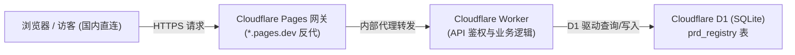

# 交互式原型 PRD 打点标注与多版本规约生成系统 (PM Prototype PRD Pin Engine V7.0 (Cloudflare D1 Edge Edition))

## 📖 概述

`pm-proto-prd-pin` 是一套**高保真、即插即用、生产就绪、跨框架兼容**的原型交互规约标注引擎（纯原生 Vanilla JS + CSS + Vditor IR 引擎 + Cloudflare D1 边缘数据库 / Cloudflare Pages 免翻墙网关 / Supabase / JSONBin 云端 KV / GitHub REST API / Node.js 本地微服务）。
它不仅支持传统的静态 HTML 原型（后台管理系统、电商前台、移动端 H5、PC 门户等），还**原生兼容现代 Vue (2/3/Vite/Nuxt) 与 React (17/18/Next.js) SPA 单页应用**，瞬间赋予专业的产品经理（PM）交互式打点标注、多版本管理、**集成 Vditor 即时渲染与 Tab 多级缩进工作台**、纯白 Mermaid 流程图动态防截断渲染、全景文档大屏展示以及**五模态持久化、访客只读与动态权限隐藏矩阵**能力。

---

## 🎯 核心规范与模块功能模板 (1:1 完整实现标准)

### Phase 0: 🌐 原生全球多语言架构体系 (Native Multi-Language i18n Protocol)
- **四国语言内建覆盖**：
  - 🇨🇳 **简体中文 (`zh-CN` / `zh_CN`)**
  - 🇺🇸 **English (`en` / `en_US`)**
  - 🇯🇵 **日本語 (`ja` / `ja_JP`)**
  - 🇰🇷 **한국어 (`ko` / `ko_KR`)**
- **全要素动态本地化 (115 个词条字典全覆盖)**：
  - 抽屉左侧控制按钮、顶部操作栏、排序管理模式提示条与操作按钮、搜索占位符、需求卡片脚标、Vditor 编辑器全量语言包、全景 PRD 大屏所有元数据与目录大纲、版本冲突处理对话框等 **100% 字典覆盖**；
- **运行时无感知热切换与本地记忆**：
  - 抽屉顶部提供多语言切换下拉菜单，切换后即刻热重绘所有组件与徽标，并将偏好持久化至 `localStorage('prd_ui_lang')`；
- **强制前置语言确认规范 (Mandatory Phase 0 Inception)**：
  - **在使用本 Skill 执行构建时，Agent 必须首先向用户确认期望使用的语言框架（中文 / 英文 / 日文 / 韩文）**；
  - 最终生成出来的原型框架、初始需求规约数据、业务规则模板、以及表头字典，必须严格采用用户指定的对应语言！

---

### Phase 0.5: 🧩 跨框架自主感知与前置确认协议 (Autonomous Framework Detection & Inception)

> 🌟 **核心铁律 (Strict Zero-HTML Generation In Modern Frameworks)**：  
> **当识别到项目为 React (Vite / Next.js / CRA) 或 Vue (Vue 2/3 / Nuxt) 等现代前端 SPA 工程时，严禁生成任何独立的 `.html` 原型文件！**  
> 现代工程已有完整的组件与路由体系，打点工具仅作为全局外挂图层（通过 `main.tsx` / `main.js` 导入），实现零新增 HTML、零模板污染、零业务侵入。

> 🌟 **核心规范 (Core Protocol)**：  
> 本引擎具备跨技术栈自适应能力。在执行打点工具集成前，Agent 必须执行两步感知与确认流程：

1. **Step 1: 自动化工程架构自主嗅探 (Autonomous Inspection)**：
   - Agent 必须首先检查目标项目的目录结构与配置文件：
     - **Vue.js 工程**：检查 `package.json` 中的 `dependencies.vue`、`vue.config.js`、`vite.config.*`（含 `@vitejs/plugin-vue`）、或 `nuxt.config.*`；
     - **React 工程**：检查 `package.json` 中的 `dependencies.react`、`next.config.*`、`vite.config.*`（含 `@vitejs/plugin-react`）、或 `App.tsx`/`index.jsx`；
     - **HTML 静态原型**：检查根目录下是否存在独立 `.html` 原型文件（如 `admin.html`、`index.html`）且无前端构建依赖；
2. **Step 2: 无法确定框架时的强制前置确认 (Interactive Clarification Fallback)**：
   - **若项目中无 `package.json` 或无法明确推断框架体系，Agent 必须向用户发起明确提问**：
     > 💬 *“请问当前项目采用的是什么前端框架？（HTML 静态原型 / Vue 2/3 / React / Next.js / Nuxt）以及 PRD 打点标注工具需要应用在哪些页面或模块？（全局所有路由页面 / 仅特定业务端页面）”*
3. **Step 3: 各框架精准接入指导 (严禁跨形态误生成文件)**：
   - **React 工程 (Vite / Next.js / CRA / React 18)**：
     - 🚫 **严禁新建任何 `.html` 页面文件**；
     - 资源放置：将 `prd-pin-tool.js` 与 `vendor/vditor` 置于 `public/assets/js/` 和 `public/assets/vendor/`；
     - 入口引入：在 `src/main.tsx` 或 `src/App.tsx` 中写入：
       ```tsx
       import '../public/assets/js/prd-pin-tool.js';
       ```
     - 零修改 `index.html`，零侵入原有业务组件。
   - **Vue 工程 (Vue 2 / Vue 3 / Vite / Nuxt)**：
     - 🚫 **严禁新建任何 `.html` 页面文件**；
     - 入口引入：在 `src/main.js` 或 `src/main.ts` 中写入：
       ```javascript
       import '../public/assets/js/prd-pin-tool.js';
       ```
   - **纯静态 HTML 原型 (Vanilla Multi-Page HTML)**：
     - 仅在纯静态 HTML 仓库中，才在各 HTML 页面 `</body>` 闭合前引入 `<script src="./assets/js/prd-pin-tool.js"></script>`。

---

### Module 1: 💾 五模态持久化体系 (含 Cloudflare D1 边缘数据库与 Pages 免翻墙网关)

> 🌟 **云端强确认后置缓存核心原则 (Post-Cloud Confirmation Cache Principle)**：  
> 1. **严禁前置假保存**：严禁在云端请求返回前静默写入 `localStorage` 假装保存成功；  
> 2. **真实 HTTP 200 强校验**：必须在收到云端返回的 `HTTP 200 OK` 且携带确认实体后，才允许将数据镜像写入 `localStorage` 作为客户端离线/秒开缓存；  
> 3. **失败原子回滚**：若云端网络超时或鉴权失败，系统立即阻断并自动回滚内存状态，弹出红色错误 Toast，杜绝本地与云端数据不一致；  
> 4. **跨浏览器/多端免密直读**：系统默认公开 `GET /api/prd/:docId` 只读端点，任何同事、评审方在任意新电脑/新浏览器（含无痕模式）中打开，启动时自动秒级拉取最新规约，实现真正的「全员零配置直读、创立人权限写入」。

| 方案 | 核心技术实现 | 读写延迟与快捷性 | 适用场景与权衡 (Trade-offs) |
| :--- | :--- | :--- | :--- |
| **⚡ 方案 0：Cloudflare D1 边缘数据库 + Pages 网关 —— 【默认推荐 / 全球加速首选】** | 基于 Cloudflare D1 (SQLite) + Worker + Pages 反代网关：<br>• 读：`GET /api/prd/{docId}`（公开只读，边缘就近缓存）<br>• 写：`POST /api/prd/{docId}` 带 `Authorization: Bearer <SecretKey>` | **极速 (50~150ms)**<br>全球 CDN 边缘就近读取，国内免翻墙直连，永不休眠 | **企业、团队协作与公网演示首选**：完美解决 `workers.dev` 在大陆地区的 SNI 阻断问题，强一致性写入，零服务器运维成本。 |
| **⚡ 方案 1：Supabase Serverless 数据库 (PostgREST API) —— 【大容量备选】** | 基于 Supabase RESTful PostgREST 架构：<br>• 读：`GET /rest/v1/{table}?id=eq.{docId}` 带 `apikey`<br>• 写：`POST /rest/v1/{table}` 带 `Prefer: resolution=merge-duplicates` | **极速 (100~200ms)**<br>企业级直连，500MB 大容量与高并发 | **大型复杂多库原型**：适合已有 Supabase 基础设施的项目，支持强关系字段与海量规约。 |
| **🔑 方案 2：Serverless 云端 KV 存储 (JSONBin.io) —— 【免建表即用】** | 基于 RESTful JSONBin API 架构：<br>• 读：`GET /v3/b/{binId}/latest?_t=timestamp`<br>• 写：`PUT /v3/b/{binId}` 带 `X-Master-Key` | **极速 (200~300ms)**<br>秒级实时直读直写，零构建等待 | **轻量备用**：无需任何后端建表，开箱即用（免费版单条 100KB 限制）。 |
| **☁️ 方案 3：GitHub Contents API 推送提交 (Git Commit 模式)** | 基于 GitHub REST API：<br>调用 `PUT /repos/{owner}/{repo}/contents/{filePath}` 提交正式 Commit | **较慢 (1~3 秒)**<br>需经历 GitHub API 网络调用、生成 Commit 节点与分支推进 | **代码库一体化归档**：需要完整 Git Commit 审计记录与提交历史的场景。 |
| **💻 方案 4：本地 Node.js 磁盘直写 (Local Node 模式)** | 本地启动 `node server.js` 微服务，前端通过 `POST /api/save-prd` 调用 fs 模块直接修改磁盘上的物理 `prd-data-*.js` 文件 | **极快 (10~50ms)**<br>本机 localhost 内部直接落盘 | **纯脱机独立开发**：无外网网络、企业保密内网、纯本地研发环境。 |

#### 🏗️ Cloudflare 全栈部署最佳实践（标准化架构）



1. **D1 数据表结构 (`schema.sql`)**：
   ```sql
   CREATE TABLE IF NOT EXISTS prd_registry (
     id TEXT PRIMARY KEY,
     data TEXT NOT NULL,
     updated_at DATETIME DEFAULT CURRENT_TIMESTAMP
   );
   ```
2. **Worker 核心接口规范**：
   - `GET /api/prd/:docId`：公开读取当前页面的全量规约 JSON；
   - `POST /api/prd/:docId`：验证 `Authorization: Bearer <PRD_ADMIN_SECRET>`，通过后写入/覆盖 D1；
   - `GET /api/prd/list`：列出所有已持久化的页面主键；
   - 支持完整的 CORS 预检（`OPTIONS`）与 `Access-Control-Allow-Origin: *`。
3. **Pages 透明反向代理网关 (`_worker.js`)**：
   ```javascript
   export default {
     async fetch(request, env) {
       const url = new URL(request.url);
       const targetOrigin = 'https://<YOUR_WORKER_DOMAIN>.workers.dev';
       const targetUrl = new URL(url.pathname + url.search, targetOrigin);
       const forwardHeaders = new Headers(request.headers);
       forwardHeaders.set('Host', targetUrl.host);
       return fetch(targetUrl.toString(), {
         method: request.method,
         headers: forwardHeaders,
         body: request.method !== 'GET' && request.method !== 'HEAD' ? request.body : null
       });
     }
   };
   ```

---

### Module 2: 🔒 读写权限隔离、动态功能隐藏保护矩阵与创立人身份鉴权 (Dynamic UI Guard & Creator Auth)

为防止外部人员、评审方或访客随意篡改线上 PRD 原型规约，系统实现了**严格的动态权限显隐与读写物理隔离保护矩阵**：

```mermaid
graph TD
    UserOpen["用户打开原型页面"] --> CheckAuth{"是否已持有管理员密钥鉴权？<br>(isPRDEditAuthorized)"}
    
    CheckAuth -->|❌ 未解锁 (访客只读模式)| VisitorUI["【动态隐藏全部管理与编辑入口】<br>• 隐藏抽屉顶部「排序管理」按钮<br>• 隐藏版本栏「新建/导入」按钮与下拉菜单管理项<br>• 隐藏卡片底部「编辑」与「删除」按钮，禁用拖拽<br>• 隐藏抽屉底部「新增打点」主按钮<br>• 隐藏 Mini-rail「+」按钮<br>• 隐藏大头针气泡「编辑需求」按钮<br>• 状态徽标显示「🔒 Cloudflare (访客只读)」"]
    
    CheckAuth -->|✅ 已解锁 (管理员模式)| AdminUI["【全量展现完整编辑工作台】<br>• 展现新增打点、编辑、删除、拖拽排序<br>• 展现新建版本、导入数据、管理锁<br>• 状态徽标显示「🟢 Cloudflare (已解锁)」<br>• 任意修改实时同步至 Cloudflare D1"]
    
    VisitorUI --> ClickUnlock["点击状态徽标 🔒 或触发鉴权"]
    ClickUnlock --> EnterSecret["输入创立人专属 API Key / Secret Key"]
    EnterSecret --> Verify["云端实时校验密钥有效性"]
    Verify -->|✅ 校验通过| AdminUI
```

#### 1. 🔒 访客只读模式下的动态元素隐藏规则（未授权状态）
当 `isPRDEditAuthorized()` 为 `false` 时，前端界面自动执行全要素安全收敛：
- **抽屉顶部操作栏**：彻底隐藏「排序管理」按钮（`#prd-manage-order-btn`）；
- **多版本工具栏**：彻底隐藏「新建」和「导入」按钮（`#prd-version-new-btn`, `#prd-version-import-btn`）；版本下拉框（`#prd-version-select`）仅保留版本切换选项，**彻底过滤并隐藏所有「新建空白版本/复制当前版本/上传数据/删除版本」等选项**；
- **需求卡片列表 (`renderRightDrawerList`)**：卡片底部**彻底隐藏「编辑」与「删除」按钮**，仅保留「定位」按钮；禁用卡片拖拽手柄与点击改序交互；
- **抽屉底部操作栏**：**彻底隐藏「➕ 新增打点」主按钮**，将「查看完整PRD」按钮自适应填满整行宽度；
- **56px Mini-rail 紧凑标号条**：**彻底隐藏底部的「+」圆圈新增打点按钮**；
- **大头针悬浮气泡 (`showInspectBubble`)**：底部**彻底隐藏「编辑需求」按钮**，展示轻量「访客只读」状态标签；
- **全景 PRD 文档大屏 (`openCurrentPagePRDDoc`)**：顶部工具栏**彻底隐藏「上传/导入版本」按钮**。

#### 2. 🟢 创立人身份密钥校验与动态解锁
- 点击抽屉顶部的 `🔒 Cloudflare (访客只读)` 状态徽标；
- 弹出管理员鉴权模态框，输入管理员写入密钥（`PRD_ADMIN_SECRET`）；
- 系统向 Cloudflare / Supabase / GitHub 发起真实写权限校验；
- 校验通过后将状态注入 `sessionStorage`，徽标实时更新为 `🟢 Cloudflare (已解锁)`，页面毫秒级动态重绘，**瞬间展示所有隐藏的新增、编辑、删除、版本与排序管理按钮**。

#### 3. 🔒 一键锁定恢复只读
- 点击 `🟢 Cloudflare (已解锁)` 徽标，点击「清除授权 (切换为只读模式)」；
- 系统立即清除本地会话密钥，界面瞬间恢复为纯净的访客只读模式，所有编辑入口立即全部收敛隐藏。

---

### Module 3: 📍 交互式十字准星打点与智能空间锚定 (Pinning & Spatial Anchoring Engine)
- **十字准星拾取器 (`bindPickListeners`)**：
  - 点击「📍 新增打点」进入打标模式，鼠标指针变为 `crosshair`，底层元素高亮深琥珀色虚线框；
  - **打标时自动收起右侧抽屉**：进入十字准星打标模式时，右侧抽屉**自动完全收起**，折叠为边缘胶囊 `✕ 📍 点击组件打标 (点击或ESC退出)`，彻底杜绝侧边栏遮挡底层页面组件；
  - 拾取完成或按 ESC 后，自动无缝呼出需求规格编辑工作台；
- **自愈式弹性 CSS 选择器算法 (`getElementSelector`)**：
  - 优先提取精准 `#id`、语义化类名、结构层级路径（`div:nth-of-type(n)`）与表单属性，保证动态重绘后打点依然 100% 准确对齐；
- **连续帧率发光框追踪算法 (Continuous Frame-Rate Glow Box Tracking)**：
  - 采用 `requestAnimationFrame` 在平滑滚动的 50 帧（约 800ms）全周期内实时调用 `getBoundingClientRect()` 动态重绘红色发光脉冲框（`position: fixed`），彻底解决页面平滑滚动导致的坐标漂移；
- **智能容器自动展开 (Smart Container Auto-Unfolding)**：
  - 当打点目标位于未激活的 Tab 面板、已关闭的弹窗或折叠面板中时，定位时自动触发父容器的激活事件（如 `click` / Tab 切换），确保目标元素完全可见后再平滑聚焦。

---

### Module 4: ✍️ Vditor IR 即时渲染与多级缩进工作台 (Vditor IR Editor Workbench)
- **独立自包含原生 Toast 浮动反馈系统 (`#prd-global-toast-container`)**：
  - 彻底解耦外部环境，内建原生浮动 Toast UI 容器（`z-index: 10000099`），不依赖任何第三方 UI 库或 `window.UI`；
  - 在保存、删除、模式切换、鉴权拦截等关键操作节点提供翡翠绿/珊瑚红/深空灰渐变的高可见度即时反馈；
- **三方组件集成架构 (Vditor Instant Rendering Engine)**：
  - **双通道与 SPA 绝对路径加载机制 (`ensureVditorLoaded`)**：
    - 采用绝对根路径与 CDN 双通道加载，杜绝 React / Vue 深层 SPA 嵌套路由下相对路径 404（HTML 污染）导致 CSS 失效；
  - **Tailwind CSS Preflight 样式强隔离与重置修复**：
    - 强制对 `#prd-vditor-container` 实施严格样式沙箱隔离，重置并锁定工具栏 SVG 图标为标准的 `14px × 14px`，彻底杜绝 Tailwind CSS 全局 `svg { display:block; width:100% }` 造成的工具栏图标撕裂与字母巨大化（H/B/T 字母变形）问题；
  - **IR (Instant Rendering) 即时渲染模式**：
    - Typora 级的流式文档编写手感，输入 `- 列表` 或 `### 标题` 即刻呈现高保真排版；
- **⌨️ 完整支持 Tab / Shift+Tab 多级层级缩进**：
  - **多级嵌套列表**：在无序列表、有序列表或任务清单中按 **`Tab`** 即可瞬间向右缩进生成下一层级（如 `1 -> 1.1 -> 1.1.1` 或 `• -> ◦ -> ▪`）；
  - **反向缩进 / 升级层级**：按 **`Shift + Tab`** 或行首 `Backspace` 即可瞬间回退层级；
- **📊 交互式可视化表格直编**：
  - 彻底告别 Markdown 竖线管道符 (`| col |`)，表格直接渲染为可视 HTML 矩阵；
  - 支持鼠标点击任意单元格直接打字输入，按 `Enter/Tab` 顺畅换行换格；
  - 原生工具栏一键插入表格与进行行列扩展；
- **🔄 纯白底色 Mermaid 矢量图表即时渲染**：
  - 支持即时渲染 Mermaid 状态图、时序图、流程图，纯白背景卡片呈现，杜绝暗色杂乱；
- **💡 业务规约三大核心预置模板 (3 Core Standard Templates)**：
  1. **📋 业务规则模版**：触发条件、前置校验、流转逻辑（含多级缩进）、异常分支处理；
  2. **🔄 状态机流程图**：标准 Mermaid `graph TB` 状态机流转矢量图；
  3. **📊 字段数据字典表**：字段名、字段类型、是否必填、枚举值/格式、业务口径与默认值表格；
- **单一入口草稿暂存与最小化机制 (`.prd-editor-mini-dock`)**：
  - **右上角极简**：仅保留右上角关闭按钮 `✕`，彻底去除重复按钮；
  - **底部单一看页面入口**：底部操作栏保留 **「👀 暂存并看页面」** 按钮；
  - **无损暂存与一键恢复**：点击后草稿数据实时自 Vditor 实例读取并无损暂存，弹窗折叠为右下角常驻胶囊（`✏️ 编辑中: 需求名称 · 草稿已暂存`），点击 **「恢复编辑」** 即可无损还原全部内容。

---

### Module 5: 🗂️ 三态抽屉与左边缘双按钮控制体系 (3-State Drawer & Dual Inward Handles)
- **左边缘双按钮控制把手组 (朝内指向抽屉，颜色与功能清晰区隔)**：
  - **上方按钮 (全收起)**：深色科技质感（`#0f172a`）+ 朝内向右箭头 `›`，点击完全收起抽屉；
  - **下方按钮 (半收起)**：深铁锈红质感（`#8C4A28`）+ 朝内紧凑标号条图标 `⇥`，点击收窄为 56px 纯数字标号竖条；
  - **收起状态极简呈现**：当抽屉完全收起时，页面右侧中间无任何多余漂浮物，仅保留右上角 `📌 需求打点 (n)` 胶囊把手；
- **三态无缝切换 (`全展开 400px` ⇄ `半收起标号条 56px` ⇄ `完全收起 0px`)**：
  - **全展开 (400px)**：展示完整需求卡片列表、多版本下拉框、完全模糊搜索栏；
  - **半收起紧凑标号竖条 (56px Mini Rail)**：抽屉收窄为右侧极窄的纯标号竖条 `[①][②][③][④]...`，完全释放底层 95% 页面画布；
    - 点击标号条中任意序号：页面平滑滚动并闪烁定位发光框，且**在目标组件旁精准弹出打点详情气泡 (`Inspect Popover`)**，无缝查看需求；
    - 鼠标悬停标号展示需求标题 Tooltip；
  - **完全收起**：折叠至右侧边缘胶囊 `📌 需求打点 (n)`；
- **100% 绝对统一卡片高度 (Strict 136px Unified Height)**：
  - 标题单行截断带省略号（`text-overflow: ellipsis`）；
  - 简介使用纯文本摘要提取算法（过滤代码块/表格/标记），锁定标准 2 行（36px）展示，杜绝高度塌陷；
  - 所有卡片高度**严格统一为 136px**，列表排版整齐如一；
- **纯标题完全模糊搜索与检索系统 (Fuzzy Title Search)**：
  - 支持中英文子串包含、空格多关键词分词（如 `订单 履约`）、以及字符流顺序模糊检索，配有一键清空按钮 `✕`。

---

### Module 6: 🔒 排序管理安全锁与依次顺延瞬移体系 (Sequential Cascade Reordering)
- **日常安全浏览模式（默认）**：
  - 卡片隐藏排序/删除按钮，禁用拖拽，彻底防止日常查阅和定位误触；
- **排序与删除管理模式（点击 `⚙️ 排序管理` 开启，需创立人鉴权）**：
  - 抽屉浮现提示条与 `✓ 完成退出` 按钮；
  - **智能连续排序与依次瞬移顺延**：
    - `🔝 置顶`：直接将目标项瞬移至第 1 项，后续所有项目**自动依次向下顺延 (1 -> 2 -> 3...)**；
    - `🔢 移至`：输入目标序号，目标项精准插入，其余项目依次顺延；
    - `▲` / `▼`：单步上移/下移；
    - `⠿`：鼠标按住拖拽排序；
  - **列表滚动高度锁定与平滑高亮**：调整排序后列表滚动位置毫秒级锁定不跳动，瞬移到位的新卡片带有呼吸发光边框，页面大头针数字同步更新。

---

### Module 7: 🏷️ 严格多版本物理隔离与导入冲突控制 (Multi-Version & Import Resolver)
- **版本数据模型与向后兼容**：
  - 统一由 `versionRegistry` 全局维护：
    ```javascript
    window.PRD_VERSION_REGISTRY = {
      "activeVersion": "v1.0.0",
      "versions": {
        "v1.0.0": [ /* pins */ ],
        "v1.1.0": [ /* pins */ ]
      }
    };
    ```
- **严格版本物理隔离 (Strict Version Isolation & Zero Cross-Contamination)**：
  - 页面大头针徽标、右侧抽屉列表、打点详情气泡、以及全文 PRD 文档大屏**仅展示当前所选激活版本的数据**，互相版本的打点**完全物理隔离、互不可见**；
  - **新建版本一律为全新空白版本 (Default Clean Blank Slate)**：
    - 点击「➕」或「➕ 新建空白版本...」时，直接创建一个全新的空打点版本（打点数：0），方便 PM 从零开始标注下一迭代；
    - 若需要派生副本，可选择「📋 复制当前版本副本」；
- **上传 JS 文件与同版本智能冲突处理 (Conflict Modal)**：
  - 用户上传 `.js` / `.json` 文件时弹出冲突模态框：
    - 🔴 **【覆盖现有版本】**：清空当前版本旧打点，完全替换为上传内容；
    - 🟢 **【追加合并】**：保留旧打点，将上传打点追加至末尾并重新递增编号；
    - 🔵 **【另存为新版本】**：自动命名为 `[版本]_imported`。

---

### Module 8: 📑 全景 PRD 文档大屏与交付导出 (PRD Document Screen & Export)
- **抽屉常驻入口**：右侧抽屉底部常驻 `📑 查看完整PRD` 按钮；
- **独立新网页打开 (`↗️ 在新网页打开`)**：
  - 在独立新标签页中打开纯净 PRD 大屏文档，带固定 TOC 目录大纲；
  - 适配打印排版，按 `Ctrl+P / Cmd+P` 一键导出交付级 PDF；
- **多格式一键导出**：支持 `📥 导出 Markdown`、`💾 导出 JS 数据`、`🖨️ 打印 / 导出 PDF`。

---

### Module 9: ⚛️ Vue & React 现代框架 SPA 兼容与自适应引擎 (Vue & React Framework Adaptation Engine)

针对现代前端 SPA 单页应用与组件化工程，引擎内建了框架自适应技术：

1. **🌐 SPA 客户端路由自动劫持 (`pushState` / `popstate`)**：
   - 自动代理拦截全局 `history.pushState` 与 `history.replaceState`，并监听 `popstate` 与 Hash 变更；
   - 当 Vue Router / React Router / Next.js 执行无刷新路由跳转时，系统毫秒级识别当前页面路由（如 `/mall/detail` -> `mall_detail`），自动热重绘对应路由的打点列表与大头针。
2. **🔄 虚拟 DOM 动态挂载自愈 (Virtual DOM Dynamic Re-anchoring)**：
   - 结合全局 `MutationObserver` 监听 DOM 树的动态增删；
   - 当 Vue 的 `v-if` 或 React 的条件渲染组件（如弹窗、抽屉、异步表格）动态插入页面时，引擎在 50~100ms 内自动重新计算坐标并贴附大头针。
3. **🧹 Scoped CSS 与哈希类名清洗过滤 (Scoped CSS & Hash Filtration)**：
   - 自动识别并过滤 Vue 的 `data-v-xxxx` 以及 React CSS-in-JS (Emotion / styled-components) 生成的动态随机哈希类名（如 `.css-178fa9`）；
   - 优先提取稳定的语义结构路径（`nth-of-type`）、组件 ID、表单名称、或业务自定义属性（`data-prd="key"`），保证打包重构后打点永不漂移。
4. **🛡️ HTTP Header ISO-8859-1 编码清洗与云端校验**：
   - 自动对 SPA 中文路由路径（如 `/预警信息/押品预警信息`）进行 `encodeURIComponent` 清洗，杜绝浏览器原生 `fetch` 因中文字符导致的 `non ISO-8859-1 code point` 校验阻断，确保云端 KV 瞬时秒级同步。

---

## 🛠️ 项目工程结构与文件规范

```text
my-prototype/
├── admin.html               # 原型页面 A (或 Vue / React 路由页面)
├── mall.html                # 原型页面 B
├── merchant.html            # 原型页面 C
├── h5.html                  # 原型页面 D
├── merchant-h5.html         # 原型页面 E
├── server.js                # 本地持久化后端服务 (Node.js 原生零依赖，提供 /api/save-prd)
├── start.sh                 # 一键启动脚本 (自动拉起静态服务与持久化接口)
└── assets/
    ├── vendor/              # 第三方独立组件库
    │   └── vditor/
    │       ├── index.min.js # Vditor 核心引擎 (本地离线支持)
    │       └── index.css    # Vditor 核心样式
    └── js/
        ├── prd-pin-tool.js  # 核心引擎 (跨框架通用: HTML / Vue / React)
        ├── prd-data-admin.js# admin.html 专属数据底包
        ├── prd-data-mall.js # mall.html 专属数据底包
        ├── prd-data-merchant.js
        ├── prd-data-h5.js
        └── prd-data-merchant-h5.js
```
