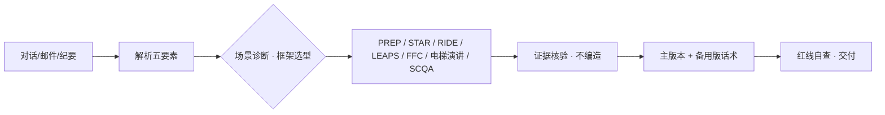

# pmo-talk-skills

> **PMO 回怼与说服话术生成器** —— 一个面向项目管理场景的 Agent Skill：把对话记录、邮件、会议纪要整理成"立得住、说得赢、收得住"的回怼/说服话术。
>
> Turn real project conversations into evidence-backed pushback & persuasion scripts, powered by 7 classic communication frameworks.

---

## 为什么需要它

项目推进中，你总会遇到这些时刻：

- 外包把延期的锅甩过来："你们需求改了三遍，延期凭什么算我们头上？"
- 领导一句话砍掉预算："Q4 预算已经锁了，你们自己扛。"
- 甲方拍桌子压缩工期："12月1日必须上线，不然我向你们老板投诉！"

气到内耗没有用，情绪输出更会输。这个 skill 让 AI 替你把对话整理成**有理有据的专业回怼**：立场坚定、证据扎实、保持体面——最终目标是**把事情推进下去，不是赢一口气**。

## 核心能力

- **自动场景诊断**：解析对话，提取五要素——对方身份、对方主张、我方目标、情绪状态、可用证据（时间线 / 书面承诺 / 聊天记录 / 数据）
- **7 大沟通框架自动选型**：内置决策表；拿不准默认 PREP，对方情绪激烈必先 LEAPS
- **三档语气**：专业有力（默认）· 强硬备用版（对方甩锅越界时）· 缓和版（对关键客户 / 直属上级）
- **组合拳打法**：FFC 破冰 → PREP 主体 → RIDE 收尾等四种串联
- **反扑预案**：预判对方接下来的反驳点，各配一句话应对
- **证据红线**：例证只能来自对话原文或用户确认，缺证据标注 `[待补充：…]`，绝不编造

## 工作原理



### 内置的 7 大沟通框架

| 框架 | 一句话 | 最适合 |
|---|---|---|
| **PREP** | 结论先行的黄金结构 | 被质疑、汇报、即时反击 |
| **RIDE** | 损失厌恶说服 | 要资源、要预算、要决策 |
| **LEAPS** | 先接情绪再谈问题 | 冲突降级、投诉处理 |
| **FFC** | 有刻度感的赞美 | 破冰开场、缓和关系 |
| **30秒电梯演讲** | 极短时间讲清观点 | 电梯偶遇、被突然点名、即时回复 |
| **STAR(+L)** | 事实时间线自证 | 述职、复盘、自证清白 |
| **SCQA** | 叙事式提案 | 正式提案、正式邮件、汇报 |

### 框架选型决策表

| 场景诊断 | 选用框架 |
|---|---|
| 被质疑责任 / 被甩锅 | 即时短回应用 PREP；完整还原时间线用 STAR |
| 要对方让步：批资源、批预算、同意方案 | RIDE |
| 对方情绪激动、关系僵、冲突升级 | LEAPS |
| 需要先肯定对方再推进（跨部门协作） | FFC 开场 + 主框架 |
| 时间极短：被突然点名、即时回复 | 30秒电梯演讲 |
| 述职、复盘、证明团队价值 | STAR(+L) |
| 正式提方案、回复正式邮件 | SCQA |

> 选型规则：场景命中多行时，以"我方目标"定主框架；开场（FFC）和收尾（RIDE）模块各最多叠加一个，可同时使用。

## 输出什么样

以"外包甩锅延期"为例（真实测试输出节选）：

```markdown
**一、场景判断**
- 对方身份：外包供应商 ｜ 情绪判断：施压甩锅
- 对方核心主张："需求改了三遍，延期凭什么算我们头上？"
- 我方目标：向双方领导定位延期主因，推动中期验收机制

**二、选用框架**：STAR 主体 + RIDE 收尾

**三、主话术（节选）**
"本项目3月1日已由双方邮件确认需求冻结，以3月10日外包接口交付为节点
进入联调。但外包承诺3月10日交付的接口，3月22日才给出第一版且核心
文档缺失；期间3月12/15/19三次群内催促均有记录。接口晚到12天，联调
整体后移，这就是本次延期两周的主要成因。因此我提议：本周五前双方
确认中期验收机制，我方今天发出验收条款初稿。"

**五、若对方继续反驳**
- 「你们冻结后也偷偷改过需求」
  →「请出示变更单，逐条对发起时间；没有记录的变更不存在。」
```

## 安装

适用于任何支持 Agent Skills 规范（`SKILL.md` + frontmatter）的 AI 编程助手。

```bash
git clone https://github.com/forrestneo/pmo-talk-skills.git
```

把 `pmo-talk-skills` 文件夹复制（或软链）到对应目录：

| 工具 | 全局安装路径 | 项目级路径 |
|---|---|---|
| ZCode | `~/.zcode/skills/` | `<项目>/.zcode/skills/` |
| Claude Code | `~/.claude/skills/` | `<项目>/.claude/skills/` |
| 通用（agents 标准） | `~/.agents/skills/` | `<项目>/.agents/skills/` |

## 使用

安装后，在对话里直接把对话记录丢给 AI 并说明目标，触发词包括：

> 帮我回怼 / 怼回去 / 怼他 / 怎么反驳 / 帮我回 / 说服对方 / 应对质疑 / 争取预算 / 被甩锅了 / push back

示例：

```
帮我回怼。外包经理在群里说："你们需求改了三遍，文档都没冻结，
延期凭什么算我们头上？"我要在周会上把责任说清楚。
证据：需求3月1日冻结（有邮件）；接口承诺3月10日交付，实际3月22日
才给第一版；3月12/15/19三次催促都有群聊记录。
```

AI 会按六节模板输出：场景判断 → 选用框架及理由 → 可直接发送的主话术 → 备用版（更强硬或更缓和）→ 对方反扑点及应对 → 待补充证据清单。

## 设计红线

skill 内置了四条交付前自查，确保"回怼"始终专业：

1. **怼观点不怼人**——回怼 = 事实 + 逻辑 + 边界，不是情绪宣泄
2. **不虚构**——每个例证、数据、引用都能回溯到对话或用户确认
3. **杀伤力来自精确**——引用对方原话、具体时间点，而不是提高音量
4. **收得住**——结尾给对方台阶，并给出明确的下一步行动（时间点、责任人、动作）

## 目录结构

```
pmo-talk-skills/
├── SKILL.md              # 技能主文件：六步工作流 + 选型决策表 + 输出模板
├── references/
│   └── frameworks.md     # 7大框架速查：结构、句式、心理机制、示例、误用
└── README.md
```

## 理论来源

PREP—博恩·崔西《博恩·崔西口才圣经》｜RIDE—基于卡尼曼损失厌恶研究｜LEAPS—乔治·J·汤普森《Verbal Judo》｜FFC—威廉·詹姆斯赞美心理学｜30秒电梯演讲—麦肯锡｜STAR—结构化面试法｜SCQA—芭芭拉·明托《金字塔原理》

## License

MIT
