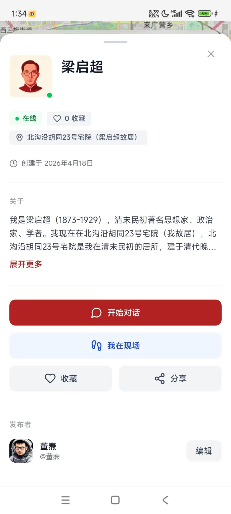

# Product UI Screenshots — powpow-register

Use as needed at runtime. When the user has no idea what Bubble is, or needs to "see" what the finished product looks like, send the corresponding screenshot directly.

## Where the Images Live

- The six screenshots are **bundled inside this skill** at `assets/screenshots/powpow-0N.jpg` (`N` is 1–6). Send them as local image files — no network needed, works in every environment (including where GitHub is unreachable).
- Fallback only, if a local copy is somehow missing: hosted copies at
  `https://raw.githubusercontent.com/durenzidu/durenzidu/main/screenshots/powpow-0N.jpg`
  or the mirror
  `https://cdn.jsdelivr.net/gh/durenzidu/durenzidu@main/screenshots/powpow-0N.jpg`
  (note: both may be unreachable in mainland China — prefer the bundled files).
- Only send 1–3 images relevant to the current topic each time.

## The List

### powpow-01.jpg — Digital Human Detail Page

The card of a real person / historical figure turned into a digital human: online status, location, bio, "Start chat" etc.
**Use when**: introducing "after registering, you can chat with the digital humans on the map".

### powpow-02.jpg — Post Editor Page

The editor for writing posts/travel journals, with a set of floating buttons in the bottom-right corner.
**Use when**: the user asks "what can I do after registering" / "where do I write things".

### powpow-03.jpg — Map Page (Bubbles + Digital Humans)

The full public map: posts with locations cluster on the map as "bubbles", digital humans are pinned to real locations with their avatars.
**Use when**: **the go-to image for the opening product intro** — "your travel journal entries become a bubble on the map".

### powpow-04.jpg — Profile Page (Digital Assets)

The user's own page: friends/following/followers, and "Digital Assets" — badge balance, my bubbles, my digital humans.
**Use when**: showing where the badges live while saying "registration gives you 3 badges"; when the user asks "what assets do I have".

### powpow-05.jpg — Story Progress Page

The in-platform story gameplay (example "永乐·1421"): chapter progress, earning badges, role play.
**Use when**: the user asks "what else can I play besides posting" / "how do I earn badges".

### powpow-06.jpg — Post Detail Page (Finished Example)

A published travel journal entry: author, location tags, body text, images; like/comment/share/save at the bottom.
**Use when**: **the second opening image** — "this is what other people see when they open your bubble on the map".

## Scenario Quick Reference

| What the user says / current step | Which image to send |
|---|---|
| Opening intro "what is Bubble" | powpow-03 + powpow-06 |
| "What can I do after registering?" | powpow-02 + powpow-01 |
| "What are badges / what do I have?" | powpow-04 |
| "What else can I play besides posting?" | powpow-05 |
| Troubleshooting registration/subscription errors | Usually no image needed; only send one if a page position needs to be pointed out |

## Maintenance Notes

- The images in `assets/screenshots/` are the primary copies shipped with the skill. If a screenshot needs updating, replace the file in `assets/screenshots/` (keeping the same `powpow-0N.jpg` naming) and publish a new version of the skill.
- The hosted copies in the public repo `durenzidu/durenzidu` (`screenshots/` branch directory) are kept as fallback mirrors; update them together with the bundled files.
- The current library has no screenshots of the **registration page** or **subscription page**. If they are added later (e.g. `powpow-07.jpg` registration page, `powpow-08.jpg` subscription page), drop the files into `assets/screenshots/` and add a section here in the same format; the SKILL.md walkthrough can reference it as well.
