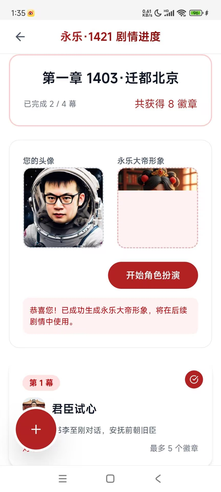

# ഉൽപ്പന്ന യൂസർ ഇന്റർഫേസ് സ്ക്രീൻഷോട്ടുകൾ — powpow-register

റൺടൈമിൽ ആവശ്യമുള്ളപ്പോൾ എടുത്തുപയോഗിക്കുക. ഉപയോക്താവിന് കുമിളയെക്കുറിച്ച് ആശയമില്ലെങ്കിൽ, അല്ലെങ്കിൽ "പൂർത്തിയായ ഉൽപ്പന്നം എങ്ങനെയാണെന്ന് കാണണം" എന്ന് ആവശ്യമുണ്ടെങ്കിൽ, അനുബന്ധ സ്ക്രീൻഷോട്ട് നേരിട്ട് അയയ്ക്കുക.

## ചിത്രങ്ങളുടെ സ്ഥാനം

- ആറ് സ്ക്രീൻഷോട്ടുകൾ **സ്കില്ലിനൊപ്പം പാക്ക് ചെയ്തിരിക്കുന്നു**, `assets/screenshots/powpow-0N.jpg` (`N` എന്നത് 1–6) ൽ സ്ഥിതി ചെയ്യുന്നു. ലോക്കൽ ഇമേജ് ഫയലായി നേരിട്ട് അയയ്ക്കുക — ഇന്റർനെറ്റ് ആവശ്യമില്ല, എല്ലാ ചുറ്റുപാടിലും പ്രവർത്തിക്കും (GitHub ലഭ്യമല്ലാത്ത ചുറ്റുപാടുകൾ പോലും).
- പാക്കേജിലെ ഫയലുകൾ അപ്രതീക്ഷിതമായി നഷ്ടപ്പെട്ടാൽ മാത്രം മടങ്ങുക: ഹോസ്റ്റ് ചെയ്ത പകർപ്പ് `https://raw.githubusercontent.com/durenzidu/durenzidu/main/screenshots/powpow-0N.jpg` അല്ലെങ്കിൽ മിറർ `https://cdn.jsdelivr.net/gh/durenzidu/durenzidu@main/screenshots/powpow-0N.jpg` (ശ്രദ്ധിക്കുക: രണ്ടും ചൈന മെയിൻലാൻഡിൽ തുറക്കാൻ സാധ്യതയില്ല — പാക്കേജിലെ ഫയലുകൾക്കാണ് മുൻഗണന).
- ഓരോ തവണയും നിലവിലെ വിഷയവുമായി ബന്ധപ്പെട്ട 1–3 ചിത്രങ്ങൾ മാത്രം അയയ്ക്കുക.

## ലിസ്റ്റ്

### powpow-01.jpg — ഡിജിറ്റൽ മനുഷ്യൻ വിശദാംശ പേജ്

യഥാർത്ഥ / ചരിത്ര വ്യക്തിയെ ഡിജിറ്റൽ മനുഷ്യനാക്കിയതിന്റെ കാർഡ്: ഓൺലൈൻ സ്റ്റേറ്റസ്, സ്ഥിതി ചെയ്യുന്ന സ്ഥലം, വ്യക്തി പരിചയം, "开始对话" (സംഭാഷണം ആരംഭിക്കുക) മുതലായവ.
**ഉപയോഗം**: "രജിസ്റ്റർ ചെയ്ത ശേഷം മാപ്പിലെ ഡിജിറ്റൽ മനുഷ്യരുമായി സംസാരിക്കാം" എന്ന് പരിചയപ്പെടുത്താൻ.

### powpow-02.jpg — പോസ്റ്റ് എഡിറ്റ് പേജ്

പോസ്റ്റ് / യാത്രാവിവരണം എഴുതുന്ന എഡിറ്റിംഗ് ഇന്റർഫേസ്, വലത്തേ താഴ്ന്ന കോണിൽ ഒരു ഗ്രൂപ്പ് ഫ്ലോട്ടിംഗ് ബട്ടണുകൾ.
**ഉപയോഗം**: ഉപയോക്താവ് "രജിസ്റ്റർ ചെയ്ത ശേഷം ഞാൻ എന്ത് ചെയ്യാം" "എവിടെയാണ് എഴുതുക" എന്നൊക്കെ ചോദിക്കുമ്പോൾ.

### powpow-03.jpg — മാപ്പ് പേജ് (കുമിള + ഡിജിറ്റൽ മനുഷ്യർ)

പൊതു മാപ്പിന്റെ മൊത്തം കാഴ്ച: സ്ഥലം അടങ്ങിയ പോസ്റ്റുകൾ മാപ്പിൽ "കുമിള" ആയി കൂട്ടിയിരിക്കുന്നു, ഡിജിറ്റൽ മനുഷ്യർ യഥാർത്ഥ സ്ഥലത്ത് പ്രൊഫൈൽ ചിത്രമായി പിന്നിൽ തറക്കുന്നു.
**ഉപയോഗം**: **ആമുഖത്തിൽ ഉൽപ്പന്നം പരിചയപ്പെടുത്താനുള്ള ആദ്യ ചിത്രം** — "നിങ്ങൾ അയയ്ക്കുന്ന യാത്രാവിവരണം മാപ്പിലെ ഒരു കുമിള ആയി മാറും".

### powpow-04.jpg — വ്യക്തിഗത ഹോംപേജ് (ഡിജിറ്റൽ അസറ്റുകൾ)

ഉപയോക്താവിന്റെ സ്വന്തം പേജ്: കൂട്ടുകാർ/ഫോളോവർ/ഫാൻസ്, കൂടാതെ "ഡിജിറ്റൽ അസറ്റുകൾ" — ബാഡ്‌ജ് ബാലൻസ്, എന്റെ കുമിളകൾ, എന്റെ ഡിജിറ്റൽ മനുഷ്യർ.
**ഉപയോഗം**: "രജിസ്ട്രേഷനിൽ 3 ബാഡ്‌ജുകൾ സൗജന്യം നൽകുന്നു" എന്ന് പറയുമ്പോൾ ബാഡ്‌ജുകൾ എവിടെയാണെന്ന് കാണിക്കാൻ; ഉപയോക്താവ് "എനിക്ക് എന്ത് അസറ്റുകളുണ്ട്" എന്ന് ചോദിക്കുമ്പോൾ.

### powpow-05.jpg — കഥാ പുരോഗതി പേജ്

പ്ലാറ്റ്ഫോമിനുള്ളിലെ കഥാ ഗെയിംപ്ലേ (ഉദാഹരണം "永乐·1421"): അധ്യായ പുരോഗതി, ബാഡ്‌ജുകൾ നേടൽ, റോൾ-പ്ലേ.
**ഉപയോഗം**: ഉപയോക്താവ് "പോസ്റ്റ് ചെയ്യുന്നത് കൂടാതെ എന്ത് കളിക്കാം" "ബാഡ്‌ജുകൾ എങ്ങനെ നേടാം" എന്നൊക്കെ ചോദിക്കുമ്പോൾ.

### powpow-06.jpg — പോസ്റ്റ് വിശദാംശ പേജ് (പൂർത്തിയായ ഉദാഹരണം)

അയച്ച ഒരു യാത്രാവിവരണം: എഴുതിയയാൾ, സ്ഥല ടാഗ്, ബോഡി, ചിത്രങ്ങൾ, താഴെ ലൈക്ക്/കമന്റ്/ഷെയർ/സേവ് ചെയ്യാം.
**ഉപയോഗം**: **ആമുഖത്തിലെ രണ്ടാമത്തെ ചിത്രം** — "മറ്റുള്ളവർ മാപ്പിൽ നിങ്ങളുടെ കുമിള ക്ലിക്ക് ചെയ്യുമ്പോൾ കാണുന്നത് ഇതാണ്".

## അനുബന്ധ സാഹചര്യ ക്വിക്ക് റഫറൻസ്

| ഉപയോക്താവ് പറയുന്നത് / നിലവിലെ ഘട്ടം | ഏത് അയയ്ക്കണം |
|---|---|
| ആമുഖം "കുമിള എന്നാൽ എന്ത്" | powpow-03 + powpow-06 |
| "രജിസ്റ്റർ ചെയ്ത ശേഷം എന്ത് ചെയ്യാം?" | powpow-02 + powpow-01 |
| "ബാഡ്‌ജ് എന്ത് / എനിക്ക് എന്തുണ്ട്?" | powpow-04 |
| "പോസ്റ്റ് ചെയ്യുന്നത് കൂടാതെ എന്ത് കളിക്കാം?" | powpow-05 |
| രജിസ്ട്രേഷൻ/സബ്സ്ക്രിപ്ഷൻ എറർ ട്രബിൾഷൂട്ടിംഗ് | സാധാരണ ചിത്രം ആവശ്യമില്ല; പേജ് സ്ഥാനം വിശദീകരിക്കേണ്ടി വന്നാൽ മാത്രം അയയ്ക്കുക |

## പരിപാലന കുറിപ്പ്

- `assets/screenshots/` ലെ ചിത്രങ്ങൾ പാക്കേജിനൊപ്പം പ്രസിദ്ധീകരിക്കുന്ന പ്രിഫറേഡ് കോപ്പിയാണ്. സ്ക്രീൻഷോട്ടുകൾ അപ്ഡേറ്റ് ചെയ്യേണ്ടി വന്നാൽ, `assets/screenshots/` ലെ അതേ പേരുള്ള ഫയൽ മാറ്റി (പേര് `powpow-0N.jpg` നിലനിർത്തി) പുതിയ വേർഷൻ പ്രസിദ്ധീകരിക്കുക.
- പബ്ലിക് റിപ്പോസിറ്ററി `durenzidu/durenzidu` (`screenshots/` ഡയറക്ടറി) യിലെ ഹോസ്റ്റ് ചെയ്ത പകർപ്പ് ഫാൾബാക്ക് മിററായി നിലനിർത്തിയിരിക്കുന്നു, പാക്കേജിലെ ഫയലുകളുമായി സമന്വയിപ്പിച്ച് അപ്ഡേറ്റ് ചെയ്യുന്നു.
- നിലവിലെ ഇമേജ് ലൈബ്രറിയിൽ **രജിസ്ട്രേഷൻ പേജ്** ഉം **സബ്സ്ക്രിപ്ഷൻ പേജ്** ഉം സ്ക്രീൻഷോട്ടുകൾ ഇല്ല. പിന്നീട് ചേർക്കുകയാണെങ്കിൽ (ഉദാഹരണത്തിന് `powpow-07.jpg` രജിസ്ട്രേഷൻ പേജ്, `powpow-08.jpg` സബ്സ്ക്രിപ്ഷൻ പേജ്), ഫയൽ `assets/screenshots/` ൽ വയ്ക്കുക ഉം അതേ ഫോർമാറ്റിൽ ഒരു സെക്ഷൻ കൂട്ടിച്ചേർക്കുക മാത്രം മതി, SKILL.md ന്റെ ഗൈഡ് ടെക്സ്റ്റ് അതിനെ റഫർ ചെയ്യാം.
