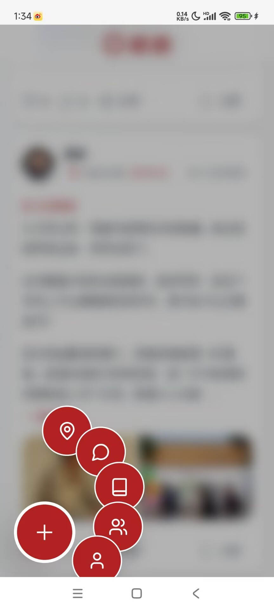
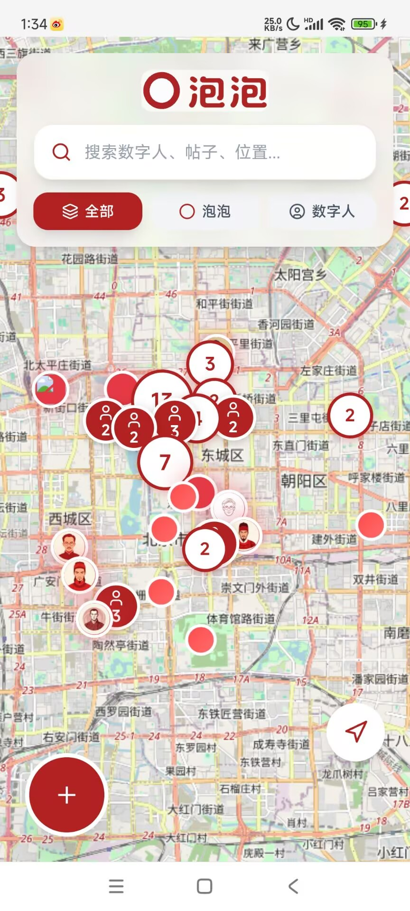

# தயாரிப்பு இடைமுக ஸ்கிரீன்ஷாட்கள் — powpow-register

இயக்க நேரத்தில் தேவைக்கேற்ப பயன்படுத்துங்கள். பயனருக்கு குமிழி பற்றிக் கருத்து இல்லை, அல்லது முடிவுப்பொருள் எப்படி இருக்கும் என்று "பார்க்க" வேண்டும் என்றால், தகுந்த ஸ்கிரீன்ஷாட்டை நேரடியாக அனுப்புங்கள்.

## படங்களின் இடம்

- ஆறு ஸ்கிரீன்ஷாட்களும் **ஏற்கனவே skill உடன் தொகுக்கப்பட்டுள்ளன**, `assets/screenshots/powpow-0N.jpg` இல் (`N` = 1–6). உள்ளூர் படக் கோப்புகளாக நேரடியாக அனுப்புங்கள் — இணையம் தேவையில்லை, எந்தச் சூழலிலும் பயன்படும் (GitHub அணுக முடியாத சூழல்கள் உட்பட).
- தொகுப்பில் கோப்பு எதிர்பாராமல் இல்லாமல் போனால் மட்டும் திரும்புங்கள்: ஹோஸ்ட் செய்யப்பட்ட நகல் `https://raw.githubusercontent.com/durenzidu/durenzidu/main/screenshots/powpow-0N.jpg` அல்லது பிரதிபலிப்பு `https://cdn.jsdelivr.net/gh/durenzidu/durenzidu@main/screenshots/powpow-0N.jpg` (கவனம்: இரண்டும் சீனாவில் திறக்க முடியாமல் போகலாம் — முதலில் தொகுப்பினுள் உள்ள கோப்பையே பயன்படுத்துங்கள்).
- ஒவ்வொரு முறையும் தற்போதைய தலைப்புடன் தொடர்புடைய 1–3 படங்களை மட்டுமே அனுப்புங்கள்.

## பட்டியல்

### powpow-01.jpg — டிஜிட்டல் மனிதர் விவரப் பக்கம்

உண்மையான/வரலாற்று நபரை டிஜிட்டல் மனிதராக மாற்றிய பின் வரும் அட்டை: ஆன்லைன் நிலை, சேர்ந்த இடம், நபர் அறிமுகம், "开始对话" (உரையாடலைத் தொடங்கு) போன்றவை.
**பயன்படும் இடம்**: "பதிவு முடிந்ததும் வரைபடத்தில் உள்ள டிஜிட்டல் மனிதருடன் உரையாடலாம்" என்று அறிமுகப்படுத்தும்போது.

### powpow-02.jpg — பதிவிடும் திருத்தும் பக்கம்

பதவு/பயணக் குறிப்பு எழுதும் திருத்தும் இடைமுகம், வலது கீழ் மூலையில் மிதக்கும் பொத்தான்களின் தொகுப்பு.
**பயன்படும் இடம்**: பயனர் "பதிவு முடிந்ததும் நான் என்ன செய்ய முடியும்", "எங்கே எழுத முடியும்" என்று கேட்கும்போது.

### powpow-03.jpg — வரைபடப் பக்கம் (குமிழ்கள் + டிஜிட்டல் மனிதர்கள்)

பொது வரைபடத்தின் முழு தோற்றம்: இடம் கொண்ட பதவுகள் "குமிழ்களாக" வரைபடத்தில் கூட்டமாக இருக்கும், டிஜிட்டல் மனிதர்கள் சுயவிவரப் படத்துடன் உண்மையான இடங்களில் ஆணியிடப்பட்டிருப்பார்கள்.
**பயன்படும் இடம்**: **தொடக்கத்தில் தயாரிப்பை அறிமுகப்படுத்துவதற்கான முதன்மைப் படம்** — "நீங்கள் இடும் பயணக் குறிப்பு வரைபடத்தில் ஒரு குமிழாக மாறும்".

### powpow-04.jpg — தனிப்பட்ட முதன்மைப் பக்கம் (டிஜிட்டல் சொத்துகள்)

பயனரின் சொந்தப் பக்கம்: நண்பர்கள்/பின்தொடர்வோர்/ரசிகர்கள், மற்றும் "டிஜிட்டல் சொத்துகள்" — பேட்ஜ் இருப்பு, எனது குமிழ்கள், எனது டிஜிட்டல் மனிதர்கள்.
**பயன்படும் இடம்**: "பதிவு செய்தாலே 3 பேட்ஜ்கள் இலவசம்" என்று சொல்லும்போது பேட்ஜ் எங்கே இருக்கும் என்று காட்ட; பயனர் "எனக்கு என்ன சொத்துகள் உள்ளன" என்று கேட்கும்போது.

### powpow-05.jpg — கதை முன்னேற்றப் பக்கம்

தளத்தினுள் உள்ள கதை விளையாட்டு (உதாரணம் "永乐·1421"): அத்தியாய முன்னேற்றம், பேட்ஜ் சம்பாதிப்பு, பாத்திரத்தில் நடித்தல்.
**பயன்படும் இடம்**: பயனர் "பதவிடுவதைத் தவிர வேறு என்ன விளையாடலாம்", "பேட்ஜ்களை எப்படிச் சம்பாதிக்கலாம்" என்று கேட்கும்போது.

### powpow-06.jpg — பதவு விவரப் பக்கம் (முடிவுப்பொருள் உதாரணம்)

இடப்பட்ட ஒரு பயணக் குறிப்பு: ஆசிரியர், இடம் டேக், உள்ளடக்கம், படங்கள்; கீழே லைக்/கருத்து/பங்கிடு/சேமி செய்யலாம்.
**பயன்படும் இடம்**: **தொடக்கத்தின் இரண்டாவது படம்** — "மற்றவர்கள் வரைபடத்தில் உங்கள் குமிழத்தைத் திறந்தால் காண்பது இதுதான்".

## சூழலுக்கேற்ற விரைவு வழிகாட்டி

| பயனர் சொல்வது / தற்போதைய நிலை | எந்தப் படத்தை அனுப்புவது |
|---|---|
| தொடக்கத்தில் "குமிழி என்றால் என்ன" என்று அறிமுகப்படுத்துதல் | powpow-03 + powpow-06 |
| "பதிவு முடிந்ததும் என்ன செய்ய முடியும்?" | powpow-02 + powpow-01 |
| "பேட்ஜ் என்றால் என்ன / எனக்கு என்ன இருக்கிறது?" | powpow-04 |
| "பதவிடுவதைத் தவிர வேறு என்ன விளையாடலாம்?" | powpow-05 |
| பதிவு/சந்தா பிழை ஆய்வு | பொதுவாகப் படம் தேவையில்லை; பக்கத்தின் இடத்தை விளக்கத் தேவைப்பட்டால் மட்டும் அனுப்புங்கள் |

## பராமரிப்பு குறிப்புகள்

- `assets/screenshots/` உள்ள படங்களே skill உடன் வெளியிடப்படும் முதன்மை நகல்கள். ஸ்கிரீன்ஷாட்களைப் புதுப்பிக்க வேண்டும் என்றால், `assets/screenshots/` உள்ள அதே பெயர் கோப்புகளை மாற்றுங்கள் (`powpow-0N.jpg` பெயரிடும் முறையைப் பேணுங்கள்) மற்றும் புதிய பதிப்பை வெளியிடுங்கள்.
- பொது களஞ்சியம் `durenzidu/durenzidu` (`screenshots/` அடைவு) உள்ள ஹோஸ்ட் செய்யப்பட்ட நகல் திரும்பும் பிரதிபலிப்பாக வைக்கப்பட்டு, தொகுப்பினுள் உள்ள கோப்புகளுடன் ஒத்திசைவாகப் புதுப்பிக்கப்படும்.
- தற்போதைய படக் களஞ்சியத்தில் **பதிவுப் பக்கம்** மற்றும் **சந்தாப் பக்கம்** ஸ்கிரீன்ஷாட்கள் இல்லை. பின்னர் சேர்க்கப்பட்டால் (உதாரணம் `powpow-07.jpg` பதிவுப் பக்கம், `powpow-08.jpg` சந்தாப் பக்கம்), கோப்பை `assets/screenshots/` இல் வைத்து அதே வடிவமைப்பில் ஒரு பகுதியைச் சேர்க்கவும்; SKILL.md இன் வழிகாட்டி உரையிலும் அதைச் சேர்த்துக்கொள்ளலாம்.
