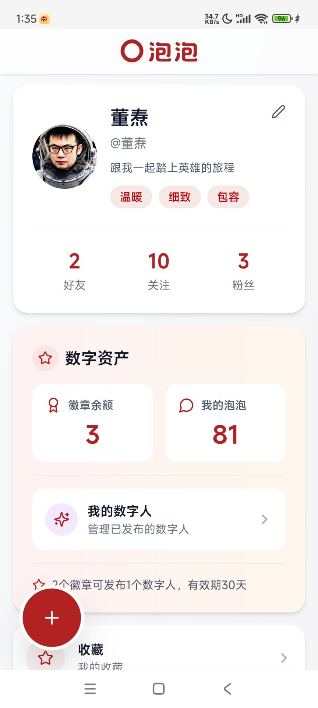

# Ürün arayüz ekran görüntüleri — powpow-register

Çalışma sırasında gerektiğinde kullanılır. Kullanıcının Kabarcık hakkında fikri yokken ya da bitmiş ürünün neye
benzediğini «görmesi» gerektiğinde ilgili ekran görüntüsünü doğrudan gönderin.

## Görsellerin yeri

- Altı ekran görüntüsü **skill ile birlikte paketlidir**, `assets/screenshots/powpow-0N.jpg` konumundadır
  (`N` = 1–6). Yerel görsel dosyası olarak doğrudan gönderilir — ağ gerekmez, her ortamda kullanılabilir
  (GitHub'a ulaşılamayan ortamlar dahil).
- Yalnızca paketteki dosya yanlışlıkla eksikse şuna dönülür: barındırılan kopya
  `https://raw.githubusercontent.com/durenzidu/durenzidu/main/screenshots/powpow-0N.jpg` ya da yansı
  `https://cdn.jsdelivr.net/gh/durenzidu/durenzidu@main/screenshots/powpow-0N.jpg`
  (dikkat: ikisi de Çin anakarasında açılmayabilir — önce paket içindeki dosyayı kullanın).
- Her seferinde yalnızca güncel konuyla ilgili 1–3 görüntü gönderin.

## Liste

### powpow-01.jpg — dijital insan detay sayfası

Gerçek kişi/tarihî kişiliğin dijital insana dönüştürülmüş kartı: çevrimiçi durumu, bağlı olduğu yer, kişi özeti,
«sohbeti başlat» vb.
**Ne zaman**: «kayıttan sonra haritadaki dijital insanlarla sohbet edebilirsin» tanıtımında.

### powpow-02.jpg — gönderi yazma sayfası

Gönderi/seyahat günlüğü yazma arayüzü, sağ altta bir grup yüzen düğme.
**Ne zaman**: kullanıcı «kayıttan sonra ne yapabilirim», «nerede yazı yazılır» diye sorduğunda.

### powpow-03.jpg — harita sayfası (Kabarcık + dijital insanlar)

Kamuya açık haritanın bütünü: konumlu gönderiler haritada «Kabarcık» olarak toplanır, dijital insanlar avatarlarıyla
gerçek mekânlara iliştirilir.
**Ne zaman**: **ürünü tanıtırken açılışta tercih edilen görüntü** — «yayınladığın seyahat günlüğü haritada bir
kabarcığa dönüşür».

### powpow-04.jpg — kişisel sayfa (dijital varlıklar)

Kullanıcının kendi sayfası: arkadaş/takipçi listeleri ve «dijital varlıklar» — rozet bakiyesi, kabarcıklarım,
dijital insanlarım.
**Ne zaman**: «kayıt hediyesi 3 rozet» denirken rozetin nerede durduğunu göstermek; kullanıcı «hangi varlıklarım
var» diye sorduğunda.

### powpow-05.jpg — hikâye ilerleme sayfası

Platform içindeki hikâye oynanışı (örnek «Yongle·1421»): bölüm ilerlemesi, rozet kazanma, rol yapma.
**Ne zaman**: kullanıcı «gönderi dışında ne oynanır», «rozet nasıl kazanılır» diye sorduğunda.

### powpow-06.jpg — gönderi detay sayfası (bitmiş örnek)

Yayınlanmış bir seyahat günlüğü: yazar, konum etiketi, metin, fotoğraflar; en altta beğen/yorum/paylaş/kaydet.
**Ne zaman**: **açılıştaki ikinci görüntü** — «başkası haritada kabarcığını açtığında göreceği şey bu».

## Senaryoya hızlı bakış

| Kullanıcının dediği / bulunduğu adım | Hangi görüntü gönderilir |
|---|---|
| Açılış, «Kabarcık nedir» tanıtımı | powpow-03 + powpow-06 |
| «Kayıttan sonra ne yapabilirim?» | powpow-02 + powpow-01 |
| «Rozet nedir / neyim var?» | powpow-04 |
| «Gönderi dışında ne oynanır?» | powpow-05 |
| Kayıt/abonelik hatası giderme | Genelde görüntü gerekmez; sayfa konumunu anlatmak gerçekten gerekiyorsa gönderilir |

## Bakım notları

- `assets/screenshots/` içindeki görseller paketle dağıtılan asıl kopyadır. Ekran görüntülerinin güncellenmesi
  gerektiğinde `assets/screenshots/` altındaki aynı adlı dosyaları değiştirin (`powpow-0N.jpg` adlandırmasını
  koruyun) ve yeni sürüm yayınlayın.
- Herkese açık `durenzidu/durenzidu` deposundaki (`screenshots/` dizini) barındırılan kopya yedek yansı olarak
  korunur, paket içindeki dosyalarla eşzamanlı güncellenir.
- Mevcut galeri **kayıt sayfası** ve **abonelik sayfası** görüntüsü içermez. İleride eklenirse (ör. `powpow-07.jpg`
  kayıt sayfası, `powpow-08.jpg` abonelik sayfası) dosyaları `assets/screenshots/` içine koyup aynı biçimde bir
  bölüm eklemek yeterlidir; SKILL.md'deki tanıtım metni de buna bağlama yapabilir.
