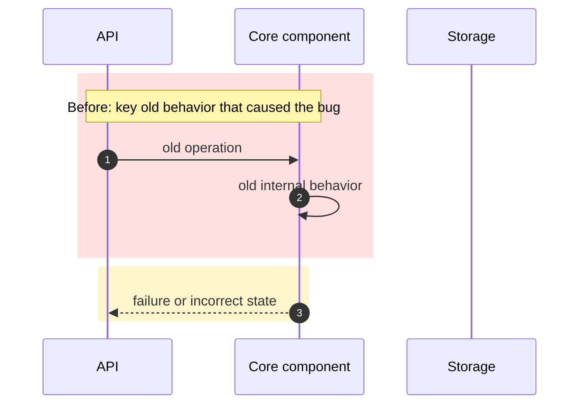
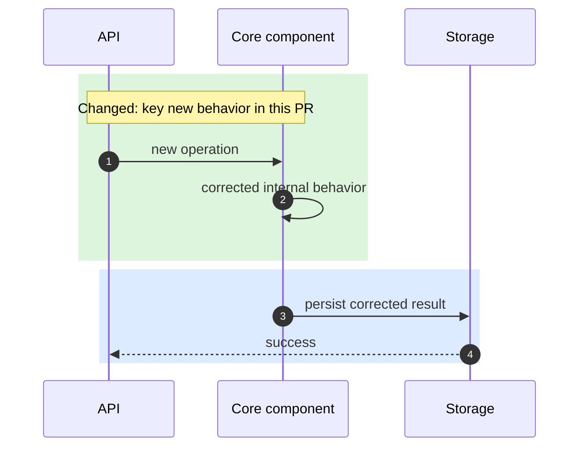
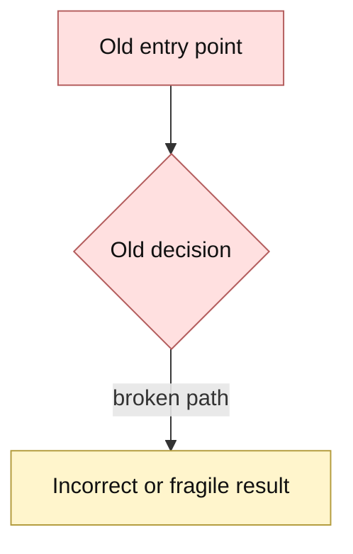
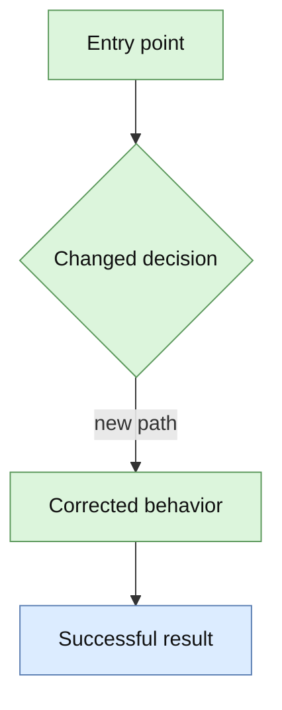
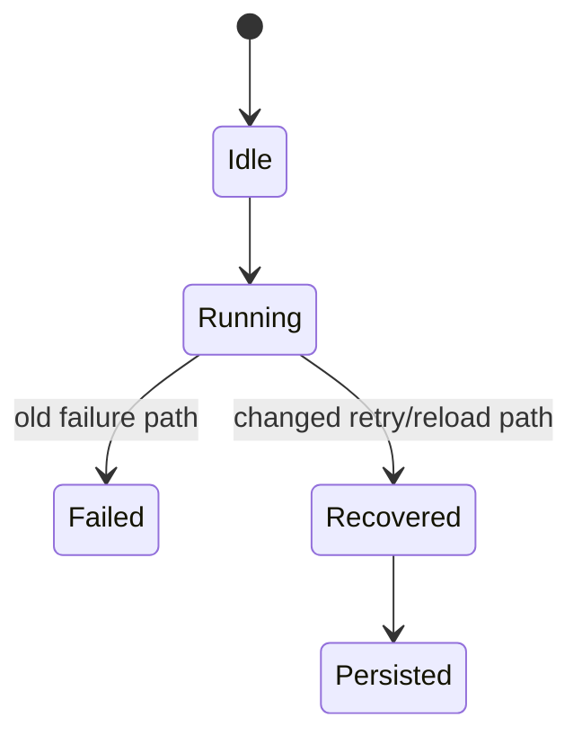
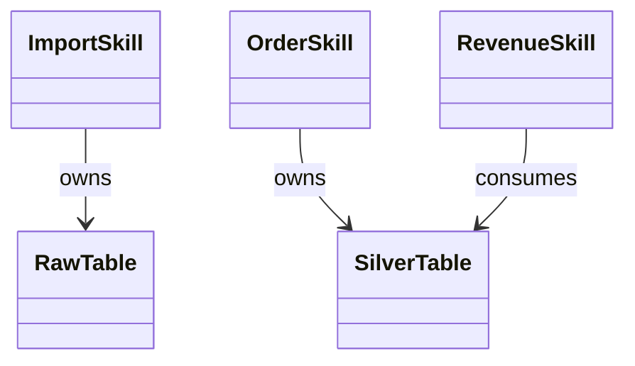
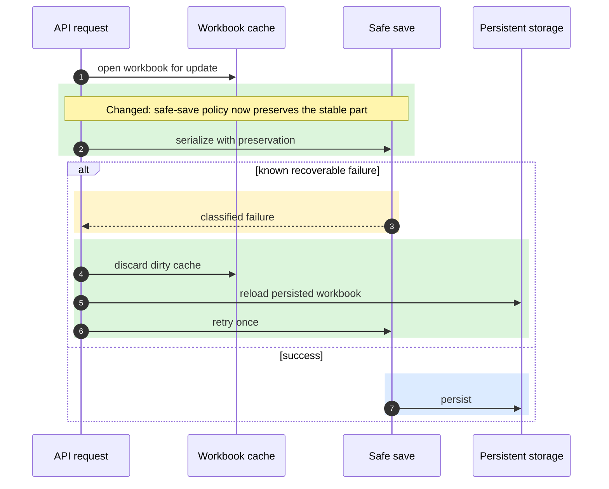

# PR Context Diagram

## Goal

Produce a PR description that lets a reviewer quickly answer:

- What broke or was missing before?
- What changed now?
- Why is the new behavior correct?
- How was it verified?
- What risks, drawbacks, or future work remain?

Optimize for both humans and follow-up coding agents. Make the PR body self-contained enough that another agent can review the diff without reconstructing the whole conversation.

## Workflow

1. Inspect the branch and diff before writing.
   - Run `git branch --show-current`, `git status --short`, `git log --oneline <base>..HEAD`, and `git diff --stat <base>...HEAD`.
   - Treat `main`, `master`, and `dev` as protected branches for this workflow unless the user explicitly says otherwise.
   - Read the key changed files around the behavioral changes.
   - If a PR already exists, fetch the current body with `gh pr view`.

2. Reconstruct the problem from evidence.
   - Include the failing symptom or error text if available.
   - Identify the operation path, affected endpoint/tool, and data shape.
   - Separate root cause from adjacent operational issues.
   - Do not claim a fix covers cases that were not tested.

3. Write a before/after comparison.
   - Use short prose for the old behavior.
   - Use short prose for the new behavior.
   - Highlight only the parts that changed, not the whole system.
   - Name the key difference explicitly before the diagrams, for example: "old path rebuilt shared strings globally; new path preserves or merges them by operation type."

4. Choose the right diagram type before writing Mermaid.
   - Do not force a sequence diagram when the change is not primarily about request/response or actor interaction.
   - Use the simplest diagram that makes the changed behavior obvious to a reviewer.
   - Prefer one main diagram type per PR section, not a random mix.
   - Add a short sentence before the diagrams that explains why this diagram type is the right one.

5. Add Mermaid diagrams.
   - Include one `Before` and one `After` diagram when that comparison is clearer than a single diff-style diagram.
   - When the change is small, one `Key Differences Highlighted` diagram plus prose is often enough.
   - Highlight changed areas visually; do not rely on prose alone.
   - Add a short color guide before the diagrams.
   - For multi-layer fixes, add one diagram per important path if it improves clarity.
   - Keep labels concrete: API, cache, serializer, validator, storage, worker, schema contract, pipeline stage, worksheet, etc.
   - Before creating or updating the PR, scan every Mermaid block for GitHub parse hazards. In flowcharts, quote node labels that contain brackets, braces, parentheses, slash-heavy paths, dots, colons, pipes, question marks, or other punctuation.
   - Prefer flowchart node syntax such as `A["Read pg_sources[n]"]` and `B{"Source exists?"}` over raw labels such as `A[Read pg_sources[n]]` or `B{pg_sources[n] exists?}`.

6. Add verification evidence.
   - List exact test commands and whether they passed.
   - List manual/local/dev verification with document IDs or URLs when relevant.
   - Include readback checks, not only write success.
   - Include logs consulted and what they confirmed.

7. Add drawbacks and future improvements.
   - Distinguish accepted tradeoffs from known bugs.
   - Mention concurrency, performance, data growth, compatibility, or observability risks when relevant.
   - Give actionable next steps without blocking the PR unless the risk is severe.

8. Create or update the PR.
   - Before any PR action, confirm the current branch is not `main`, `master`, or `dev`.
   - If the current branch is protected, stop and create or switch to a working branch first:
     - bug fix -> `fix-{name}`
     - feature -> `feat-{name}`
   - Do not make new commits directly on protected branches unless the user explicitly requests it.
   - Prefer `gh pr create --base <base> --head <branch> --title ... --body-file ...` for long descriptions.
   - Use a temporary body file for long Markdown to avoid shell quoting problems.
   - Confirm the PR with `gh pr view --json number,title,url,baseRefName,headRefName,state`.

## Branch Safety

Before creating or updating a PR:

- Run `git branch --show-current`.
- If the current branch is `main`, `master`, or `dev`, stop and do not create or update the PR from that branch.
- Create or switch to a working branch first:
  - bug fix -> `fix-{name}`
  - feature -> `feat-{name}`
- Move the intended commits onto that working branch before running `gh pr create`.
- Do not make new commits directly on protected branches unless the user explicitly requests it.
- If the user explicitly wants PR work from a protected branch, call out the risk clearly in the response and scope the action to exactly what they requested.

## Diagram Selection

Choose the diagram type from the change shape, not from habit.

### Use `sequenceDiagram` when

- the main question is who called whom, in what order
- a request path, retry path, fallback path, or async handoff changed
- the bug depends on timing, ordering, or missing coordination

Examples:

- API request -> validator -> cache -> storage
- worker dispatch -> queue -> processor -> retry
- workbook save -> recover -> reload -> persist

### Use `flowchart` when

- the main question is branching logic, decision rules, or pipeline routing
- the PR changes classification, gating, or stage ownership
- the reviewer needs to see where one path now stops or redirects

Examples:

- import-sheet now stops at `R_*` instead of continuing into Bronze
- validation now branches into retry vs hard-fail
- route selection by source type, platform, or schema

### Use `stateDiagram-v2` when

- the main question is state transitions, lifecycle, or allowed transitions
- the PR fixes invalid intermediate states or stale-state recovery

Examples:

- cache entry states
- workbook/job lifecycle
- sync status transitions

### Use `classDiagram` or ER-style structure diagrams when

- the main question is ownership, schema shape, or data contract relationships
- the PR primarily changes model boundaries, contracts, or references

Examples:

- which skill owns which table contract
- before/after schema layering
- manifest, schema, and generated artifact relationships

### Use a comparison table instead of Mermaid when

- the change is mostly field-level renaming or config-key migration
- a diagram would be visually noisy and low signal
- reviewers need exact before/after names, flags, defaults, or file paths

In that case, include a short markdown table with `Before`, `After`, and `Why`.

### If unsure

- Ask: is the core change about order, branching, state, or structure?
- Order -> sequence diagram
- Branching -> flowchart
- State transitions -> state diagram
- Ownership or schema -> class/relationship diagram or table
- If two different concerns matter, use two small diagrams rather than one overloaded one

## PR Body Shape

Use this structure unless the repository has a stricter template:

```markdown
## Context

Briefly describe the user-facing or production symptom, affected operation, and why the bug happens.

## What Changed

### 1. First Layer / Main Path

Explain the focused code change and why it addresses the root cause.

### 2. Second Layer / Related Path

Explain related behavior separately when the fix has multiple mechanisms.

## Before / After Diagrams

Diagram choice: explain in one sentence why this diagram type fits the change.

Color guide:

- Red: old failing behavior.
- Yellow: failure result or risky state.
- Green: new changed behavior in this PR.
- Blue: successful/preserved result.

### Before: failing path

Use a matched pair of the same diagram type unless there is a strong reason to compare two different views.

Example sequence pair:



### After: corrected path



Example flowchart pair:





Example state diagram pair for lifecycle fixes:



Example class / relationship diagram for ownership or structure fixes:



### Key Differences Highlighted

Use only when it adds clarity. This can be a sequence, flowchart, state, or class-style diagram.

```mermaid
sequenceDiagram
    autonumber
    participant Op as Operation
    participant Old as Before behavior
    participant New as After behavior
    participant Result as Result

    rect rgb(220, 245, 220)
        Note over Op,New: Changed: highlight the actual new path
        Op->>New: new path added by this PR
    end

    rect rgb(255, 224, 224)
        Op->>Old: old path
        Old-->>Result: wrong or fragile outcome
    end

        New-->>Result: stable or corrected outcome
    end
```

## Change Effects

- Concrete behavior now works.
- Guardrail still applies.
- Adjacent behavior is unchanged.

## Verification Run

### Automated

```bash
test command here
```

Result: passed.

### Manual / Environment

- Local: operation, document, readback result.
- Dev/staging: operation, document, readback result.
- Logs: command/path and relevant confirmation.

## Known Drawbacks / Future Improvements

1. Accepted tradeoff.
2. Remaining operational risk.
3. Follow-up improvement.

## Review Notes

- File or module reviewers should start with.
- Specific areas worth checking.
```

## Diagram Guidance

Write diagrams at the behavior boundary, not at every function call.

The purpose is reviewer comprehension, not Mermaid maximalism.

### Diagram-Specific Guidance

#### Sequence diagrams

- Best for order, retries, fallbacks, and coordination bugs.
- Keep participants to real actors, not helper functions.
- Use `alt` blocks for retry/fallback behavior.
- Prefer shared steps outside highlighted blocks when only part of the flow changed.

#### Flowcharts

- Best for gating, routing, ownership, and stage boundaries.
- Keep decisions short and binary where possible.
- Use `classDef` and `class` styling to highlight changed nodes when `rect` is not available.
- Do not recreate every implementation branch; keep only the decisions that explain the bug or fix.
- Quote all non-trivial node labels. GitHub Mermaid commonly fails when raw flowchart labels contain `[]`, `{}`, `()`, `:`, `|`, `.`, or literal data references such as `pg_sources[n]`; use `A["..."]` and `B{"..."}` instead.
- Keep edge labels simple ASCII words when possible. If an edge label needs punctuation or a long phrase, move that detail into the target node label.

#### State diagrams

- Best for invalid lifecycle transitions and recovery paths.
- Show only stable states that matter to the bug.
- Label the transition that changed; do not overload the nodes with prose.

#### Class / relationship diagrams

- Best for ownership, schema, and contract boundaries.
- Use them when reviewers need to understand who owns what, not how each request flows.
- Keep relationships concrete: `owns`, `generates`, `consumes`, `references`, `validates against`.

### Highlighting Requirements

For sequence diagrams, always use color blocks for the important difference:

- Use `rect rgb(255, 224, 224)` for the old broken behavior.
- Use `rect rgb(255, 245, 204)` for the old failure/risk result.
- Use `rect rgb(220, 245, 220)` for the new changed implementation path.
- Use `rect rgb(220, 235, 255)` for the successful/preserved result.
- Put `Note over ...: Changed: ...` inside the green block so reviewers can find the actual change without reading every arrow.

Mermaid sequence diagrams on GitHub support `rect rgb(...)` blocks. Keep RGB values light so text remains readable in both light and dark GitHub themes. Avoid saturated colors.

For flowcharts and other Mermaid types that do not support the same `rect` pattern, prefer light styling via `classDef` and label the changed node or edge explicitly with `Changed:` or `Before only:`.

### Mermaid Syntax Safety

Before publishing a PR body, inspect each Mermaid block for syntax that GitHub Mermaid may parse as shape delimiters instead of label text:

- In flowcharts, never put literal square brackets inside an unquoted square node label, for example `A[Read pg_sources[n]]`.
- Write that as `A["Read pg_sources[n]"]`.
- For decision nodes with punctuation or data references, use `D{"pg_sources[n] worksheet_state exists?"}`.
- Quote labels containing `[]`, `{}`, `()`, `:`, `|`, `.`, `/`, `?`, `<`, `>`, or backticks.
- Avoid markdown code spans inside Mermaid labels. Use plain text labels and put exact code identifiers in the surrounding prose.
- If a diagram includes production error text, keep the exact error in a fenced text block outside Mermaid and summarize the diagram node label.

Prefer this for sequence changes:



Avoid diagrams that mirror implementation line by line. Reviewers need causality and changed behavior.

## Common Tricks

- If a PR has two fix layers, create two before/after pairs or one detailed pair plus `Key Differences Highlighted`.
- If the old and new paths share 80% of the flow, draw the shared steps outside color blocks and color only the divergent steps.
- If a retry or fallback is the key change, put the `alt` block inside a green `rect` or put green blocks around the retry branch.
- If the key difference is stage ownership or routing, use a flowchart instead of a fake sequence diagram.
- If the key difference is contract ownership or schema references, use a structure/relationship diagram or a markdown comparison table.
- If the key difference is a fixed invalid lifecycle transition, use a state diagram.
- If a validation guardrail remains unchanged, put the guardrail success in blue and label it as "Effect", not "Changed".
- If a known drawback remains, do not color it green; document it under drawbacks and optionally mark the risky old/new boundary yellow.
- If GitHub rendering becomes hard to read, split one large diagram into smaller diagrams instead of adding more participants.
- If none of the Mermaid types make the point clearer than prose plus a table, skip Mermaid and use the table.

## Review Quality Rules

- Lead with the actual behavior change, not with commit trivia.
- Include exact error messages only when they are useful for searchability.
- Use absolute dates/times for deploy or log evidence when available.
- State when GitHub PR pages or external sources were inaccessible and local git history was used instead.
- Keep claims scoped to verified cases.
- Mention if a test was weak or initially wrong, then describe the corrected verification.
- Avoid hiding serious drawbacks under "future work"; mark blockers clearly.
- If protected-branch workflow was explicitly overridden, say so in the PR notes rather than implying it is the default path.
- Do not include secrets, bearer tokens, private credentials, or full sensitive curls in PR bodies.
- Do not force a sequence diagram onto a structural change just because the skill name contains "diagram".
