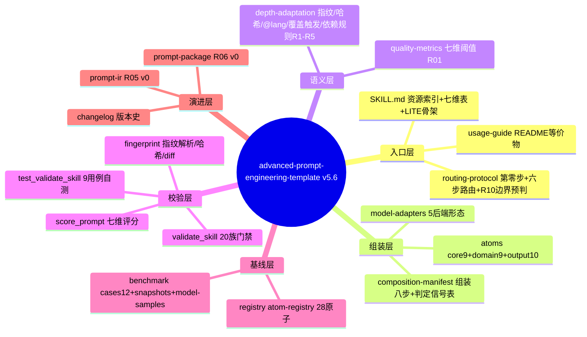
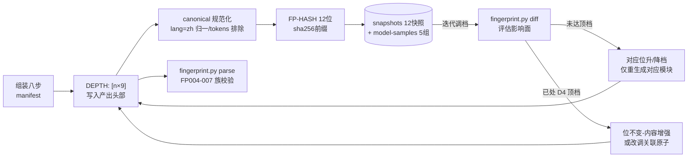

# 全局架构文档(architecture)

> 定位:全架构的**地图层** —— 只描述"谁在哪、谁管什么、改动要同步什么",不复制任何协议内容(唯一真相源纪律见第二节)。
> 何时读取:新增/修改原子、步骤、校验族、文档章节之前;排查跨文件脱节时。
> 数据基线:v5.6.0 门禁实测(20 族编码 / 21 个校验函数,由脚本实证提取,非手抄)。

## 目录

- 体系分层思维导图
- 唯一真相源对照表
- 指纹数据流
- 门禁校验族清单
- 升级同步检查单
- 引用通则

## 一、体系分层思维导图

执行顺序即自上而下:入口层判定路由 → 组装层按指纹取原子 → 语义层提供档位/规则语义 → 校验层对以上全部做契约锁定 → 基线层提供回归对照 → 演进层存放下一代接口(v0 只定协议不含运行时)。

## 二、唯一真相源对照表(核心)

> 通则:**数量性/编号性/引用性表述只允许出现在真相源一处**,其余位置用语义名引用(如"组装八步"引用 manifest,不重复列步骤)。

| 信息类别 | 唯一真相源 | 其余位置的正确引用方式 |
|----------|-----------|----------------------|
| 核心原子位序 | `validate_skill.py` 的 `CORE_ATOM_KEYS`(score_prompt 经 import 引用;fingerprint.py 由门禁 FP003 锁定) | "组装位序见门禁常量",禁止再内联列表 |
| 依赖规则 R1-R5 | `depth-adaptation.md` 规则表 + `fingerprint.py DEPENDENCY_RULES`(FP010 双向锁定一致) | "按依赖规则求值",禁止转抄规则条目 |
| 七维阈值 | `quality-metrics.md` 阈值表(QL006/QL007 锁定与 score_prompt METRICS 一致) | "阈值见质量指标文档" |
| 组装步骤 | `composition-manifest.md` 正文(八步) | 引用步骤**名**(如"模型适配步"),禁止裸序号 |
| 原子注册 | `atom-registry.yaml`(由 `scripts/gen_registry.py` 实证生成;RG002/003 双向一致,RG006 反查 deps) | "注册见注册中心" |
| 版本号 | `SKILL.md` frontmatter `version:`(FM 族锁定三处一致) | 引用"当前版本" |
| 门禁编码语义 | `validate_skill.py` 各 check 调用点 | 文档引用编码前先对脚本核实(P2-5 教训) |
| 校验族清单 | 本文档第四节(由脚本实证提取) | 变更门禁后须同步本表 |

## 三、指纹数据流

不变量:同哈希 ⇒ 结构一致的产出(R07);渲染器不得改位序、丢字段、变条数(R05 一致性不变量);`@lang=en/bilingual` 时标点规则按 depth-adaptation.md"@lang 处理规则"裁决。

## 四、门禁校验族清单(20 族,脚本实证)

| 族 | 条目数(实测) | 管辖对象 |
|----|------------|---------|
| AT | 1 | ATOM 契约块存在性 |
| BN | 7 | benchmark 结构 |
| CR | 9 | 核心原子契约(位号 CR010/011 等) |
| DH | 6 | 目录卫生(白名单 DH005 含目录级) |
| DP | 15 | 深度段(D1-D4 语义锚) |
| EX | 5 | 示例完备性 |
| FM | 6 | frontmatter(版本三处一致) |
| FP | 11 | 指纹(位序 FP003/双真相源 FP010 等) |
| IR | 5 | PromptIR 规范与样本 |
| LT | 2 | LITE 骨架 |
| MA | 13 | 模型适配表与适配器 |
| MF | 8 | manifest(原子名双向存在) |
| PK | 4 | 提示词包协议 |
| QL | 8 | 质量阈值一致性(QL003/008 warning,余 error) |
| RB | 8 | 回归基线(confirmed↔快照双向 RB003/007、boundary_precheck RB008) |
| RG | 7 | 注册中心(双向一致 + deps 反查 RG006) |
| RI | 2 | 资源索引 |
| RP | 4 | 路由协议 |
| TB | 5 | Token 基线(TB004 数值一致性 warning) |
| TS | 1 | 真相源声明 |

> 条目数由脚本提取;新增/删除校验后必须同步本表与 changelog。

## 五、升级同步检查单(防"单向棘轮")

| 变更类型 | 必须同步的位置 | 守护门禁 |
|----------|--------------|---------|
| 新增核心原子 | atoms/core 文件 → manifest 判定表 → depth-adaptation 位序表 → CORE_ATOM_KEYS(一处) → registry 重生成 → 质量清单位号 | DP007/MF011/RG002/FP003 |
| 新增依赖规则 | depth-adaptation 规则表 → fingerprint.py DEPENDENCY_RULES → 相关原子 deps 行 → registry 重生成 | FP010/RG006 |
| 新增组装步骤 | manifest 正文标题与条目 → 所有引用处(用步骤名) | MF002 |
| 新增校验族 | validate_skill → usage-guide 门禁命令节 → 本文档第四节 → changelog | — |
| 修改阈值 | quality-metrics 表 ↔ score_prompt METRICS(双向) | QL006/007/008 |
| 新增后缀键 | depth-adaptation 后缀表 → fingerprint.py 解析与 canonical 归一 → 处理规则章节(不得空接口) | FP004/005/007 |
| 版本升级 | SKILL.md frontmatter + 标题 → changelog 新段 | FM 族 |
| 新增顶层目录 | WHITELIST_TOP(唯一消费点) → SKILL.md 资源索引 | DH005 |

## 六、引用通则

1. 跨文档引用一律**语义名**(步骤名/规则名/章节名),禁止裸序号 —— 序号只活在真相源。
2. 任何"数量"表述(N 步/N 类/N 原子)写入文档前先跑脚本实证,或直接引用真相源。
3. 变更后验收三件套:`validate_skill.py --strict`(exit 0)、`test_validate_skill.py`(9/9)、changelog 登记。
