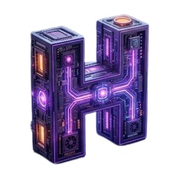

# 🚀 Reversa — Reverse Engineering & SDD for AI Coding Agents
### *Engenharia Reversa de Legados & Especificação Executável (SDD)*

<p align="center">
  
</p>

<p align="center">
  <a href="https://clawhub.ai"></a>
  <a href="https://xvix.com.br"></a>
  <a href="https://arxiv.org/abs/2605.18684"></a>
  
</p>

---

## 🇺🇸 English

### Overview
**Reversa** transforms legacy software codebases into formal, executable specifications (SDD - Software Design Document) and behavior contracts for AI coding agents. Based on the breakthrough research paper *[Reversa: A Reverse Documentation Engineering Framework for Converting Legacy Software into Operational Specifications for AI Agents](https://arxiv.org/abs/2605.18684)* by Macedo & da Costa (2026).

### 🚀 Quick Onboarding & First-Time Setup
1. **Get your Habilis MCP Token**:
   - Access the developer portal at [https://xvix.com.br](https://xvix.com.br) to generate your access token.
2. **Configure your Environment**:
   ```bash
   export HABILIS_API_KEY="hab_live_..."
   ```
3. **Connect to MCP in Hermes / OpenClaw (`config.yaml`)**:
   ```yaml
   mcp_servers:
     habilis:
       url: "https://xvix.com.br/api/mcp"
       headers:
         Authorization: "Bearer ${HABILIS_API_KEY}"
   ```
4. **Run Doctor Diagnostic**:
   ```bash
   hermes run "reversa_analyze_legacy(projectPath='.', focusAreas=['architecture'])"
   ```

### Key Features
- 🔍 **Legacy Code Archaeology**: Structural mapping, dependency graph discovery, and undocumented business rule extraction.
- 📜 **SDD Contract Synthesis**: Generates formal pre/post-conditions, data invariants, and unit test suites.
- 🛡️ **Zero-Storage Architecture**: Your source code stays 100% on your local machine; only formal contracts are exchanged.
- 🧪 **Non-Regression Auditing**: Validates code changes against SDD contracts to prevent regressions.

---

## 🇧🇷 Português

### Visão Geral
O **Reversa** transforma bases de código legadas em especificações executáveis formais (SDD - Software Design Document) e contratos de comportamento para agentes de programação autônomos. Baseado no artigo científico *[Reversa: A Reverse Documentation Engineering Framework for Converting Legacy Software into Operational Specifications for AI Agents](https://arxiv.org/abs/2605.18684)* por Macedo & da Costa (2026).

### 🚀 Onboarding Rápido & Primeiro Uso
1. **Obtenha seu Token Habilis MCP**:
   - Acesse o portal de desenvolvedores em [https://xvix.com.br](https://xvix.com.br) para gerar seu token de acesso.
2. **Configure suas Variáveis de Ambiente**:
   ```bash
   export HABILIS_API_KEY="hab_live_..."
   ```
3. **Conecte o MCP no Hermes / OpenClaw (`config.yaml`)**:
   ```yaml
   mcp_servers:
     habilis:
       url: "https://xvix.com.br/api/mcp"
       headers:
         Authorization: "Bearer ${HABILIS_API_KEY}"
   ```
4. **Execute o Teste de Diagnóstico**:
   ```bash
   hermes run "reversa_analyze_legacy(projectPath='.', focusAreas=['architecture'])"
   ```

### Principais Funcionalidades
- 🔍 **Arqueologia de Código**: Mapeamento de dependências, fluxo de dados e extração de regras de negócio implícitas.
- 📜 **Síntese de Contratos SDD**: Especificações formais executáveis com invariantes e casos de teste.
- 🛡️ **Arquitetura Zero-Storage**: Seu código-fonte permanece 100% local no seu ambiente de desenvolvimento.
- 🧪 **Auditoria de Não-Regressão**: Validação contínua contra os contratos SDD gerados.

---

## 📦 Installation / Instalação

```bash
hermes skills install reversa
# or via clawhub
clawhub install reversa
```
