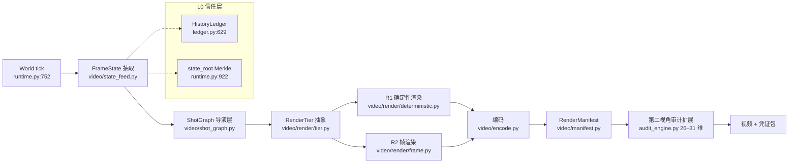

# HLD — second-reality-video 架构设计

> **文档类型**：High-Level Design  
> **版本**：v0.2（B 线：持久世界状态 + 无时序帧渲染器）  
> **日期**：2026-11-05（v0.2：§4 改写为无时序帧渲染器，新增审计维度 31，Phase 1/2 重排）  
> **基座仓库**：second-reality (SPL-VIRTUAL-WORLD-BASE)  
> **状态**：草案

---

## 0. 一句话

视频不是"生成"出来的，是世界状态的**视觉投影**；模型只负责画当前一帧，不负责记住上一帧。

---

## 1. 设计目标

### 1.1 核心命题

现有生成式视频模型的三个病根：**无持久状态**（每 10 秒重赌一次）、**身份漂移**（像素空间链式续接）、**不可审计**（抽卡无凭证）。second-reality-video 用 Second-Reality 已有的确定性世界运行时做"状态与记忆的唯一权威"，把渲染降级为纯函数 `frame = render(state, shot)`。

### 1.2 设计原则

| 原则 | 含义 | 来源 / 对应 API |
|------|------|-----------------|
| 状态外置 | 连续性由世界状态承载，不由模型上下文承载 | `World.tick()` (runtime.py:752), `state_root()` (922) |
| 渲染是纯函数 | 同 state + 同 shot + 同 renderer 版本 → 同帧 | `verify_determinism` (demo/virtual_world.py:2139) |
| 表征层硬隔离 | 渲染层属于"虚幻"，只读世界状态，永不回写 | `representation_isolation` (audit_engine.py FIELDS:187) |
| 无剧本传导 | 导演层只能调度摄像机与剪辑，不得下发行为指令 | `no_scripted_plot` (FIELDS:173) |
| 渲染守恒 | 每一帧必须有 `content_digest` 背书；无背书帧数 = 0 | `conservation_law` (FIELDS:189) |
| 视频即视口录像 | 离线渲染与 AR 实时共用一条 viewport 管线 | `EdgeSdk.viewport()` (edge_sdk.py:179) |
| 分支可渲染 | 一个世界可派生多条分支视频，全部可复验 | `fork_world()` (runtime.py:1015), `branch_space()` (1051) |

### 1.3 非目标

- **不做通用文生视频**（不接受"凭提示词无世界出片"）
- **不在 Phase 0/1 训练任何模型**
- **不承诺 R2 帧渲染的逐字节复现**（只承诺 R1 与状态层逐字节复现）
- **不重写 system/ 现有模块的语义**（只调用 + 增量扩展）。
  `World.tick()` 已按 §9·S1 **增量扩展空间推进语义**：新增确定性空间推进算子并
  写入事件，不改变 tick 的返回结构、不触碰需求/记忆/账本/共识。原表述「不改动
  system/ 现有模块的语义」与此实现矛盾，已于本次修订更正。

---

## 2. 系统架构

### 2.1 分层

```
┌─────────────────────────────────────────────────┐
│              L4 交付层 Delivery                   │
│   编码 / 封装 / RenderManifest / 审计凭证          │
├─────────────────────────────────────────────────┤
│              L3 渲染层 Render                     │
│   R1 确定性渲染器 (pygame/three.js/Remotion)      │
│   R2 帧渲染器 (逐帧独立，无时序，后期)           │
├─────────────────────────────────────────────────┤
│              L2 编排层 Orchestration              │
│   ShotGraph (镜头计划 · 只控摄像机)                │
│   Timebase (tick ↔ frame 映射 · HLC 权威时钟)     │
├─────────────────────────────────────────────────┤
│              L1 状态层 State                      │
│   World tick · AOI delta feed · HLC · ledger     │
│   SnapshotRegistry · branch space                │
├─────────────────────────────────────────────────┤
│              L0 信任层 Trust                      │
│   Constitution · Genesis seed · hash chain       │
│   Second-Perspective audit (25+ 维)               │
└─────────────────────────────────────────────────┘
```

### 2.2 数据流



### 2.3 模块映射

| second-reality 现有模块 | 角色 | 真实行号 |
|------------------------|------|----------|
| `World.tick()` | 推进世界一拍，返回 `{tick, events}` | runtime.py:752 |
| `World.state_root()` | Merkle 根（世界状态指纹） | runtime.py:922 |
| `World.replay_canonical_events()` | 从账本重放确定事件序列 | runtime.py:937 |
| `World.fork_world()` / `branch_space()` | 分叉世界 / 分支空间 | runtime.py:1015 / 1051 |
| `DeltaSync.diff()` | 计算状态增量 `{added, removed, changed, bits}` | aoi_sync.py:90 |
| `SyncScheduler.set_push()` | 增量推送钩子（集群模式） | aoi_sync.py:150 |
| `HistoryLedger.append()` | 追加哈希链条目 | ledger.py:645 |
| `SnapshotRegistry.delta_since()` | 两快照间差异 | ledger.py:997 |
| `HybridLogicalClock.peek()` | 权威逻辑时间戳 | hlc.py:97 |
| `EdgeSdk.viewport()` | 视口裁剪（相机取景） | edge_sdk.py:179 |
| `precompute_era()` | 先算后渲路径（已存在） | demo/virtual_world.py:1275 |
| `--screenshot` (SDL dummy) | 离屏单帧导出 | demo/virtual_world.py:2017 / 2221 |
| `SecondPerspectiveAuditor.audit_world()` | 25 维合规审计 | audit_engine.py:301 |
| AuditReport.FIELDS | 审计维度清单（含 `no_scripted_plot`, `representation_isolation`, `conservation_law`） | audit_engine.py:164-192 |

### 2.4 新增目录布局

```
second-reality/
├── video/                          ← 新增子系统
│   ├── __init__.py
│   ├── state_feed.py               ← FrameState 抽取（挂 SyncScheduler.set_push + 语义增量扩展）
│   ├── shot_graph.py               ← 导演层：镜头计划（只控摄像机，不控行为）
│   ├── timebase.py                 ← tick↔frame 映射，HLC 权威时钟
│   ├── render/
│   │   ├── tier.py                 ← RenderTier 抽象接口
│   │   ├── deterministic.py        ← R1：复用 demo/virtual_world.py 绘制函数，离屏帧导出
│   │   └── frame.py                ← R2：帧渲染器（逐帧独立，无时序，Phase 2）
│   ├── identity_assets.py          ← soul_hash → 外观资产/embedding（账本锚定）
│   ├── manifest.py                 ← RenderManifest + 签名 + 第三方复验
│   ├── encode.py                   ← 帧序列 → mp4 (ffmpeg)
│   └── cli.py                      ← srender CLI：从世界/账本区间渲染视频
├── system/                         ← 不改，仅被调用
├── audit_engine.py                 ← 扩展 26–31 维
└── docs/HLD-SecondRealityVideo-20261015.md  ← 本文档
```

---

## 3. 核心机制

### 3.1 FrameState：状态增量总线

每个 tick 产生一个 `FrameState`，作为渲染器的唯一输入：

```python
FrameState = {
    "tick": int,                    # World.temporal_substrate.global_clock (runtime.py:762)
    "hlc": {...},                   # HybridLogicalClock.peek() (hlc.py:97)
    "state_root": str,              # World.state_root() Merkle root (runtime.py:922)
    "souls": {soul_hash: {
        "position": [x, y, z],      # World.positions (runtime.py:175 / position_of:843)
        "needs": {physiology, safety, belonging, esteem, self_actualization},  # Agent.needs
        "action": str,              # 本 tick 决策 (tick() events)
        "relations": {...},         # Agent.relationships
        "memory_digest": str,       # HMAC 封存记忆的可公开摘要
    }},
    "events": [...],                # tick() 返回的 events 列表
    "delta": {"added": [], "removed": [], "changed": [], "bits": n}  # DeltaSync.diff (aoi_sync.py:90)
}
```

**增量推送**：集群模式下通过 `SyncScheduler.set_push(push_fn)` (aoi_sync.py:150) 订阅；单机模式下由 `video/state_feed.py` 轮询 `World.tick()` 返回值 + 自行计算语义增量（注意：当前 `DeltaSync.diff` 只带 position，needs/relations 不在增量里 → 需要 `SemanticDelta` 扩展，但不改 `system/` 原有语义）。

### 3.2 时基：tick ↔ frame

世界默认 TPS = 10 (`run_gui tps=10`)，视频 30fps → **frames_per_tick = 3**。

```
frame_index = tick * frames_per_tick + sub,  sub ∈ [0, 3)
```

- 位置：线性插值（确定性，不用随机）
- needs/action：阶梯保持（不插值，避免伪造状态）
- 帧的权威时间来自 `ctx.tick`（世界逻辑时钟），**不读墙钟**。
  注意：`state_root` 的 Merkle 输入含 HLC 的 pt 分量，而 pt 取自墙钟
  （`system/hlc.py` `peek()` → `_now_ms()`），故 `state_root` 跨运行必然不同，
  只能作跨节点旁证 —— 复现锚点用 `content_digest`（见 §9·S5）。
- 渲染进程崩溃后从 ledger 重放 → 帧号一致

**具体数字**：90 秒成片 = 900 个世界 tick = 2700 帧。

### 3.3 ShotGraph：导演层（只控镜头）

ShotGraph 是声明式镜头计划，**严禁包含任何行为指令**（对应 `no_scripted_plot` 审计维度）：

```python
Shot = {
    "id": str,
    "tick_from": int, "tick_to": int,
    "camera": {
        "mode": "follow|orbit|static|aoi",
        "target_soul": str | None,
        "origin": [x, y, z] | None,
        "radius": float,
        "fov": float,
        "height": float,
    },
    "framing": {"aspect": "16:9", "resolution": [1920, 1080], "fps": 30},
    "tier": "R1|R2",
    "overlay": {"hud": bool, "state_panel": bool, "caption_from": "ledger|none"},
}
```

**硬约束**：`ShotGraph.validate()` 静态拒绝任何包含 `action`, `set_needs`, `move_agent`, `force_event` 等字段的 Shot。Camera 复用 `EdgeSdk.viewport(soul_hash, origin, ...)` (edge_sdk.py:179) 与 `World.agents_near(origin, radius)` (runtime.py:894) 做取景裁剪 → 大世界里只渲染视口内灵魂，成本可控。

### 3.4 RenderTier 抽象

```python
class RenderTier(Protocol):
    tier_id: str          # "R1-deterministic" / "R2-frame"
    version: str          # 渲染器/模型版本哈希
    def render(self, fs: FrameState, shot: Shot, ctx: RenderContext) -> Frame
    def provenance(self) -> Dict   # 可复验信息：代码哈希/模型哈希/种子/硬件
```

**R1 确定性渲染**：复用 `demo/virtual_world.py` 的 iso 绘制函数 `grid_ground` (1309) / `build_sky` (1400) / `build_ground` (1421) / `draw_agent_anim` (1553)，改为**离屏 surface 渲染 + 按帧导出**，走 `SDL_VIDEODRIVER=dummy`（2221 已有先例）。剥离 HUD 侧栏（原 `WW = 60*32+350` 含 350px 侧栏），输出纯 1920×1080 视口，HUD 作为 overlay 单独合成。

升级路径：three.js headless / Blender Python / Remotion（已验证 Remotion 能逐帧确定性出 1080p30）。

**R2 帧渲染**：逐帧独立，输入只含单帧 Scene IR，无时序上下文（见第 4 节）。

### 3.5 身份锚定：soul_hash → 外观资产

`identity_assets.py`：`soul_hash → AppearanceAsset {ref_images, embedding, palette, seed}`，注册进账本（`HistoryLedger.append` ledger.py:645），创世锁定 → 同一灵魂在任何镜头、任何分支、任何时间永远长一样。这是解决"漂移"的根本手段：身份不来自上一帧像素，而来自账本锚定的资产。

### 3.6 RenderManifest：渲染凭证与第三方复验

```python
{
    "world_id": str,
    "genesis_seed": int,            # runtime.py:160
    "ledger_range": {"from_block": str, "to_block": str},
    "state_root_start": str,
    "state_root_end": str,          # runtime.py:922
    "shot_graph_hash": str,
    "timebase": {"tps": 10, "fps": 30, "frames_per_tick": 3},
    "renderer": {"tier": "R1", "version": code_sha256},
    "model": {"tier": "R2", "weights_hash": str, "sampling_seed": int, "hardware": str} | null,
    "frame_count": int,
    "duration_s": float,
    "video_sha256": str,
    "audit": {"dimensions": 29, "verdict": "PASS"},
    "signature": ed25519_signature,
}
```

**第三方复验路径**（复算式）：
```bash
git clone → 同 genesis_seed 建世界 → replay_canonical_events() (runtime.py:937)
→ 同 ShotGraph → 同 renderer 版本 → 逐帧 sha256 比对
```

R1 必须逐字节一致；R2 只要求"状态层一致 + 模型/种子/硬件一致下可复现"，并在 manifest 里如实标注（诚实边界条款）。

### 3.7 分支视频

`fork_world()` (runtime.py:1015) + `branch_space()` (1051) → 一个世界可派生多条分支视频，每条分支都有独立的 ledger 链与 state_root 序列，全部可审计。杀手级特性：**同一个世界，不同的选择，不同的视频，全都可复验**。

### 3.8 实时/直播 = 视口录像

`EdgeSdk.viewport(soul_hash, origin)` (edge_sdk.py:179) 已经是相机取景 API。离线渲染与 AR 实时共用同一条管线：**视频 = 视口的录像**。实时模式下，viewport_delta (194) 推送增量到边缘设备，渲染器就地出帧 → 低延迟直播。

---

## 4. 帧渲染器（R2）：无时序的逐帧渲染

### 4.1 为什么不用时空注意力

视频模型之所以需要时空注意力，是因为它被要求**同时**做两件事：记住世界长什么样，
以及记住它怎么动。这两件事混在像素里学，注意力就得跨帧聚合特征——而聚合是软的、
压缩是有损的，于是漂移与编造不可避免。

实测（2026-11-05）：把 R1 的真实关键帧作为首帧交给 H3-Max 做 8 秒 I2V，
10 个账本锚定的身份里有 **1 个在后半程像素数归零**——身份色彻底不再可辨。
这是时空注意力幻觉的一次现场取证，不是推断。

因此 R2 的定义做一次**减法**：

> **把"怎么动"交还给状态层（已经是这样），模型只负责"单帧怎么画"。**

帧渲染器的契约只有一行：

```
pixel = f(scene_ir, appearance_assets, seed)
```

输入里**没有任何跨帧信息**。帧与帧之间没有信息传递，就**没有东西可以漂移**。
这不是"更聪明的时序聚合"，而是**把时序一致性从模型手里拿走，交给状态层**。

> 对照：NeRF / 3DGS / 神经渲染那一族的核心思路也是"用多视角一致性替代
> 时序一致性"——同一份场景表示渲染所有帧。R2 走的是同一条路，只是那份
> 表示不是 3D 场景，而是**已经可哈希、可断言的 Scene IR**。

### 4.2 条件化输入（无 prev_frames）

R2 接收的不是"提示词"，而是单帧的结构化事实：

```
Condition = {
    "scene_ir": {...},                  # 实体/位置/needs/身份哈希/相机/画幅/事件
    "appearance_assets": {...},        # 外观锚点（可由 scene_ir.identity 携带）
    "render_class": "soul",            # 实体类别绑定：禁止按生成先验改写
    "seed": 12345,                     # 采样种子（决定性）
}
```

**没有 `prev_frames`，没有 temporal context，没有 attention over time。**
这是 R2 与任何视频模型契约的根本差别，也是本节标题的全部含义。

`render_class`（见 §5.2）在此处承担硬约束：模型拿到的不是"画什么"的自由，
而是"这是哪一类实体"的绑定——否则生成模型会按训练先验把几何体画成人，
悄悄改写世界观（实测：R1 的彩色矩形被 I2V 改写成无面孔人形）。

### 4.3 教师-学生数据契约：R1 → R2

**关键洞察**：R1 确定性渲染器本身就是无限、完美标注的 `(Scene IR, frame)`
配对数据生成器。

| 角色 | 是谁 | 产出什么 |
|------|------|----------|
| 教师 | R1（确定性程序渲染器） | `(Scene IR, frame)` 配对；可随时重跑 → 教材无限量、零人工 |
| 学生 | R2（无时序帧渲染器） | 学同一个函数的"漂亮版本"：结构一样，画法更好 |

条件来自确定性仿真而不是人工标注——这正是 R1 相对通用视频模型的**结构性优势**：
它把"世界事实 → 像素"这个函数写成了程序，于是这个函数可以被无限次求值、
可以免费标注、可以被逐字节审计。

而且 R1 输出天然是 R2 的**回归测试基准**：R2 出的帧与 R1 出的帧在语义上必须对应
（灵魂数、位置、身份），可用第 27 维自动核对 → 帧渲染器被仿真"审计"。闭环成立。

### 4.4 一致性策略（为什么不再需要时序一致性策略）

| 机制 | 保证什么 |
|------|----------|
| **状态空间链式** | 每段的起点是 `state_root`，而非上一帧像素 → 没有累积漂移 |
| **分段独立** | 长视频切成多个 shot，每个 shot 重新从 `state_root` 条件化 → 任意长度 |
| **身份锚定** | appearance embedding 来自账本，跨镜头恒定 |
| **帧间零传递** | 每帧独立渲染 → 漂移、身份丢失、实体增殖这类**跨帧**错误**在结构上不可能发生** |

**错误类因此收窄**：从「漂移 + 身份丢失 + 实体增殖」收窄为「单帧错位 / 错数」。
这是本架构能给像素层的最强承诺——不是"生成得更好"，而是"坏的方式更少"。

### 4.5 训练与推理成本

- 训练：需要 GPU 集群；数据集 = R1 生成的 `(Scene IR, frame)` 对（数量无上限，
  质量取决于 R1 资产精度）
- **数据生成成本 ≈ 零**：R1 渲染约 54 帧/秒 CPU、零积分——教材本身几乎免费
- 推理：**每帧独立**，~1–5s/帧（取决于模型大小）→ 90s 成片 @30fps = 2700 帧
  → **45 分钟 ~ 3.75 小时 GPU**。但帧之间无依赖 → 可完全并行，且可与
  `precompute_era()` (demo/virtual_world.py:1275) 的世界计算重叠，
  **渲染慢不影响世界确定性**
- 分布式：spatial_sharding ShardRouter (spatial_sharding.py:48) → 每个 DC 渲染自己分片的视口

### 4.6 与视频模型的边界（明确划线）

| 视频模型能否… | 结论 |
|--------------|------|
| 当渲染层（R2） | **不能**。它接受提示词而非 `(state, shot)`，只认提示词；平台静默升级会让 `frame_hashes_digest` 失效。版本漂移的复现锚比没有锚更糟 |
| 当资产来源 | **可以**。生成结果落盘 + 哈希入库（`video/baked_assets.py`），渲染器只读常量 → 像素层仍逐字节可复现 |
| 当宣传物料 | **随便**。预告片、社媒片，与流水线正交，不进复现链 |

一句话：**视频模型负责"画得好看"，帧渲染器负责"画得对"，状态层负责"画的是真的"。**
三者不能互换。

---

## 5. 宪法对齐与审计扩展

### 5.1 表征层隔离

为什么渲染天然属于"虚幻"？GLOSSARY.md 定义：**Representation layer（表征层）** = "虚幻唯一被允许存在的地方——信念、传闻、梦境；一旦进入执行层即成作弊通道。" 渲染器输出的像素就是"表征"，它绝不能写回世界执行层（不能改变 agent 位置/needs/memory）。架构上强制：`RenderTier.render()` 是纯函数，无 side effect。

### 5.2 新增审计维度 26–31

在现有 25 维基础上扩展：

| 维度 | 名称 | 含义 | 判据 |
|------|------|------|------|
| 26 | `visual_provenance` | 渲染凭证完备 | manifest 存在、签名可验、哈希对得上 |
| 27 | `state_frame_correspondence` | 状态-画面对应 | 抽样帧：画面里的灵魂数 = 视口内灵魂数；位置投影一致（VLM/规则核对）。**无时序帧渲染器下错误类已收窄为「单帧错位/错数」**——漂移、身份丢失、实体增殖在结构上不可能发生 |
| 28 | `direction_is_camera_only` | 导演层只控镜头 | ShotGraph 静态扫描无行为字段 |
| 29 | `identity_persistence` | 身份恒定 | 同 soul_hash 跨镜头外观资产哈希一致 |
| 30 (可选) | `render_conservation` | 渲染守恒残差 = 0 | 无 state_root 背书的帧数 / 总帧数 = 0 |
| 31 | `render_is_frame_independent` | 渲染层无时序上下文 | 渲染器输入契约只含**单帧** Scene IR：IR schema 无 `prev_frames` / 跨帧字段 ∧ `RenderTier.render` 签名只吃单帧 IR。**静态可查、确定性** |

> 第 31 维把 §4 的架构决定变成**可审计属性**：一旦有人往渲染器里塞回
> `prev_frames` 或任何跨帧状态，这条维直接 FAIL —— "不用时空注意力"
> 从设计主张变成受审计的不变量。

### 5.3 M1 入章纪律自查

按 GLOSSARY.md 的 M1 admission discipline，每条新框架必须有生产者/消费者/复算式/边界条款：

| 维度 | 生产者 | 消费者 | 复算式 | 边界条款 |
|------|--------|--------|--------|----------|
| 26 visual_provenance | `video/manifest.py` 生成 manifest | `audit_engine._audit_visual_provenance()` | 第三方运行 `verify_manifest(manifest, video)` | manifest 缺失或签名无效 → FAIL |
| 27 state_frame_correspondence | R1/R2 渲染器输出帧 | VLM/规则检查器 | `count_souls_in_frame == len(viewport_souls)` | WARN（概率性判定，非确定性）；错误类已收窄为单帧错位 |
| 28 direction_is_camera_only | `video/shot_graph.py` 静态验证 | `audit_engine._audit_direction()` | 扫描 Shot JSON 无禁止字段 | 发现行为字段 → FAIL |
| 29 identity_persistence | `video/identity_assets.py` 注册外观资产 | `audit_engine._audit_identity()` | `sha256(asset[soul]) 跨镜头一致` | 不一致 → FAIL |
| 30 render_conservation | `video/manifest.py` 记录 state_root 覆盖 | `audit_engine._audit_conservation()` | `unbacked_frames / total_frames == 0` | > 0 → FAIL |
| 31 render_is_frame_independent | `video/scene_ir.py` 契约 + `video/render/tier.py` 接口 | `audit_engine._audit_render_independence()` | Scene IR schema 无跨帧字段 ∧ `RenderTier.render` 只吃单帧 IR | 发现跨帧输入 → FAIL |

> **已实现（2026-11-05）**：第 31 维已并入审计器，见 `audit_engine.py` 的
> `_audit_render_independence()`，判据实现于 `video/render/frame.py`
> （只用标准库 + `ast` 静态解析源码，**不 import 渲染器** —— 审计不该为了
> 查契约把 pygame 拉进来）。已做**证伪测试**：往 Scene IR schema 注入
> `prev_frames` 字段后，`attest` 立即报 `FAILED - 1/26 项未通过`。
>
> 第 26–30 维**仍未并入**审计器，保持"以 `verify` 检查项体现"的状态。

---

## 6. 分期路线 Phase 0–3

### Phase 0：现在就能做（无 GPU，技术验证）

**交付物**：一段 30–60s 的 iso 风格演示视频 + RenderManifest + 审计报告

**步骤**（与实际 CLI 一致；`encode` 子命令已并入 `render`，帧不落盘 PNG 序列）：
```bash
# 1) 抽状态：extract 内部按创世参数确定性重建世界，无需先跑 demo
#    --world 必须指向空目录（世界存储有状态）
python -m video.cli extract --world-id sr-video-demo --world .tmp_world \
       --seed 42 --agents 10 --ticks 0-120 --out out/states.jsonl

# 2) R1 渲染 + 编码：rawvideo 管道直送 ffmpeg，一步出片
#    同时产出 hashes.txt / frames.jsonl / identity_assets.json / 抽样 PNG
python -m video.cli render --state out/states.jsonl --shot video/shots/demo.yaml \
       --tier R1 --samples 3 --out out/world.mp4

# 3) 凭证 + 真跑审计（25 维，verdict 由 audit_engine 实跑得出，不预置）
python -m video.cli attest --video out/world.mp4 --hashes out/hashes.txt \
       --state out/states.jsonl --shot video/shots/demo.yaml \
       --manifest out/manifest.json

# 4) 第三方独立复验：由 manifest 的创世参数重建世界，逐项比对
python -m video.cli verify --manifest out/manifest.json --hashes out/hashes.txt \
       --shot video/shots/demo.yaml --frames out/rerender.mp4
```

**验收标准**：同 seed 两次运行 `out/world.mp4` 的 sha256 一致（逐字节可复现），manifest 可被第三方复验。**实测结果见 §9 S6–S7。**

### Phase 1：美术资产 + 确定性渲染器（零积分，像素层仍逐字节可复现）

- 替换 pygame iso 为 three.js headless / Blender Python / Remotion
- 引入资产包（建筑/地形/角色模型），分辨率提升至 4K
- 保持 R1 确定性不变 → 像素层仍逐字节可复现
- **附带产出**：Phase 1 的漂亮帧就是 Phase 2 的训练教材（教师信号）

> Phase 0.6 已先行完成**内容侧**（决策→运动→关系→字幕桥）与**结构层**
> （Scene IR / 结构验收 / 资产烘焙）。Phase 1 的瓶颈因此明确落在
> **美术资产与渲染器**，而不是"世界不会动"——后者已不再是问题。
>
> Phase 1 不是"过渡期"，它是 Phase 2 的**教师**：教师越漂亮、越一致，
> 学生（R2）的上限越高。教材由 R1 免费产出（54 帧/秒 CPU、零积分）。

### Phase 2：无时序帧渲染器 R2（研究级）

- 训练管线：Phase 1 的 R1 产出 `(Scene IR, frame)` 配对 → 学生
- **学生结构：逐帧独立**。输入只有单帧 Scene IR + 外观资产 + 采样种子
  → 无时空注意力、无 `prev_frames`、无跨帧状态（§4）
- 集成到 RenderTier 抽象，支持 R1/R2 切换 —— `render_ir(scene_ir)` 已是该契约
- 第 27 维核对（VLM 判定，WARN）+ **第 31 维**保证渲染层无时序上下文（FAIL 级，静态可查）
- 复现口径：结构层逐字节；像素层"同权重 + 同种子 + 同环境可复现"

> 与"训一个视频模型"的区别：视频模型要同时学"世界是什么"和"它怎么动"，
> 于是必须跨帧聚合，必然编造。帧渲染器只学"这一帧怎么画"，时序由状态层给定。
> 详见 §4.1 与 §4.6。

### Phase 3：分布式渲染农场

- spatial_sharding ShardRouter → 每个 DC 渲染自己分片的视口
- hierarchical_consensus 定序全局时间线
- partition_guard 的 MerkleDiffTree 合并分支渲染结果
- 支持大规模世界（百万级灵魂）的长视频渲染

---

## 7. 风险与权衡

| 风险 | 缓解 |
|------|------|
| R1 视觉上限低（60×60 iso 像素风） | Phase 0 定位为"技术验证"，美学成品靠 Phase 1 资产升级 |
| R2 需要 GPU + 数据管线 + 训练 | 明确为研究级工作量，单独立项；Phase 0/1 不依赖。**教材由 Phase 1 的 R1 免费产出**（54 帧/秒 CPU、零积分） |
| 帧渲染器逐帧独立 → 推理成本 × 帧数 | 90s 成片 @30fps = 2700 帧 × 1–5s ≈ **45 分钟 ~ 3.75 小时 GPU**。但帧间无依赖 → 可完全并行，且与世界计算重叠；可先出 720p 短样片再提分辨率 |
| 视频模型被误当渲染层 | §4.6 划界 + 第 31 维（只吃单帧 IR，FAIL 级）双重拦截。版本漂移的复现锚比没有锚更糟 |
| 第 27 维像素级审计是概率性的（VLM 判定） | 标注为 WARN 而非 PASS，与 24 维状态级审计的确定性区分开 |
| R2 的"逐字节复现"跨硬件不成立 | manifest 里如实标注"同环境可复现"，品牌口径分开说：状态层逐字节，像素层同环境 |
| 大世界渲染成本高 | 视口裁剪 + AOI 是必需，不是可选；ShardRouter 分布式 |
| pygame 不是生产级渲染器 | Phase 1 必须换（three.js headless / Blender / Remotion） |
| 生成模型会按训练先验改写世界观 | Scene IR 绑定 `render_class`（实体类别），R2 必须按类别渲染；否则"几何体"会被画成人，事实被模型重写 |
| 内容侧若空心化，画面再美也是空镜 | Phase 0.6 起，位移由需求→行动→目标点驱动（cos≈0.98），关系真实记录交互，字幕桥打通可读性 |

---

## 8. 验收：一段可复验的样片

Phase 0 完成后，应产出：

```
out/
├── states.jsonl           # 每 tick 一个 FrameState（含 content_digest）
├── world.mp4              # 视频，容器 sha256 为旁证
├── hashes.txt             # 逐帧 sha256 序列 —— 像素层复现锚
├── frames.jsonl           # 每帧背书：frame_index / tick / sub / content_digest / backing
├── identity_assets.json   # soul_hash → AppearanceAsset（第 29 维证据）
├── sample_NNNNN.png       # 均匀铺满全片的抽样帧，供目视核对
├── manifest.json          # RenderManifest，含可验签名
└── audit_report.txt       # audit_engine 实跑结论（25 维）
```

第三方复验命令：
```bash
python -m video.cli verify --manifest out/manifest.json --hashes out/hashes.txt \
       --shot video/shots/demo.yaml --frames out/rerender.mp4
# 输出：六项检查 + VERDICT: PASS/FAIL（退出码 0/1）
```

`--frames` 可选：不传则跳过像素层重渲，只验签名 / 背书 / 帧哈希摘要 /
状态摘要 / 身份锚定五项。**帧哈希摘要检查不依赖 `--frames`**，
因此单改 `hashes.txt` 也会被抓住（见 §9 S7）。

---

## 附录 A：关键 API 引用（真实行号）

| API | 文件 | 行号 |
|-----|------|------|
| `class World` | system/runtime.py | 142 |
| `World.tick()` | system/runtime.py | 752 |
| `World.state_root()` | system/runtime.py | 922 |
| `World.replay_canonical_events()` | system/runtime.py | 937 |
| `World.fork_world()` | system/runtime.py | 1015 |
| `World.branch_space()` | system/runtime.py | 1051 |
| `World.spawn_agent()` | system/runtime.py | 699 |
| `World.position_of()` | system/runtime.py | 843 |
| `World.agents_near()` | system/runtime.py | 894 |
| `DeltaSync.diff()` | system/aoi_sync.py | 90 |
| `SyncScheduler.set_push()` | system/aoi_sync.py | 150 |
| `HistoryLedger.append()` | system/ledger.py | 645 |
| `SnapshotRegistry.delta_since()` | system/ledger.py | 997 |
| `HybridLogicalClock.peek()` | system/hlc.py | 97 |
| `EdgeSdk.viewport()` | system/edge_sdk.py | 179 |
| `precompute_era()` | demo/virtual_world.py | 1275 |
| `--screenshot` (SDL dummy) | demo/virtual_world.py | 2017 / 2221 |
| `verify_determinism()` | demo/virtual_world.py | 2139 |
| `SecondPerspectiveAuditor.audit_world()` | audit_engine.py | 301 |
| `AuditReport.FIELDS` | audit_engine.py | 164-192 |
| `draw_agent_anim()` | demo/virtual_world.py | 1553 |
| `grid_ground()` | demo/virtual_world.py | 1309 |

---

## 9. 实施记录（Phase 0 · 2026-10-16）

> 本节记录**已落地**的改动与**实测结果**，用于消除文档与代码的分歧。
> 未落地项一律保持为规划态。

### S1 · `system/runtime.py` 空间推进算子（增量扩展）

- 新增 `_space_delta()` / `_advance_space()`：位移由
  `sha256(world_id | genesis_seed | clock | soul_hash)` 派生 —— 不读墙钟、
  不依赖 dict 遍历序、不使用 `random`。
- `tick()` 在决策循环内推进位置，并把 `pos` 写入事件：位置据此进入
  `state_root()`，亦可被多节点重放重建。
- 参数：`SPACE_STEP = 0.25`、`SPACE_BOUND = 20.0`（占位物理，可替换）。
- 实测：两次独立运行位置序列完全一致。
- **力量来源**：此算子闭合了 §2 的必需节点 —— 在此之前 `tick()` 只产
  `action` 字符串，`positions` 恒为原点，渲染层没有任何空间信号可取。

### S2 · 身份种子化

- `video/state_feed.deterministic_soul_secret(genesis_seed, i)` 取代
  `generate_user_keypair()`（其 Ed25519 随机源无法种子化）。
- `system/keys.py` **未改动** —— `build_genesis_proof` 本就接受任意 bytes 私钥。

### S3 · R1 渲染器

- 像素由 `FrameState` 驱动：位置走等距投影，needs 走需求条。
- 身份色取自账本锚定资产，**废止 `md5(soul_hash)` 造色**（旧实现把像素绑在
  随机生成的 soul_hash 上，是复现失败的直接成因）。
- `static / follow / orbit / aoi` 四种相机全部实装；未知 mode 直接抛错，
  不做静默降级；`target_soul: "auto"` 取字典序最小灵魂，避免身份进入导演层。
- 修掉 `identity_assets.generate_demo_asset` 的内置 `hash()`
  （受 `PYTHONHASHSEED` 随机化，跨进程不稳定）。

### S4 · 时基与编码

- 1 tick → 3 帧；位置线性插值，needs/relationships 阶梯保持；帧名与
  `frame_index` 严格一致。
- 帧走 ffmpeg `rawvideo` 管道，**不落盘 PNG 序列**：旧实现因帧号与编码序列
  不一致，产出过 11 帧 / 0.37 秒的废片。
- 编码强制 `-threads 1` + `-fflags/-flags +bitexact` + `-map_metadata -1`。

### S5 · 复现口径分层（诚实边界条款）

| 层 | 锚点 | 性质 |
|---|---|---|
| 状态层 | `content_digest` 序列 | 确定性，可逐字节复验 |
| 像素层 R1 | 逐帧 sha256 序列 | 确定性，可逐字节复验 |
| 容器层 | `world.mp4` sha256 | **旁证**，跨 ffmpeg 版本不保证 |
| 像素层 R2 | 权重 / 采样种子 / 硬件 | 仅同环境可复现（**未实现**） |

`state_root` 因含 HLC 墙钟分量，在 manifest 中明确标注为旁证，
**不再充当复现锚**（原文档此处的表述与实现不符，已更正）。

### S6 · 验收（实测结果）

- 输入：`seed=42`、`agents=10`、`ticks=0-120` → 363 帧。
- 两次独立运行（不同 `data_dir`）：
  **逐帧哈希 363/363 相同**；mp4 容器 sha256 相同；`content_digest` 序列相同。
- 画面有效性：363 帧中 **361 帧哈希唯一**（改造前：61 帧仅 2 种 → 画面是死的）。
- 跨镜头：`ticks=0-400`（1203 帧，镜头切换在 tick 301）渲染正常，
  1201 帧哈希唯一 —— 镜切只换摄像机、世界不换，接缝不存在。
- `verify` 由 manifest 独立重建世界，五项全部 **PASS**：
  签名 / 帧背书（第 30 维）/ `content_digest` 复现 / 身份锚定（第 29 维）/
  像素层逐帧复现。

### S7 · 独立复验（第三方视角重跑，2026-10-16）

由未参与实现的一方按 §8 命令从零重跑，结论如下。

**可复现性声明成立**

- **三次**独立运行（`data_dir` 各异；其中一次刻意 **不设 `PYTHONHASHSEED`**，
  即 str 哈希随机化开启）：`hashes.txt` sha256 三次相同（`81f5609c…`）、
  `world.mp4` 容器 sha256 三次相同（`34fbc60b…`）、`content_digest` 序列相同、
  `identity_assets.json` 相同 → 确定性确实不依赖 `PYTHONHASHSEED`，
  `generate_demo_asset` 里内置 `hash()` 的隐患已真消除。
- `state_root` 序列三次**均不相同** —— 与 S5 分层口径一致，旁证定位正确。
- 跨镜头 `ticks=0-400`：1203 帧 / 1201 唯一，与 S6 一致；且 0-400 段的
  **前 360 帧与 0-120 段的前 360 帧逐帧相同** —— 镜切只换摄像机、世界不换。
- `attest` 的 25 维审计是真跑（`audit_report.txt` 逐项可查，Final Verdict: PASS）。

**修正 S6 对「361/363 唯一」的表述**

唯一帧数不是画面活性的直接度量：`_interpolate` 对末 tick 没有后继状态，
按 `nxt = current` 钳位，末 3 帧必然相同 → 恒定少 2 个唯一值
（363−2=361，1203−2=1201，两次都对上正是这个原因）。
实质结论应表述为：**除末 tick 的钳位帧外全部帧唯一**（前 360 帧无一重复）。
副作用：末 3 帧是 `tick_to` 的函数，复现必须固定 tick 区间
（manifest 已记录 `tick_from` / `tick_to`）。

**发现并修复的两处缺陷**

1. **`cmd_verify` 只比帧数、不比帧哈希摘要** —— `hashes_digest` 已 import
   却从未被调用。实测后果：把 `hashes.txt` 第 200 帧改成全 0，
   不传 `--frames` 时 `verify` 输出 **VERDICT: PASS、退出码 0**，
   像素层复现锚形同虚设。已补 `frame hashes digest` 检查（不依赖 `--frames`）；
   同一篡改现在 FAIL、退出码 1，并指出 `first mismatch=200`。`verify` 五项 → 六项。
2. **`shot_graph._validate_shot` 只扫顶层键** —— 实测 `camera.action`、
   `camera.force_event`、`overlay.script`、`camera.path[0].move_agent`
   **全部通过校验**，`no_scripted_plot` 可被一行嵌套写法绕过。
   已改为递归扫描并回报完整路径。

修复后回归：干净产物 `verify` 六项全 PASS、退出码 0；重渲的 `hashes.txt`
与 `world.mp4` sha256 与修复前逐字节一致（渲染层未受影响）。

**防线复核（负向测试）**

| 篡改 / 越界 | 结果 |
|---|---|
| 改 `manifest.genesis_seed` 42→43 | 签名 FAIL + `content_digest` FAIL + 身份锚定 FAIL，退出码 1 |
| 改 `hashes.txt` 单帧 | 帧哈希摘要 FAIL；带 `--frames` 时像素重渲亦 FAIL（362/363） |
| 镜头未覆盖全部 tick | 硬报错 `no shot covers tick 51`，退出码 1，不静默降级 |
| `--tier R2` | `tier R2 not implemented in Phase 0`，退出码 1，不冒充 |
| 嵌套禁止字段 | 已拒绝（修复前放行） |

### 复现前提（硬约束）

- **`data_dir` 必须为空**：世界存储是有状态的，复用会让第二次运行读到已注册
  的灵魂。`verify` 走临时目录，不触碰用户目录。
- **必须一次性连续渲染**；禁止 `ffmpeg concat demuxer` 拼接分段 —— 接缝正是
  由分段拼接产生的。

### 已知限制

- `SPACE_STEP` / `SPACE_BOUND` 是占位物理：低位移动使 agent 早期聚在原点附近，
  广角镜头观感偏空。属可调参数，**不是确定性缺陷**。
- R2 帧渲染未实现；manifest 的 `model` 字段为 `null`，不冒充。
- 审计结论来自 `audit_engine` **实跑**（25 维），不再硬编码 `PASS`；
  渲染层新增的 26–31 维目前以 `verify` 的六项检查体现，尚未并入审计器。
- **`derive_states` 的 `tick_from > 0` 未预热世界**：循环是
  `range(tick_from, tick_to + 1)`，只 tick 了 `tick_to − tick_from + 1` 次，
  却把状态标号为 `tick_from..tick_to`。目前只在 `tick_from = 0` 验证过，
  非零起点会产出「标号与真实演化步数不符」的状态序列。
- **审计世界比渲染末帧早一个 tick**：`_audit_world` 用 `range(tick_to)`，
  `derive_states` 用 `range(tick_from, tick_to + 1)`（起点为 0 时即 `tick_to + 1` 次）。
  即 25 维审计覆盖的不是被渲染的最后一个状态。属 off-by-one，不影响 PASS/FAIL 结论的性质。
- `video/shots/demo.yaml` 与 `out/` 曾被清空，导致流水线无法按文档直接复跑。
  已重建 `video/shots/demo.yaml`（双镜：`static zoom 3.0` → tick 301 起
  `orbit target_soul: auto`，1280×720@30fps）。
- `video/render/__init__.py` 曾缺失，靠隐式命名空间包工作（打包时会丢）；已补。

---

<div align="center">

[← 返回 README](../README.md) &nbsp;·&nbsp; [← 虚拟世界 HLD](https://github.com/nohn3043-arch/Second-Reality/blob/main/docs/HLD-VirtualWorld-20261013.md)

<sub>NOHN AI · SPL-VIRTUAL-WORLD-BASE · second-reality-video</sub>

</div>
